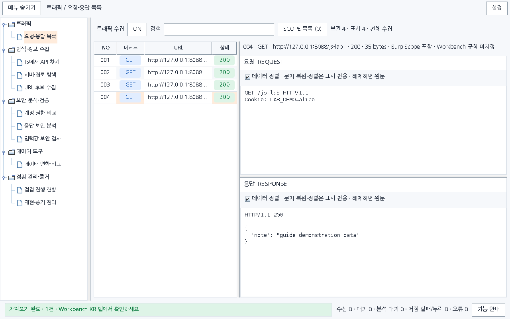
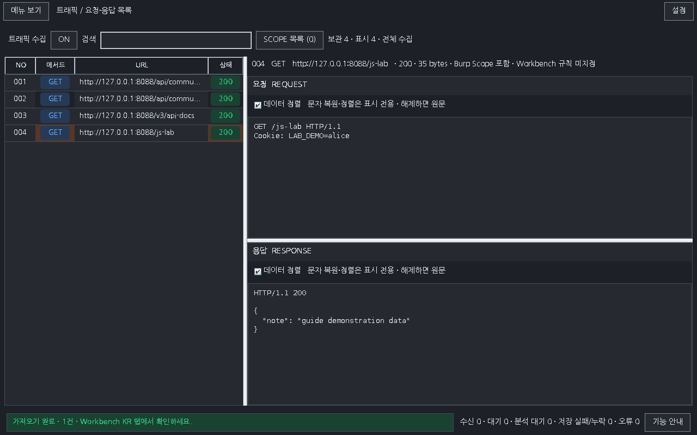

# Workbench 0.27.0 · 왼쪽 폴더 메뉴

길게 늘어선 상단 도구 탭을 왼쪽의 접고 펼치는 폴더 목록으로 바꿨습니다. 기존 화면의 10개 도구와 작업 데이터는 그대로 사용하며, 선택한 도구를 오른쪽 작업 영역에 표시합니다.

## 기능 위치

| 폴더 | 도구 |
|---|---|
| 트래픽 | 요청·응답 목록 |
| 탐색·정보 수집 | JS에서 API 찾기 · 서버·경로 탐색 · URL 후보 수집 |
| 보안 분석·검증 | 계정 권한 비교 · 응답 보안 분석 · 입력값 보안 검사 |
| 데이터 도구 | 데이터 변환·비교 |
| 점검 관리·증거 | 점검 진행 현황 · 재현·증거 정리 |

SCOPE 목록은 **요청·응답 목록** 내부 기능입니다. 별도 메뉴로 추가하지 않았습니다. 설정은 상단 **설정**, 기능 설명은 하단 **기능 안내** 또는 F1로 엽니다.

## 메뉴 폭과 표시

1. 폴더 옆 화살표나 폴더 이름을 눌러 펼치고 도구를 선택합니다. 방향키로도 폴더와 기능을 이동할 수 있습니다.
2. 메뉴와 작업 영역 사이의 세로 경계선을 끌어 폭을 조절합니다. 기본 폭은 220px이며 160~420px 안에서 작업 영역의 최소 폭을 함께 확보합니다. 좁게 줄인 메뉴의 긴 이름은 가로 스크롤로 확인합니다.
3. 상단 **메뉴 숨기기**를 누르면 작업 영역이 넓어집니다. 같은 위치의 **메뉴 보기**로 다시 엽니다. **Ctrl+Shift+M**으로도 전환합니다.
4. 메뉴를 다시 열면 이전 폭을 복원합니다. 폭과 숨김 여부는 Burp 환경설정에 저장해 다음 로딩에도 사용합니다. 환경설정 저장을 사용할 수 없어도 현재 세션에서 조절·숨기기를 사용할 수 있습니다.

도구를 전환하거나 메뉴를 숨겨도 기존 페이지를 새로 만들지 않습니다. 입력한 변환·페이로드 문자열, 선택한 트래픽, 하위 화면과 결과는 해당 도구가 유지합니다. 우클릭·기능 안내·Ctrl+F 등 기존 이동도 폴더의 현재 선택과 연결합니다. 메뉴 이동은 검사 실행이나 요청 전송을 시작하지 않습니다.

작은 화면에서 JS 수동 분석 입력을 확보하도록 최근 분석 선택기의 폭도 줄였습니다. 긴 출처 URL 전체는 기존처럼 툴팁에서 확인합니다.

## 실제 코드 화면

아래 그림은 배포 JAR의 운영 Swing 구성요소에 합성 데이터를 넣어 렌더링한 결과입니다. 이미지 생성 시안이나 실제 Burp GUI 캡처와 구분합니다.

## 검증과 이어가기

정식 release 검사 **1,988개**(Java 47그룹 1,490개 · 페이로드 HTTP 132개 · 전체 기능 HTTP 100개 · 모의 진단 266개), 별도 Mapper Java 75개·Node 7개를 통과했습니다. 새 메뉴 회귀는 Java 합계에 포함한 **40개**입니다. 운영 Swing **126화면**과 기능 안내 **48화면**, 패키징 검사 4개 및 버전별 해시·소스 지문 확인도 통과했습니다.

실행한 검사 수, 산출물 해시와 환경별 한계는 [0.27.0 검증 기록](VERIFICATION_0.27.0.json)을 확인하세요. 새 메뉴 회귀는 10개 도구의 실제 페이지 이동, 수동 입력·선택 유지, 숨김·복원, 폭 조절, 설정 저장·복구 및 추가 HTTP 요청 0건을 확인합니다. 화면 검사는 3개 크기와 밝은/어두운 테마에서 메뉴 표시·숨김·폭 조절·복원을 포함합니다.

실제 Burp GUI의 운영체제별 글꼴·DPI·마우스 드래그는 별도 확인 범위입니다. Mapper 0.2.0과 실습 사이트 3.5.2는 변경하지 않으며, 기존 버전 다운로드도 보존합니다. 0.25.4 PDF는 이전 상단 탭 화면을 기준으로 한 도구 참고 자료입니다.

[다운로드](../downloads/README.md) · [날짜별 대화 기록](chat-logs/2026-10-16/workbench-folder-navigation-0270.md)
