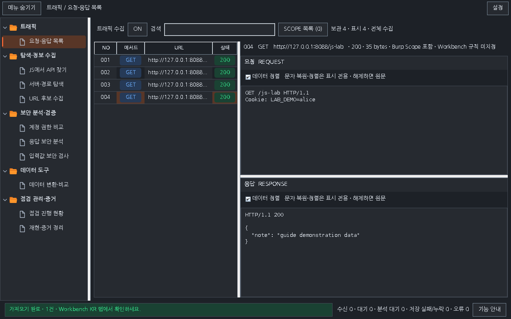
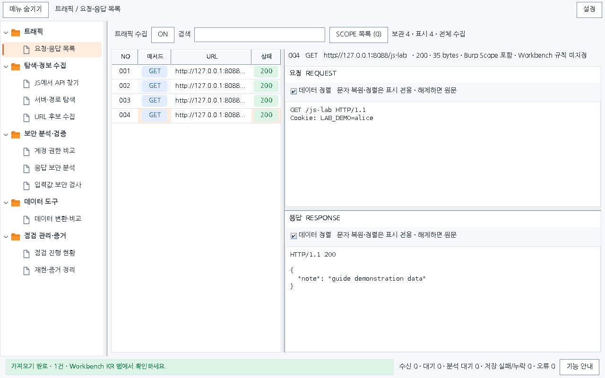
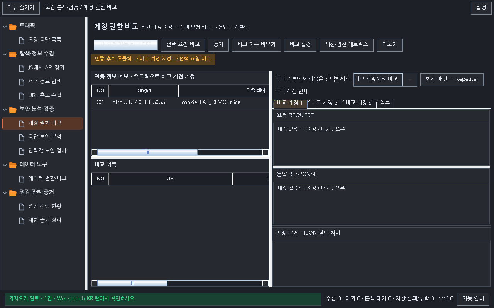

# Workbench 0.27.1 · 폴더 아이콘과 선택 강조

왼쪽 폴더 메뉴를 첨부 시안의 주황색 폴더와 선택 강조 방식으로 다듬었습니다. 운영체제 기본 아이콘 대신 직접 그린 폴더·문서 아이콘을 사용하고, 현재 열려 있는 도구의 행 전체에 배경색과 왼쪽 주황색 강조선을 표시합니다.

- 폴더: 주황색 아이콘과 굵은 제목, 펼침·접힘 화살표로 구분합니다.
- 도구: 문서 아이콘과 14px 글자, 36px 행 높이로 간격을 맞췄습니다.
- 현재 도구: 밝은 테마는 옅은 주황색, 어두운 테마는 짙은 주황색 배경입니다. 오른쪽 작업 영역을 눌러도 강조가 유지됩니다.
- 마우스를 올린 행은 은은하게 표시하고, 키보드 포커스는 점선으로 구분합니다. 행의 빈 공간을 눌러도 도구 선택·폴더 펼침을 할 수 있습니다.
- 기존 10개 도구·5개 폴더, 폭 조절·메뉴 숨기기·Ctrl+Shift+M·설정 저장과 입력값 유지를 그대로 사용합니다.

SCOPE는 기존처럼 요청·응답 목록 내부 기능입니다. 변경 대상은 Workbench 메뉴이며 별도 Mapper와 실습 사이트 배포는 유지합니다.

## 실제 코드 화면

배포 JAR의 운영 Swing 구성요소에 합성 데이터를 넣어 렌더링했습니다. 아래 그림은 실제 Burp GUI 캡처와 구분합니다.

## 검증과 인수인계

로컬 정식 release **1,988개**(Java 47그룹 1,490개·페이로드 HTTP 132개·전체 기능 HTTP 100개·모의 진단 266개), 메뉴 회귀 40개(위 Java 합계에 포함), 운영 Swing 126화면·안내 48화면과 패키징 4개를 통과했습니다. 별도 스타일 확인 40개도 통과했습니다.

실행 결과·배포 해시는 [0.27.1 검증 기록](VERIFICATION_0.27.1.json)과 관련 PR의 Checks를 확인합니다. 기존 메뉴 회귀는 10개 도구 이동·입력값 유지·폭 조절·숨김 복원·설정 저장과 HTTP 요청 0건을 확인합니다. 화면 검사는 밝은/어두운 테마와 1024×720·1280×800·1440×920을 사용합니다.

초기 렌더링에서 늦게 붙는 입력값 보안 검사 페이지의 아이콘 폭이 계산에서 빠져 글자가 잘리는 문제를 발견했습니다. 비활성 상태에서도 아이콘 폭을 확보하고, 화면 검사에 렌더러의 실제 필요 폭 확인을 추가했습니다. 수정 후 모든 메뉴 이름의 표시를 확인했습니다.

폴더 아이콘과 선택 행은 Java2D로 그려 2배 배율의 렌더링도 확인했습니다. 실제 Burp GUI, 운영체제별 DPI·글꼴과 물리 마우스 조작은 별도 확인 범위입니다. 이전 버전 JAR·ZIP과 검증 기록은 덮어쓰지 않습니다.

[최신 다운로드](../downloads/README.md) · [기존 폴더 메뉴 사용법](RELEASE_0.27.0_KR.md) · [날짜별 작업 대화](chat-logs/2026-10-16/workbench-folder-design-0271.md)
