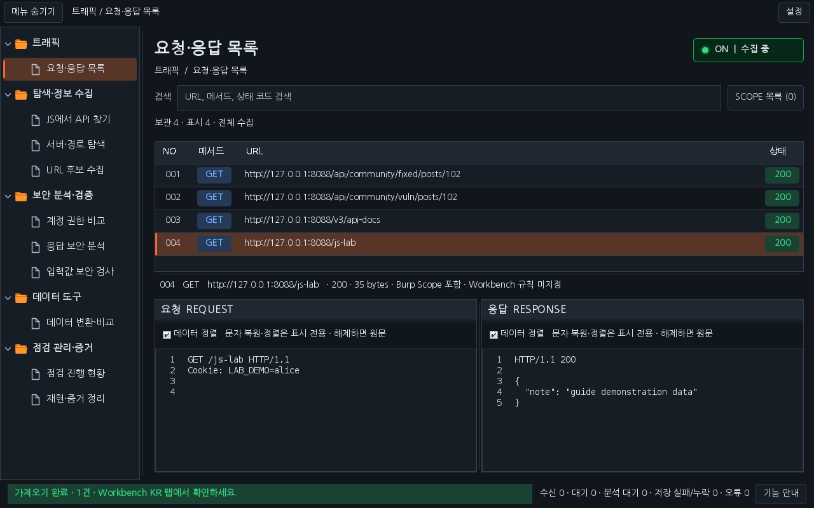
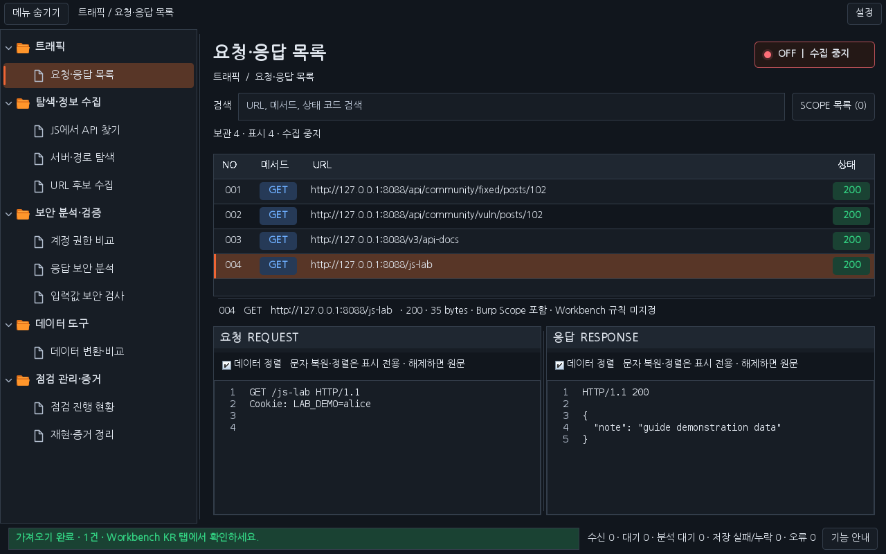
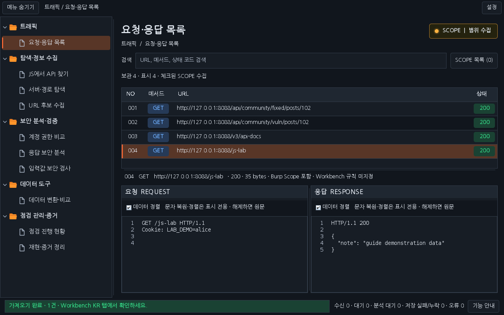
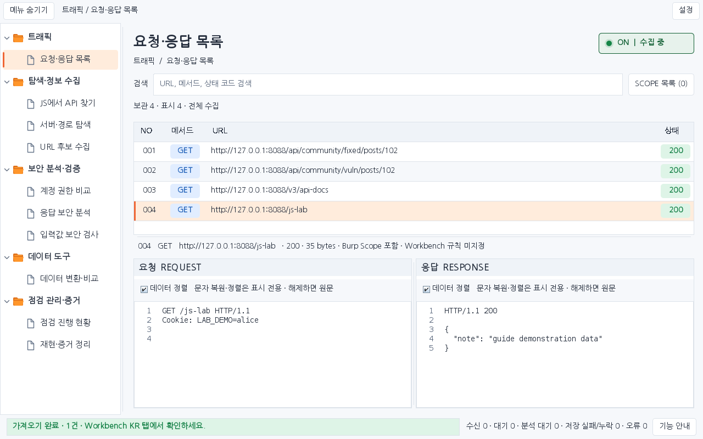
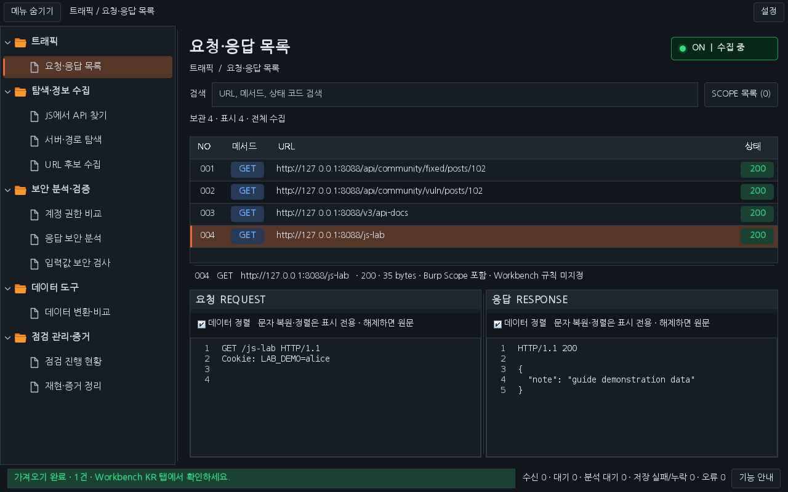

# Workbench 0.28.0 · 시안 기반 전체 화면 디자인

0.27.1은 왼쪽 메뉴 중심의 수정이어서 사용자가 제시한 화면의 글꼴·여백·트래픽 배치·수집 상태 표시와 차이가 컸습니다. 0.28.0은 작업 화면 전체를 다듬고, 확장 등록 이후 호스트가 스타일을 다시 적용하는 상황도 처리합니다.

## 적용된 화면

- 배경·카드·표 헤더·버튼·분할선에 같은 색상 체계를 적용합니다. Burp의 밝은/어두운 테마를 따라갑니다.
- 포함된 나눔고딕으로 한국어 메뉴와 제목을 표시합니다. 기본 14px, 폴더 메뉴 15px·40px 행, 트래픽 제목 25px를 사용합니다. 패킷은 14px 고정폭 글꼴과 줄 번호로 표시합니다.
- 트래픽 제목·경로 안내·검색창·수집 상태 버튼을 분리하고, 목록 전체 폭을 사용합니다. 요청·응답은 목록 아래에서 나란히 표시합니다.
- ON은 초록 상태등과 ‘수집 중’, OFF는 빨강과 ‘수집 중지’, SCOPE는 주황과 ‘범위 수집’입니다. 색상과 글자를 함께 표시하며 클릭 순서·실제 수집 조건은 그대로입니다.
- 폴더·문서 아이콘, 메뉴·트래픽 선택 행 전체의 배경과 주황색 강조선을 적용합니다. 폭 조절·숨기기·입력값·선택 유지를 지원합니다.
- 확장 등록·테마 변경 이후 메뉴 렌더러와 버튼 UI가 바뀌는 상황에 스타일을 다시 적용합니다. 원래 Burp 설정이나 전체 앱의 글꼴·테마 값은 변경하지 않습니다.

최초 0.28.0 로딩에서는 시안의 **좌/우 · 목록 위** 배치로 전환합니다. 이후에는 사용자가 고른 배치를 저장·복원합니다. **설정 → 요청 / 응답 배치**에서 이전 **상/하 · 목록 왼쪽** 방식으로 바꿀 수 있습니다. SCOPE 목록은 요청·응답 목록의 기존 버튼으로 엽니다.

## 설치와 화면 확인

기존 Workbench를 해제하고 [최신 0.28.0 JAR](../downloads/README.md)를 로드하세요. Burp Extensions 목록에서 확장 이름 끝의 **(0.28.0)**으로 버전을 확인할 수 있습니다.

아래는 최종 배포 JAR의 운영 Swing 구성요소와 합성 데이터로 렌더링한 결과이며 실제 Burp GUI 캡처가 아닙니다.

## 검증과 인수인계

로컬 전체 검사 **2,008개**(Java 48그룹 1,510개·페이로드 HTTP 132개·전체 기능 HTTP 100개·모의 진단 266개), 운영 Swing **144화면**·안내창 **48화면**, 패키징 4개와 버전별 해시·소스 지문 검사를 통과했습니다. 새 스타일 회귀 20개는 Java 합계에 포함합니다.

실행한 검사와 해시는 [0.28.0 검증 기록](VERIFICATION_0.28.0.json)을 확인하세요. 이번 회귀는 호스트의 회색 기본 렌더러·짧은 행·버튼 UI·글꼴·색상 재설정을 명시적으로 재현한 뒤, 폴더 주황색·상태등·제목 크기·사용자 입력 복원과 비동기 EDT 오류 0건을 확인합니다. 실제 Burp에서 발생한 내부 호출을 직접 추적한 결과와는 구분합니다.

작은 화면에서는 권한 비교의 요청·응답과 판정 근거 영역도 분할해 한쪽이 눌리지 않도록 했습니다. 테마 재설정 중 탭 UI의 늦은 뷰포트 이벤트가 폐기한 UI를 참조하던 오류도 정리했습니다. 화면 검사에는 ON/OFF/SCOPE와 호스트 스타일 재적용 후 화면을 포함하며 렌더링 중 비동기 예외도 실패로 처리합니다.

이미지 시안과 운영체제 창 테두리·글꼴 렌더링까지 픽셀 단위 동일함을 보증하지는 않습니다. 실제 Burp GUI·운영체제 DPI·물리 마우스 확인은 별도 범위입니다. 이전 버전 다운로드와 Mapper·실습 사이트는 보존합니다.

[다운로드](../downloads/README.md) · [날짜별 작업 대화](chat-logs/2026-10-16/workbench-reference-ui-0280.md)
