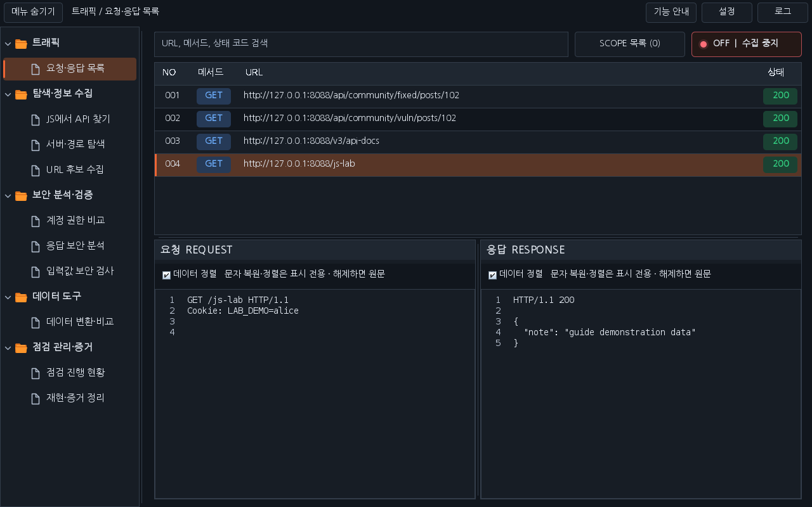
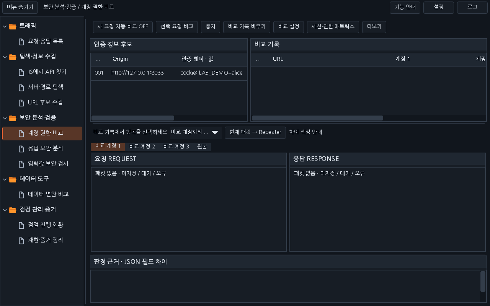
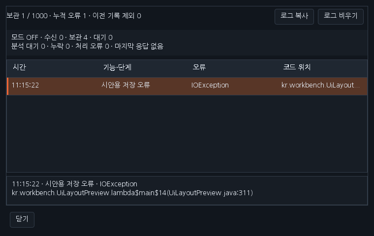
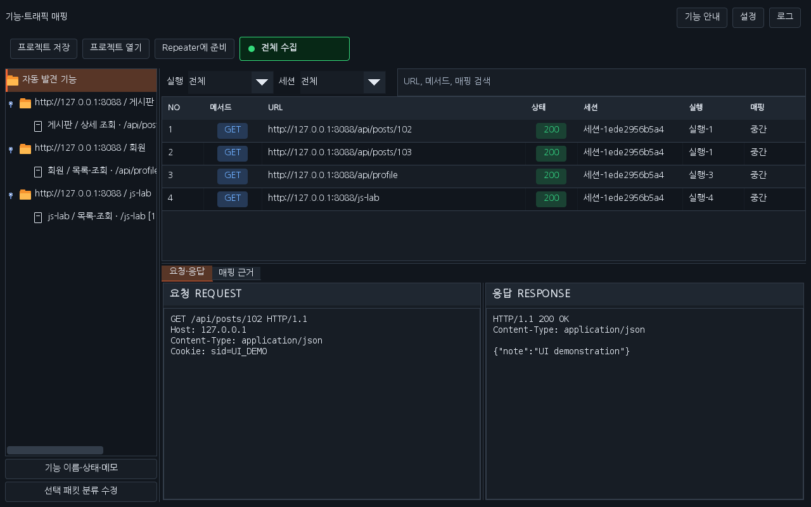
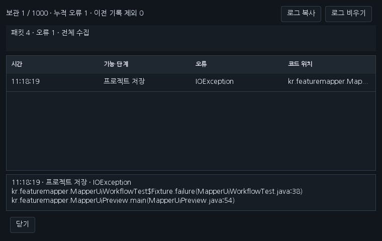

# Workbench 0.29.0 · 작업 영역과 오류 로그

사용자가 확정한 이미지 시안을 실제 코드에 적용했습니다. 이전 0.28.1에서 이미지로만 제시했던 레이아웃을 이번 배포부터 사용할 수 있습니다. 함께 관리하는 Feature Mapper는 0.3.0으로 배포합니다.

## 화면

- 요청·응답 목록의 큰 제목·중복 경로·검색 라벨을 제거하고 검색 입력, SCOPE 목록, 수집 상태를 위 한 줄에 둡니다.
- 보관/표시 요약, 선택 패킷 설명, 하단 수신/대기 통계를 주 작업 화면에서 제거해 트래픽 목록과 나란한 요청·응답 영역을 넓혔습니다. 수집 상태의 상세 수치는 로그 창에서 확인합니다.
- 상단 버튼을 **기능 안내 → 설정 → 로그** 순서로 배치합니다. F1과 도구별 안내·설정 창을 유지합니다.
- 계정 비교·데이터·JS·서버/경로·URL 수집·점검 현황·응답 분석·입력값 검사·증거 정리 화면에서도 큰 제목과 반복 안내를 정리했습니다. 실제 실행·중지·진행 상태와 판정 근거는 유지합니다.
- 토글·콤보 상자·스크롤바의 기본 밝은 스타일을 테마와 맞췄습니다. 메뉴 폭·숨김·선택·사용자 입력과 배치 설정은 유지합니다.

OFF는 새 수집을 막고 SCOPE는 체크된 네이티브 Burp 범위만 수집하는 0.28.1 조건을 그대로 사용합니다. UI 정리로 수집 범위를 넓히지 않습니다.

## 로그

상단 **로그**를 누르면 시각·기능/단계·예외 종류·확장 코드 위치를 확인할 수 있습니다. 행을 고르면 원인 예외 종류와 위치가 아래에 표시됩니다. 자동 수집, 화면 처리, 각 도구의 처리한 오류를 같은 창에서 확인하며 로그 복사와 비우기를 지원합니다.

이 로그는 해당 확장의 처리 경로에서 기록한 오류이며 Burp 전체 이벤트 로그를 읽는 기능은 아닙니다. 최근 1,000개를 보관하고 이전 기록 제외 수와 누적 오류 수를 표시합니다. 원본 예외 객체·메시지·HTTP 본문·쿠키·토큰을 기록하지 않습니다. 파일에 자동 저장하지 않으며 확장 해제 시 기록·창·갱신 타이머를 정리합니다.

## Feature Mapper 0.3.0

같은 한국어 글꼴·밝은/어두운 테마·주황색 폴더/선택 강조를 적용했습니다. 상단 안내/설정/로그, 별도 설정 창, 검색 입력과 넓어진 기능 목록·요청/응답 영역을 제공합니다. 프로젝트 원본 보관·자동 매핑·브라우저 연결과 수집 설정의 의미를 유지합니다. 브라우저 도우미는 같은 0.3.0 묶음으로 제공합니다.

## 운영 코드로 렌더링한 화면

아래 이미지는 최종 배포 JAR의 운영 Swing과 합성 데이터로 렌더링한 결과입니다. 실제 Burp GUI 캡처와 구분합니다.

## 설치·검증

이전 Workbench/Mapper를 해제한 뒤 [새 JAR·소스·브라우저 도우미](../downloads/README.md)를 설치합니다. 실행한 검사 건수·산출물 해시·화면 행렬·남은 환경 범위는 [0.29.0 검증 기록](VERIFICATION_0.29.0.json)에 기록합니다. 실제 Burp GUI·운영체제 DPI와 자동 Swing 검사를 구분합니다. 이전 버전 다운로드와 실습 사이트는 보존합니다.

[날짜별 대화](chat-logs/2026-10-16/workbench-clean-layout-0290.md)
