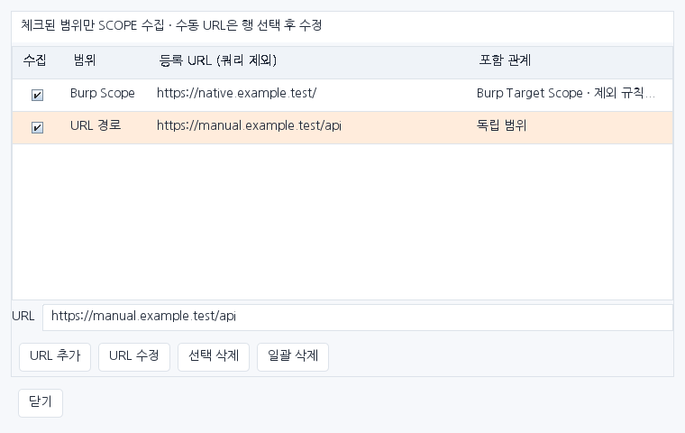
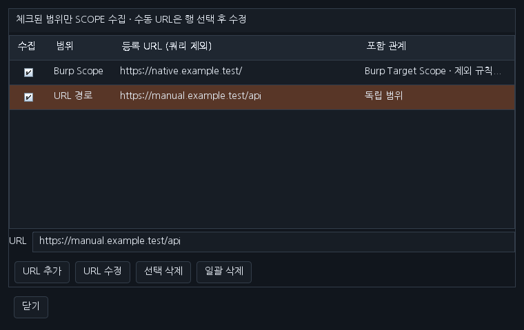
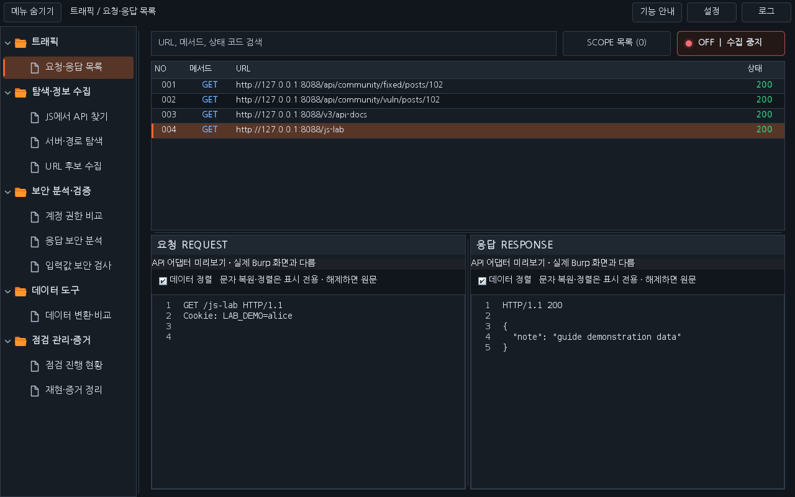

# Workbench 0.30.0 · SCOPE 수정·조밀한 트래픽·Burp 패킷 보기

SCOPE 목록에서 URL을 추가해도 트래픽이 들어오지 않던 동작을 수정했습니다. 0.29.0까지는 목록에 저장한 수동 URL이 개별 도구에만 적용되고, 수집은 네이티브 Burp Scope만 확인했습니다. 이제 **SCOPE 모드에서 체크한 Burp Scope 또는 수동 URL에 해당하는 요청을 수집**합니다. 시작 상태는 OFF이며, OFF에서는 새 패킷·History 가져오기·자동 관찰을 수집하지 않습니다.

## 추가·수정하기

**요청·응답 목록 → SCOPE 목록**에서 HTTP(S) URL을 입력하고 **URL 추가**를 누릅니다. 새 URL은 체크된 상태로 등록됩니다. 수집 버튼을 **SCOPE**로 바꾼 뒤 사이트를 다시 사용하세요. URL을 추가하는 것만으로 기존 History 전체를 가져오거나 서버에 요청을 보내지는 않습니다.

수동으로 추가한 행을 하나 선택하면 아래 입력칸에 URL이 표시됩니다. 주소를 바꾸고 **URL 수정**을 누르면 해당 행을 교체합니다. 체크 상태·목록 순서를 유지하며 이전 URL은 즉시 범위에서 빠집니다. 다른 체크된 규칙이 이전 URL을 포함하고 있다면 그 규칙은 계속 적용됩니다. 정렬한 목록에서도 선택한 행을 수정하고, Burp 알림으로 목록이 갱신되어도 입력 중인 수정값을 유지합니다.

잘못된 HTTP(S) URL이나 같은 규칙으로의 중복 수정은 원래 목록을 유지한 채 거부합니다. 쿼리·프래그먼트를 저장하지 않으며 `/api`는 `/api`와 `/api/child`에 적용되고 `/apievil`에는 적용되지 않습니다. 프로토콜·호스트·포트도 구분합니다. 우클릭으로 등록한 도메인 전체 규칙은 수정 후에도 도메인 전체 의미를 유지합니다.

체크 해제는 해당 규칙의 수집·도구 적용을 중지합니다. **선택 삭제**는 체크된 규칙을 삭제하며, 행 강조 선택과는 별개입니다. **일괄 삭제**는 체크 여부와 관계없이 모두 삭제합니다. 수정은 강조한 수동 행 한 개에만 적용합니다.

## Burp Scope와의 관계

Burp **HTTP history → Add to scope**의 자동 반영은 유지합니다. 네이티브 항목은 매 패킷마다 Burp의 현재 포함 여부를 다시 확인하므로 Burp 제외 규칙·범위 삭제·조회 실패를 수집에 반영합니다. 네이티브 항목 자체는 Burp에서 변경하고, Workbench에서는 체크·삭제 상태를 별도로 관리합니다.

수동 URL은 Workbench의 범위이며 **Burp 전역 Scope를 변경하지 않습니다**. 수집과 개별 도구가 같은 체크된 규칙을 사용합니다. Burp가 설정 내보내기로 제공하는 활성 제외 규칙도 수동 URL에 적용합니다. 설정 내보내기를 지원하지 않는 호스트에서는 수동 URL을 독립적으로 적용하며 Burp 제외 규칙을 조회할 수 없습니다. 네이티브 항목에는 이 경우에도 Burp의 실시간 포함 여부를 확인합니다.

## 조밀한 트래픽과 Burp 패킷 보기

요청·응답 목록의 트래픽 표만 **36px → 24px 행 높이**, **13px 나눔고딕**, **28px 표 머리글**로 바꿉니다. 같은 360px 목록 영역에 10행 대신 15행을 표시합니다. 메서드·상태의 큰 배지를 줄이고 색상 글자를 유지해 간격을 좁혔습니다. 선택 강조·검색·정렬·우클릭 기능을 유지하며, 호스트가 테마를 다시 적용한 뒤에도 행 간격과 고딕 글꼴을 복원합니다.

요청·응답 영역에는 **Burp Montoya API가 제공하는 READ_ONLY 메시지 편집기의 실제 UI**를 연결합니다. 기존에는 편집기를 생성하고 원본을 전달해도 화면에는 자체 PacketView를 표시했습니다. 이제 Burp 편집기의 Pretty·Raw·Hex, 지원되는 Render, 구문 강조·줄 번호·검색·줄바꿈과 사용자 메시지 편집기 설정을 사용할 수 있습니다. 세부 탭은 Burp 버전·메시지 형식에 따릅니다.

패킷은 재작성 없이 원본 요청·응답 객체를 전달합니다. Workbench의 테마·고딕 글꼴을 Burp 메시지 편집기 내부에 덮어쓰지 않습니다. 목록 선택을 해제하면 두 편집기를 비웁니다. 편집기 UI를 제공하지 않는 호스트에는 기존 자체 미리보기를 대체 화면으로 유지합니다. 기존 자체 미리보기의 ‘데이터 정렬’은 Burp 편집기에서는 Pretty·Raw 선택으로 대신합니다.

## 확인한 화면

최종 JAR의 운영 Swing과 합성 데이터로 렌더링했습니다. 실제 Burp GUI 캡처는 아닙니다. 트래픽 화면의 패킷 부분은 명시적인 API 어댑터 미리보기이며, 실제 Burp의 구문 강조 화면을 재현했다고 해석하지 않습니다. 최소 560×300에서도 URL 입력·수정·삭제 버튼을 사용할 수 있습니다.

## 배포·검증

[0.30.0 JAR·소스](../downloads/README.md)로 이전 Workbench를 교체합니다. Mapper 0.3.0·실습 사이트 3.5.2·기존 다운로드는 유지합니다. [이번 검증 기록](VERIFICATION_0.30.0.json)과 관련 PR의 Checks에서 로컬 검사와 원격 검사를 구분해 확인할 수 있습니다. 실제 Burp GUI·운영체제 DPI는 별도 확인 범위입니다.

[요청·작업 대화](chat-logs/2026-10-16/workbench-scope-traffic-native-0300.md)
