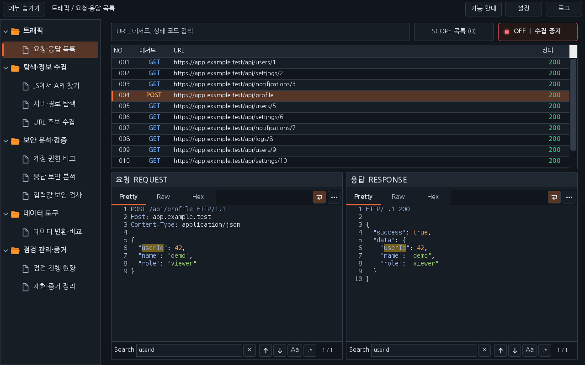
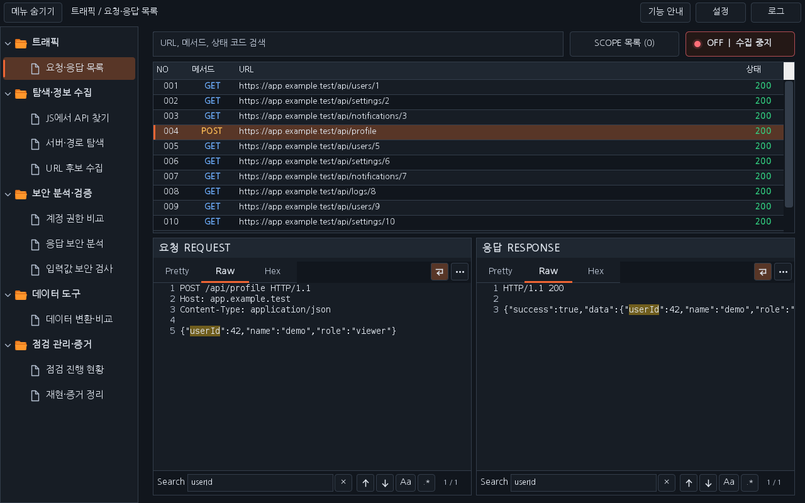
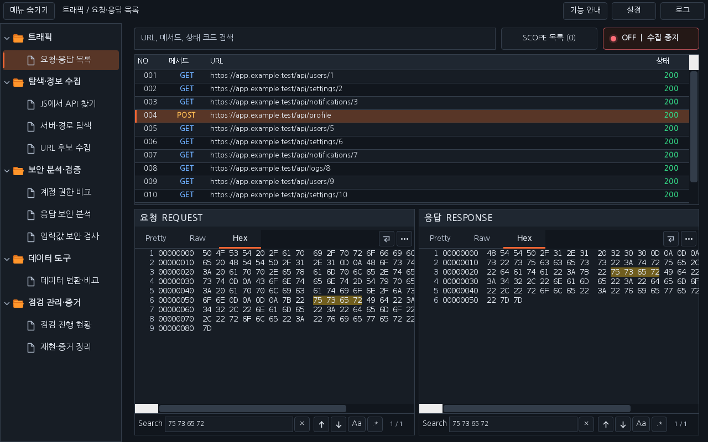
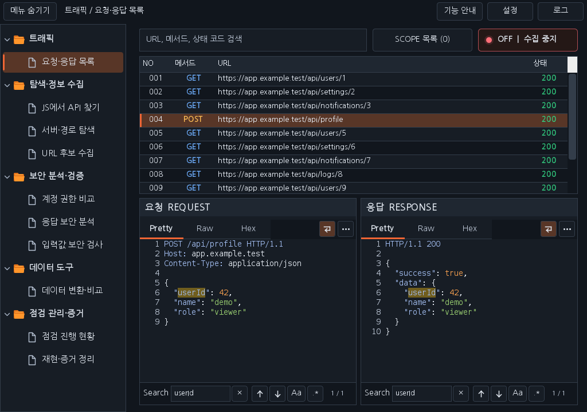

# Workbench 0.31.0 · Pretty·Raw·Hex와 Search

> 이 파일은 0.31.0 후보 기록입니다. 원격 Windows 회귀에서 Raw 줄바꿈 직렬화와 검색 위치 문제가 발견되어 배포 승인을 보류했습니다. [수정한 0.31.1](RELEASE_0.31.1_KR.md)을 사용하세요.

확정한 이미지 시안을 요청·응답 목록의 실제 패킷 화면에 적용했습니다. 양쪽에 독립적인 Pretty·Raw·Hex 탭, 줄 번호, 구문 강조와 하단 Search 바를 제공합니다. OFF/SCOPE·수동 URL 편집·24px 트래픽 행·13px 나눔고딕은 유지합니다.

## 보기와 검색

- **Pretty**: HTTP 헤더와 JSON 문자열·키·숫자 등을 색상으로 구분하고 지원하는 JSON/XML/HTML 본문을 표시용으로 정렬합니다. 큰 JSON 정수는 원문 숫자를 유지합니다.
- **Raw**: 정렬하지 않은 원문 텍스트입니다. 원래 줄바꿈을 문서에 유지하고, 유효한 UTF-8은 한국어까지 표시합니다. 텍스트로 표현할 수 없는 값은 Hex에서 확인하세요.
- **Hex**: 실제 원본 바이트의 16진수·오프셋·ASCII를 표시합니다. 압축 해제한 Pretty 내용과 구분합니다.
- **Search**: 현재 선택한 보기에서 문자열을 찾고 모든 일치 위치를 강조합니다. ↑/↓, Enter/Shift+Enter 또는 F3/Shift+F3으로 이전·다음 결과를 순환하고 현재 위치/일치 개수를 표시합니다. Ctrl+F는 패킷 내부에서 해당 검색창으로 이동합니다. × 또는 Esc로 비웁니다.
- **Aa / .***: 대소문자 구분과 정규식 옵션입니다. 기본은 대소문자를 구분하지 않는 일반 문자열 검색입니다. 잘못된 정규식은 오류 표시·툴팁으로 안내하며 기존 결과를 제거합니다. 길이가 0인 일치는 강조·이동에서 제외합니다.
- **↵ / ⋯**: 긴 줄 자동 줄바꿈과 Burp 기본 편집기 열기입니다. 기본 편집기에는 전체 원본 객체를 전달하고 Burp 내부 스타일을 유지합니다. 버전·메시지 형식에 따라 제공하는 Render 등도 이 창에서 사용할 수 있습니다.

요청·응답의 검색어·보기·옵션은 각각 유지됩니다. 패킷이나 탭을 바꾸면 현재 보기에서 다시 검색하며 이전 비동기 결과가 새 패킷에 표시되지 않습니다. 확장 해제 시 검색 타이머·작업·미리보기 내용을 정리합니다.

## 원본과 표시 범위

뷰는 읽기 전용이며 전송·보관한 패킷을 변경하지 않습니다. 미리보기와 검색은 앞 **64 KiB**를 기준으로 하며, 정렬 결과는 최대 128 Ki 문자입니다. 원본 저장 개수·본문 크기에 새 제한을 두지 않습니다. 더 큰 원본은 **⋯**로 Burp 기본 편집기에서 확인하세요. 큰 원문은 native ByteArray에서 표시 범위만 복사합니다. 작은 응답의 Pretty는 기존 문자셋·압축 복원을 사용하며, 큰 응답은 원본 앞부분을 표시합니다.

검색은 백그라운드에서 실행하고 입력을 짧게 묶어 처리합니다. 검색어는 최대 512자, 강조·이동은 앞 2,000개 일치까지 제공하고 초과 시 `+`를 붙입니다. 지나치게 복잡한 정규식은 시간 예산으로 중단하고 제한을 표시합니다. 이 범위는 화면의 미리보기·검색에만 적용됩니다.

## 화면과 검증

아래는 배포 JAR의 운영 Swing 구성 요소와 합성 HTTP 데이터로 렌더링한 결과입니다. 이미지 시안을 다시 생성한 그림이 아니며, 실제 Burp GUI 캡처와는 구분합니다.

자동 검사는 원본 바이트·줄바꿈·구문 강조·검색·정규식·탭 전환·독립 상태·취소·해제와 기존 수집·도구의 회귀를 확인합니다. [0.31.0 검증 기록](VERIFICATION_0.31.0.json)과 해당 PR의 원격 Checks에서 실행 범위를 확인하세요. 실제 Burp GUI·운영체제 DPI는 별도 범위입니다.

[새 JAR·소스 다운로드](../downloads/README.md) · [날짜별 작업 대화](chat-logs/2026-10-16/workbench-packet-tabs-search-0310.md)
