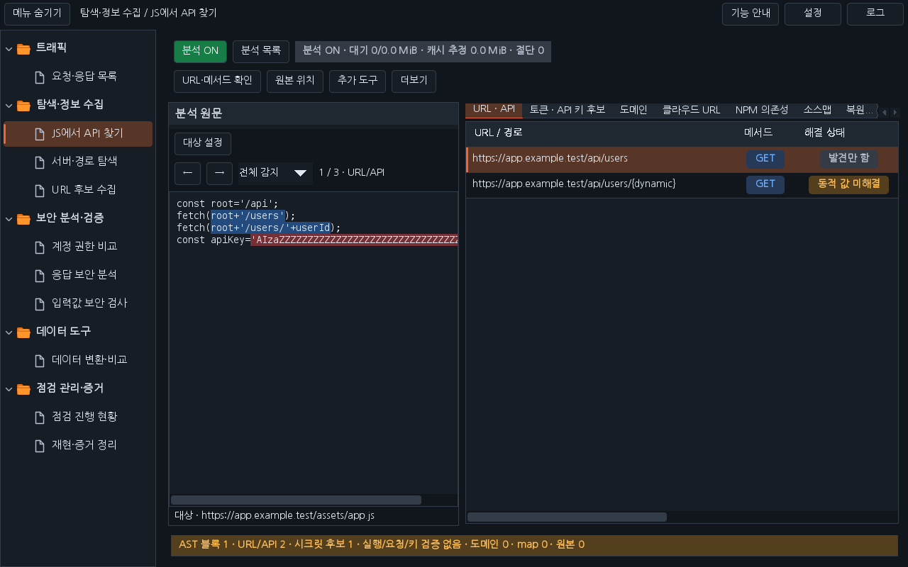
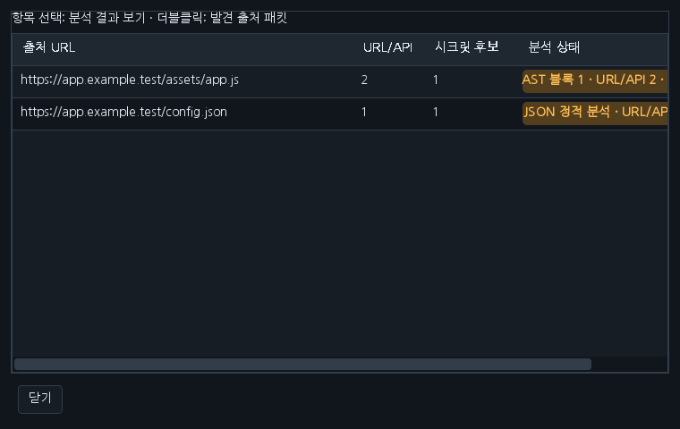
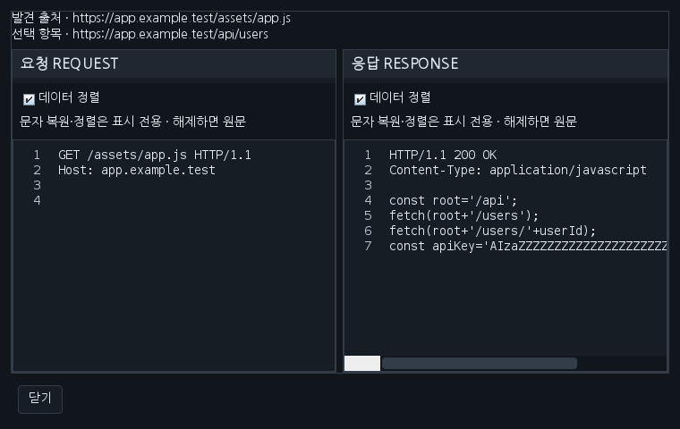

# Workbench 0.32.1 · JS·텍스트 분석과 목록 팝업

‘JS에서 API 찾기’를 결과 중심 화면으로 정리했습니다. 왼쪽은 읽기 전용 분석 원문, 오른쪽은 URL·API, 토큰·API 키 후보 등 기존 결과 탭입니다. 상시 요청·응답 패킷 영역을 없애 결과 표에 더 많은 공간을 사용합니다.

## 바뀐 사용 순서

1. SCOPE 내 사이트를 사용하고 **분석 ON**을 유지합니다. ON은 초록색, OFF는 빨간색입니다. OFF로 바꾸면 새 자동 분석과 대기 중인 분석을 중지하고, 이미 실행 중이던 작업의 늦은 결과도 적용하지 않습니다. ON으로 돌아오면 History를 다시 확인하며 내용 지문으로 중복 분석을 줄입니다. 기존 분석 결과는 보관합니다.
2. **분석 목록**을 눌러 별도 창에서 출처별 URL/API·키 후보 개수와 분석 상태를 확인합니다. 행을 선택하면 본 화면의 결과와 원문을 확인할 수 있습니다. 최근 분석 드롭다운과 History 분석 탭은 이 창으로 통합했습니다. 출처 URL 열은 넓게 유지하고 가로 스크롤로 나머지 내용을 확인합니다.
3. URL·API, 토큰·키, 도메인, 클라우드 URL, NPM, 소스맵, 복원 원본 목록의 항목을 **더블클릭**하거나 **Enter**를 누르면 발견 출처의 요청·응답을 별도 창으로 엽니다. 해당 API를 새로 요청하거나 관측하지 않은 응답을 만들지 않습니다. 창에는 출처와 선택 항목을 표시하고, 열린 패킷은 다른 분석이 들어와도 바뀌지 않습니다. 출처 패킷 미리보기가 없으면 그 상태를 표시합니다.
4. API 행을 선택하고 **Ctrl+R**을 누르면 Repeater에 초안을 준비합니다. 기존 ‘선택 URL → Repeater’ 버튼은 제거했습니다. 정렬된 표에서도 선택한 행을 연결합니다. 동적 경로나 메서드가 불명확하면 URL·메서드 확인 창에서 값을 확인한 뒤 준비합니다. 직접 전송은 Repeater의 Send로 수행합니다.

‘수동 분석’, ‘선택 응답 가져오기’, ‘수집 파일 저장’의 화면 버튼과 파일 저장 메뉴를 제거했습니다. 원문 창은 감지 위치 탐색용 읽기 전용 보기입니다. 기존 트래픽 우클릭에서 명시적으로 가져오는 경로는 유지합니다. ‘전체 API / 요청 미관측 / 동적 값 미해결’ 필터 UI는 없애고 모든 API 후보를 표시합니다. 원본 위치·감지 위치 이동·소스맵/NPM 추가 도구·가림 결과 복사·초기화는 유지합니다.

## 분석 대상

- **JavaScript**: 기존 AST 기반 호출·메서드·파라미터·본문 키 추출과 상수/동적 값 구분을 유지합니다.
- **JSON**: 중첩 값·배열·경로 키에서 URL을 찾고, 문자열의 이스케이프·Unicode를 해석합니다. API 키·토큰 이름과 제공자 패턴으로 후보를 찾으며 원본 위치를 유지합니다.
- **XML / SVG**: 속성·요소 텍스트·CDATA를 읽습니다. 기본·숫자 엔티티만 문자열로 복원하며 외부 엔티티·파일·DTD를 해석하거나 요청하지 않습니다.
- **HTML**: 기존 인라인 JS 분석에 속성 URL 후보를 더하고, script가 없는 HTML도 분석합니다.
- **일반 텍스트**: URL, 경로, `key=value`·YAML 형태의 설정 문자열에서 후보를 찾습니다. 임의 언어의 구문·실행 결과를 해석하는 기능은 아닙니다.

확장자가 없거나 Content-Type이 불명확해도 텍스트 본문을 확인합니다. 이미지·동영상·폰트·PDF·압축 파일 등 알려진 바이너리 형식과 제어문자가 많은 본문은 제외합니다. 기존 Scope 조건과 압축·문자셋 복원, 개별 응답 2 MiB·원문 분석 512 Ki 문자·결과 500개·캐시/대기 예산은 유지합니다. 패킷 창은 캐시에 보관한 제한된 텍스트 미리보기입니다. 원본 트래픽의 수집·보관 개수와 본문 크기를 새로 제한하지 않습니다.

JSON·XML·텍스트에서 발견한 URL 문자열만으로 HTTP 메서드나 실제 도달 여부를 확정하지 않습니다. 토큰·API 키는 가림 값·지문으로 결과 목록과 보고서를 표시하며, 원문과 출처 패킷은 사용자의 명시적인 탐색에서 확인합니다.

## 구현 화면과 검증

아래 이미지는 합성 HTTP 데이터를 넣은 배포 JAR의 운영 Swing 구성 요소입니다. 실제 Burp GUI 캡처는 별도 범위입니다.

검사 수와 실제 수행 범위는 [검증 기록](VERIFICATION_0.32.1.json), 원격 Linux·Windows 최종 결과와 main 반영 상태는 관련 PR을 기준으로 합니다.

[다운로드](../downloads/README.md) · [날짜별 대화](chat-logs/2026-10-16/workbench-js-response-windows-0320.md)
