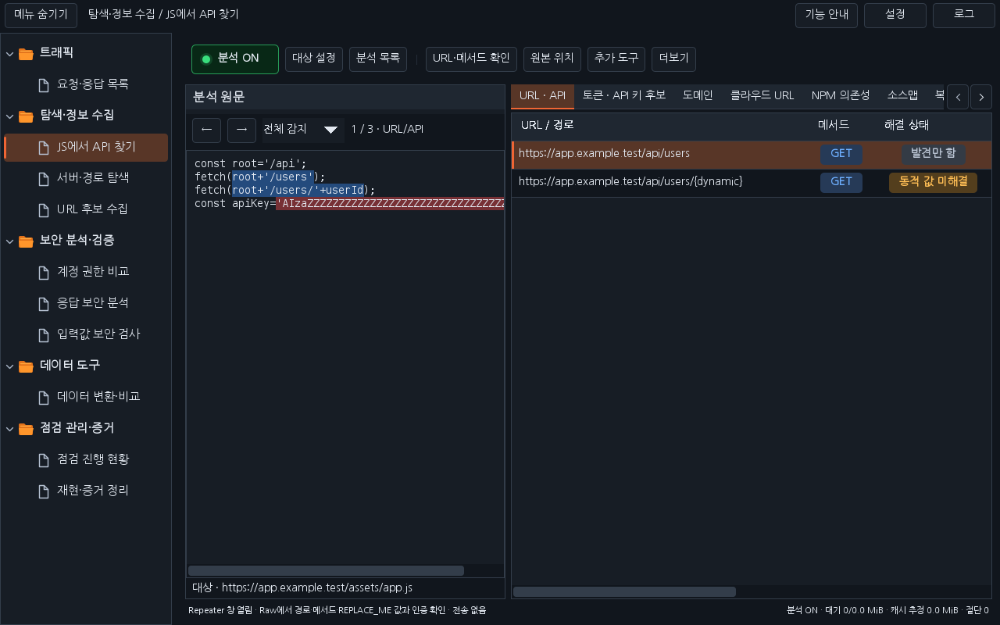
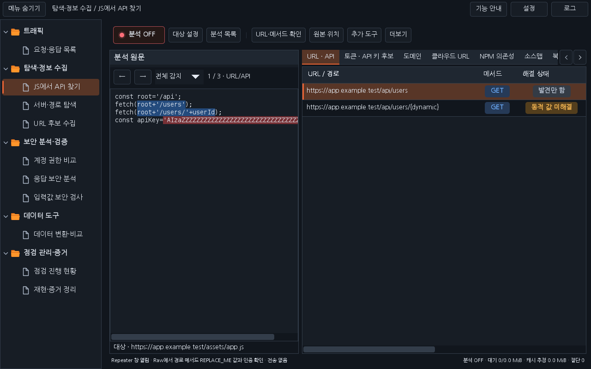
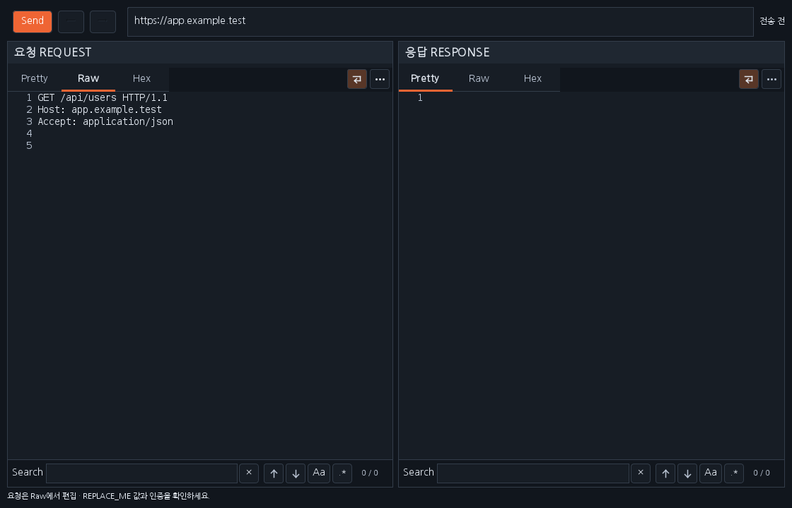

# Workbench 0.33.0 · JS 작업 영역과 Repeater 창

확정한 화면 시안을 운영 코드에 적용했습니다. 상단은 **분석 ON/OFF → 대상 설정 → 분석 목록 | URL·메서드 확인 → 원본 위치 → 추가 도구 → 더보기** 순서입니다. 분석 버튼은 요청·응답 목록의 수집 버튼과 같은 상태등·테두리 방식으로 ON은 초록색, OFF는 빨간색입니다. 분석 목록 뒤 구분선은 높이 12px의 옅은 선입니다. 작은 화면에서는 버튼이 잘리지 않게 줄바꿈합니다.

대상 설정의 기존 원문 안쪽 행과 큰 하단 상태 배너를 없애 분석 원문과 결과 영역을 위아래로 넓혔습니다. 분석 상태·대기 개수/바이트·캐시 추정·절단 개수는 오른쪽 하단 11px 글자로 표시합니다. 상세 처리 카운터는 상태 문구의 툴팁으로 확인합니다. URL·API부터 분석 상세까지 결과 탭은 유지하며 오른쪽의 **‹ / ›**로 제목을 이동합니다. 첫쪽과 끝쪽에서는 해당 방향 버튼만 비활성화합니다.

## Ctrl+R로 요청 만들고 보내기

1. URL·API 표에서 API 행을 선택하고 **Ctrl+R**을 누르면 별도의 모델리스 Repeater 창이 즉시 열립니다. 여러 행을 선택했다면 같은 창의 이전/다음 요청으로 확인합니다. 메인 화면의 선택이나 분석 결과가 바뀌어도 이미 연 창의 요청을 덮어쓰지 않습니다.
2. 요청은 **Raw**에서 편집합니다. **Pretty / Raw / Hex** 보기와 요청·응답별 **Search**를 제공합니다. Pretty와 Hex는 표시 전용이며 Raw 편집 내용을 전송합니다. 보기 전환은 요청 바이트를 재작성하지 않습니다.
3. 경로가 미해결이면 `REPLACE_PATH`, 메서드가 불명확하면 `REPLACE_METHOD`로 표시합니다. Raw에서 확인하기 전에는 Send가 전송하지 않습니다. 기존 **URL·메서드 확인** 버튼으로 값을 정하고 Repeater를 열 수도 있습니다.
4. **Send**를 직접 누르면 편집한 요청 하나를 전송하고 실제 응답·상태 코드·경과 시간·크기를 표시합니다. 전송 대상 Origin은 창 위 입력값이며 요청 경로·쿼리·본문은 Raw에서 수정합니다. 전송 전 Scope를 다시 확인하고 자동 리다이렉트는 따르지 않습니다. 본문을 바꾸면 Content-Length를 갱신하며 요청 기록에는 실제 전송한 패킷을 표시합니다.
5. 이전/다음은 요청과 해당 응답을 함께 복원합니다. 요청 쪽 **⋯**는 편집한 초안을 Burp 기본 Repeater에 복사합니다. 복사만으로는 전송하지 않습니다.

창을 여는 동작·분석 목록 선택·원문 위치 이동은 HTTP 요청을 보내지 않습니다. 창을 닫거나 확장을 해제하면 해당 작업과 편집기·검색 자원을 정리하며 늦게 도착한 응답은 닫힌 창에 적용하지 않습니다. 실제 Burp 기본 Repeater의 창을 제어하는 기능이 아니라 Montoya HTTP API를 사용하는 Workbench의 별도 요청 편집 창입니다.

## URL·API와 원문을 조합하는 방식

원문에서 찾은 호출 맥락의 **URL, 메서드, 쿼리/params 이름, 본문 키**를 같은 API 후보에 연결해 초안을 만듭니다. 상대 경로는 출처 URL 또는 정적으로 확인한 baseURL을 기준으로 조합합니다. JSON·XML·일반 텍스트의 URL 문자열처럼 메서드 근거가 없으면 임의로 GET으로 확정하지 않습니다.

예를 들어 `POST /api/users?page=1`의 호출에서 본문 키 `name`, `role`을 찾으면 다음 형태의 초안을 준비합니다.

```http
POST /api/users?page=REPLACE_ME HTTP/1.1
Host: app.example.test
Accept: application/json
Content-Type: application/json

{"name":"REPLACE_ME","role":"REPLACE_ME"}
```

예시에서는 가독성을 위해 자동 계산되는 Content-Length를 생략했습니다. URL의 기존 쿼리 값은 복사하지 않고 이름만 사용합니다. 실제 값·자료형·중첩 구조·필수 여부를 자동 확정하지 않으며 현재 기본 본문 초안은 평면 JSON입니다. 폼/파일 업로드 등 실제 형식은 Raw에서 확인하거나 관측한 원본 요청을 Burp Repeater로 가져와 사용합니다. 발견한 토큰·API 키·Cookie·Authorization 값을 자동으로 넣지 않습니다.

따라서 **URL·API 선택 → Ctrl+R → Raw에서 파라미터 값·메서드·인증 확인 → Send**가 사용 흐름입니다. JS 실행·로그인 세션 자동 연결·다른 API의 임의 파라미터 합치기는 하지 않습니다. 목록의 헤더 이름은 분석 근거이며 실제 인증 값이 준비됐다는 뜻은 아닙니다.

## 검증과 실제 화면

회귀·격리 HTTP 검사, 두 테마의 운영 Swing 화면 배치와 패키징을 확인합니다. 새 Repeater 회귀는 별도 loopback 서버가 실제로 받은 쿼리·UTF-8 JSON 본문, 보기 전환 후 편집 보존, 요청/응답 기록, Scope 차단, 미해결 값과 잘린 미리보기의 전송 차단을 검사합니다. 요청·응답 미리보기는 기존 64 KiB 범위이며 원본 트래픽 수집 한도를 바꾸지 않습니다.

아래 그림은 합성 패킷을 넣어 배포 JAR의 실제 Swing 구성 요소를 렌더링한 것입니다. 이미지 생성 시안이나 실제 Burp GUI 캡처가 아닙니다.







[검증 기록](VERIFICATION_0.33.0.json) · [다운로드](../downloads/README.md) · [날짜별 대화](chat-logs/2026-10-17/workbench-js-layout-repeater-0330.md)

실제 Burp GUI·운영체제 DPI·전체 Docker 실행은 이번 로컬 검증 범위와 구분합니다. 최종 원격 검사와 main 반영 상태는 관련 PR의 Checks를 확인하세요.
