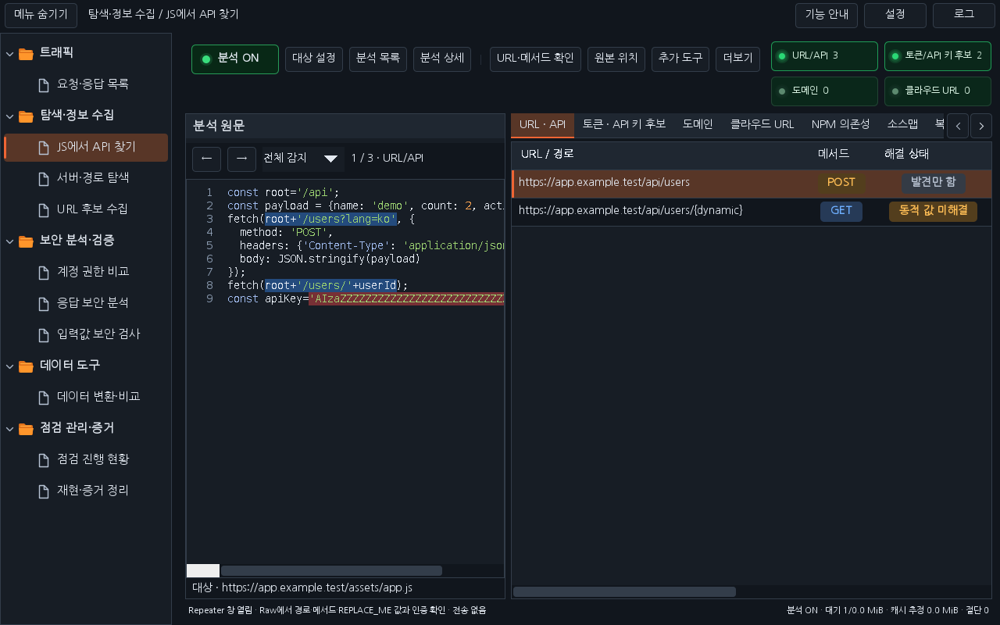
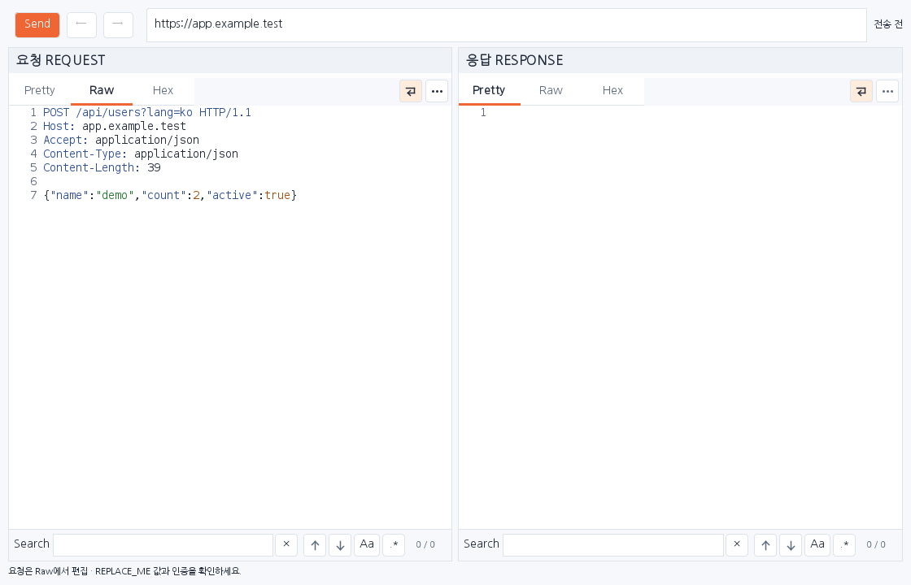
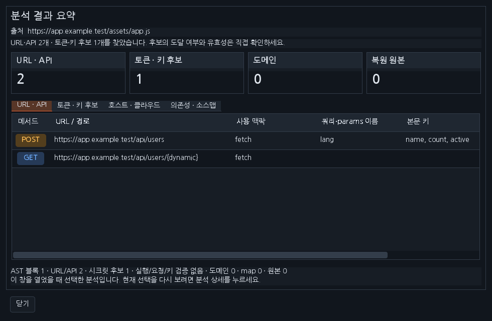
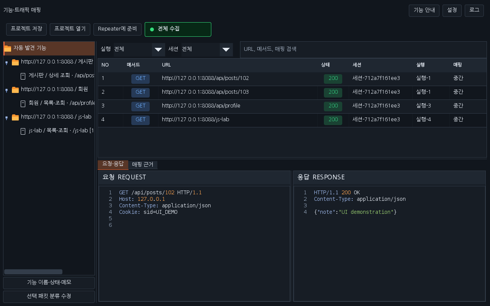

# Workbench 0.35.0 · 분석 상세 창·전체 집계·요청 값 매핑

분석 원문에 고정폭 글꼴·Burp 스타일 구문 색상과 왼쪽 줄 번호를 적용했습니다. Workbench의 계정 비교·서버 탐색·URL 수집·입력값 검사·응답 비교·재현 패킷과 팝업, 별도 Feature Mapper 0.3.1의 요청·응답에도 같은 색상과 줄 번호를 적용합니다. 기존 트래픽·Repeater의 Pretty·Raw·Hex·Search는 유지하며 Raw에도 구문 색상을 표시합니다. 원문·줄바꿈·편집 값·감지 위치와 비교 강조는 그대로 유지합니다.

## 분석 상세 창과 전체 집계

상단은 **분석 ON/OFF → 대상 설정 → 분석 목록 → 분석 상세 | URL·메서드 확인 → 원본 위치 → 추가 도구 → 더보기** 순서입니다. 기존 오른쪽 결과의 분석 상세 탭을 제거하고, 분석 목록 바로 오른쪽의 **분석 상세** 버튼으로 별도 창을 엽니다. 요약 카드·출처·설명과 URL/API, 토큰/키, 호스트/클라우드, 의존성/소스맵 표로 내용을 정리했습니다. 표는 읽기 전용·정렬·가로/세로 스크롤을 지원하고 빈 결과도 안내합니다. 창을 연 시점의 선택을 유지하며 버튼을 다시 누르면 현재 선택으로 갱신합니다. 값 가림은 유지합니다.

상단 오른쪽 끝은 전체 분석 목록의 **URL/API · 토큰/API 키 후보 · 도메인 · 클라우드 URL** 수를 표시합니다. 첨부한 분석 ON의 초록 불빛·옅은 테두리 스타일을 적용하고, 좁은 화면에서도 숫자와 버튼이 잘리지 않도록 배치했습니다. 개별 파일을 선택해도 전체 집계를 유지합니다. 메서드+URL, 키 지문, 호스트와 클라우드 URL을 기준으로 중복을 제외하며, 보관 중인 분석의 추가·재분석·캐시 퇴출·초기화에 맞춰 갱신합니다. OFF는 보관된 집계를 지우지 않습니다.

## Repeater 사용

URL·API에서 행을 선택하고 **Ctrl+R**로 창을 엽니다. 요청의 **Raw**에서 필요한 값을 확인하고 **Send 또는 Ctrl+Space**를 누르면 현재 요청 하나를 전송합니다. 요청·응답 편집 영역, Search와 대상 Origin에 커서가 있어도 단축키를 사용할 수 있습니다. 전송 중에는 중복 실행을 막습니다. Pretty·Hex는 표시 전용입니다.

요청이나 대상 Origin을 바꾸면 이전 응답을 화면에서 비우고 ‘편집됨 · 미전송’으로 표시합니다. 새 전송을 시작하거나 실패한 경우에도 이전 응답을 현재 응답처럼 남기지 않습니다. 이전/다음 기록에서는 실제 보낸 요청과 그 응답을 함께 복원합니다. 전송 직전 Scope를 확인하고 리다이렉트를 자동으로 따라가지 않습니다.

## REPLACE_METHOD·REPLACE_PARAMETER 문제 확인

0.33.0은 `REPLACE_METHOD`와 `REPLACE_PATH`는 차단했지만 쿼리·본문의 `REPLACE_ME`를 실제 값처럼 보낼 수 있었습니다. 현재 코드에서 `REPLACE_PARAMETER`를 생성하는 경로는 없었으나 이 표기도 함께 차단하도록 수정했습니다.

| 입력 근거 | 0.35.0 요청 초안 |
|---|---|
| 호출의 정적인 URL 쿼리·params | 확인된 값을 연결하고 URL 인코딩 |
| const·JSON.stringify·Axios data의 확인된 JSON | 문자열·숫자·불리언·null·중첩 객체/배열 유지 |
| 명시한 Content-Type과 지원하는 JSON·폼·텍스트 본문 | 해당 형식으로 준비 |
| 메서드 근거 없는 JSON·XML·텍스트의 URL 문자열 | REPLACE_METHOD로 표시, Raw 확인 필요 |
| 실행 중 값·동적 경로·미지원 직렬화 | 미확정 표시, 전송 차단 |
| Authorization·Cookie 등 인증 헤더 | 자동 복사하지 않음 |
| 이름으로 식별한 민감 쿼리·JSON 필드 | REPLACE_ME로 표시 |

`REPLACE_ME`, `REPLACE_METHOD`, `REPLACE_PARAMETER`, `REPLACE_PARAM`, `REPLACE_PATH`, `REPLACE_BODY`, `{dynamic}`가 남으면 Send와 Ctrl+Space 모두 전송하지 않습니다. URL 인코딩된 표기도 확인합니다. 동일한 URL이 여러 호출에 등장해도 원문 위치별 파라미터 값을 연결합니다. **URL·메서드 확인**에서 메서드만 정할 때도 이미 확인한 쿼리·본문 값을 유지합니다.

예를 들어 아래 원문은 다음 요청 초안으로 연결됩니다. Content-Length는 실제 UTF-8 바이트 수로 계산됩니다.

```javascript
fetch('/api/users?lang=ko', {
  method: 'POST',
  headers: {'Content-Type': 'application/json'},
  body: JSON.stringify({name: 'demo', count: 2, active: true})
});
```

```http
POST /api/users?lang=ko HTTP/1.1
Host: app.example.test
Accept: application/json
Content-Type: application/json
Content-Length: 39

{"name":"demo","count":2,"active":true}
```

JS를 실행하거나 로그인 세션을 자동 연결하지 않습니다. 런타임 값·인증·CSRF·필수 필드와 서버의 실제 처리 조건은 Raw에서 확인해야 합니다. 정적 초안만으로 API의 성공 응답을 보장하지 않습니다. 지원하지 않는 fetch 객체 BodyInit를 임의의 JSON으로 바꾸거나 큰 객체를 일부만 잘라 보내지 않습니다. 분석 원문·상세 초안은 기존 메모리 캐시 예산에 포함하며, 값이 포함된 초안을 가림 보고서나 분석 내보내기에 추가하지 않습니다.

## 검증·화면

로컬 정식 release 2,348개와 Mapper Java 94·Node 7, 두 테마 화면 288개·패키징 4개를 통과했습니다. 회귀 검사에서 실제 loopback 수신 내용, Ctrl+Space·중복 실행 방지·미확정 값 전송 차단·자료형/호출별 매핑·이전 응답 제거와 기록 복원·감지 위치/강조 보존을 확인합니다. 실제 실행 수와 두 테마 화면 결과는 [검증 기록](VERIFICATION_0.35.0.json)을 기준으로 확인하세요.

아래는 배포 JAR의 Swing 구성 요소에 합성 데이터를 넣은 화면입니다. 실제 Burp GUI 캡처가 아닙니다.









[다운로드](../downloads/README.md) · [작업 대화](chat-logs/2026-10-17/workbench-packet-draft-0350.md)

실제 Burp GUI·운영체제 DPI와 OS/IME의 키 입력 전달은 별도 확인 범위입니다. 최종 원격 검사와 main 반영 상태는 관련 PR의 Checks에서 확인합니다.
