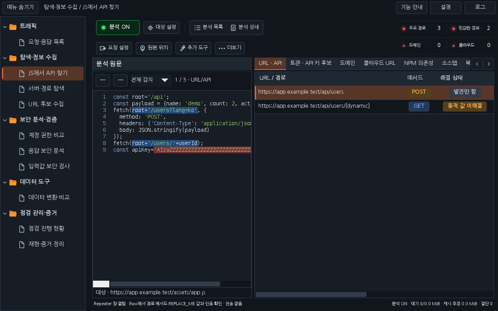
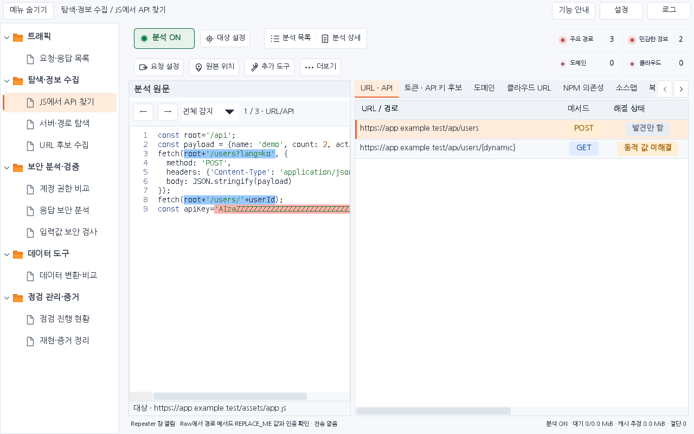
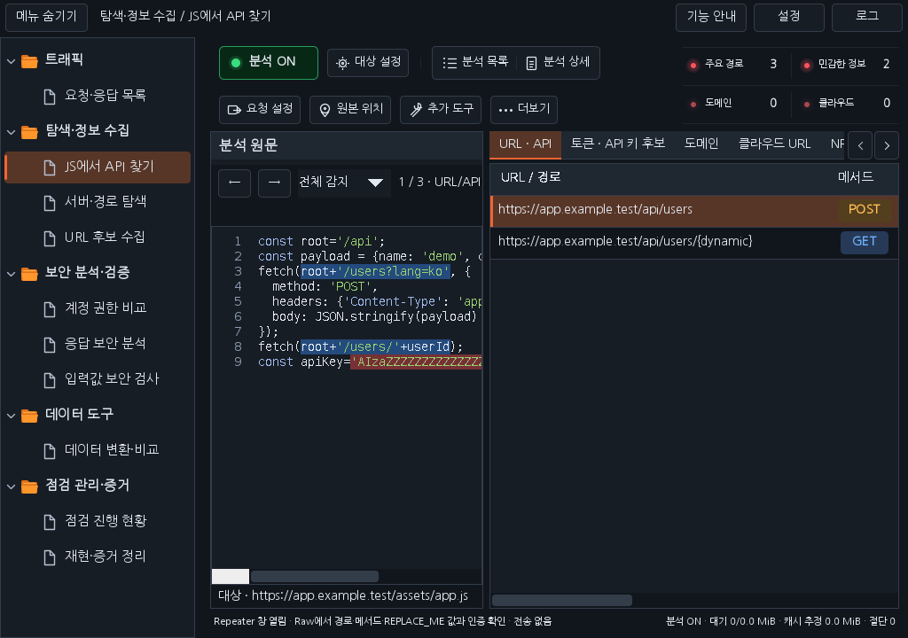

# Workbench 0.35.1 — JS 분석 버튼과 빨간 집계

기존 한 줄 버튼이 집계 영역과 겹쳐 답답해 보이던 배치를 승인된 시안처럼 두 줄로 정리했습니다.

- 첫 줄: 분석 ON/OFF → 대상 설정 → 분석 목록 / 분석 상세. 두 분석 창 버튼은 하나의 공통 프레임으로 묶고 짧고 옅은 구분선으로 대상 설정과 구분합니다.
- 둘째 줄: 요청 설정 → 원본 위치 → 추가 도구 → 더보기. 기존 URL·메서드 확인을 요청 설정으로 줄였으며 경로·메서드 확인과 Repeater 초안 준비는 그대로 제공합니다.
- 우측 상단: 주요 경로 / 민감한 정보, 도메인 / 클라우드의 2×2 집계. 이름은 11px, 숫자는 13px로 표시하고 빨간 불빛과 얇은 구분선을 적용했습니다. 0개는 조금 어두운 빨간색입니다.
- 분석 ON 버튼은 초록색, OFF 버튼은 빨간색을 유지합니다. 전체 분석 집계, 요청·응답 보기, 단축키와 전송 조건은 기존 동작을 유지합니다.

주요 경로는 URL/API, 민감한 정보는 토큰/API 키 후보를 표시하는 짧은 이름입니다. 긴 명칭과 후보 설명은 툴팁에서 확인합니다. 집계는 현재 선택한 원문이 아니라 보관 중인 전체 분석에서 중복을 제외한 수입니다.

## 설치

이전 Workbench를 해제하고 [0.35.1 JAR](../downloads/extensions/0.35.1/burp-workbench-kr-0.35.1.jar)를 Burp **Extensions → Add → Java**에서 로드합니다. [소스 ZIP](../downloads/extensions/0.35.1/burp-workbench-kr-0.35.1-source.zip)도 함께 제공합니다.

## 실제 구성 요소로 확인한 화면

배포 JAR의 Swing 구성 요소에 합성 데이터를 넣은 화면이며 실제 Burp GUI 캡처와 구분합니다.

로컬 정식 release 2,348개, 운영 화면 258개와 패키징 4개를 통과했습니다. 실행한 검사·화면 크기·통과 수는 [검증 기록](VERIFICATION_0.35.1.json)을 참고하세요. 실제 Burp GUI·운영체제 DPI·IME 키 전달은 별도 확인 범위입니다. 원격 최종 검사와 main 병합은 관련 PR에서 확인합니다.

[다운로드](../downloads/README.md) · [이전 패킷·Repeater 사용법](RELEASE_0.35.0_KR.md) · [작업 대화](chat-logs/2026-10-17/workbench-js-toolbar-red-0351.md)
