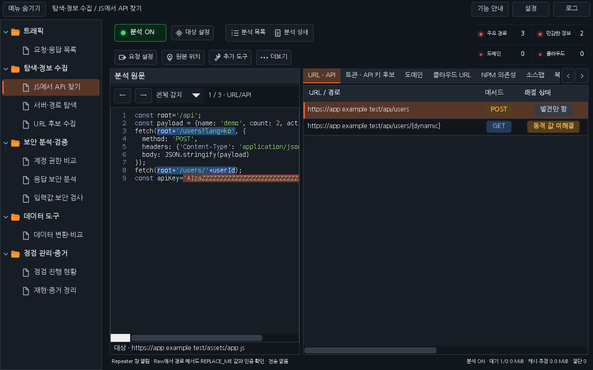

# Workbench 0.36.0 — 레이아웃을 유지한 JS 분석 고도화

JS에서 API 찾기의 기존 두 줄 버튼, 분석 목록/상세 창, 2×2 집계, 원문/결과 분할, 표의 열·폭, 연속 스크롤과 단축키를 유지합니다. 새 버튼이나 탭은 추가하지 않습니다. 검토 근거는 기존 사용 맥락 열과 행 툴팁에 표시하고, 실제 API 패킷은 기존 **추가 도구 → 관찰된 API 패킷 보기**로 엽니다.

## 바뀐 동작

| 항목 | 이전 | 0.36.0 |
|---|---|---|
| API 주소 | JS 파일 출처를 상대 주소의 기준으로 사용 | HTML 자체 URL, 캡처된 Referer, 명시적 Axios baseURL을 구분. JS 실행 페이지가 없으면 호스트 미확정 |
| Axios | axios.get/post 등 직접 호출 중심 | const 인스턴스의 axios.create 기본 설정과 인스턴스 메서드/요청별 재정의 추적 |
| fetch 래퍼 | 호출 옵션만 보고 GET으로 추정할 여지 | 함수 인수·기본 옵션·내부 fetch 메서드/본문·조건부 기본값 추적. 호출 위치별 초안 유지 |
| 큰 JS | 앞 512×1024자·500개 결과, 2MiB 초과 응답 제외 | 백그라운드 구간 분석으로 뒤쪽까지 확인. 생산 분석의 500개 결과 제한 제거. 잘린 문맥·시간 제한은 일부 분석으로 표시 |
| 압축 | gzip·deflate | Brotli, 복합 인코딩 역순 해제, raw deflate 지원. 실패 사유는 분석 목록에 미분석으로 기록 |
| 소스맵 | 복원 API의 위치·풍부한 초안 연결이 끊김 | 복원 파일·줄·열·로컬 오프셋 및 요청 초안 유지. 원본 위치 버튼으로 복원 코드에 이동 |
| 분석 보관 | 24MiB/100개 메모리 캐시 밖 결과 제거 | 프로젝트별 디스크 이력에 전체 원문·가림 메타데이터 보관. 캐시 밖 결과는 선택할 때 백그라운드 복원 |
| 같은 JS의 변경 | 같은 URL 결과 교체 | 내용과 페이지 문맥의 지문으로 변경 버전 분리. 분석 목록에서 이전 버전 선택 |
| 실제 호출 대조 | 활동 상태와 출처 패킷을 별도로 찾아야 함 | 기존 해결 상태 열의 발견/관측/수동 완료를 유지하고 추가 도구에서 수집된 실제 API 패킷을 조회 |
| 검토 순서 | 경로를 사용자가 모두 읽어 분류 | 권한·파일·외부 URL·객체 식별자 이름에 따른 우선 검토 이유를 기존 열/툴팁에 표시. 취약점 확정은 하지 않음 |
| GraphQL | /graphql 한 주소로 확인 | fetch/Axios의 정적 JSON 요청에서 query/mutation/subscription·작업 이름·variables를 구분. 작업별 행과 operationName 초안 |
| 중복 | 호출 위치마다 반복 행 | API와 GraphQL 작업별 통합. 파라미터/본문/헤더 이름의 차이와 각 발견 위치를 툴팁에 보존. 초안은 첫 발견 기준임을 표시 |
| 비 Proxy 응답 | Proxy History 중심 | 기존 SCOPE 수집을 통과한 Repeater 등 비 Proxy 응답도 분석 ON일 때 관찰 |

## 사용하기

1. 이전 Workbench를 해제하고 [0.36.0 JAR](../downloads/extensions/0.36.0/burp-workbench-kr-0.36.0.jar)를 Burp Extensions에 추가합니다.
2. SCOPE와 분석 ON을 확인하고 사이트를 사용합니다. 기존 위치의 분석 목록/상세와 결과 표를 사용합니다.
3. 사용 맥락 열과 행 툴팁에서 검토 이유·발견 파일/위치·입력 이름의 차이를 확인합니다. 해결 상태의 관측/완료와 취약점 확정은 다릅니다.
4. Ctrl+R로 요청 초안을 확인합니다. 호스트가 미확정이면 REPLACE-HOST.invalid를 표시하고 Send를 차단합니다. 실제 호스트·메서드·경로·값을 확인한 뒤 직접 전송합니다. 인증 정보를 자동 복사하지 않습니다.
5. 실제 API 패킷은 행 선택 후 추가 도구 → 관찰된 API 패킷 보기로 확인합니다. 더블클릭/Enter의 기존 발견 출처 패킷 보기는 그대로입니다.
6. 이전 분석이나 JS의 변경 버전도 같은 분석 목록에서 선택합니다. 분석 초기화는 이 프로젝트의 디스크 이력까지 삭제합니다. 확장 해제는 디스크 이력을 보존합니다.

## 보관과 분석 한계

- 원문·패킷 미리보기는 로컬 프로젝트 전용 기록입니다. 원문에는 수집한 민감정보가 포함될 수 있습니다. 별도의 외부 전송은 추가하지 않으며 소유자 전용 권한과 원자적 파일 교체를 사용합니다. 프로젝트에 저장된 무작위 ID로 다른 프로젝트 기록과 구분합니다. 해당 프로젝트가 제공하는 Montoya Persistence가 필요합니다.
- 가림 메타데이터에는 풍부한 요청 초안을 직렬화하지 않습니다. 이력 선택 시 원문을 다시 분석해 메모리에서 초안을 복원합니다. 원문 자체의 상수는 보관 원문에 남습니다.
- 메모리 캐시 24MiB, 대기/실행 스냅샷 예산 16MiB를 유지합니다. 압축 해제 작업은 32MiB, 인코딩 최대 4중을 사용합니다. 수집 원본 전체의 저장 제한과 분석 작업 예산은 구분합니다. 예산을 넘는 입력은 미분석 사유를 표시하며 HTTP history 원본을 사용합니다.
- 원문 기본 미리보기는 512×1024자, 패킷 미리보기는 64KiB입니다. 디스크 원문은 분석한 전체 텍스트이며 뒤쪽 발견 위치를 선택하면 원문을 읽어 이동합니다.
- 분할은 문장 경계를 우선합니다. 큰 단일 함수는 최대 4Mi 문자 구간으로 처리하며 구간 간 변수·런타임 연산·지원 밖 구문은 미확정으로 남을 수 있습니다. 개별 분석의 시간 예산과 기존 소스맵 복원 예산을 유지합니다. JS를 실행하지 않습니다.
- Referer는 실행 문맥의 관찰 근거이며 실제 브라우저 실행이나 HTML base 요소를 완전히 증명하지 않습니다. 런타임 설정·동적 import의 실제 실행 결과·복잡한 래퍼·직렬화는 Raw와 실제 트래픽으로 확인합니다.
- GraphQL 분석은 확인된 정적 JSON 요청 문서를 대상으로 합니다. Apollo 등의 런타임 클라이언트 전체를 실행하거나 자동 introspection하지 않습니다.
- 중복 통합 행에는 모든 발견 위치와 입력 이름 차이가 남습니다. 다른 위치의 값까지 하나의 요청으로 임의 합치지 않습니다. 필요한 변형은 원문/실제 패킷을 보고 편집합니다.
- 디스크 공간·권한 오류는 처리 실패로 기록하며 저장에 실패한 결과의 영구 보존을 보장하지 않습니다. 실제 패킷 연결은 현재 수집 목록 안의 같은 메서드·URL의 최신 요청을 사용하고, 조회는 백그라운드에서 수행합니다.

## 검증

정식 release 2,392개(58그룹 Java 1,893개·페이로드 HTTP 132개·전체 기능 HTTP 101개·모의 진단 266개), 별도 Mapper Java 94개·Node 7개, 운영 화면 258개와 패키징 4개 검사를 통과했습니다. 이전 0.35.1과 비교한 512개 조작 요소·96개 본문 영역의 위치·크기가 일치합니다.

실행한 검사·화면 배치 비교와 미실행 범위는 [0.36.0 검증 기록](VERIFICATION_0.36.0.json)에 기록합니다. 과거 통과 수를 이번 결과로 합산하지 않습니다. 합성 Montoya 호스트·격리된 loopback 서버·운영 Swing 렌더링이며 실제 Burp GUI, 운영체제 DPI 및 사용자 브라우저 실행은 별도 범위입니다.

[소스 ZIP](../downloads/extensions/0.36.0/burp-workbench-kr-0.36.0-source.zip) · [다운로드](../downloads/README.md) · [작업 대화](chat-logs/2026-10-17/workbench-js-intelligence-0360.md)
