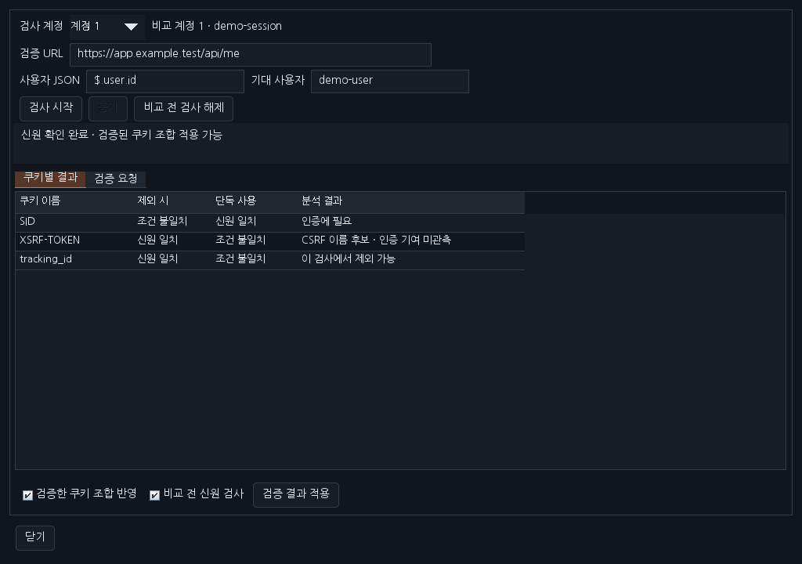
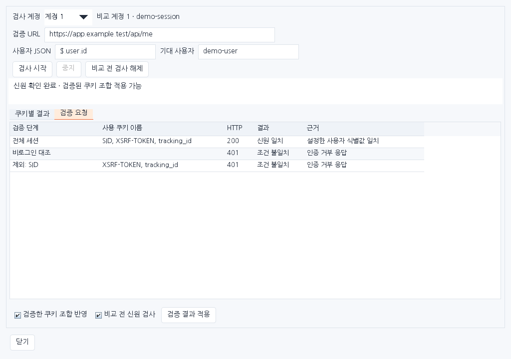

# Workbench 0.37.0 — 쿠키 식별과 세션 신원 검사

최신 main 0.36.0의 JS 분석·Brotli·디스크 이력·GraphQL 개선을 유지한 추가 기능입니다. [0.36.0 안내](RELEASE_0.36.0_KR.md)와 기존 배포 파일을 보존합니다.

계정 권한 비교에서 Cookie 헤더 전체를 사용하던 방식에 쿠키별 실험과 사용자 신원 확인을 추가했습니다. 인증 쿠키 이름을 사람이 미리 알지 못해도 지정한 사용자 확인 API에서 실제 동작을 비교할 수 있습니다.

## 사용 순서

1. 정상 로그인 요청의 인증 후보를 우클릭해 비교 계정 1/2/3에 지정하고 **세션 검사**를 엽니다.
2. 검사 계정을 고르고 같은 Origin/SCOPE에 있는 사용자 확인 **GET URL**을 입력합니다. 예: `https://app.example.test/api/me`.
3. 사용자 JSON 경로와 기대 사용자 값을 입력합니다. 응답이 `{"user":{"id":"alice"}}`라면 경로는 `$.user.id`, 기대 값은 `alice`입니다. 사용자 식별값이 일치해야 신원이 확인됩니다.
4. **검사 시작**으로 전체 세션·비로그인 대조, 쿠키만 사용, 각 쿠키 제외·단독 사용과 순차 조합 축소 결과를 확인합니다. **검증 요청** 탭은 각 단계의 쿠키 이름·상태·판정 근거를 보여 줍니다.
5. 결과가 완전하고 신원이 확인됐을 때 **검증 결과 적용**을 누릅니다. **검증한 쿠키 조합 반영**은 해당 슬롯의 쿠키만 줄이며 다른 인증 헤더는 유지합니다. **비교 전 신원 검사**를 켜면 다음 비교부터 최대 두 번의 사용자 확인/비로그인 GET을 먼저 보냅니다. 실패한 계정의 비교 대상 요청은 보내지 않습니다.

계정과 쿠키를 다른 슬롯에 자동 전파하지 않습니다. 계정 재지정·해제 시 검증 설정도 해제되며 검사 창에서 비교 전 검사만 해제할 수도 있습니다. 갱신 설정을 사용한다면 갱신된 자격정보로 신원을 확인합니다. 자동 비교 ON에도 계정별 신원 검사가 적용됩니다.

## 결과를 읽는 방법

| 표시 | 확인한 동작 |
|---|---|
| 인증에 필요 | 해당 쿠키를 빼면 신원 조건 불일치, 단독 사용은 신원 일치 |
| 조합에 필요 | 빼면 조건 불일치하며 단독으로도 확인되지 않음 |
| 단독으로도 유효 | 다른 쿠키 없이도 설정한 사용자의 신원 일치 |
| 이 검사에서 제외 가능 | 이 확인 API에서는 제외해도 신원이 일치함 |
| CSRF 이름 후보 | 이름에 CSRF/XSRF가 포함되고 인증 기여가 관측되지 않은 후보 |
| 쿠키 없이도 신원 확인 | Bearer 등 다른 인증 헤더로도 신원이 확인됨 |
| 판정 보류 | 응답 형식·상태가 불명확하거나 중간 결과가 구분되지 않음 |

하나의 GET 확인 API에서 제외 가능했다는 이유로 추적용·불필요한 쿠키라고 단정하지 않습니다. CSRF 보호와 상태 변경 기능은 이 실험으로 검증하지 않습니다. 축소 조합은 실제 신원을 다시 확인한 충분한 조합이며 모든 가능한 조합 중 전역 최소라는 뜻은 아닙니다.

## 실행 범위와 보관

사용자의 검사 시작·비교 실행에 따라 같은 Origin/SCOPE의 지정 GET URL만 요청합니다. 검사는 쿠키 32개·총 요청 128개 이내, 직렬 실행·응답 타임아웃 10초이며 자동 리다이렉트·공유 쿠키 저장소·재시도를 사용하지 않습니다. 검사 중에도 SCOPE와 실제 전송 대상/인증을 확인합니다. 설정과 결과는 메모리에만 두며 보고서에는 쿠키 이름과 판정만 남기고 쿠키 값·응답 사용자 값은 넣지 않습니다.

중복 쿠키 이름은 경로별 쿠키를 구분할 수 없어 재수집이 필요합니다. 128 KiB 초과 응답·HTML 로그인 페이지·리다이렉트·같은 사용자 정보를 돌려주는 공개 API는 적용을 보류합니다. Set-Cookie로 기존 쿠키 값이 바뀌면 상태가 섞이지 않도록 중단하며 새 쿠키로 다시 검사합니다. 런타임 인증·서버의 부수 효과·다른 API의 권한까지 보장하는 기능은 아닙니다.

## 설치·확인한 화면

이전 Workbench를 해제한 뒤 [0.37.0 JAR](../downloads/extensions/0.37.0/burp-workbench-kr-0.37.0.jar)를 Burp **Extensions → Add → Java**에서 로드합니다. [소스 ZIP](../downloads/extensions/0.37.0/burp-workbench-kr-0.37.0-source.zip)도 제공합니다.

다음 화면은 배포 JAR의 실제 Swing 구성 요소와 합성 계정·결과로 렌더링한 미리보기이며 실제 Burp GUI 캡처는 아닙니다.

로컬 정식 release 2,442개(쿠키·세션 50개 포함), 운영 화면 266개와 패키징 4개를 통과했습니다. 실행한 검사 수와 HTTP·화면 범위는 [검증 기록](VERIFICATION_0.37.0.json)을 참고하세요. 실제 Burp GUI·OS DPI·IME는 별도 확인 범위입니다.

[다운로드](../downloads/README.md) · [작업 대화](chat-logs/2026-10-17/workbench-cookie-session-0370.md)
