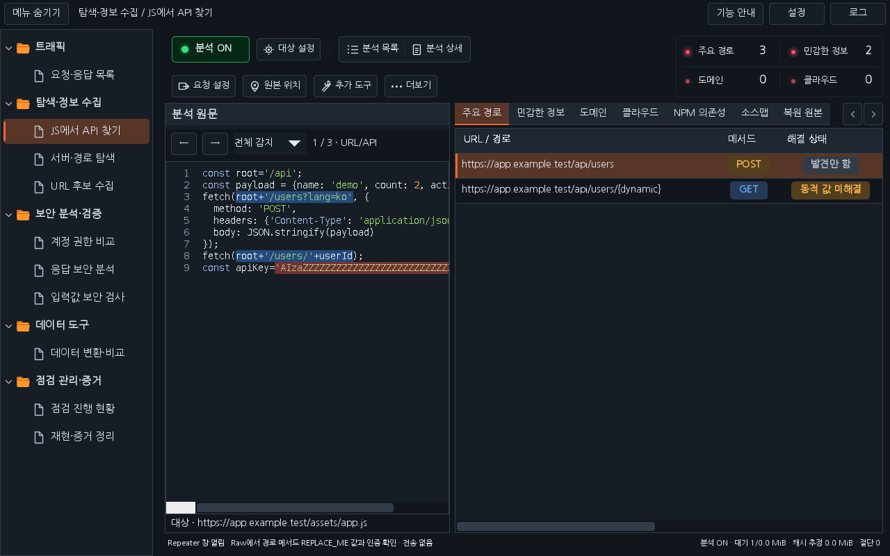
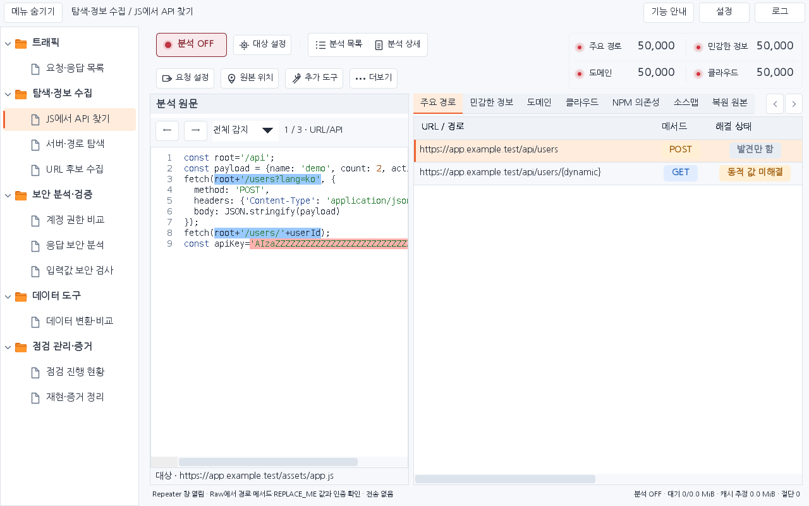

# Workbench 0.37.1 — JS 분석 가독성과 명칭 정리

승인된 시안을 **JS에서 API 찾기**의 실제 Swing 화면에 반영했습니다. 전체 집계의 글자·숫자·여백을 조금 키우고, 집계와 결과 탭의 이름을 맞췄습니다.

| 항목 | 이전 | 0.37.1 |
|---|---|---|
| 집계 이름 | 11px | 13px |
| 집계 숫자 | 13px 굵게 | 16px 굵게 |
| 집계 한 칸 | 최소 116px × 34px | 최소 140px × 40px, 큰 숫자에 따라 확장 |
| 경로 결과 탭 | URL · API | 주요 경로 |
| 민감 정보 결과 탭 | 토큰 · API 키 후보 | 민감한 정보 |
| 클라우드 결과 탭 | 클라우드 URL | 클라우드 |

집계는 **주요 경로 / 민감한 정보**, **도메인 / 클라우드**의 2×2 빨간 표시등 배열과 옅은 테두리를 사용합니다. 긴 원래 명칭은 툴팁에 남겨 의미를 확인할 수 있습니다. 분석 목록의 개수 열과 분석 상세의 관련 요약 카드·탭에도 같은 명칭을 적용했습니다. 민감한 정보는 토큰·API 키 후보이며 유효성이 확인된 비밀이라는 뜻은 아닙니다.

전체 보관 분석의 중복 제외 계산, 분석 ON/OFF, 패킷·원문 위치 이동, Ctrl+R·Ctrl+Space와 요청 편집 동작은 유지합니다. 좁은 창에서는 기존 결과 탭 화살표로 뒤의 탭에 접근할 수 있습니다. [0.37.0 쿠키·세션 검사](RELEASE_0.37.0_KR.md)와 실습 사이트 3.6.0을 함께 사용할 수 있습니다.

## 설치와 화면

이전 Workbench를 해제한 뒤 [0.37.1 JAR](../downloads/extensions/0.37.1/burp-workbench-kr-0.37.1.jar)를 Burp **Extensions → Add → Java**에서 로드합니다. [소스 ZIP](../downloads/extensions/0.37.1/burp-workbench-kr-0.37.1-source.zip)과 해당 폴더의 SHA256SUMS도 제공합니다. 기존 버전은 보존합니다.

아래는 배포 JAR의 실제 Swing 구성 요소를 합성 데이터로 렌더링한 화면입니다. 실제 Burp GUI 캡처와 구분합니다.

작은 화면(1024×720), 두 테마, 각 집계 50,000과 분석 상세 창을 포함해 검사했습니다. 실행 결과·정확한 검사 수·환경 한계는 [0.37.1 검증 기록](VERIFICATION_0.37.1.json)을 기준으로 확인합니다. 실제 Burp GUI·OS DPI·IME 확인은 별도 범위입니다.

[다운로드](../downloads/README.md) · [이번 작업 대화](chat-logs/2026-10-17/workbench-js-readable-0371.md)
