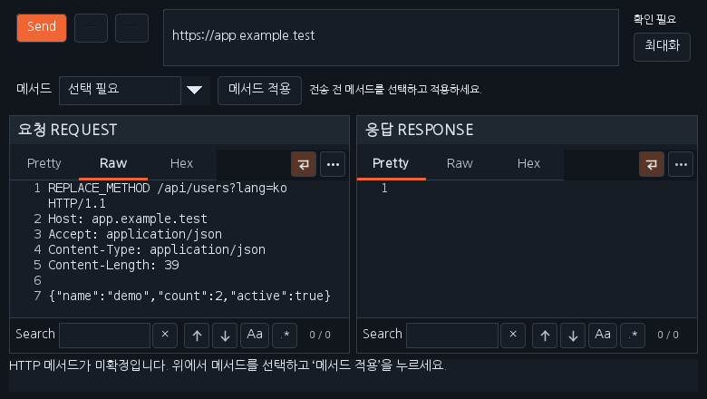
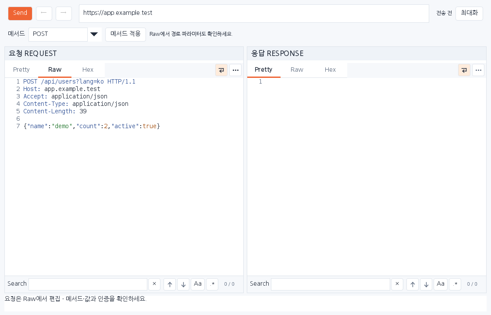

# Workbench 0.37.2 — Repeater 전송 확인·단축키·최대화

첨부한 Repeater 화면은 첫 줄의 `REPLACE_METHOD` 때문에 **HTTP 요청을 전송하기 전에 차단된 상태**였습니다. 실제 메서드가 정해지지 않은 요청에는 서버 응답이 생기지 않습니다. 이전에는 작은 하단 문구만 표시해 Send나 단축키가 동작하지 않는 것처럼 보일 수 있었습니다.

## 전송하는 순서

1. Repeater 위쪽 **메서드**에서 원본 HTTP history 등으로 확인한 GET·POST 등의 메서드를 선택하고 **메서드 적용**을 누릅니다. 직접 메서드를 입력할 수도 있습니다. 적용만으로 요청을 전송하지 않습니다.
2. Raw에서 실제 경로·쿼리·본문·인증을 확인합니다. `REPLACE_ME`, `REPLACE_PATH` 등 남은 미확정 값은 직접 수정합니다. Origin과 실제 요청 URL은 SCOPE에 들어 있어야 합니다.
3. **Send** 또는 **Ctrl+Space**로 전송합니다. 정상 응답은 오른쪽 창과 상태 코드·소요 시간·수신 크기로 확인합니다. 전송 전 차단과 네트워크 오류는 줄바꿈되는 하단 메시지로 구분합니다.

메서드를 GET으로 자동 추정하거나 미확정 값·SCOPE 검사를 우회하지 않습니다. 메서드 적용은 요청의 경로·헤더·본문을 보존하고 Raw를 열어 변경을 확인할 수 있게 합니다. 요청을 수정하면 이전 응답을 비우며 전송한 요청과 응답의 이력 연결은 유지합니다.

## Ctrl+Space와 창 크기

Repeater 내부에 포커스가 있을 때만 Send를 호출하는 키 이벤트 처리를 추가했습니다. 메서드 입력창·요청·응답·검색·버튼 등에서 같은 전송 검사를 사용합니다. 키를 누르고 있는 동안 반복 전송하지 않으며 일반 공백 입력이나 다른 Repeater 창에는 영향을 주지 않습니다. 창이 보이지 않을 때는 동작하지 않으며 닫히면 이벤트 등록을 해제합니다.

오른쪽 위 **최대화**는 현재 모니터의 작업 표시줄을 제외한 영역에 창을 맞춥니다. **이전 크기**로 원래 위치와 크기를 복원합니다. 기존 모달리스 창과 요청·응답 편집 상태를 그대로 사용합니다.

## 설치·확인한 화면

이전 Workbench를 해제하고 [0.37.2 JAR](../downloads/extensions/0.37.2/burp-workbench-kr-0.37.2.jar)를 Burp **Extensions → Add → Java**에서 추가합니다. [소스 ZIP](../downloads/extensions/0.37.2/burp-workbench-kr-0.37.2-source.zip)과 같은 폴더의 SHA256SUMS도 제공합니다. 기존 배포는 보존합니다.

아래는 실제 운영 Swing 구성 요소를 합성 데이터로 렌더링한 화면입니다. 실제 Burp GUI나 사용자 첨부 대상에 접속한 결과가 아닙니다.

격리된 loopback 서버를 사용한 요청·응답과 합성 키 이벤트, 최대화·복원 경계 어댑터를 포함한 Repeater 회귀를 실행했습니다. 전체 실행 수와 재실행 기록은 [검증 기록](VERIFICATION_0.37.2.json)을 확인하세요. 실제 Burp 네이티브 API·물리 키 입력·Windows IME·OS 창 동작은 별도 확인 범위입니다.

[다운로드](../downloads/README.md) · [가독성 개선 0.37.1](RELEASE_0.37.1_KR.md) · [이번 작업 대화](chat-logs/2026-10-17/workbench-repeater-0372.md)
