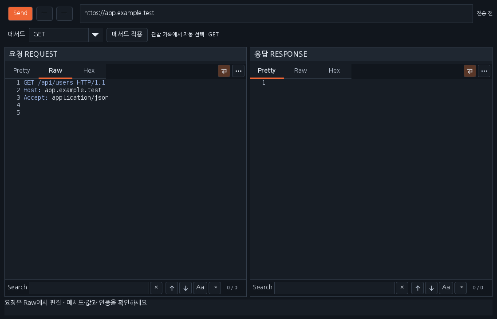
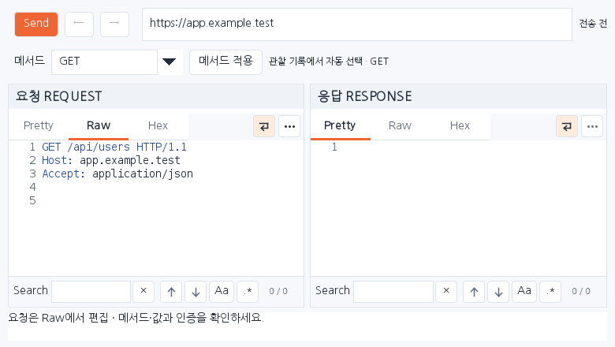

# Workbench 0.37.3 — 메서드 자동 선택·제목 표시줄 창 버튼

Repeater에 보낼 때 확인 가능한 메서드를 자동 선택하도록 보완했습니다. 본문의 **최대화 / 이전 크기** 버튼은 삭제하고, 오른쪽 위 제목 표시줄에서 운영체제의 기본 **□ 최대화·복원 / X 닫기**를 사용하는 표준 창으로 변경했습니다.

## 메서드 선택 기준

| 근거 | 동작 |
|---|---|
| JS의 fetch·axios 등에서 확인한 메서드 또는 이미 확정한 초안 | 해당 메서드를 우선 선택 |
| 미확정 초안이며 같은 Origin·경로의 실제 관찰 메서드가 하나 | 해당 메서드를 자동 선택하고 근거 표시 |
| GET·POST 등 여러 메서드가 관찰됨 | 충돌을 표시하고 수동 선택 유지 |
| 관찰 기록이 없거나 URL 발견 기록만 존재 | 수동 선택 유지 |
| 관찰 메타데이터가 한도를 넘겨 불완전함 | 관찰 기반 자동 선택 보류 |

단일 관찰 메서드는 현재 **점검 진행 현황의 활동 추적**에 보관된 실제 요청 기록에서 구합니다. Origin·포트·경로를 구분하고 쿼리 값은 비교 키와 자동 선택 결과에 복사하지 않습니다. 활동 추적이 OFF이면 새 관찰 근거는 추가되지 않으며 보관된 관찰 기록은 사용할 수 있습니다. 기록이 없으면 기존 JS 분석 근거와 수동 선택을 사용합니다. 창을 열 때 근거를 조회하므로 새 관찰 기록은 다시 열 때 반영합니다. 기록을 초기화하면 자동 선택 근거도 없어집니다. 기존 10,000개 메타데이터 한도를 유지하며 선택 항목을 한 번에 조회합니다.

알 수 없는 모든 메서드를 GET으로 가정하지 않습니다. 원본에서 확인한 POST를 관찰 GET으로 바꾸지 않으며, 미확정 경로·값·인증과 SCOPE 검증은 계속 적용합니다. 메서드 자동 선택을 위해 추가 HTTP 요청이나 JS 실행을 하지 않습니다. 관찰 요청의 인증 헤더·쿠키·본문·쿼리 값도 복사하지 않습니다.

## 사용 순서

1. 필요한 트래픽을 관찰한 뒤 JS 결과를 선택해 Repeater를 엽니다. 메서드와 옆의 선택 근거를 확인합니다.
2. 자동 선택됐다면 별도 **메서드 적용** 없이 Raw의 경로·값·인증을 확인하고 **Send / Ctrl+Space**로 전송합니다.
3. 근거가 없거나 충돌하면 메서드를 직접 선택하고 **메서드 적용**을 누릅니다. 남아 있는 REPLACE_ME·REPLACE_PATH 값은 Raw에서 수정합니다.
4. 창 크기는 제목 표시줄의 **□**로 최대화·복원하고 **X**로 닫습니다. 닫기와 확장 종료 시 세션·전송 작업자·단축키 등록을 정리합니다.

## 배포·검증

이전 확장을 해제한 뒤 [0.37.3 JAR](../downloads/extensions/0.37.3/burp-workbench-kr-0.37.3.jar)를 추가합니다. [소스 ZIP](../downloads/extensions/0.37.3/burp-workbench-kr-0.37.3-source.zip)과 SHA256SUMS를 제공합니다. 기존 배포는 보존합니다.

다음은 운영 Swing 구성 요소의 합성 데이터 미리보기입니다. 본문 버튼 제거와 자동 선택 근거를 보여 주며 **운영체제 제목 표시줄을 그린 그림이 아닙니다**. 제목 표시줄은 실제 실행 환경의 기본 창 장식이 표시합니다.

실행한 검사 수·환경·재실행 여부는 [검증 기록](VERIFICATION_0.37.3.json)과 이번 PR Checks에서 확인합니다. 별도 Windows headful 검사는 자체 Swing 프레임을 사용하며 실제 Burp GUI·Windows IME 물리 키 입력 검사와 구분합니다.

[다운로드](../downloads/README.md) · [전송·단축키 사용법 0.37.2](RELEASE_0.37.2_KR.md) · [작업 대화](chat-logs/2026-10-17/workbench-method-auto-0373.md)
