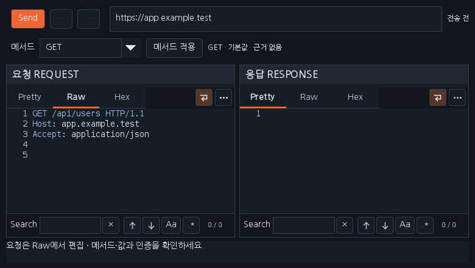
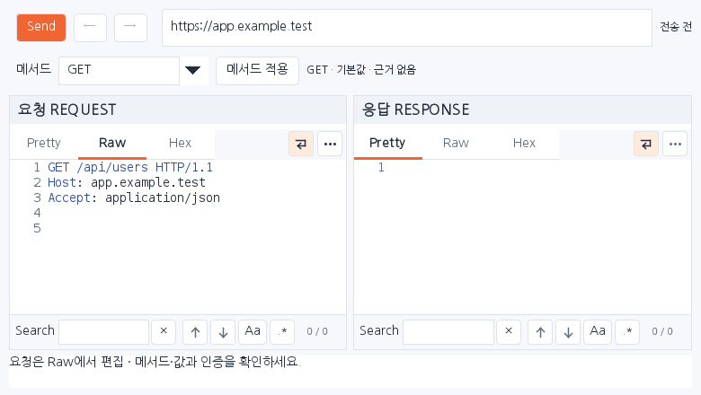

# Workbench 0.37.4 — 미확정 메서드 기본 GET

JS 결과를 Repeater로 보낼 때 메서드가 미확정이면 **GET을 기본값**으로 준비합니다. 0.37.3에서는 관찰 근거가 없거나 충돌하면 `REPLACE_METHOD`를 직접 수정해야 했습니다. 이제 아래 순서로 선택하며 별도 메서드 적용 없이 요청을 편집·전송할 수 있습니다.

| 우선순위 | 근거 | 선택 |
|---|---|---|
| 1 | JS 분석에서 확인한 메서드 또는 확정한 초안 | 해당 메서드 |
| 2 | 미확정 초안이며 같은 Origin·경로의 관찰 메서드가 하나 | 관찰 메서드 |
| 3 | 근거 없음·관찰 충돌·불완전한 관찰 기록 | GET · 기본값 |

`GET · 기본값 · 근거 없음` 또는 `GET · 기본값 · 관찰 충돌`로 분석·관찰 근거와 구분합니다. 기본값은 서버가 실제 GET을 지원한다는 확인 결과가 아닙니다. POST·PUT·PATCH 등으로 직접 바꾸고 **메서드 적용**을 누를 수 있으며, 직접 바꾼 요청은 이후 분석으로 덮어쓰지 않습니다. 새 JS 분석 결과는 해당 결과에서 Repeater를 다시 열 때 적용합니다.

자동 선택은 추가 HTTP 요청이나 JS 실행을 하지 않으며, 창을 여는 동작만으로 전송하지 않습니다. 실제 전송은 **Send / Ctrl+Space**입니다. 미확정 경로·파라미터·인증과 SCOPE 검사는 유지합니다. 기본 GET으로 바꿔도 기존 URL·본문·Content-Type을 보존하며, 남아 있는 `REPLACE_ME`·`REPLACE_PATH` 등은 실제 값으로 수정해야 전송됩니다.

제목 표시줄의 **□ 최대화·복원 / X 닫기**는 0.37.3 동작을 유지합니다.

아래는 합성 데이터를 넣은 운영 Swing 화면입니다. 실제 Burp나 운영체제 제목 표시줄을 캡처한 화면은 아닙니다.

이전 Workbench를 해제한 뒤 [0.37.4 JAR](../downloads/extensions/0.37.4/burp-workbench-kr-0.37.4.jar)를 로드하세요. [소스 ZIP](../downloads/extensions/0.37.4/burp-workbench-kr-0.37.4-source.zip), SHA256SUMS와 기존 배포를 제공합니다.

[실제 검증 기록](VERIFICATION_0.37.4.json) · [날짜별 대화](chat-logs/2026-10-17/workbench-default-get-0374.md) · [다운로드](../downloads/README.md)
