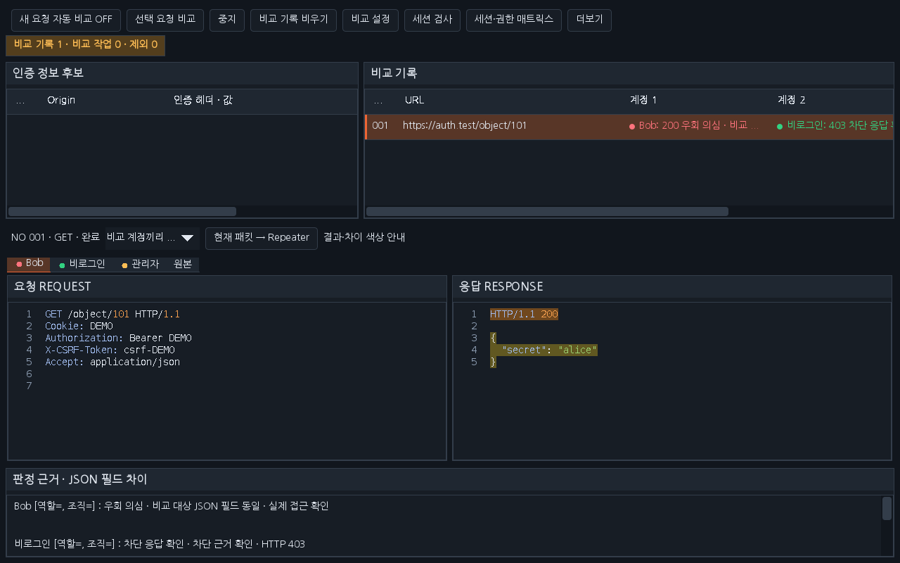
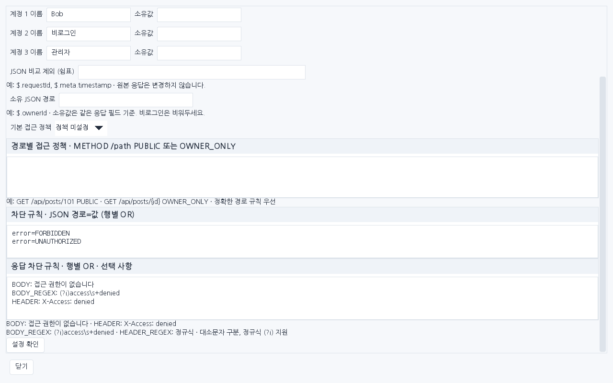

# Workbench 0.38.0 — 계정 비교 응답 판정과 색상

인증 후보를 계정 1/2/3에 지정하고 **선택 요청 비교**를 실행합니다. 세션 검사와 사용자 확인 API는 선택 사항입니다. 기존 화면 구성·표 열·패킷 탭·연속 스크롤을 유지합니다.

## 결과 읽기

| 색상 | 분류 | 의미 |
|---|---|---|
| 빨강 | 우회 의심 | 다른 인증으로 동일한 성공 본문 또는 비교 대상 JSON 필드가 반환됨. 기대 DENY인데 성공한 경우 등도 후보로 표시 |
| 초록 | 차단 응답 확인 | 401/403 또는 명시한 JSON·문자열·정규식 차단 규칙에 일치 |
| 노랑 | 확인 필요 | 본문 차이·리다이렉트·404/410·서버 오류·정책 충돌·정규식 제한 등 |
| 회색 | 비교 미성립 | 동일 인증·실제 전송 인증/대상 변경·신원 검사 실패·응답 없음·미전송 등 |

색상은 취약점 확정이나 서버 내부의 토큰 검증 보장이 아닙니다. 응답이 다른 경우에도 보호된 데이터가 노출될 수 있고 공개 응답이 같은 것은 정상일 수 있습니다. HTTP 200만 보고 초록으로 표시하지 않습니다. 계정 결과 셀과 패킷 탭의 점 색상을 함께 사용하고, 선택한 기록의 **판정 근거 · JSON 필드 차이**에서 분류와 이유를 확인합니다. 정렬한 기록에서도 각 행의 실제 결과를 표시합니다.

## 사이트별 차단 규칙

**비교 설정 → 응답 차단 규칙**에 한 줄씩 입력합니다. 빈 값이면 기존 상태·본문·JSON 비교만 수행합니다.

```text
BODY: 접근 권한이 없습니다
BODY_REGEX: (?i)access\s+denied
HEADER: X-Access: denied
HEADER_REGEX: (?i)x-error:\s*forbidden
```

행들은 OR입니다. 문자열은 대소문자를 구분하며 정규식은 `(?i)`로 무시할 수 있습니다. 정규식은 여러 줄에 대해 검사합니다. 규칙은 최대 16개, 각 값 512자, 전체 8KiB입니다. 본문 128KiB·헤더 64KiB 범위와 정규식 실행 예산을 적용하며 제한에 걸리면 확인 필요로 표시합니다. 규칙 값이나 응답 데이터를 판정 설명에 복사하지 않고 일치한 규칙 번호와 위치를 표시합니다.

원본부터 차단 문구가 있으면 기준이 잘못됐을 수 있어 판정을 보류합니다. 리다이렉트·404/410·서버 오류는 문구 일치만으로 정상 차단으로 바꾸지 않습니다. JSON 차단 규칙은 계속 사용할 수 있습니다. 동일 경로에 `error=FORBIDDEN`, `error=UNAUTHORIZED`를 여러 줄로 지정해도 마지막 값으로 덮어쓰지 않고 OR로 검사합니다. JSON 차단 기준 응답은 대상 상태 코드보다 먼저 검사하며 기대 권한 매트릭스로 덮어쓰지 않습니다. 기대 ALLOW인데 새 규칙에 차단된 경우에는 정책·세션 재검토를 표시합니다. 새 규칙의 결정·검사 제한은 기대 권한 매트릭스로 덮어쓰지 않습니다. 대용량 해시 모드에서 새 규칙 검사가 불가능하면 수동 확인으로 남깁니다.

규칙은 실행 시작 시 고정하며 이후 수정은 다음 비교부터 반영합니다. 규칙 추가 자체는 HTTP 요청을 보내지 않습니다. 인증값은 Cookie뿐 아니라 설정된 Authorization 등과 CSRF 보조 헤더도 계정별로 교체합니다. 쓰기 재전송은 기존 명시적 허용 옵션을 유지합니다.

## 설치와 검증

이전 확장을 해제하고 [0.38.0 JAR](../downloads/extensions/0.38.0/burp-workbench-kr-0.38.0.jar)를 로드하세요. [소스 ZIP](../downloads/extensions/0.38.0/burp-workbench-kr-0.38.0-source.zip)과 SHA256SUMS를 제공합니다. 이전 배포·실습 사이트·별도 Mapper는 보존합니다.

[이번 실행 검증](VERIFICATION_0.38.0.json)을 확인하세요. API 어댑터·합성 Swing과 실제 Burp GUI는 구분합니다. 이번 작업에서 사용자의 Burp·브라우저 설정을 변경하거나 외부 진단 대상에 요청하지 않습니다.

## 화면 예시

배포 JAR의 운영 Swing 구성 요소에 합성 패킷을 넣은 렌더링입니다. 실제 Burp GUI 캡처는 아닙니다. 설정은 기존 스크롤 창에서 아래로 내려 입력합니다.




