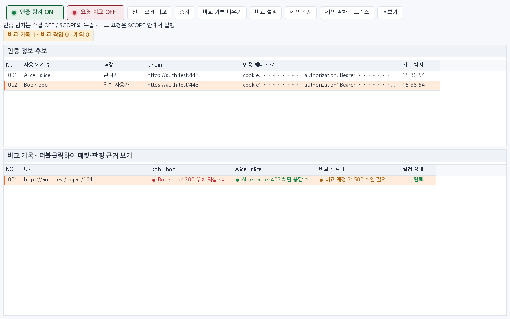
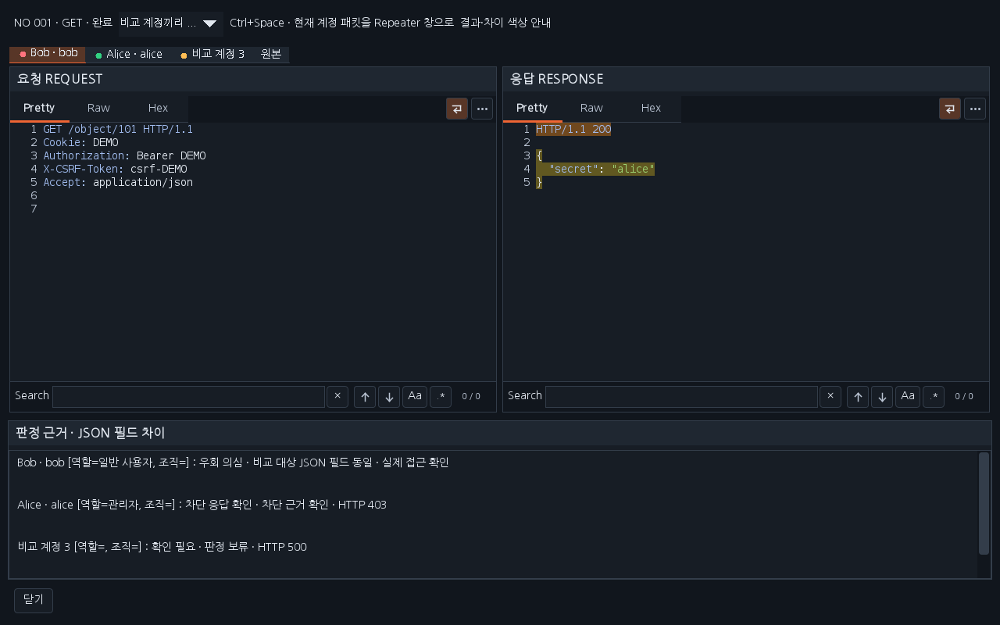
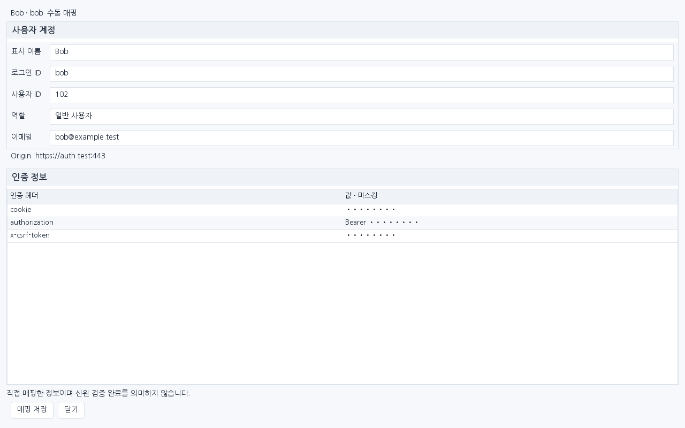

# Workbench 0.39.0 — 계정 권한 비교 화면과 단축키

**인증 탐지 ON/OFF**와 **요청 비교 ON/OFF**를 따로 제어합니다. 인증 탐지는 요청·응답 목록의 OFF/SCOPE와 관계없이 켤 수 있습니다. 시작 상태는 둘 다 OFF이며, 실제 계정 비교 재전송은 기존 SCOPE 조건과 쓰기 요청 허용 설정을 따릅니다. 확장 프로그램의 재전송은 인증 후보로 다시 수집하지 않습니다.

인증 후보를 더블클릭하면 사용자 계정 카드와 인증 헤더 표를 엽니다. 표시 이름·로그인 ID·사용자 ID·역할·이메일을 입력하고 **매핑 저장**을 누릅니다. 입력한 계정은 후보 목록, 비교 기록 열·결과 셀, 상세 패킷 탭에 표시됩니다. 이 정보는 사용자가 매핑한 메타데이터입니다. 선택 사항인 세션 검사와 신원 검증 결과는 별도로 유지합니다. 목록과 후보 상세의 인증값은 마스킹합니다.

메인 화면에는 인증 후보와 비교 기록을 위아래로 배치했습니다. 비교 기록을 더블클릭하면 별도 창에서 계정별 요청·응답과 판정 근거를 확인합니다. 패킷에는 Pretty·Raw·Hex와 Search를 제공합니다. 빨강·초록·노랑·회색 응답 분류와 차단 규칙은 0.38.0 동작을 유지합니다.

비교 상세의 **현재 패킷 → Repeater 버튼을 제거**했습니다. 상세 창에서 계정 탭을 선택하고 **Ctrl + Space**를 누르면 해당 계정의 요청·응답이 Workbench의 별도 Repeater 창으로 열립니다. 원본 탭에서는 원본 패킷이 열립니다. 창 열기는 HTTP를 보내지 않습니다. Repeater에서 키를 놓은 뒤 Send 또는 Ctrl + Space를 눌러 전송합니다. 창을 여는 단축키를 계속 누르고 있어도 자동 전송하지 않습니다.

매핑은 현재 실행 중 메모리에 보관합니다. 인증 후보 비우기와 확장 해제 시 삭제합니다. 과거 비교 기록의 계정명은 실행 당시 이름으로 고정하여 이후 매핑 변경으로 바뀌지 않습니다. 새로운 인증 후보가 들어오면 이전 후보의 계정 정보를 자동으로 이어붙이지 않습니다.

## 설치

이전 확장을 해제한 뒤 [0.39.0 JAR](../downloads/extensions/0.39.0/burp-workbench-kr-0.39.0.jar)를 로드합니다. [전체 소스·의존성 ZIP](../downloads/extensions/0.39.0/burp-workbench-kr-0.39.0-source.zip)과 SHA256SUMS를 함께 제공합니다.

## 화면과 검증

아래는 운영 Swing 구성 요소에 합성 데이터를 넣은 렌더링입니다. 실제 Burp GUI 캡처와 구분합니다. [실행한 검증](VERIFICATION_0.39.0.json)을 확인하세요.

이번 실행: 정식 release 2,532개(Java 2,032·payload HTTP 132·전체 기능 HTTP 102·모의 진단 HTTP 266), 별도 Mapper Java 94 및 브라우저 도우미 회귀, 패키징 회귀 4개, 두 테마·두 해상도 Swing 화면 20개·컨트롤 320개, 다운로드 해시·소스 지문 검증을 통과했습니다. 실제 Burp GUI·Windows DPI/IME 검증은 미수행입니다.
