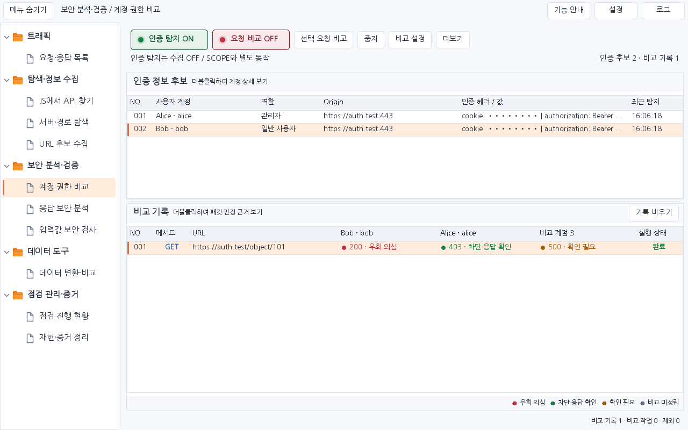
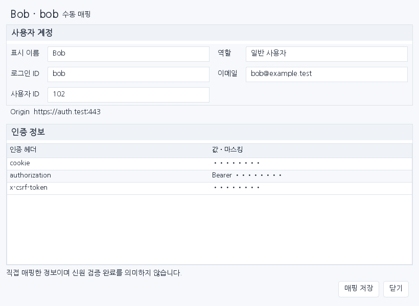
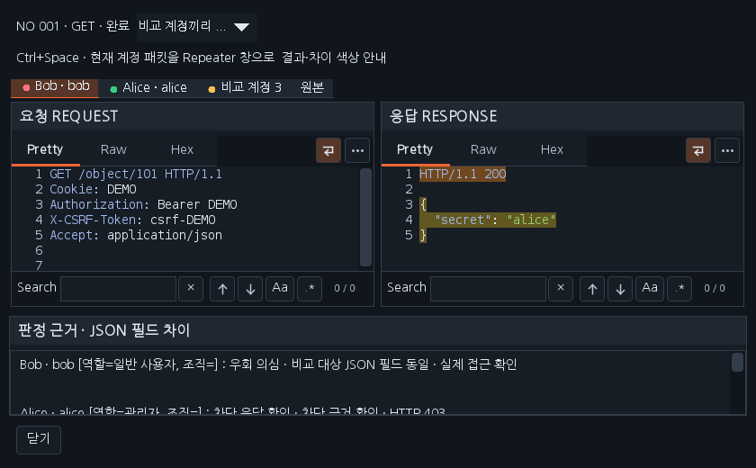

# Workbench 0.39.1 — 계정 비교 레이아웃 보정

사용자가 제공한 실제 화면과 승인 시안을 비교해 버튼 위치·표 너비·상세 창의 입력 배치를 수정했습니다. 0.39.0에서 표가 고정 너비여서 남던 오른쪽 빈 영역을 없애고, 화면을 줄이면 읽을 수 있는 최소 열 너비를 유지하면서 가로 스크롤합니다.

- 상단은 인증 탐지, 요청 비교, 선택 요청 비교, 중지, 비교 설정, 더보기의 6개 주요 버튼입니다. 세션 검사·권한 매트릭스는 더보기로 이동합니다.
- 기록 비우기는 비교 기록 제목 오른쪽에 배치합니다. 표 아래에는 결과 색상 범례, 상단 오른쪽에는 실제 인증 후보·비교 기록 개수를 표시합니다.
- 비교 기록은 NO / 메서드 / URL / 매핑된 계정 3개 / 실행 상태 순서입니다. 결과 셀은 상태 코드와 짧은 판정을 표시하고 전체 계정명·근거는 툴팁과 상세 창에서 확인합니다.
- 인증 후보와 비교 기록의 표는 가용 너비를 채웁니다. 데이터가 없으면 다음 사용 방법을 안내하며 시안의 예시 데이터를 실제 후보로 추가하지 않습니다.
- 사용자 계정 상세는 두 열 입력 폼과 오른쪽 정렬 저장·닫기 버튼을 제공합니다. 기본 크기는 820×600, 최소 700×520입니다. 비교 상세는 기본 1180×780, 최소 840×520이며 안내 행을 나누어 버튼과 겹치지 않게 했습니다.

더블클릭 상세, Ctrl+Space로 현재 계정 패킷의 별도 Repeater 열기, 독립 인증 탐지, 계정별 실제 재전송과 판정 조건은 유지합니다. 후보의 인증값 마스킹도 유지합니다.

[0.39.1 JAR](../downloads/extensions/0.39.1/burp-workbench-kr-0.39.1.jar) · [전체 소스 ZIP](../downloads/extensions/0.39.1/burp-workbench-kr-0.39.1-source.zip) · [검증 기록](VERIFICATION_0.39.1.json)

아래는 합성 데이터를 넣은 실제 Swing 구성 요소의 렌더링이며 네이티브 Burp 캡처는 아닙니다. 사이드 메뉴가 열린 전체 화면, 초기 빈 화면, 상세 창의 기본·최소 크기를 함께 검증합니다.

이번 검증: 정식 release 2,630개(Java 2,130·payload HTTP 132·전체 기능 HTTP 102·모의 진단 HTTP 266), 신규 레이아웃 회귀 98개, 별도 Mapper Java 94 및 브라우저 도우미 회귀, 패키징 회귀 4개, Swing 화면 54개·컨트롤 786개·제목 372개와 다운로드 해시·소스 지문 검증을 통과했습니다. 실제 Burp GUI·Windows DPI/IME 검증은 미수행입니다.
