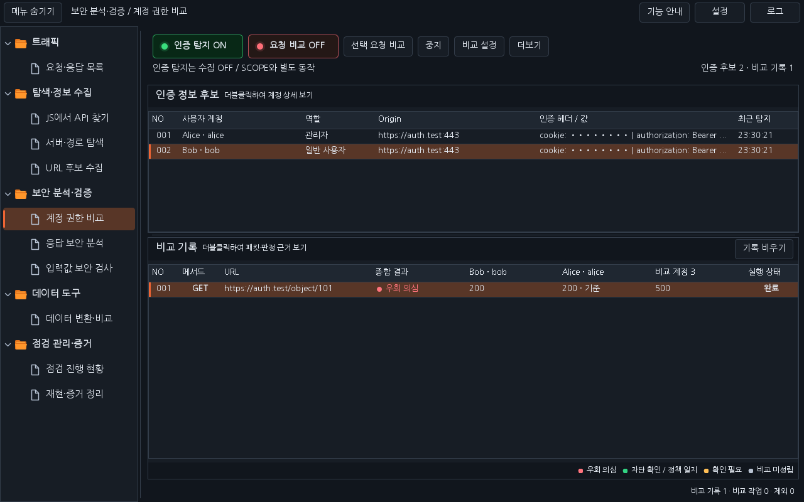
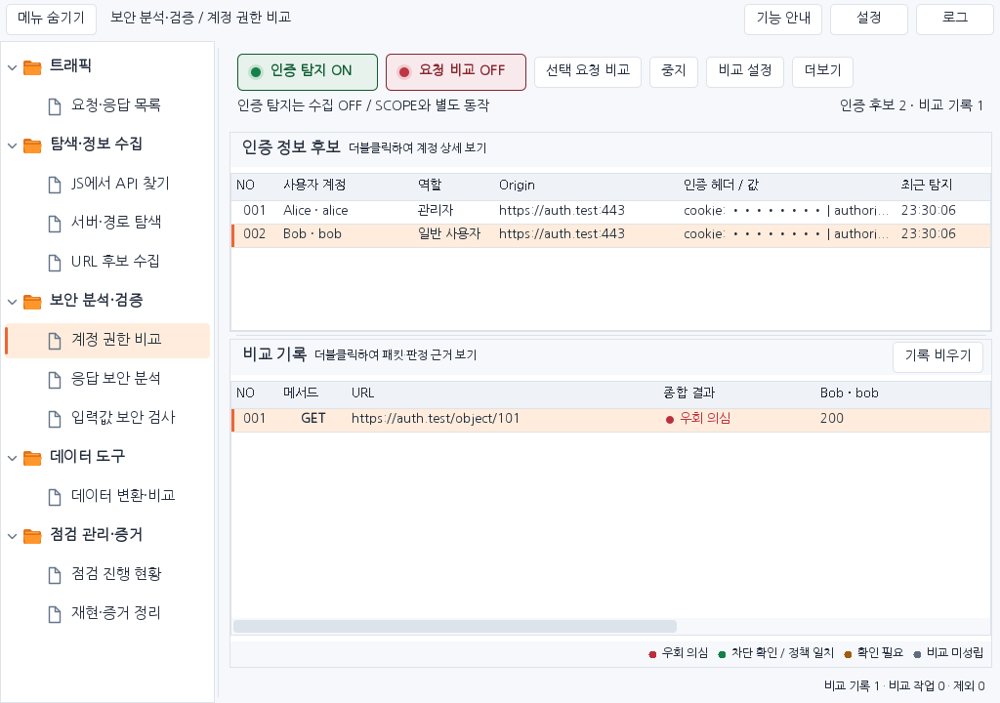

# Workbench 0.39.2 — 응답 코드와 종합 결과 분리

계정별 응답 코드 옆에 서로 다른 판정이 나열되던 화면을 정리했습니다. 비교 기록 한 줄은 하나의 원본 요청을 여러 계정으로 재전송한 실행 묶음입니다.

- 계정별 열은 `200`, `401`, `403` 등 응답 코드만 표시합니다. 원본과 같은 인증정보로 재전송된 계정에는 `200 · 기준`처럼 기준 표시를 붙입니다. 미지정·대기·응답 없음도 응답 상태로만 표시합니다.
- URL 바로 오른쪽의 **종합 결과** 열에 한 줄당 판정과 색상 하나를 표시합니다. 좁은 화면에서도 종합 결과를 먼저 볼 수 있습니다.
- 기준 계정은 교차 인가 종합 판정에서 제외합니다. 다른 비교 응답에 우회 의심 근거가 있으면 이를 우선 표시하고, 일부 전송 실패·미확인·중지 결과가 섞이면 전체를 차단 확인으로 표시하지 않습니다.
- 정상 성공 응답인 기준이 없으면 확인 필요, 다른 계정의 유효한 비교가 없으면 비교 미성립입니다. 실행 중에는 최종 판정 대신 비교 중을 표시합니다.
- 현재 지정한 비교 계정 모두에서 차단 근거를 관측한 경우 차단 응답 확인을 표시합니다. 명시적으로 설정한 허용 정책과 일치하는 결과가 포함되면 정책 일치로 구분합니다. 어떤 결과도 해당 URL 전체의 안전성을 보증하지 않습니다.
- 상세 창에는 종합 결과·집계 근거를 먼저 표시하고 계정별 응답·세부 판정·차이를 이어서 보여 줍니다. 계정 패킷 탭의 개별 판정 색상 아이콘을 제거했습니다. 더블클릭과 Ctrl+Space의 Repeater 준비 기능은 유지합니다.

개별 응답의 기존 판정 로직과 HTTP 재전송 조건은 유지합니다. 특히 접근 정책을 지정하지 않은 동일 성공 응답은 기존 로직상 우회 의심 후보가 될 수 있으며, 공개 목록이나 공유 데이터의 정상 응답인지 실제 접근 정책과 함께 확인해야 합니다. HTTP 200 또는 같은 본문만으로 권한 위반을 확정하지 않습니다.

[설치 JAR](../downloads/extensions/0.39.2/burp-workbench-kr-0.39.2.jar) · [전체 소스 ZIP](../downloads/extensions/0.39.2/burp-workbench-kr-0.39.2-source.zip) · [검증 기록](VERIFICATION_0.39.2.json)

아래 화면은 합성 데이터를 넣은 실제 Swing 구성 요소의 렌더링이며 실제 Burp 캡처는 아닙니다.

실제 네이티브 Burp GUI·Windows DPI/IME 검증은 미수행입니다. 자세한 실행 명령과 검사 수는 검증 기록에 남깁니다.
