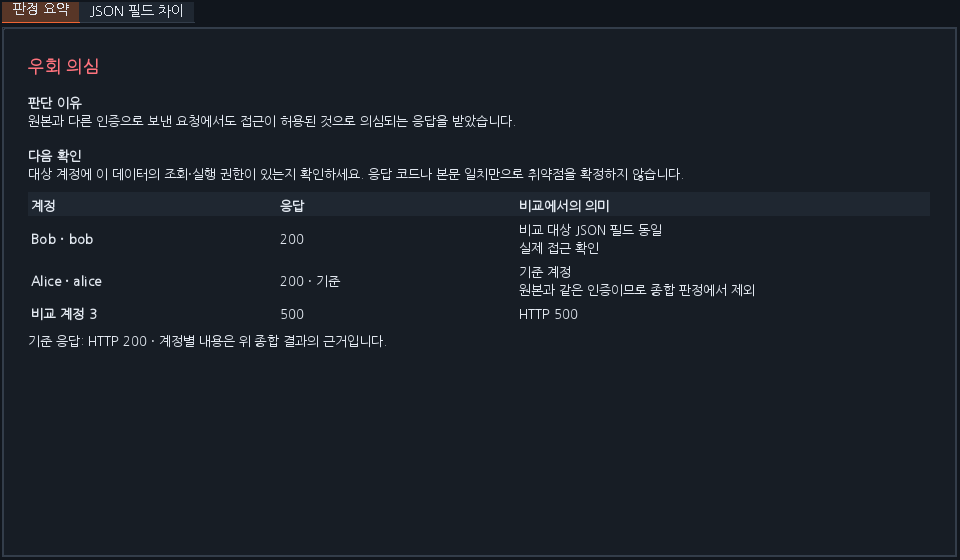
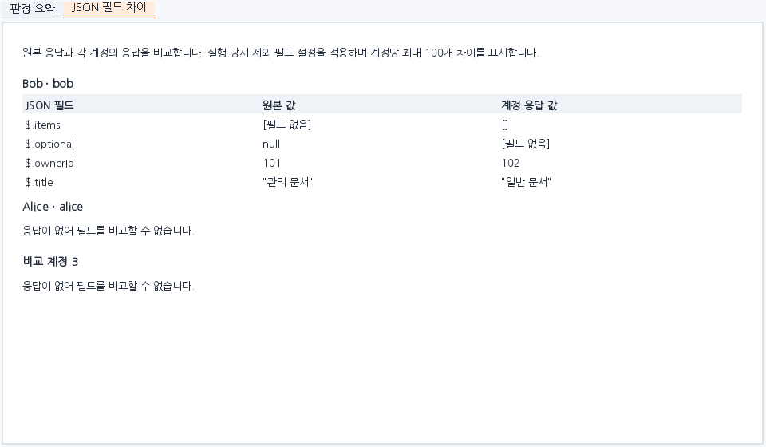
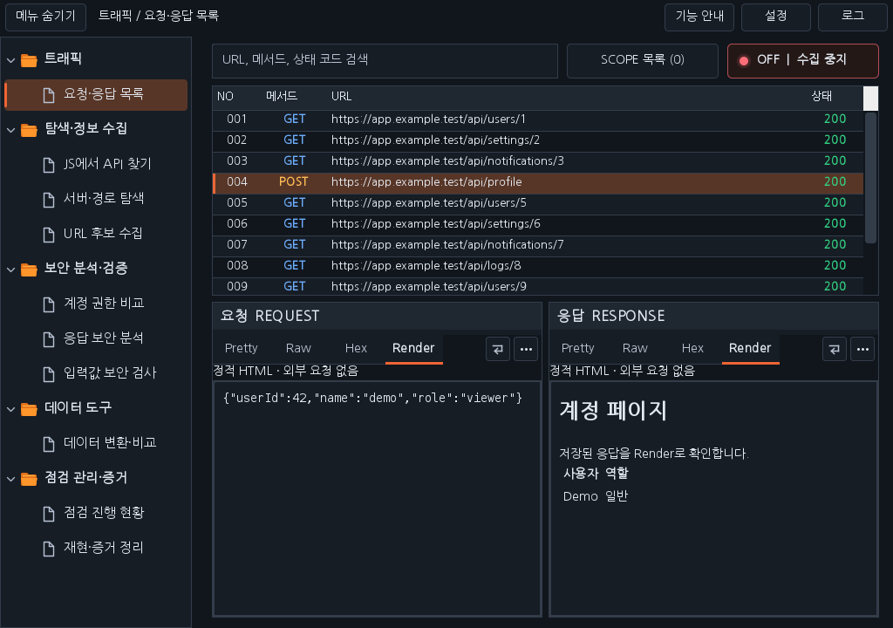

# Workbench 0.40.0 — 굴림·Render·인증 비교 사용성

- **글꼴**: Workbench의 버튼·표·본문·패킷에 굴림체(GulimChe)를 우선 적용합니다. 굴림체가 없으면 굴림(Gulim)을, 두 글꼴 모두 없는 OS에서는 포함된 한글 글꼴을 사용합니다. Burp 자체 UI의 전역 글꼴 설정은 변경하지 않습니다.
- **Render**: 모든 Workbench Repeater와 공통 패킷 뷰어에 Pretty / Raw / Hex / Render를 제공합니다. 받은 HTML의 제목·문단·표 등을 정적으로 보여 줍니다. HTML이 아닌 본문은 텍스트로 표시합니다. JavaScript 실행, 외부 이미지·CSS·프레임·폼 동작은 지원하지 않으며 Render를 열어 추가 HTTP 요청을 보내지 않습니다. 최대 64 KiB 미리보기이며 Raw 전송 바이트는 유지합니다. Search는 Pretty / Raw / Hex에서 사용합니다.
- **판정 근거**: `판정 요약`에 종합 결과 하나·판단 이유·다음 확인·계정별 관측 근거를 구분합니다. `JSON 필드 차이`는 필드 / 원본 값 / 계정 응답 값을 표로 보여 줍니다. 필드 없음·null·빈 객체·빈 배열을 구분하고 실행 당시 제외 필드 설정을 적용합니다. `크게 보기`에서 근거 전체를 별도 창으로 읽을 수 있습니다. 기존 판정 규칙은 유지합니다.
- **우클릭 삭제**: 인증 정보 후보와 비교 기록에서 선택한 항목을 삭제합니다. 정렬 상태에서도 클릭한 항목을 삭제하며 진행 중 비교·자동 비교 ON에서는 삭제를 비활성화합니다. 후보 삭제는 현재 계정 지정을 해제하고 과거 비교 기록의 스냅샷은 유지합니다. 탐지 ON 중 같은 인증이 새로 관측되면 새 후보로 수집될 수 있습니다.
- **인증값 표시**: 후보 목록과 상세의 인증 헤더/값을 가림 없이 표시합니다.
- **후보 메뉴**: 관리자 / 일반 / 후보1 / 비로그인 / 해제 / 삭제를 상위 메뉴에 표시합니다. 관리자·일반·후보1은 1·2·3번째 비교 위치입니다. 비로그인은 세 번째 위치를 사용하고 같은 메뉴를 다시 누르면 해제됩니다. 해제는 선택한 후보의 모든 계정 지정을 해제합니다. 사용자 매핑이 있는 후보의 이름·역할은 해당 매핑을 유지합니다.

[설치 JAR](../downloads/extensions/0.40.0/burp-workbench-kr-0.40.0.jar) · [전체 소스 ZIP](../downloads/extensions/0.40.0/burp-workbench-kr-0.40.0-source.zip) · [검증 기록](VERIFICATION_0.40.0.json)

이전 Workbench를 해제한 뒤 Burp의 Extensions → Add → Java에서 새 JAR를 선택하세요.

화면 증거는 합성 인증값을 넣은 운영 Swing 렌더링입니다. 실제 Burp GUI·Windows DPI/IME는 이번 환경에서 검증하지 않았습니다. Linux 화면은 굴림 미설치 대체 글꼴입니다.

