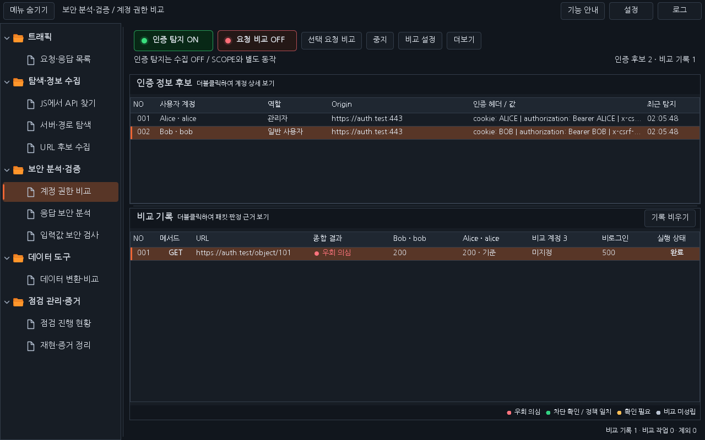
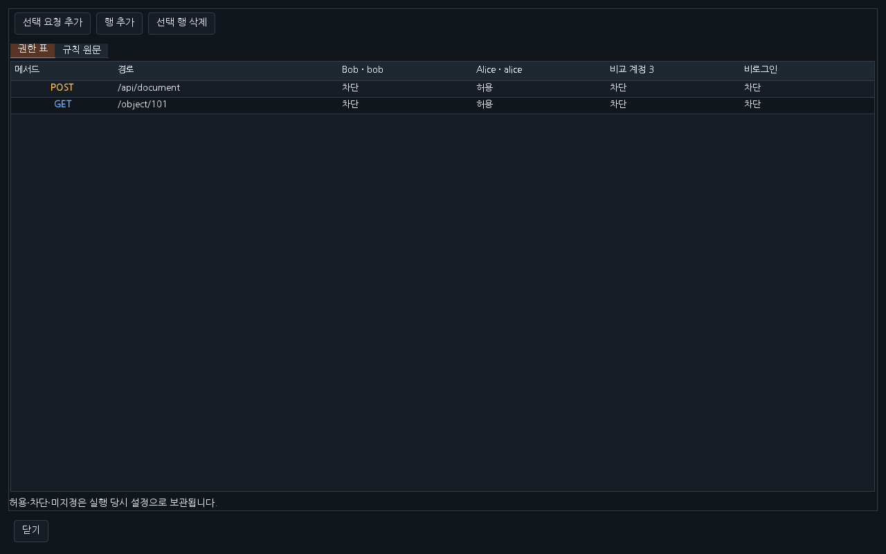
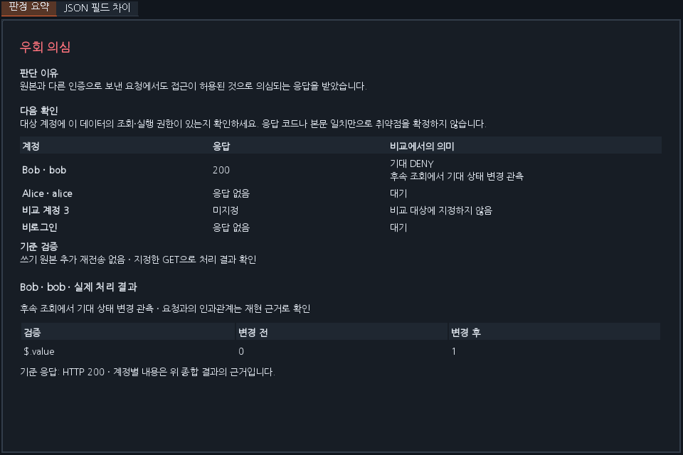

# Workbench 0.41.0 — 세션·권한 판정 고도화

인증 후보 / 비교 기록 / 패킷 상세 / 판정 근거의 기존 화면 구조를 유지합니다. 요청 한 건의 종합 결과는 하나이며, 계정별 열은 응답 코드와 기준 계정 여부를 표시합니다.

| 개선 | 동작과 설정 위치 |
|---|---|
| 현재 기준 검증 | GET·HEAD 비교 직전 원본 인증으로 다시 조회합니다. 저장된 응답이 200이어도 현재 401·403, 리다이렉트, 설정된 차단 응답이면 **세션 확인 필요**로 보류하고 비교 계정 요청을 보내지 않습니다. 캡처 원본과 현재 기준을 별도로 보관합니다. 현재 기준 탭과 필드 비교는 재검증 응답을 사용합니다. |
| 독립 비로그인 | 관리자·일반·후보1과 비로그인을 동시에 비교합니다. 우클릭 비로그인은 네 번째 위치를 켜고 끕니다. 기존 세 위치를 덮어쓰지 않습니다. |
| 계정별 권한 표 | **계정 설정 → 권한 표**에서 메서드·경로별 네 대상의 허용·차단·미지정을 선택합니다. 선택 요청 추가 / 행 추가 / 삭제를 제공합니다. 규칙 원문도 사용할 수 있습니다. 과거 3계정 원문은 비로그인 미지정으로 읽습니다. |
| 사용자·역할·조직 검증 | **세션 검사 → 추가 신원 조건**에서 역할과 조직의 JSON 경로·기대값을 입력합니다. 사용자 ID뿐 아니라 설정한 모든 조건이 맞아야 비교를 진행합니다. 역할 배열은 `$.roles[*]`를 지원합니다. 사용자 매핑의 표시용 역할과 서버 검증 조건은 별도입니다. |
| 중요 데이터 | **비교 설정 → 중요 JSON 필드**에 `$.data.id, $.items[*].id` 등을 입력합니다. 메타데이터가 바뀌어도 중요 데이터가 같으면 근거에 반영하며 누락은 보류합니다. 중요 필드·소유 필드는 제외할 수 없습니다. |
| 배열·동적 필드 | 배열 순서 무시는 선택 사항이며 중복 수를 유지합니다. **동적 필드 후보**는 같은 인증·메서드·URL의 반복 기준 응답에서 바뀐 필드를 제안합니다. 직접 체크해 적용하기 전에는 제외하지 않습니다. 업무 데이터도 제안될 수 있으므로 확인 후 선택하세요. |
| 실제 처리 결과 | **비교 설정 → 처리 결과 확인**에서 대상 쓰기 메서드·경로와 같은 Origin/SCOPE의 GET URL, JSON 경로, 기대 상태를 지정합니다. 기준 요청의 인증으로 전 조회 → 대상 계정의 쓰기 요청 한 번 → 후 조회를 수행합니다. 결과 확인은 기본 OFF이며 기존 쓰기 재전송 허용도 필요합니다. |
| 안정적인 판정 | 표시 문장과 판정 코드를 분리했습니다. 정책 미설정 상태의 동일 조회 응답은 공개·공유 여부를 확인하도록 보류합니다. 허용 기대와 차단 관측 등 설정 충돌도 확인 필요로 표시합니다. |

처리 결과 확인은 기대값으로 변경 / 값 변경 관측 / 대상·필드 삭제를 지원합니다. 최대 3회 조회하며 첫 조회 뒤 추가 조회 간격은 500ms입니다. 조회 응답은 128 KiB 이내입니다. 이미 기대 상태이거나 대상이 없으면 쓰기 요청을 보내지 않습니다. 상태를 자동으로 되돌리지 않으므로 계정별 테스트마다 데이터를 초기화해야 할 수 있습니다. HTTP 200만으로 쓰기 성공을 판정하지 않습니다. 동시 사용자나 다른 프로세스의 변경 가능성은 재현 근거로 확인하세요.

권한 표·필드 규칙·신원 조건·처리 결과 설정은 실행 당시 스냅샷으로 보관합니다. 실행 중 설정을 바꿔도 과거 결과를 재판정하지 않습니다. 기존 Scope·전송 인증 변경 감지·취소·응답 크기 제한을 적용합니다. 전후 관측값과 현재 기준 검증 이유는 기존 판정 요약에 표시합니다.

[설치 JAR](../downloads/extensions/0.41.0/burp-workbench-kr-0.41.0.jar) · [전체 소스 ZIP](../downloads/extensions/0.41.0/burp-workbench-kr-0.41.0-source.zip) · [검증 기록](VERIFICATION_0.41.0.json)

이전 Workbench를 해제한 뒤 Burp의 Extensions → Add → Java에서 새 JAR를 선택하세요. 이번 환경의 화면은 운영 Swing 컴포넌트에 합성 데이터를 넣어 렌더링했습니다. 실제 Burp GUI·Windows DPI/IME는 별도 검증 범위입니다.

