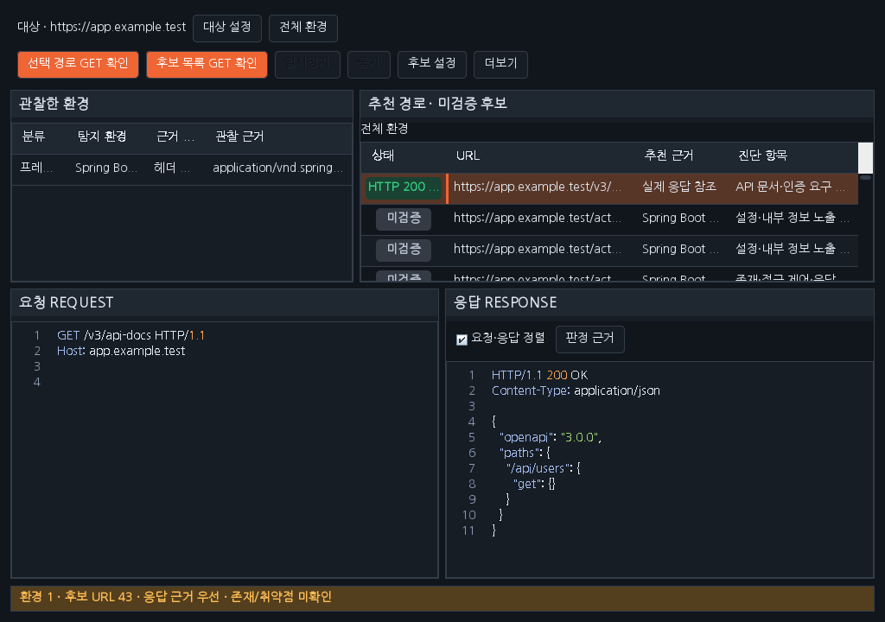
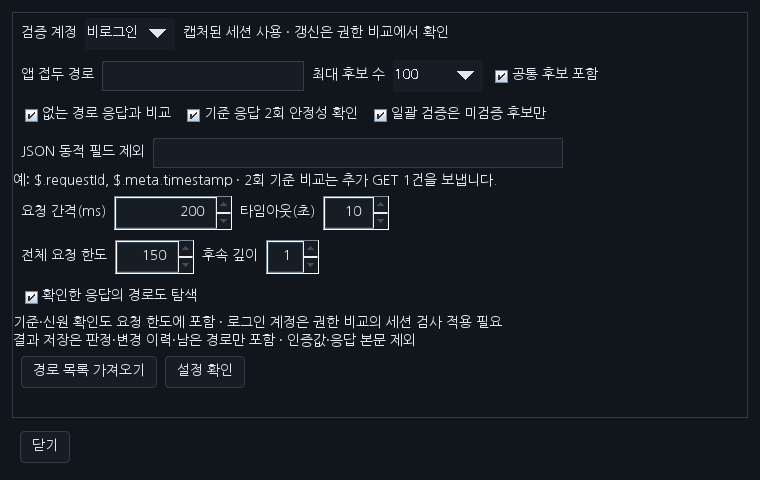
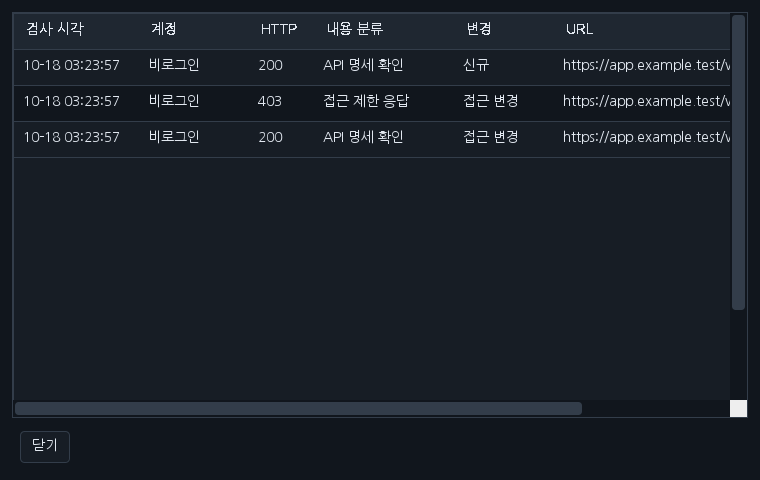

# Workbench 0.42.0 — 서버·경로 탐색 고도화

기존 환경/경로 목록과 요청/응답 영역의 구조를 유지하며 여섯 개선을 적용했습니다. 코드·파일명만으로 취약점을 확정하지 않습니다.

| 개선 | 사용 방법과 동작 |
|---|---|
| 노출 내용 판별 | 실제 응답에서 OpenAPI, 소스맵, 환경 설정, Git HEAD, 디렉터리 목록, PHP 실행 정보 등의 구조를 확인합니다. 로그인·보안 확인·오류·분석 한도 응답은 별도로 표시합니다. **판정 근거** 또는 경로 더블클릭으로 판단 이유와 다음 확인을 봅니다. 민감한 실제 값은 근거 요약에 복사하지 않습니다. |
| 가짜 200 구분 | 없는 경로 기준 응답을 기본 두 번 확인합니다. 정확히 같은 응답과 구조·텍스트가 유사한 응답을 구분하며, 유사 응답은 **공통 화면 의심**으로 보류합니다. UUID·표준 시각·request/trace ID 변동을 비교에 반영하고 JSON 업무 값은 유사도만으로 제외하지 않습니다. 기존 JSON 동적 필드 제외 설정도 유지합니다. |
| 탐색 결과 재활용 | 확인한 응답의 같은 Origin/SCOPE 링크, robots/sitemap, OpenAPI GET 선언과 Actuator 링크를 후속 후보로 반영합니다. 후보 설정의 **후속 깊이**와 전체 요청 한도를 적용합니다. 깊이 기본 1, 최대 3이며 대기 경로는 최대 500개입니다. 쓰기 전용 OpenAPI 선언·미확정 템플릿·외부 주소·로그아웃/삭제/재시작과 기존 대용량 진단 경로는 자동 후속 탐색에서 제외합니다. |
| 세션 유효성 | 비로그인은 신원 검사 없이 실행합니다. 로그인 계정은 **계정 권한 비교 → 세션 검사**에서 검증 조건을 적용해야 합니다. 실행 전·재개 시·25요청 간격으로 사용자/역할/조직 조건과 비로그인 대조를 확인합니다. 신원 실패와 세션 쿠키 갱신은 일시정지하며 새 세션 연결 후 재개합니다. 권한 거부 응답 자체를 세션 만료로 단정하지 않습니다. |
| 요청 제어·일시정지·재개 | 후보 설정에서 요청 간격(0~10초), 타임아웃(1~30초), 전체 요청 한도(1~500)를 지정합니다. 기본 200ms·10초·150건이며 기준/신원 요청도 포함합니다. **일시정지/재개**는 다음 전송을 제어하며 이미 보낸 요청은 응답을 기다립니다. 429는 Retry-After 대기 후 사용자가 재개하고 보안 확인 화면도 자동 재시도하지 않습니다. 중지·예산 소진 뒤에는 **더보기 → 남은 경로 이어서 확인**을 사용합니다. |
| 결과 저장·변경 추적 | **더보기 → 탐색 결과 저장/불러오기/변경 기록**을 사용합니다. 계정별 HTTP·내용 분류·정규화 지문을 비교해 신규/동일/내용 변경/접근 변경/분류 변경을 기록합니다. JSON은 판정 이력 최대 2,000건·후보 1,000개·대기 경로 500개, 최대 4 MiB입니다. 인증 헤더·쿠키·검증 기대값·요청/응답 본문은 저장하지 않으며 쿼리 있는 URL도 허용하지 않습니다. 불러오기는 요청하지 않습니다. 인증을 재연결하고 명시적으로 이어서 검사하세요. |

분석은 본문 64 KiB 이내에서 수행하며 그보다 큰 응답은 내용 판정을 보류합니다. 원본 패킷의 화면 미리보기는 최대 64K자, 메모리 패킷은 최근 300개입니다. 저장된 판정에 원본 패킷이 없으면 현재 응답을 다시 확인하도록 안내합니다. 본문을 포함한 별도 증거 저장 기능과 구분하세요. 결과 내용이 달라진 이유는 실제 업무·배포 변화와 함께 확인해야 합니다.

프로젝트 저장은 사용자가 선택한 JSON 파일에 임시 파일을 쓴 뒤 원자적으로 교체합니다. 잘못된 형식·버전·한도 파일은 적용하지 않습니다.

[설치 JAR](../downloads/extensions/0.42.0/burp-workbench-kr-0.42.0.jar) · [소스 ZIP](../downloads/extensions/0.42.0/burp-workbench-kr-0.42.0-source.zip) · [검증 기록](VERIFICATION_0.42.0.json)

실제 Burp GUI·Windows DPI/IME는 별도 검증 범위입니다. 검증 JSON의 이번 실행과 이전 기록을 구분하세요.

