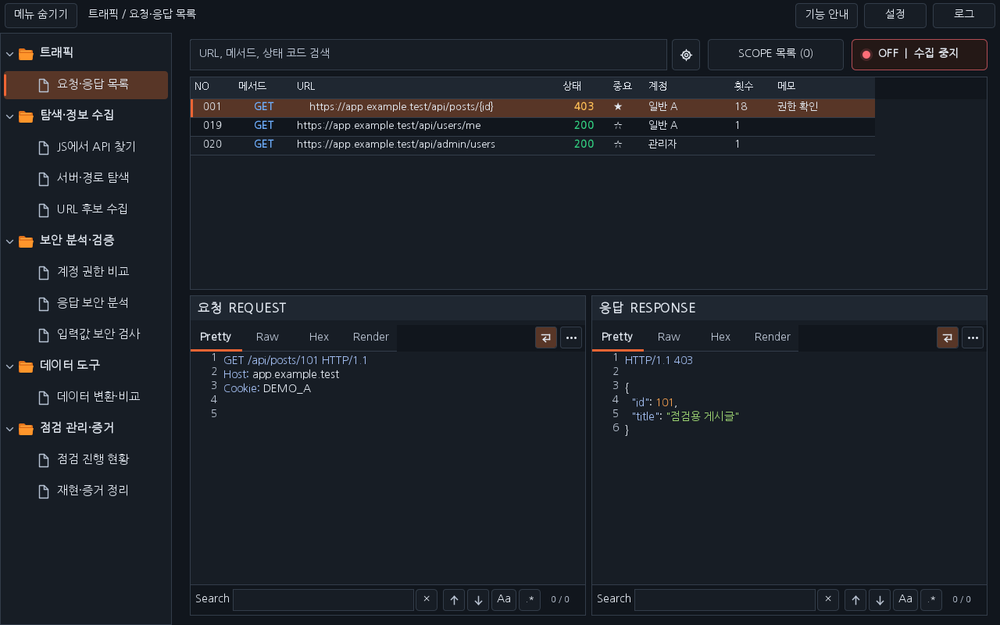
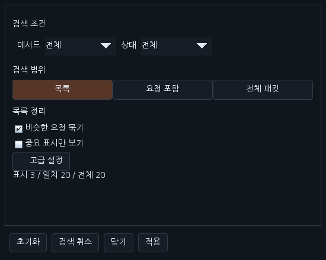
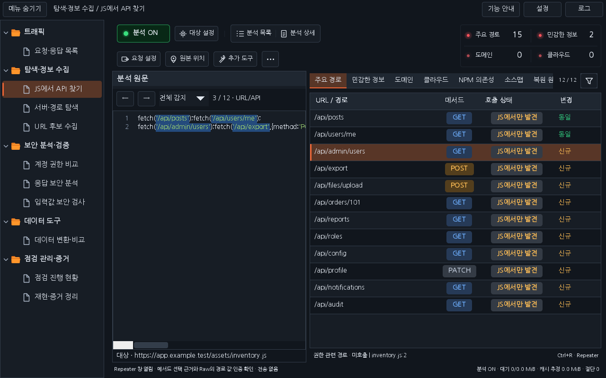

# Workbench 0.43.0 — 요청·응답 목록과 JS 분석 고도화

이번 변경은 요청·응답 목록과 JS에서 API 찾기에 적용합니다. 계정 권한 비교의 UI·자동 재전송·판정 정책은 보존합니다.

## 요청·응답 목록

검색창 오른쪽 **톱니바퀴**에서 별도 검색·목록 설정 창을 엽니다. 기본 화면에는 메서드·상태, 검색 범위(목록 / 요청 포함 / 전체 패킷), 비슷한 요청 묶기와 중요 표시만 보기를 둡니다. 계정·수집 기간·대소문자·정규식·숫자/UUID 경로 정규화·메모 열은 접힌 고급 설정에 있습니다. 설정은 현재 Burp 프로젝트에 보관하고 인증값·검색어·원본 패킷을 설정에 기록하지 않습니다.

입력 후 백그라운드에서 검색합니다. 설정 창에서 진행 상태와 취소를 사용할 수 있습니다. 요청·응답 검색은 각 원본 2 MiB 안에서 수행하며 한도를 넘긴 패킷 수를 표시합니다. 정규식 시간 한도를 넘기거나 오류가 나면 이전 결과를 유지하고 오류를 표시합니다. 검색은 수집 OFF/SCOPE 조건을 변경하지 않습니다.

같은 Origin·메서드·세션의 경로를 묶어 표시하고 더블클릭 또는 우클릭으로 원본을 펼칩니다. 숫자/UUID 정규화는 끌 수 있습니다. 묶음 툴팁에는 원본 건수와 응답 코드 분포를 표시합니다. 원본 패킷과 번호는 보존합니다. 중요 표시와 메모는 해당 원본에 연결되며 현재 수집 세션 동안 유지됩니다. 계정 이름은 명시적으로 매핑한 인증 후보만 표시하고 불확실한 경우 미매핑으로 둡니다. 계정 표시 자체가 서버 신원 검증을 뜻하지 않습니다.

## JS에서 API 찾기

- **⋯** 메뉴에 트래픽 대조와 버전 비교를 배치합니다. API 선택 후 **Ctrl+R**로 Repeater 창을 준비하며 자동 전송하지 않습니다.
- 목록은 경로·메서드·호출 상태·변경 네 열로 정리합니다. 기존 사용 맥락·쿼리·헤더·본문 키·줄은 분석 상세와 항목 툴팁에서 확인합니다.
- 선택 경로의 근거·출처는 하단 **한 줄**로 표시합니다. 별도 Repeater 버튼과 큰 상세 카드는 없습니다.
- 결과 탭에 마우스를 올리고 **휠**로 좌우 이동합니다. 목록 위의 휠은 기존 세로 스크롤입니다. 탭 클릭과 키보드 선택을 유지하고 선택한 탭을 자동으로 보이게 합니다.
- 결과 탭 오른쪽 **깔때기 아이콘**에서 호출 상태·우선 검토·신규 조건을 조합합니다. 별도 필터 버튼 줄을 없애고 표시/전체 개수를 표시합니다.
- 수집 패킷의 Origin·경로·메서드를 대조합니다. 정적 발견만으로 실제 호출을 주장하지 않으며, 메서드 충돌과 동적 경로의 미확정을 구분합니다. 응답의 민감한 **필드 이름**은 우선 검토 근거에 더하고 값은 이 대조 기록에 저장하지 않습니다.
- 같은 출처의 분석 버전을 선택해 신규·삭제·메서드·입력 이름 변화를 비교합니다. 이전 기준이 없으면 신규로 단정하지 않습니다. 기존 프로젝트 분석 이력도 불러옵니다.
- 이미 수집한 같은 Origin의 상대 ES 모듈에서 명시적으로 export한 상수·Axios 인스턴스·fetch 요청 함수를 연결합니다. 의존 파일이 나중에 수집되면 보관 중인 종속 파일을 다시 분석합니다. import 별칭과 원본 호출 위치를 보존합니다. 외부 파일을 자동 요청하거나 JS를 실행하지 않습니다.
- 반복 패턴·예제 문자열·공개 식별자 가능성을 민감정보 후보 근거에 표시합니다. 키의 실제 유효성을 자동 조회하지 않습니다.

파일 연계는 보관 중인 정적 named import/export에 한정됩니다. 동적 모듈 로더·실행 중 설정·임의 번들 런타임까지 복원하지 않습니다. 연계 파일은 최대 48개/2 MiB, 버전 메타데이터는 최대 64개/2 MiB, 트래픽 대조는 최근 10,000개 경로 안에서 보관합니다. 기존 JS 캐시·작업 큐 한도는 유지합니다. 큰 과거 기록은 메타데이터 비교를 보류할 수 있습니다. 분석·응답 차이·이름 기반 우선순위는 취약점 확정이 아닙니다.

[설치 JAR](../downloads/extensions/0.43.0/burp-workbench-kr-0.43.0.jar) · [소스 ZIP](../downloads/extensions/0.43.0/burp-workbench-kr-0.43.0-source.zip) · [검증 기록](VERIFICATION_0.43.0.json)

화면은 수정한 운영 Swing 구성 요소와 합성 패킷으로 렌더링합니다. 실제 native Burp GUI·Windows DPI/IME 검증과 구분합니다.

## 적용 화면

운영 Swing UI를 합성 데이터로 렌더링한 화면입니다.

[밝은 테마](ui/0.43.0/light-js-workspace.png) · [필터](ui/0.43.0/dark-js-filter.png) · [트래픽 대조](ui/0.43.0/dark-js-traffic-comparison.png) · [버전 비교](ui/0.43.0/dark-js-version-comparison.png)
