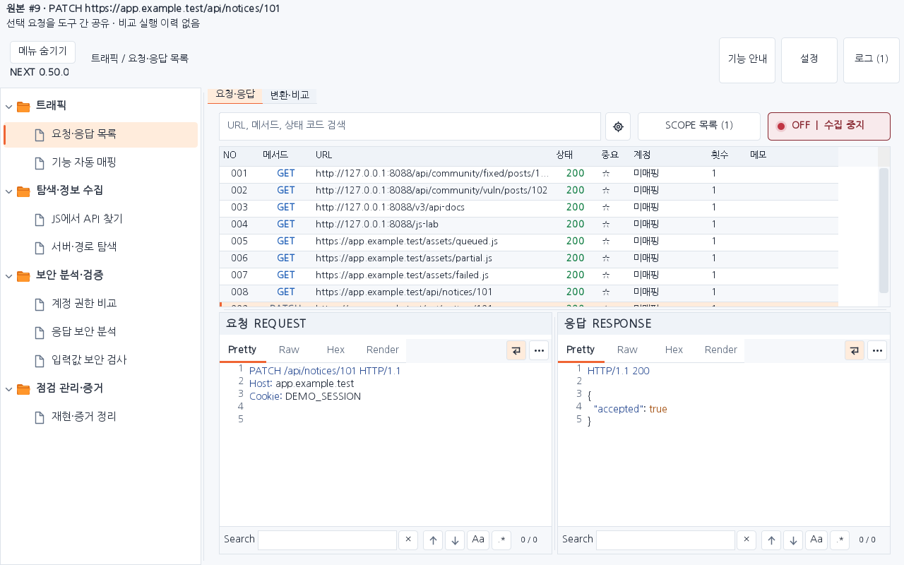
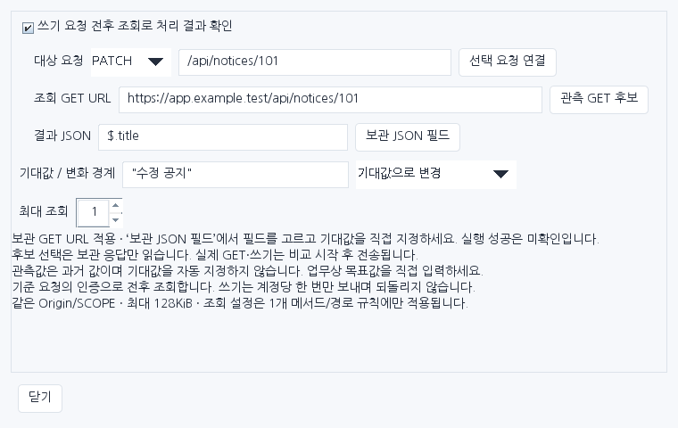
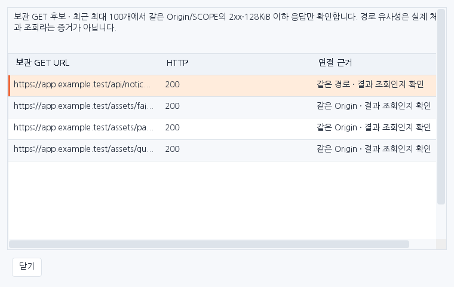
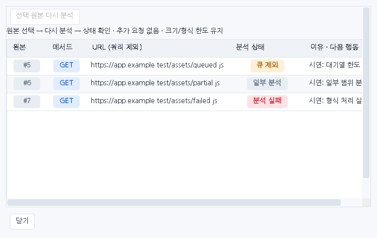

# Workbench Next 0.50.0 — 별도 버전 설치·기능 안내

기존 Workbench KR 0.49.1을 보존하고, 새 작업 흐름을 `account-a/workbench-next-0500` 브랜치에 구현했습니다. 이 문서는 **Next 0.50.0** 화면을 설명합니다. 이전 버전의 검사 결과를 이번 결과로 재사용하지 않습니다.

## 1. 기존 버전과 구분하고 설치하기

| 구분 | 기존 버전 | 새 버전 |
|---|---|---|
| 버전 | 0.49.1 | **0.50.0** |
| Burp 이름 | Burp Workbench KR | **Burp Workbench Next KR** |
| 상단 탭 | Workbench KR · 웹 보안 점검 | **Workbench Next** |
| 화면 배지 | 기존 화면 | **NEXT 0.50.0** |
| 다운로드 | `downloads/extensions/0.49.1/` | `downloads/extensions/0.50.0/` |
| 저장 설정 | 기존 키 | `next.` 접두사의 별도 키 |
| JS 분석 기록 | `.burp-workbench/js-analysis/` | `.burp-workbench-next/js-analysis/` |

1. 기존 JAR와 프로젝트를 보관합니다. 기존 확장의 로드를 해제합니다.
2. [Next JAR](../downloads/extensions/0.50.0/burp-workbench-kr-0.50.0.jar)를 받아 Burp **Extensions → Add → Java**에서 선택합니다.
3. 확장 이름과 상단의 **Workbench Next**, 화면의 **NEXT 0.50.0**을 확인합니다.
4. Next는 별도 저장 설정으로 시작합니다. **요청·응답 목록 → SCOPE 목록**에서 점검 대상을 확인하고 수집을 **OFF → SCOPE**로 전환합니다. 이전 인증값이나 분석 이력을 자동으로 복사하지 않습니다.
5. 문제가 있으면 Next 로드를 해제하고 보관한 기존 JAR를 다시 로드합니다. 기존 배포 파일과 저장 경로는 그대로 남습니다.

두 버전 동시 로드에 대한 실제 Burp 검증은 수행하지 않았습니다. 내장 Mapper 0.3.3과 실습 사이트 3.10.0은 변경하지 않았습니다.

## 2. 필요한 기능 찾기 — 주요 메뉴 11개에서 8개

| 왼쪽 주요 메뉴 | 할 수 있는 일 | 통합된 하위 화면 |
|---|---|---|
| 요청·응답 목록 | 원본 선택, SCOPE, 검색, Repeater 준비 | **요청·응답 / 변환·비교**: 인코딩, JWT, 두 데이터 비교 |
| 기능 자동 매핑 | 관찰한 요청을 기능·실행 사례로 분류 | **기능 분류·실행 / 점검 진행 현황** |
| JS에서 API 찾기 | 보관된 JS·텍스트에서 API와 단서 분석 | 기존 분석 목록·상세, **분석 처리·재시도** |
| 서버·경로 탐색 | 서버 단서와 경로 확인 | **서버·경로 확인 / URL 후보 수집** |
| 계정 권한 비교 | 같은 원본을 계정별 조건으로 비교 | 권한표, 쓰기 조회, 세션 검사 |
| 응답 보안 분석 | 관측 응답의 보안 단서와 분석 범위 확인 | **분석 처리·재시도** |
| 입력값 보안 검사 | 선택 입력의 검사값과 대조 응답 확인 | 기존 검사 설정·결과 |
| 재현·증거 정리 | 업무 재현과 증거 패킷 정리 | 권한 비교 결과·전후 조회 포함 |

기능 안내와 F1은 현재 하위 화면을 따라갑니다. 예를 들어 URL 후보 수집 탭에서 F1을 누르면 서버·경로의 일반 설명 대신 URL 후보 수집 설명을 엽니다. URL을 모으는 동작과 실제 GET을 보내는 동작은 구분됩니다.

아래 이미지는 새 JAR의 실제 Swing 화면에 합성 데이터를 넣어 렌더링한 예시입니다. 실제 Burp 실행 화면이나 취약점 검증 결과는 아닙니다.

## 3. 선택한 원본을 유지하며 작업하기

1. **요청·응답 목록**에서 원본 행을 선택합니다. 여러 행도 선택할 수 있습니다.
2. 공통 작업 영역에서 **원본 번호·메서드·대상·선택 개수**를 확인합니다. 표시 URL에서는 쿼리값·사용자 정보·fragment를 제외합니다.
3. 우클릭으로 계정 비교, 변환, JWT 확인, 입력값 검사, 증거 정리로 이동합니다. 변환과 JWT는 요청·응답의 하위 탭으로 열립니다.
4. 비교를 시작한 뒤 원본 선택·계정·판정 설정·SCOPE를 변경하면 공통 영역에 **이전 비교 조건 변경**을 표시합니다. 같은 URL이라도 원본 또는 선택 묶음이 다르면 변경으로 취급합니다.
5. 이전 결과를 현재 조건의 완료 근거로 쓰기 전에 조건을 다시 검토합니다. 공통 영역은 수동 선택 비교의 시작 조건을 추적하며, 성공·취약점·완료를 자동 판정하지 않습니다. 자동 비교 이력은 계정 비교 화면에서 확인합니다.

## 4. 권한표와 쓰기 조회를 설정하기

**권한표**는 기대되는 허용·차단을 기록합니다. **쓰기 조회**는 PATCH·POST 같은 요청 이후 실제 값이 바뀌었는지 별도의 GET으로 관찰하는 설정입니다. 설정이 있다는 사실과 실제 실행 결과는 다릅니다.

1. 비교할 원본을 선택하고 계정 인증 후보를 지정합니다.
2. 비교 전 준비 화면에서 **권한표 설정**을 누릅니다. 선택 원본의 메서드·경로가 아직 어떤 규칙에도 포함되지 않으면 편집기에 추가합니다. 기존 정확한 경로·매개변수 경로 규칙은 보존합니다.
3. 새 행의 기대 권한은 `UNKNOWN`입니다. 실제 정책을 확인해 계정별 허용·차단을 직접 지정합니다. 성공 응답만으로 허용 규칙을 만들지 않습니다.
4. 쓰기 요청이면 **쓰기 조회 설정**을 열고 대상 메서드·경로를 확인합니다. 다른 요청의 기존 설정을 편집 중이면 먼저 **선택 요청 연결**로 대상을 맞춥니다.
5. 보관 GET 후보를 조회합니다. 최근 보관 트래픽 중 같은 Origin·현재 SCOPE·2xx 응답·크기 한도를 만족하는 후보만 보여 줍니다. 같은 경로, 인접 경로 순으로 제안하지만 실제 변경을 확인할 API인지는 사용자가 판단합니다.
6. 후보를 선택하고 URL 적용 버튼을 누릅니다. JSON 응답이라면 필드 후보를 보고 사용할 경로를 별도로 적용합니다. 예전 응답의 값은 참고용이며, 미래 기대값으로 자동 입력하지 않습니다.
7. 기대값·관찰 방식·횟수를 직접 확인합니다. 설정 도중 선택한 원본이 바뀌면 후보를 다시 조회해야 합니다.
8. 준비 화면으로 돌아가 적용 범위를 확인한 뒤 비교를 시작합니다. 이때 계정 비교와 쓰기 전후 조회는 실제 HTTP 요청을 전송합니다.
9. 결과 상세에서 **판정 요약 → JSON 필드 차이 → 비교 전 설정**을 함께 읽습니다. 403이나 조회값 불변 하나만으로 차단·쓰기 실패를 확정하지 않습니다.

보조 기능은 최근 100개 원본 후보를 살펴보며 공급 단계의 복원은 개별 2 MiB·합계 8 MiB로 제한합니다. GET 응답 본문 후보는 128 KiB 이하, JSON 필드는 최대 200개입니다. 보조 화면을 여는 행위는 서버 요청을 보내지 않습니다.

## 5. 누락된 분석을 보관 원본으로 다시 실행하기

1. JS는 **더보기 → 분석 처리·재시도**, 응답 보안 분석은 같은 이름의 하위 탭을 엽니다.
2. 원본 번호와 상태를 확인합니다. 대기·분석 중·완료·일부 분석·기존 결과 확인·큐 제외·크기 제한·형식 제외·실패·중지·Scope 제외·원본 만료를 구분합니다.
3. 재시도 가능한 행을 선택하고 **선택 원본 다시 분석**을 누릅니다.
4. 선택 행에 연결된 정확한 디스크 원본을 읽어 로컬 분석합니다. 같은 URL의 최신 응답으로 바꾸지 않고, 서버에 다시 요청하지 않습니다.
5. 새 상태와 분석 결과를 확인합니다. Scope와 기존 크기·메모리 한도는 다시 적용되므로 재시도가 항상 완료를 보장하지는 않습니다.

최근 처리 메타데이터는 256건만 보관합니다. 원본이 연결되지 않은 수동 입력, 형식 제외, 크기 제한은 재시도 버튼으로 우회하지 않습니다. 트래픽을 초기화하면 연결 원본이 만료될 수 있습니다. 기존 분석 결과와 원본 트래픽은 재시도 목록의 퇴출과 별개입니다.

## 6. 느린 단계와 검색 상태 확인하기

상단 **로그**에서 수집 원본 복원, 관찰 준비, Swing 화면 대기·반영의 시간을 확인합니다. JS 진단은 **JS에서 API 찾기**의 **분석 ON·대기·캐시 상태 표시줄에 마우스를 올렸을 때 나오는 설명**에서 확인합니다. 작업 대기·실행 시간과 거부·취소·실패를 구분합니다. p50/p95는 **최근 최대 256개 관측 샘플**의 값입니다. 전체 누적 성능이나 다른 PC의 속도를 보장하는 값이 아닙니다.

- **캐시 추정 보관량**: 코드가 계산한 보관 비용 추정값입니다.
- **JVM 전체 heap**: Burp와 다른 확장을 포함한 JVM의 사용량입니다. Workbench 단독 메모리 수치가 아닙니다.
- **최장 대기·원본 경과**: 현재 지연을 파악하는 보조 지표입니다. 보관 시각 기반 원본 경과는 시스템 시계 변경의 영향을 받습니다.

트래픽 검색은 새 검색어를 입력하면 이전 작업을 취소하고 최신 대기 작업 하나만 유지합니다. **검색 취소** 후에는 새 트래픽 갱신이 취소한 검색을 자동 재시작하지 않습니다. 잘못된 정규식이나 512자를 넘는 검색어는 이전 결과를 유지하고 조건 수정을 기다립니다.

## 7. 결과를 검토하고 증거로 남기기

1. **계정 권한 비교**에서 저장할 실행 결과를 선택합니다.
2. **재현·증거 정리 → 권한 비교 추가**를 누릅니다.
3. 원본, 읽기 기준 재조회, 전송한 모든 계정 슬롯, 쓰기 전후 조회 패킷을 같은 실행 번호로 확인합니다. 내보내는 ZIP에는 기존처럼 가린 텍스트와 원본 해시를 담으며 전체 원본 바이트를 복사하지 않습니다. 네 번째 계정도 포함합니다.
4. 실행 당시 설정 적용 범위·기대 정책·판정 이유·조회 결과가 설명에 남습니다. 현재 설정으로 과거 설명을 재계산하지 않습니다. 긴 설명은 16,384자 뒤 생략을 표시합니다.
5. 전체 32개 증거 한도를 넘으면 해당 비교 묶음을 추가하기 전에 거부합니다. 기존 가림·미리보기 절차를 거쳐 영향과 재현 순서를 작성하고 저장합니다.
6. **기능 자동 매핑 → 점검 진행 현황**에서 계정/API 또는 업무를 완료 처리합니다. 확인창에 검사·입력·증거·남은 조건을 보여 주며, 사용자가 검토해야 완료됩니다.
7. 검토창을 연 뒤 관련 조건이 바뀌었으면 완료 처리를 거부합니다. 완료 후 새 검사나 세션 연결 변경이 생기면 재검토 상태로 돌아갑니다. 단순 재관찰만으로 완료를 해제하지 않습니다.

기능 매핑 분류와 점검 완료는 서로 다른 상태입니다. 매핑된 요청이 많거나 증거가 추가됐다는 이유만으로 점검 완료를 자동 표시하지 않습니다.

## 이번 적용 범위와 남은 작업

이번 버전은 메뉴 통합, 선택 원본·비교 조건 추적, 권한 설정 보조, 보관 원본 재시도, 처리 시간 관측, 최신 검색만 유지, 증거 묶음과 완료 검토를 구현합니다. 정적 분석의 콘텐츠 공통 캐시, 대상별 설정 묶음 저장, 전 도구에 걸친 업무 객체 자동 연결, 실제 Burp 장시간 부하·동시 버전 로드 검증은 후속 작업입니다. 측정 전 처리량 향상률·메모리 절감률을 제시하지 않습니다.

실제 실행한 검사, 새 JAR 해시와 한계는 [이번 검증 기록](VERIFICATION_0.50.0.json)에 정리합니다. 이전 `release/`, `history/`, 기존 버전 `downloads/`는 수정하지 않습니다.
