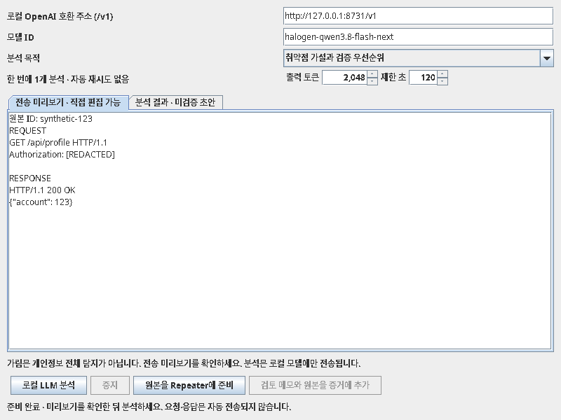

# Next 0.54.0 · 로컬 LLM 분석

0.53.4 main `222aef191a34f7d6cd1014e941ecc7152341f640`에서 개발한 후보판입니다. Simple과 기존 배포 파일은 보존합니다. 실제 검증 결과와 배포 파일은 PR·Actions에서 확인하며, 이 문서 자체는 main 병합이나 native Burp 검증을 뜻하지 않습니다.

## 사용 순서

1. 새 JAR를 Burp의 Extensions → Add → Java로 추가합니다. 기존 Next는 먼저 로드를 해제합니다. 현재 Burp 설정은 설치 과정에서 자동 변경하지 않습니다.
2. Workbench SCOPE에 대상을 지정합니다. 요청·응답 목록 또는 Burp HTTP history/Repeater에서 **응답이 있는 원본 1~4개 → 우클릭 → 로컬 LLM 분석 준비**를 선택합니다.
3. 별도 창에서 주소와 모델을 확인합니다. Halogen 기본값은 `http://127.0.0.1:8731/v1`, `halogen-qwen3.8-flash-next`입니다. 모델 ID에는 Strix의 `openai/` 접두사를 붙이지 않습니다. Ollama·LM Studio 등은 제공 서버의 OpenAI 호환 `/v1` 주소와 실제 모델 ID를 입력합니다. 해당 제품별 실서버 호환성은 별도 확인해야 합니다.
4. **전송 미리보기**에서 자료를 읽고 필요한 역할·기대 권한·관측 메모를 추가합니다. 인증 헤더·쿠키·민감 필드와 확인한 반사 값은 기존 증거 내보내기의 가림을 사용합니다. JSON/폼 이외의 본문은 제외합니다. 가림은 모든 개인정보를 탐지하지 않으므로 전송 전에 직접 검토합니다.
5. 취약점 가설, 계정별 비교, 보고서 초안 중 목적을 고르고 **로컬 LLM 분석**을 누릅니다. 준비·창 열기·패킷 수집만으로는 모델을 호출하지 않습니다.
6. 분석은 관측 근거와 미검증 가설, 대조군·기각 조건, 가용성 영향·중단 조건을 요청합니다. 모델 출력은 일반 텍스트이며 코드나 도구로 실행하지 않습니다. **원본을 Repeater에 준비**한 뒤 실제 Send와 검증 판단은 직접 합니다.
7. **검토 메모와 원본을 증거에 추가**는 현재 프로젝트·SCOPE를 다시 확인하고 원본 ID와 미검증 라벨을 유지합니다. 증거 메모는 4,096자 제한이 있어 긴 출력은 일부 생략됩니다. 결과를 그대로 확정 취약점으로 등록하지 않습니다.

## 한도와 수명

- 한 번에 1개 분석, 출력 기본 2,048/최대 4,096토큰, 기본 120/최대 300초. 서버 오류에 자동 재시도하지 않습니다.
- 원본별 요청+응답 합계 128 KiB 이하, 미리보기 원본당 11,000자, 사용자 편집 포함 48,000자. 가려지거나 잘린 자료는 전체 원본을 의미하지 않습니다.
- 로컬 `127.0.0.1`·`[::1]` 주소만 허용하고 프록시·HTTP 리다이렉트를 사용하지 않습니다. 인증이 필요한 모델 API는 이 버전에서 지원하지 않습니다.
- 작업 중 화면은 계속 조작할 수 있습니다. 취소·선택 변경·프로젝트 변경·확장 종료 후 오래된 결과는 적용하지 않습니다. 연결 취소 뒤 서버의 실제 GPU 생성 종료는 서버 구현에 달려 있습니다.
- 설정·프롬프트·응답은 이 창의 메모리에만 남습니다. 닫기는 숨김, 프로젝트 전환/확장 해제는 자료 삭제입니다. 명시적으로 증거에 추가한 메모는 기존 증거 저장 정책을 따릅니다.
- 실제 Halogen 추론 품질, Windows/DPI/IME, native Burp GUI는 합성 Swing·loopback 검사와 구분합니다.

## 로컬 개발

```sh
git clone --branch account-a/next-0540-local-llm https://github.com/ohjun1998/burp-workbench-kr.git workbench-next-local-llm
cd workbench-next-local-llm
sh run-local.sh doctor
sh run-local.sh llm-test
sh run-local.sh check
sh run-local.sh build
```

Python 3.10+, JDK 17+, 전체 검사에는 Node 22+가 필요합니다. `run-local.sh`는 PATH 또는 `~/BurpSuite/jre/bin`의 Java를 찾습니다. `llm-test --no-http`는 포트 권한이 없는 환경용이며 HTTP 검사를 생략했다고 명시합니다. 전체 검사는 격리된 loopback 서버를 사용합니다. 사용자 Burp·프록시·브라우저 설정을 변경하지 않습니다.

빌드 파일은 `project/burp-development-workspace/burp-workbench-kr/burp-workbench/dist/burp-workbench-kr-0.54.0.jar`입니다. 검증 후 배포 파일은 `downloads/extensions/0.54.0/`에 추가합니다. 기존 버전 덮어쓰기는 패키저가 거부합니다.

## 이번 검증과 다운로드

[전체 검사·배포 생성 CI](https://github.com/ohjun1998/burp-workbench-kr/actions/runs/43674853888)에서 소스 `e6ac9f7e1a482443fdd51b835a709e74d793c3c4`의 회귀 125개 그룹·4,321개, payload HTTP136·전체 기능 HTTP102·모의 진단 HTTP266, 총 **4,825개**를 통과했습니다. Mapper Java134·Node15도 별도로 통과했습니다. 이전 실패/취소 실행을 합산하지 않습니다.

로컬에서는 JDK26으로 Java17 대상 전체 확장 빌드, 네트워크 없는 LLM34·증거 가림7·패키징5 검사를 통과했습니다. 소스 ZIP388항목 CRC와 모든 소스 지문, 다운로드 JAR·ZIP의 SHA-256을 확인했습니다. [자세한 검증·제한](VERIFICATION_0.54.0_LOCAL_LLM.json).

[설치 JAR](../downloads/extensions/0.54.0/burp-workbench-kr-0.54.0.jar) · [소스 ZIP](../downloads/extensions/0.54.0/burp-workbench-kr-0.54.0-source.zip) · [체크섬](../downloads/extensions/0.54.0/SHA256SUMS) · [PR #107](https://github.com/ohjun1998/burp-workbench-kr/pull/107).

로컬 개발 폴더는 GitHub 연결 도구와 검증 소스 ZIP으로 구성한 사본이며 전체 Git 이력의 clone은 아닙니다. 실제 Halogen·native Burp는 관리 환경의 socket 제한으로 직접 검증하지 못했습니다. JDK26으로 재빌드한 dist 파일은 CI의 JDK17 설치 JAR와 바이트가 다르며, 기본 설치 링크는 CI 검증 JAR를 가리킵니다. main 병합은 별도입니다.



후속 검증: [일반 CI](https://github.com/ohjun1998/burp-workbench-kr/actions/runs/43675634794)와 [Windows/Linux 내구성 CI](https://github.com/ohjun1998/burp-workbench-kr/actions/runs/43675634786)도 소스 입력이 동일한 `0b64e30185b6122f88acedd99db2a10a6aea059c`에서 통과했습니다. 실제 모델과 사용자 Burp 확인은 [실사용 검증 안내](LIVE_LLM_CHECK_KR.md)를 따릅니다. 후속 검증 도구는 저장소의 `tools/check_live_llm.py`에 별도로 제공하며 기존 배포 ZIP을 덮어쓰지 않습니다.
