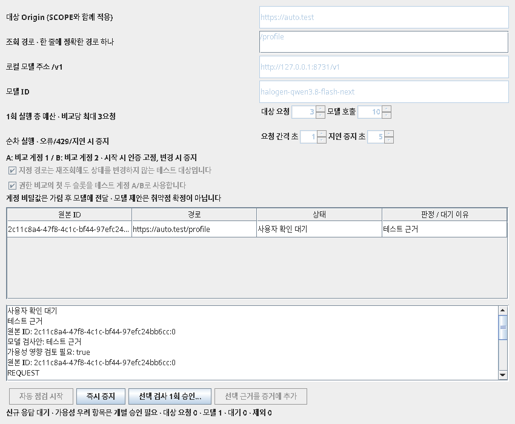

# Next 0.55.0 · 범위 제한 자동 점검

0.54.0의 수동 로컬 LLM 분석에 백그라운드 자동 점검을 추가합니다. 설정 → **로컬 LLM 자동 점검**에서 시작합니다. 신규 Proxy/Repeater 응답만 처리하며, 브라우징·크롤링 자체를 시작하지 않습니다.

## 처음 한 번 설정

1. Workbench SCOPE에 허가된 대상을 등록하고 SCOPE 수집을 켭니다.
2. 권한 비교의 첫 두 슬롯에 서로 다른 테스트 계정 A/B를 연결합니다. 원본은 A로 관측한 요청이어야 합니다. 계정명·역할은 사용자 선언이며 자동으로 신원을 증명하지 않습니다.
3. 자동 점검에서 Origin과 **정확한 조회 경로**를 한 줄에 하나씩 지정합니다. 와일드카드는 없습니다. 재조회가 상태를 바꾸지 않는 경로인지 확인합니다.
4. 대상 요청 총 예산, 모델 호출 예산, 요청 간격, 지연 중지 기준을 정하고 시작합니다. 기본값은 대상 30건, 모델 10회, 간격 2초, 지연 중지 5초입니다. 검사당 기준 요청을 포함해 최대 3건입니다.
5. A로 사이트를 탐색하면 새 응답이 선별되고 가림된 미리보기가 로컬 모델로 전달됩니다. HTML 등 기존 가림 기능이 지원하지 않는 본문은 생략되어 분석 범위가 제한됩니다.

## 실제 자동 검사 범위

이번 버전의 실행 가능한 검사 유형은 **GET 조회의 계정 간 접근 비교**입니다. 모델은 비교 또는 추가 검토를 선택하며, 실행기는 기존 URL을 A → B → A로 재전송합니다. 마지막 A 요청은 기준 응답의 안정성을 확인하는 대조군입니다. 모델이 URL·페이로드·명령·대상을 자유롭게 만들 수는 없습니다.

B가 동일한 비어 있지 않은 데이터를 반환하면 인가 취약점 후보로, 401/403이면 차단 응답 관측으로 기록합니다. A 기준의 실패·변동은 판단 불가입니다. HTTP 200 또는 응답 일치만으로 취약점을 확정하지 않습니다. 기대 권한·데이터 소유·공개 정보 여부를 추가로 확인해야 합니다.

SQLi 시간 지연, 부하 검사, 대용량 처리, 파일 업로드, 결제·삭제 등 상태 변경 검사는 자동 실행하지 않습니다. 이들은 별도의 구체적인 검사안과 사용자 확인이 필요한 수동 검토 항목입니다. 이 버전이 모든 취약점 유형을 자동 재현하는 스캐너는 아닙니다.

## 가용성 우려 항목의 사용자 확인

모델이 가용성 영향 또는 불확실성을 표시한 GET 비교는 **사용자 확인 대기**로 남고 대상 요청은 0건입니다. 항목을 선택하면 원본 미리보기와 이유를 읽을 수 있습니다. **선택 검사 1회 승인**에서 대상과 고정된 3요청 계획을 확인한 경우에만 그 항목을 실행합니다. 포괄 승인은 없으며 승인 유효기간은 계획 생성 후 3분입니다. 이 버튼은 고비용·상태 변경 검사 기능을 해제하는 권한이 아닙니다.

승인 후에도 SCOPE·계정·프로젝트·예산을 다시 검사하며 간격과 가용성 중지 기준을 유지합니다. 모델의 위험 분류는 안전 보증이 아니므로 조회 경로를 신중히 지정해야 합니다. GET 자체가 부작용 없음을 보증하지 않습니다.

## 제한과 중지

- 대상 전송과 모델 추론은 각각 순차 처리하며 대기열은 32개, 실행 중 중복 원본 주소 기억은 128개, 결과 보관은 100개입니다. 제외·대기 수를 표시합니다.
- 계정·프로젝트 변경, SCOPE 이탈, 모델 출력 형식 오류, 전송 실패, HTTP 429/5xx, 지정 지연 도달 시 중지합니다. 자동 재시도·자동 재개는 없습니다.
- 확장에서 보낸 검사 요청은 다시 자동 분석 대상으로 넣지 않습니다. 기존 신규 요청 자동 비교와 동시에 시작할 수 없습니다. 이 예산은 이 자동 점검기의 요청만 집계합니다.
- 중지는 후속 요청을 막습니다. 이미 Burp에 넘긴 요청은 최대 10초 응답 제한까지 기다릴 수 있으며 실제 서버 작업을 취소한다는 뜻은 아닙니다. 창 닫기는 숨김이므로 실행은 계속됩니다. 정지는 **즉시 중지**를 사용합니다.
- 계정 인증과 결과는 메모리 전용이며 재시작 시 자동 실행하지 않습니다. 중지 후 선택 원본과 재현 요청·응답을 기존 증거 화면에 명시적으로 추가할 수 있습니다.
- 원본 요청+응답 128 KiB 이내만 분석합니다. 재현 응답이 한도를 초과하면 중지합니다. 이 사후 검사로 서버가 큰 응답을 만드는 비용을 미리 제한할 수는 없습니다.

## 검증

운영 Java 빌드와 엔진 42개, 합성 Montoya 패널 16개, 기존 LLM의 네트워크 없는 검사 34개, 증거 가림 7개가 통과했습니다. 실제 사용자 터미널에서 Halogen 구조화 검사안 요청도 2.9초에 성공했습니다. 합성 입력의 결과는 REVIEW였고 대상 요청은 0건입니다. 모델의 공개/정적 정보라는 해석은 관측으로 증명되지 않았으므로 분석 품질 또는 실제 취약점 발견 성공으로 해석하지 않습니다.

배포 후보 CI 전체 **4,886개** 검사와 Mapper Java 134개·Node 15개, 배포 무결성 검사가 통과했습니다. 설치 JAR와 소스 ZIP을 로컬로 가져와 SHA-256, ZIP CRC, 소스 393개 지문 일치를 확인했습니다. 확대 CI는 배포 파일이 포함된 커밋에서 다시 확인합니다.

[설치 JAR](../downloads/extensions/0.55.0/burp-workbench-kr-0.55.0.jar) · [소스 ZIP](../downloads/extensions/0.55.0/burp-workbench-kr-0.55.0-source.zip)

전체 CI와 배포 무결성 결과는 [검증 기록](VERIFICATION_0.55.0_AUTO_LLM.json) 및 [PR #108](https://github.com/ohjun1998/burp-workbench-kr/pull/108)에 기록합니다. 실제 Burp GUI는 Linux 화면 제어 미지원으로 별도 확인 대상입니다.

실모델 계획만 다시 확인하려면 `python3 tools/check_live_auto_llm.py`를 사용합니다. 대상 사이트에는 요청하지 않습니다. 이 후속 진단 도구는 저장소에 별도로 제공하며 이미 포장한 배포 ZIP은 수정하지 않습니다.
