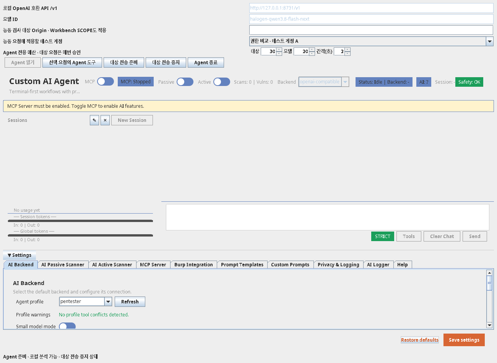

# Next 0.56.0 · Custom AI Agent 통합

Next의 설정 → Custom AI Agent에서 원본 Agent 1.1.0 화면을 엽니다. 별도 Burp 확장으로 중복 설치할 필요가 없습니다. Java 21 이상이 필요하며 기존 Next 엔진과 이전 배포는 보존합니다.

1. Workbench 요청·응답 목록에서 분석할 원본을 선택합니다.
2. 설정 → Custom AI Agent에서 Halogen 주소와 모델 ID를 확인하고 **Agent 열기**를 누릅니다. 기본 주소는 `http://127.0.0.1:8731/v1`입니다.
3. 내장 화면 상단 **MCP**를 켜서 Agent의 내부 연결을 시작합니다. 기본 수신 주소는 loopback이며 다른 MCP 서버가 같은 포트를 쓰면 Agent의 MCP 설정에서 빈 포트를 선택합니다. **선택 요청의 Agent 도구**에서 분석·수동 스캔 메뉴를 사용합니다. 원본 Agent 화면과 메뉴는 영어입니다. MCP ON은 대상 요청 승인과 별개입니다.
4. 능동 검사는 Workbench SCOPE, 정확한 Origin, 권한 비교의 테스트 계정 A 또는 B, 요청 예산을 지정하고 **대상 전송 준비**를 누릅니다. 원본 Agent에서도 Active Scanner를 명시적으로 켜야 합니다.
5. 실제 전송 전마다 **요청 전체와 영향을 확인하고 1건 승인**합니다. 승인 화면은 로컬 표시이며 인증값을 포함할 수 있습니다. 취소·닫기는 전송하지 않습니다.

## 실행 범위

원본 Custom AI Agent의 UI·로컬 HTTP 백엔드·핵심 스캐너를 내장합니다. 이는 기존 0.55.0 GET A→B→A 자동 검사와 별도 기능입니다. 새 Agent의 능동 요청은 모두 개별 승인 방식으로, 모델이 위험하지 않다고 판단해도 자동 승인하지 않습니다. 원본 프로젝트가 열거한 취약점 유형 전체의 탐지 성공이나 재현 성능을 검증했다는 의미가 아닙니다.

Workbench는 테스트 계정 인증값을 요청에 적용하고, 전송 직전 SCOPE·Origin·실제 서버·Host·계정·프로젝트를 검사합니다. 검사 대상 요청을 직렬화하고 1초 이상 간격과 총 요청 예산을 적용합니다. 기본 대상 30건, 모델 20회, 간격 2초입니다. 모델 호출 예산에는 상태 확인·재시도가 포함됩니다. 429·5xx·전송 오류·5초 이상 지연에서 후속 전송을 중지하고 리디렉션을 따라가지 않습니다. 시작한 Burp 전송은 최대 10초 응답 제한까지 기다릴 수 있으며 서버의 이미 시작한 작업을 취소하지는 않습니다.

Agent 창을 닫으면 대상 전송을 중지합니다. 모델 대화까지 종료하려면 **Agent 종료**를 사용합니다. 로드·재시작 때 대상 전송과 스캐너는 OFF이며 설정은 메모리 전용입니다. 원본 Agent는 자체 기본 프로필 파일을 `~/.burp-ai-agent/AGENTS`에 설치할 수 있습니다.

## 통합판 제한

Burp 내장 Scanner의 수동/능동 ScanCheck 연동은 Pro 기능입니다. Community에서는 내장 Scanner 연동 없이 Agent의 수동 메뉴를 중심으로 사용합니다. 실제 Community/Pro GUI를 각각 실행해 검증한 것은 아닙니다.

- 이 통합판의 모델 전송은 지정한 로컬 OpenAI 호환 API의 models/chat-completions 경로로 제한합니다.
- CLI·drop-in 백엔드·외부 MCP 클라이언트·전체 빌드의 추가 플러그인은 로드하지 않습니다. 내부 MCP는 원본 핵심 도구만 제공합니다.
- 일괄 전송·별도 RequestEngine·Intruder·WebSocket·Collaborator·Burp Scanner 작업 시작은 연결하지 않습니다. 이러한 경로가 필요한 원본 기능은 제한 메시지를 표시할 수 있습니다.
- Agent 예산은 이 연결부를 통과하는 요청에만 적용합니다. 사용자가 별도로 실행하는 Burp 도구의 요청을 합산하지 않습니다.
- Agent는 전송 전에 기존 자동 점검·신규 요청 자동 비교 상태를 확인하고, 켜져 있으면 새 대상 요청을 차단합니다. 이미 전송된 요청은 중지 뒤에도 응답을 기다릴 수 있으므로 다른 자동 작업으로 전환하기 전에 종료를 확인합니다. 수동으로 실행하는 다른 도구는 별도 동작입니다.
- upstream JAR는 수정 없이 내장하며 SHA-256을 빌드·실행 때 확인합니다. 격리 클래스 로더는 의존성 충돌을 줄이기 위한 것으로 Java 보안 샌드박스가 아닙니다.

## 검증 상태

[배포 후보 CI](https://github.com/ohjun1998/burp-workbench-kr/actions/runs/43683716289)에서 전체 4,923개 검사와 원본 JAR 부팅 10개 검사가 통과했습니다. 전송 경계 37개는 전체 4,923개에 포함되며 합산하지 않습니다. Mapper Java 134개와 Node 15개도 통과했습니다. 로컬 Java 25에서도 배포 JAR를 그대로 사용해 37개+10개를 재확인했고, JAR·소스 ZIP 체크섬 및 소스 401개 지문을 대조했습니다.

원본 부팅 검사는 합성 Montoya API와 별도 임시 사용자 홈을 사용합니다. native Burp GUI, 실제 Halogen 대화, 내부 MCP 연결 및 실제 대상 능동 검사는 미검증입니다. 초기 확대 CI는 산출물이 아직 커밋되기 전 manifest 부재로 실패했습니다. 산출물 추가 후 인증 조합·50업무 권한 비교는 통과했지만 Java 17 화면 하네스의 JSON 후보 준비에서 10초 시간 초과가 발생했습니다. 운영 코드와 화면 하네스를 변경하지 않고 [Java 21 전용 화면 검증](https://github.com/ohjun1998/burp-workbench-kr/actions/runs/43685858650)을 실행해 전체 8,088개 컨트롤과 8개 세부 화면 묶음, 패키징 7개 검사 및 소스 지문 검증이 통과했습니다. 잘림 판정은 0건이며 전체·세부 검사는 겹치므로 합산하지 않습니다. [검증 기록](VERIFICATION_0.56.0_CUSTOM_AGENT.json)에 실행 기준과 한계를 구분합니다.

출처: https://github.com/six2dez/burp-ai-agent/tree/v1.1.0 (MIT). 원본 라이선스와 의존성 고지는 내장 JAR에 보존합니다.

## 통합 화면

아래 그림은 실제 통합 패널의 Agent 열기 버튼으로 원본 UI를 로드한 합성 Montoya 화면입니다. native Burp 캡처가 아닙니다.

