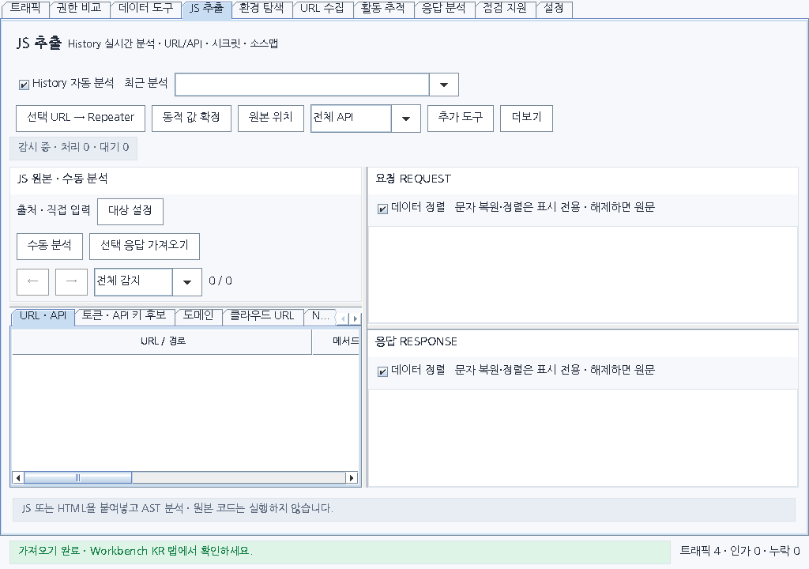
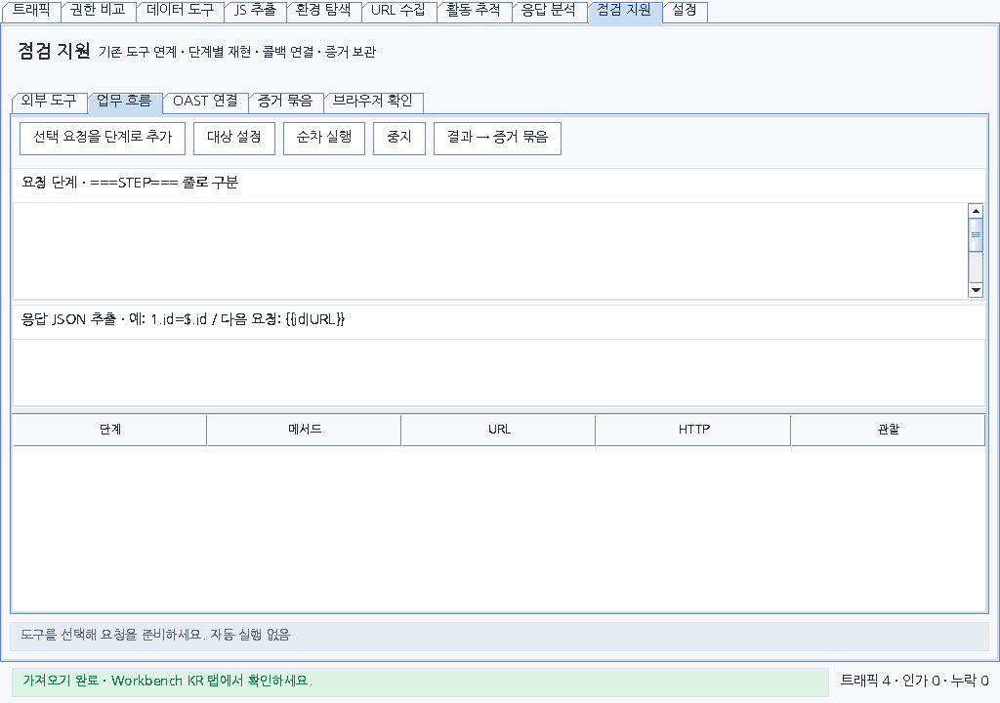
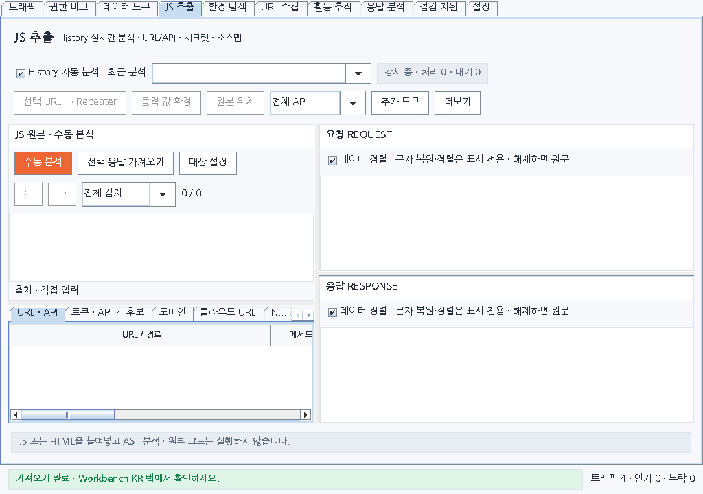
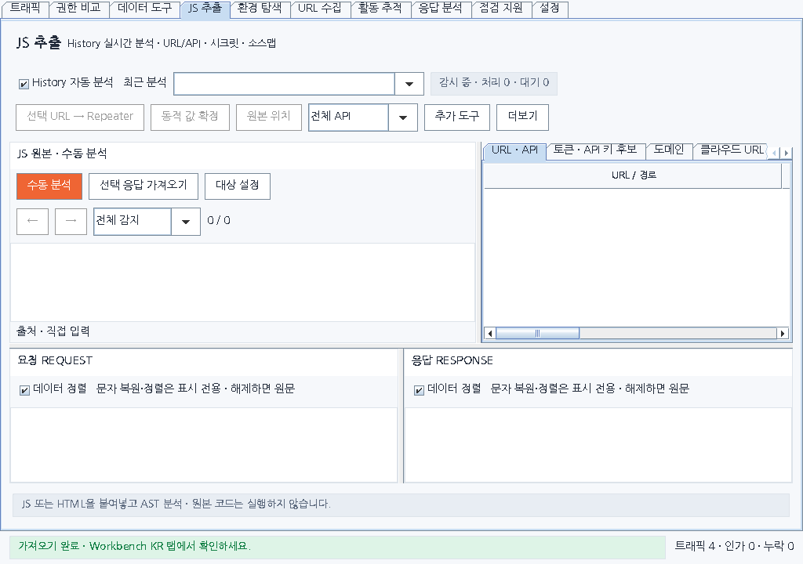
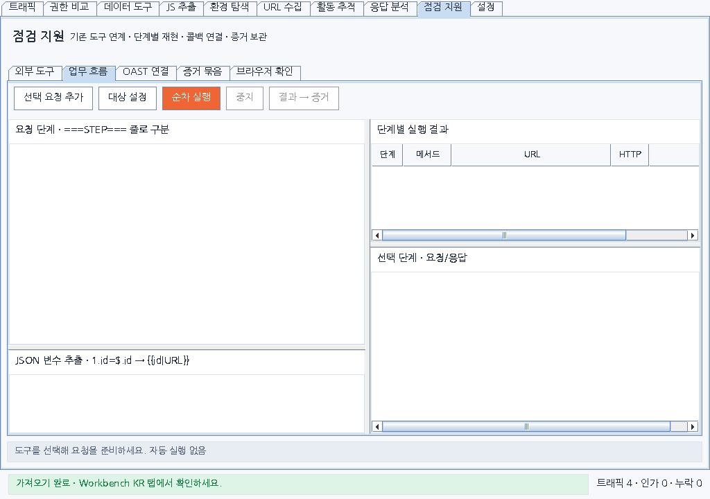
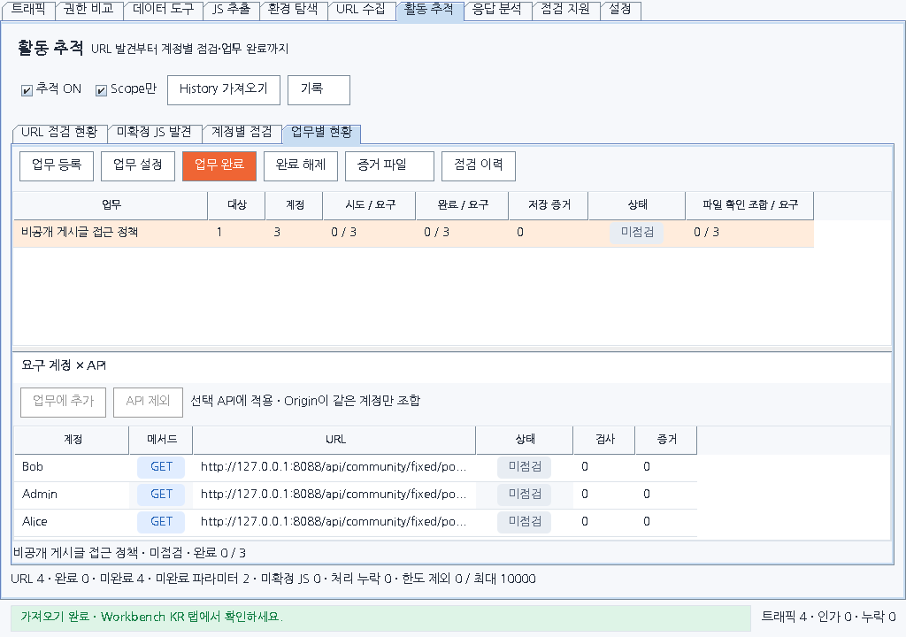

# 0.24.0 화면·버튼 개선

0.23.0의 실제 Swing 구성 요소를 같은 데이터와 크기로 렌더링해 비교했습니다. 버튼 수를 줄이는 것과 함께 원문·결과·점검표에 필요한 공간을 확보하는 데 초점을 맞췄습니다.

## 화면별 변경

| 화면 | 이전 불편 | 개선 |
|---|---|---|
| 활동 추적·계정·업무 | URL 전용 기능이 계정·업무 화면에도 계속 표시 | 공통 기능 한 줄, URL 전용 기능은 URL 화면으로 이동 |
| 업무별 현황 | 증거 관리·API 연결 등 10개 버튼이 같은 위치에 혼재 | 증거 관리 메뉴와 선택 업무·API에 맞춘 동작 배치 |
| JS 추출 | 작은 화면에서 수동 원문 입력 영역이 사라짐 | 원문 위 도구 줄을 압축하고 입력 영역 확보 |
| 점검 지원 → 업무 흐름 | 단계 표 아래의 요청·응답 상세가 화면 밖에 배치 | 입력과 결과를 좌우로 나누고 단계·상세를 세로 분할 |
| 점검 지원 → 증거 묶음 | 긴 본문 입력에 가로 스크롤, 저장 버튼이 섞임 | 영향·재현 문장 줄바꿈, 저장 동작 강조 |
| 데이터 비교 | 좌우 원본 가져오기와 비교 동작이 한곳에 혼재 | 각 데이터 영역 가까이에 가져오기, 비교·증거 동작 구분 |
| 응답 분석 | 탭과 관계없는 API·마커 기능도 공통 영역에 표시 | 관련 탭 안에 기능을 배치 |
| 공통 버튼·트래픽 | 실행 가능 상태와 버튼 강조가 어긋나고 NO가 좁은 열에서 잘림 | 준비된 주요 동작만 강조, 비활성은 중립색, NO·메서드·상태 최소 폭 확보 |

선택이나 준비된 결과가 필요한 동작은 해당 조건을 화면에 반영합니다. 기존 점검 로직, SCOPE 제한, 증거 가림과 수동 확인 절차를 유지합니다.

## 작은 화면에서 확인한 문제

아래 그림은 **개선 전 0.23.0**, 확장 작업 영역 1024×720 기준입니다. Burp 전체 창 크기와는 다릅니다.



JS 원문 입력은 실제 보이는 높이가 0px였습니다. 기본 배치의 버튼이 모두 보여도 원문을 입력할 공간이 없으므로 버튼 경계만 검사해서는 발견할 수 없는 문제입니다.



업무 흐름의 선택 단계 요청·응답 상세도 화면 밖으로 밀려 실제 보이는 높이가 0px였습니다.

## 개선 후



같은 1024×720에서 JS 원문을 입력할 수 있는 높이 99px를 확보했습니다. 원본·결과의 분할 막대도 계속 조절할 수 있습니다.

공통 설정에서 요청·응답을 가로로 배치하는 경우도 확인했습니다. JS 원문·결과 위, 요청·응답 아래 구조에서 같은 1024×720의 원문 높이는 99px, 각 패킷 본문은 94px입니다.





업무 흐름은 왼쪽에서 요청과 추출 규칙을 작성하고, 오른쪽에서 단계 표와 선택 단계의 요청·응답을 동시에 확인합니다.



업무별 현황에서는 업무 동작과 선택 API 동작을 나눴습니다. 예시의 요구 계정 3개를 세로 스크롤 없이 확인할 수 있습니다.

| 본문에서 실제 보이는 높이 | 크기 | 0.23.0 | 0.24.0 |
|---|---|---:|---:|
| JS 수동 원문 | 1024×720 | 0px | 99px |
| JS 수동 원문 | 1280×800 | 1px | 147px |
| JS 수동 원문 | 1440×920 | 53px | 219px |
| JS 대체 배치 원문 | 1024×720 | 0px | 99px |
| JS 대체 배치 원문 | 1280×800 | 0px | 147px |
| JS 대체 배치 원문 | 1440×920 | 35px | 219px |
| 업무 흐름 선택 단계 상세 | 1024×720 | 0px | 214px |
| 업무 흐름 선택 단계 상세 | 1280×800 | 0px | 279px |
| 업무 흐름 선택 단계 상세 | 1440×920 | 0px | 351px |
| 요구 계정×API 표 | 1024×720 | 81px | 96px |

밝은/어두운 테마의 측정값이 같았습니다. 새 버전은 96개 화면에서 누적 918개 버튼·입력 경계를 측정해 스크롤 밖 잘림 0건, 24px 미만 입력 0건, 핵심 작업 영역 최소 높이 미달 0건을 확인했습니다. 이전 버전은 동일 조건에서 핵심 작업 영역 18건이 기준에 미달했고, 대체 배치의 일부 버튼·필터가 1024×720에서 잘렸습니다(두 테마 합계 6건). 이 수는 반복 화면의 레이아웃 측정이며 별도 기능 검사의 통과 수와 합산하지 않습니다.

[측정 JSON](ui/0.24.0/after/layout-report.json) · [버튼·입력 CSV](ui/0.24.0/after/controls.csv) · [본문·표 CSV](ui/0.24.0/after/content.csv) · [어두운 테마 예시](ui/0.24.0/after/tasks-dark-1024.png)

검사 JAR SHA-256: `9cc3f7daac2342048cdf5693f84c155d07ce8f189e805f6a8b247182273ecbfd`.

## 재현과 검증 방법

```sh
python dev.py test
python tools/render_ui_layout.py --out tmp/ui-layout --check
```

기본 명령도 `build_all.py`의 현재 버전에 해당하는 `dist` JAR를 사용해 동봉 글꼴까지 반영합니다. JAR 해시를 기록하고 렌더링 중 파일이 바뀌면 중단합니다. 별도 배포 JAR를 검증할 때는 `--jar downloads/extensions/0.24.0/burp-workbench-kr-0.24.0.jar`를 추가합니다.

이전 JAR를 대상으로 같은 방식으로 비교할 수 있습니다. `--check`를 붙이면 기준에 미달한 작업 영역에서 실패합니다.

```sh
python tools/render_ui_layout.py --jar downloads/extensions/0.23.0/burp-workbench-kr-0.23.0.jar --out tmp/ui-layout-before
```

검사 크기는 1024×720, 1280×800, 1440×920이며 밝은/어두운 테마에서 각 16개 화면을 렌더링합니다. Swing 이벤트 큐의 크기 변경·재배치 처리를 마친 뒤 실제 화면에 노출되는 사각형을 측정합니다. 스크롤 가능한 표의 전체 폭과 당장 보이는 버튼 경계를 구분합니다.

`controls.csv`는 버튼·입력의 위치와 크기, `content.csv`는 본문·표의 실제 노출 영역, `layout-report.json`은 검사 조건과 결과입니다. 게이트는 스크롤 밖으로 잘린 입력, 24px보다 작은 입력, 70~80px 기준을 충족하지 못한 핵심 작업 영역을 확인합니다. 수치만으로 사용성을 보증하지 않으므로 PNG도 직접 검토합니다.

검사는 운영 Swing 코드에 합성 메타데이터와 테스트 API 어댑터를 넣은 헤드리스 렌더링입니다. 어두운 테마는 테스트 프로세스의 Swing Metal 색상을 조정한 것이며 Burp의 실제 테마를 복제한 것은 아닙니다. **실제 Burp GUI, 운영체제별 글꼴·DPI, 브라우저 또는 Docker 실행 검증은 아닙니다.** 실제 Burp에서는 창을 줄였다 늘리고, 키보드 포커스 이동·툴팁·팝업 메뉴·분할 막대 동작을 추가로 확인해야 합니다.
