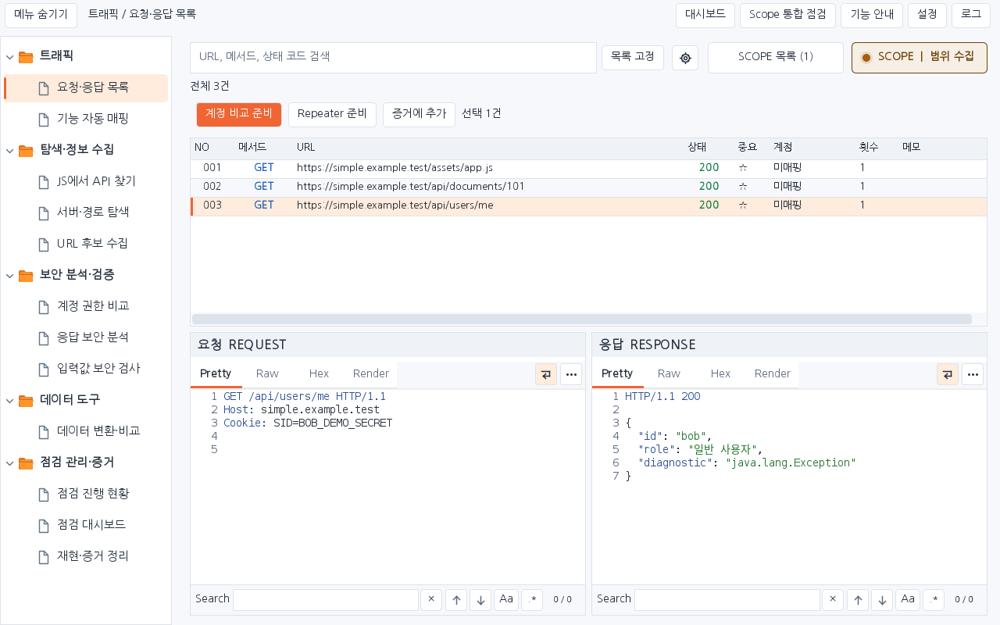
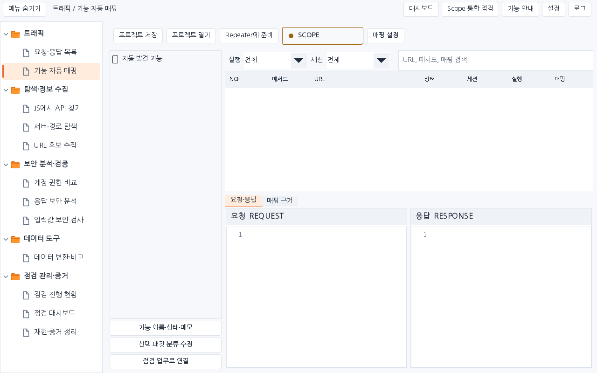
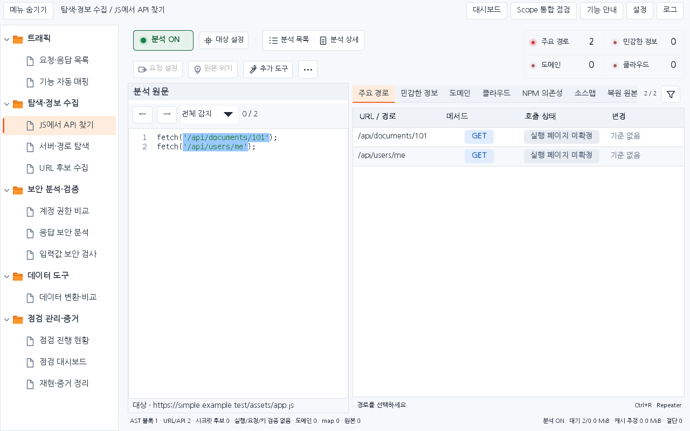
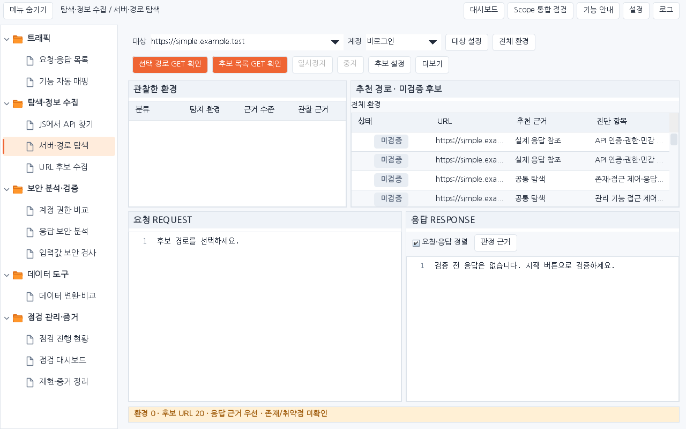
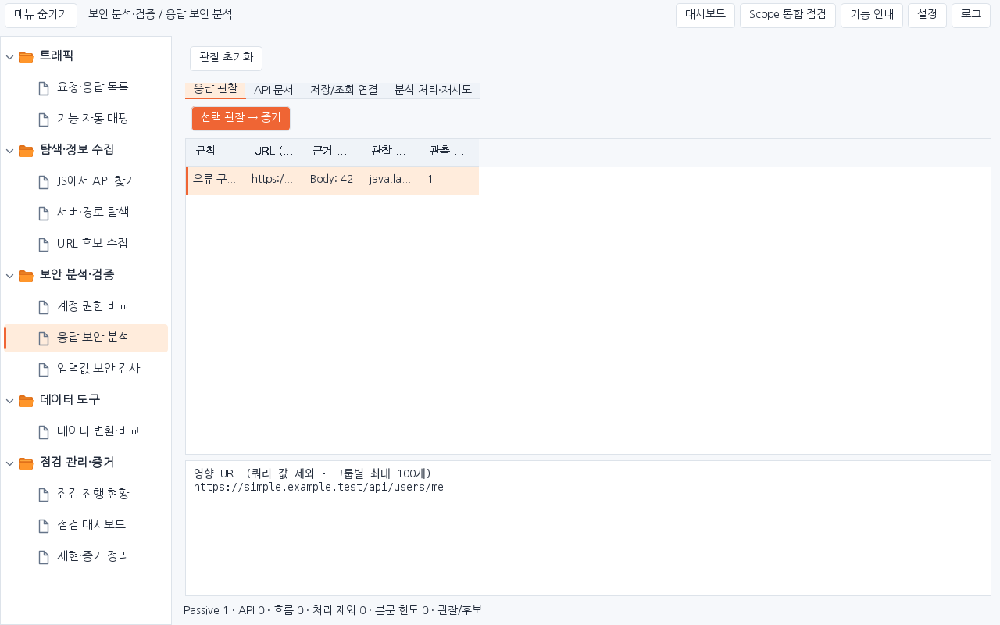
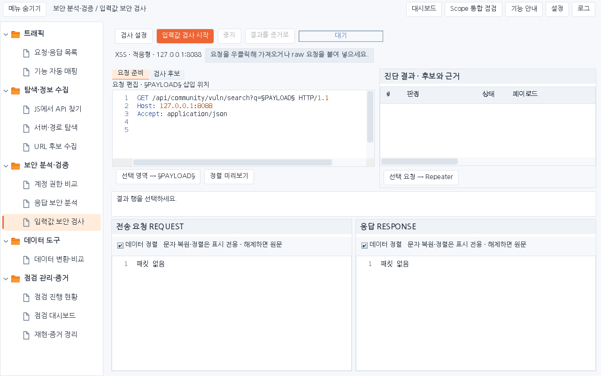
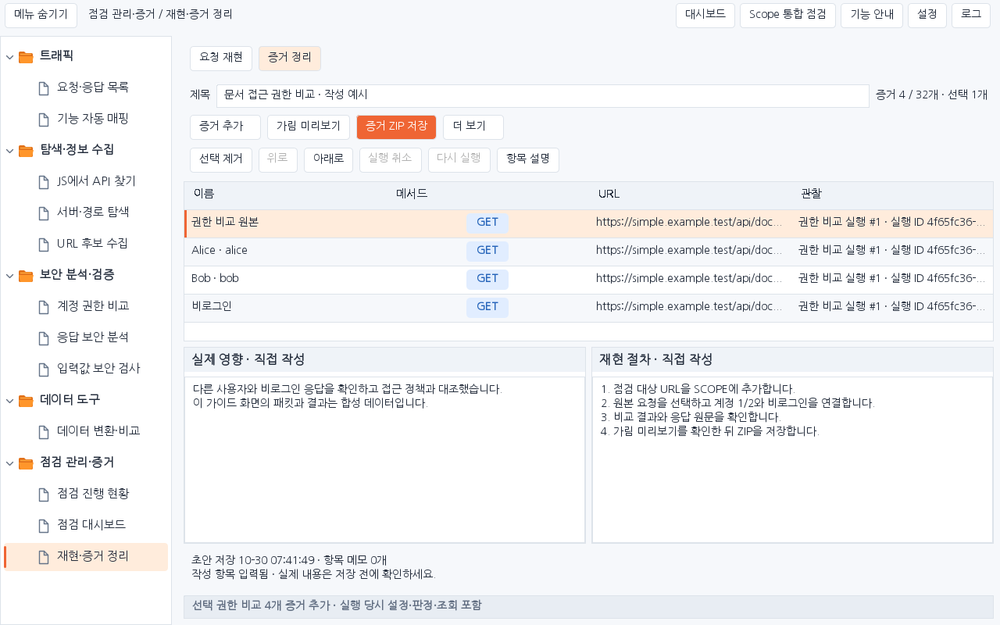
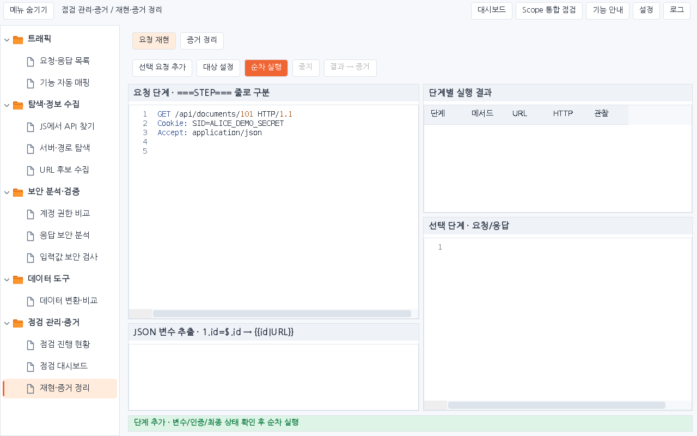

# Simple 1.4.4 · 도구별 화면 캡처

현재 배포 JAR와 같은 운영 Swing 컴포넌트에 합성 데이터를 넣은 화면입니다. 실제 Burp GUI 캡처나 실제 사이트 검사 결과가 아닙니다. 이미지 속 계정·세션 값은 테스트용 예시입니다. 앱 코드·배포 JAR는 변경하지 않았습니다.

[밝은/어두운 테마 PNG 전체 ZIP](simple-1.4.4-tool-captures.zip) · [캡처 원본 정보](captures.json)

기존 8개 도구와 재현 도구의 추가 탭 1개입니다. 각 원본은 1280×800이며, 제목 아래에 캡처 상태를 표시했습니다.

## 요청·응답 목록

합성 요청 3개와 선택한 요청·응답 원문 예시

[밝은 테마 원본](01-traffic-light.png) · [어두운 테마 원본](01-traffic-dark.png)

## 기능 자동 매핑

빈 프로젝트 · 매핑 목록이 아직 없는 초기 상태

[밝은 테마 원본](02-mapper-light.png) · [어두운 테마 원본](02-mapper-dark.png)

## 계정 권한 비교

합성 계정 후보와 비교 기록 예시 · 실제 전송/취약점 판정 아님

[밝은 테마 원본](03-auth-light.png) · [어두운 테마 원본](03-auth-dark.png)

## JS에서 API 찾기

합성 JavaScript의 API 경로 분석 예시

[밝은 테마 원본](04-js-light.png) · [어두운 테마 원본](04-js-dark.png)

## 서버·경로 탐색

경로 후보가 있으나 GET 검증 전 · 실제 검증 응답 없음

[밝은 테마 원본](05-environment-light.png) · [어두운 테마 원본](05-environment-dark.png)

## 응답 보안 분석

합성 응답에서 수집한 관찰 항목 예시

[밝은 테마 원본](06-response-light.png) · [어두운 테마 원본](06-response-dark.png)

## 입력값 보안 검사

요청 준비·검사 대기 상태 · 실행 결과 없음

[밝은 테마 원본](07-payload-light.png) · [어두운 테마 원본](07-payload-dark.png)

## 재현·증거 정리

합성 원본·비교 패킷과 증거 작성 예시

[밝은 테마 원본](08-evidence-light.png) · [어두운 테마 원본](08-evidence-dark.png)

## 재현·증거 정리 — 요청 재현 탭

8번 도구의 추가 화면 · 요청만 준비하고 실행하지 않은 상태

[밝은 테마 원본](09-replay-light.png) · [어두운 테마 원본](09-replay-dark.png)

