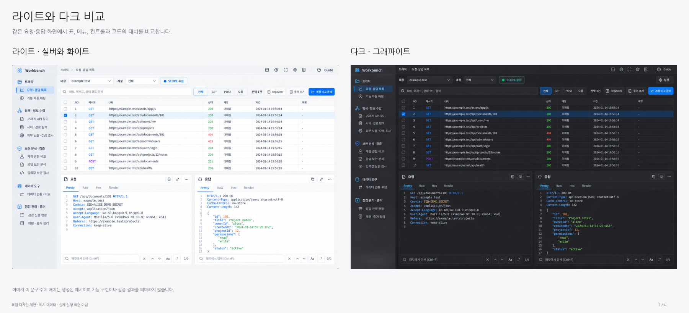

# Workbench Apple 디자인 언어 참고 시안

[라이트·다크 PDF 다운로드](workbench-apple-inspired-light-dark.pdf)

현재 Workbench 요청·응답 화면을 라이트와 다크 두 가지로 구성한 독립 디자인 제안입니다. Apple의 공식 프롬프트가 아니라 정돈된 타이포그래피, 은은한 재질감, 얇은 구분선, 절제된 파란 강조색을 참고하여 작성한 디자인 지시를 사용했습니다.

- 1쪽: 디자인 원칙과 적용한 디자인 지시 요약
- 2쪽: 라이트·다크 비교
- 3쪽: 라이트 확대 화면
- 4쪽: 다크 확대 화면

이미지는 생성한 디자인 시안이며 실제 실행 화면이나 구현 증거가 아닙니다. 문구·수치·배치는 예시입니다. 제품 소스코드와 기존 배포 파일은 변경하지 않았습니다.

## 확인

PDF 4쪽과 북마크 4개, 이미지 비율·페이지 경계, 한글 텍스트 배치, 원본 이미지와 PDF 내 이미지의 RGB 픽셀 일치를 확인했습니다. 표지와 비교 페이지를 렌더링하여 육안으로 확인했습니다. 자세한 결과는 [verification.json](verification.json)에 있습니다.

