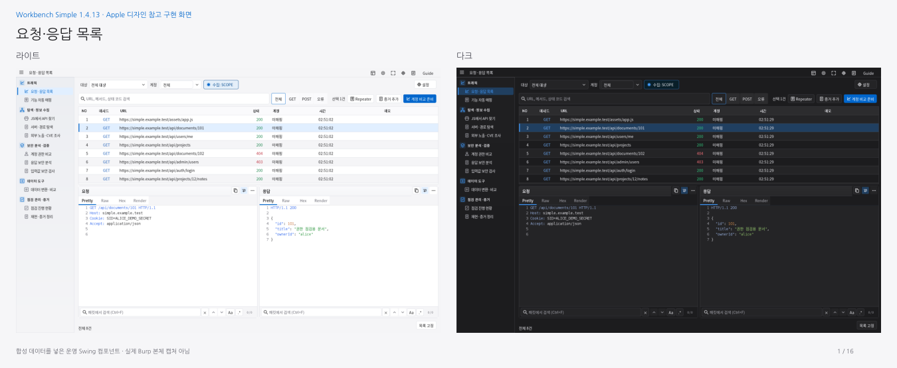

# Workbench Simple 1.4.13 · Apple 스타일 적용 화면

[설치 JAR](../../../simple/downloads/1.4.13/burp-workbench-simple-1.4.13.jar) · [소스 ZIP](../../../simple/downloads/1.4.13/burp-workbench-simple-1.4.13-source.zip) · **[16개 화면 라이트·다크 비교 PDF](workbench-simple-1.4.13-light-dark.pdf)**

승인한 Apple 디자인 언어 참고 시안을 실제 Swing 소스에 적용했습니다. 실버·화이트와 중립 그래파이트, 파란 주요 버튼·선택 표시, 정돈된 아이콘과 얇은 가로 구분선을 공유합니다. 메뉴·버튼·제목줄·입력·표·코드·카드·가이드·내장 Mapper에 같은 테마를 적용합니다. 기존의 36px 상단, Guide/F1, 독립 창·전체화면, 도구 배치와 기존 기능은 유지합니다.

모든 이미지는 합성 데이터를 넣은 운영 컴포넌트 캡처입니다. Apple 공식 UI·운영체제 블러 효과나 생성 시안과의 픽셀 단위 동일성을 의미하지 않습니다. 실제 Windows Burp·DPI/IME는 검증하지 않았습니다. 현재 결과는 작업 브랜치에 있으며, PR 생성에 필요한 GitHub API 인증은 사용할 수 없어 main에 병합하지 않았습니다.

## 화면

| 화면 | 라이트 | 다크 |
|---|---|---|
| 요청·응답 목록 | [보기](images/light/traffic.png) | [보기](images/dark/traffic.png) |
| 기능 자동 매핑 | [보기](images/light/mapper.png) | [보기](images/dark/mapper.png) |
| JS에서 API 찾기 | [보기](images/light/js.png) | [보기](images/dark/js.png) |
| 서버·경로 탐색 | [보기](images/light/environment.png) | [보기](images/dark/environment.png) |
| 외부 노출 조사 · 검색 노출 | [보기](images/light/exposure-search.png) | [보기](images/dark/exposure-search.png) |
| 외부 노출 조사 · CVE 후보 | [보기](images/light/exposure-cve.png) | [보기](images/dark/exposure-cve.png) |
| 계정 권한 비교 | [보기](images/light/auth.png) | [보기](images/dark/auth.png) |
| 응답 보안 분석 | [보기](images/light/response-recon.png) | [보기](images/dark/response-recon.png) |
| 입력값 보안 검사 · 요청 준비 | [보기](images/light/payload.png) | [보기](images/dark/payload.png) |
| 데이터 변환·비교 | [보기](images/light/data.png) | [보기](images/dark/data.png) |
| 점검 진행 현황 | [보기](images/light/activity.png) | [보기](images/dark/activity.png) |
| 재현·증거 정리 | [보기](images/light/bounty.png) | [보기](images/dark/bounty.png) |
| 점검 대시보드 | [보기](images/light/dashboard.png) | [보기](images/dark/dashboard.png) |
| 입력값 보안 검사 · 실행·결과 | [보기](images/light/payload-results.png) | [보기](images/dark/payload-results.png) |
| 재현·증거 정리 · 요청 재현 | [보기](images/light/bounty-replay.png) | [보기](images/dark/bounty-replay.png) |
| 계정 권한 비교 · 인증 후보 연결 | [보기](images/light/auth-accounts.png) | [보기](images/dark/auth-accounts.png) |

## 검증

전체 7,123개 검사(Java 6,811 · payload HTTP 136 · Mapper 147 · Node 29), Swing 194개 배치, 격리 실제 창 112개, Katana 102개를 통과했습니다.

이번 실행 결과는 [VERIFICATION.json](VERIFICATION.json)에 정리합니다. [배치 검사](layout-verification.json) · [Scope 배치](scope-layout-verification.json) · [격리 Linux 실제 창 검사](native-verification.json) · [Guide 번호 위치](guide-anchor-verification.json) · [Katana 로컬 연동](katana-verification.json) · [PDF 검사](pdf-verification.json).

초기 기본 Java에는 Java 17 API 정의 파일이 없어 컴파일하지 못했습니다. 준비된 완전한 JDK 17로 `--release 17` 검사를 실행했습니다. 첫 전체 검사는 샌드박스의 로컬 소켓 제한으로 중단했고, 최종 전체 검사는 격리 loopback 서버를 실행할 수 있는 환경에서 다시 실행했습니다. 이 초기 실행들을 최종 통과 수에 합산하지 않습니다. 첫 전체 실행에서는 과거 Mapper 0.3.13을 고정한 검사 한 곳이 실패했습니다. 기대값을 새 0.3.14로 갱신했으며, [중간 실패 기록](pre-version-expectation-test-summary.json)을 보존합니다. 수정은 테스트 기대값뿐이며 [다시 빌드한 JAR](jar-equivalence.json)은 화면·실제 창·Katana 검증 때와 바이트까지 동일합니다.

생성 시안: [승인한 라이트·다크 PDF](https://raw.githubusercontent.com/ohjun1998/burp-workbench-kr/1f6d2027ea46bcec54858d07f218fbe358991910/docs/reports/2026-10-31-apple-design-pdf/workbench-apple-inspired-light-dark.pdf).
