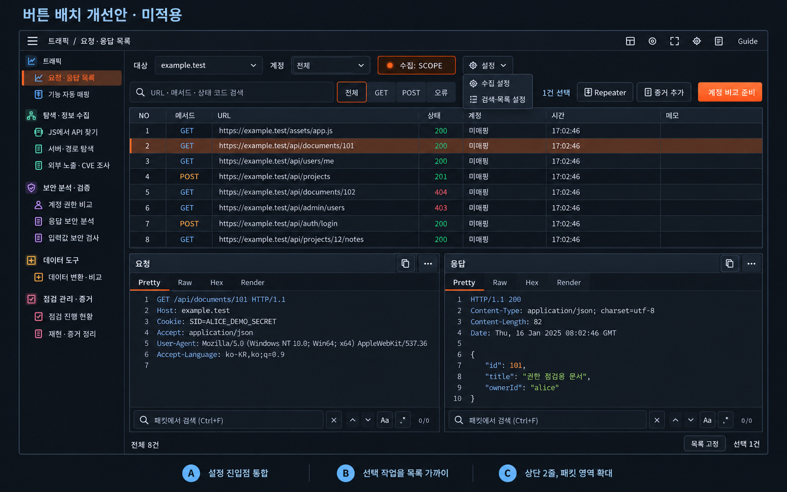
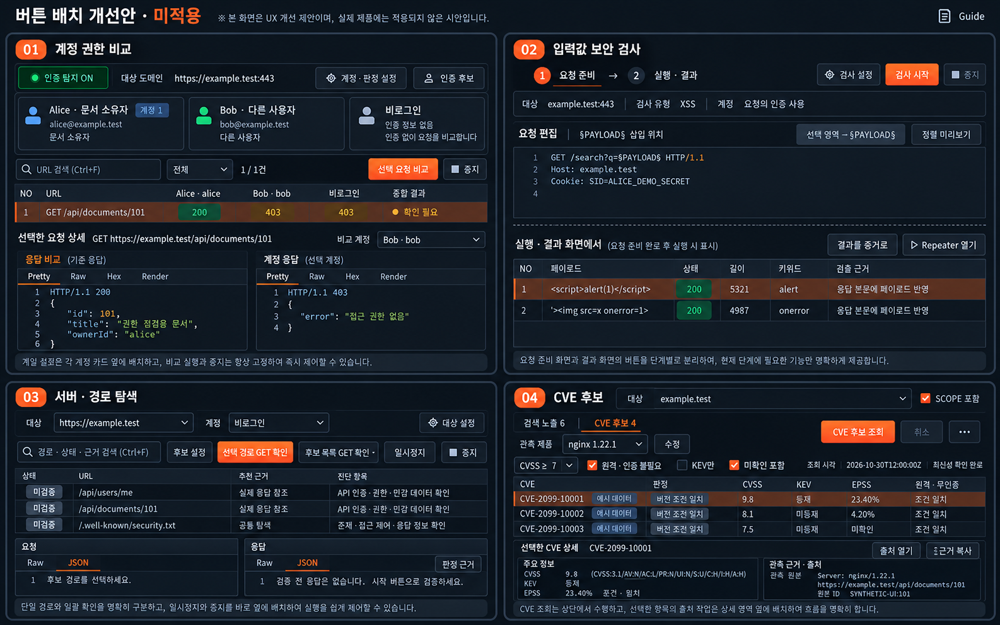
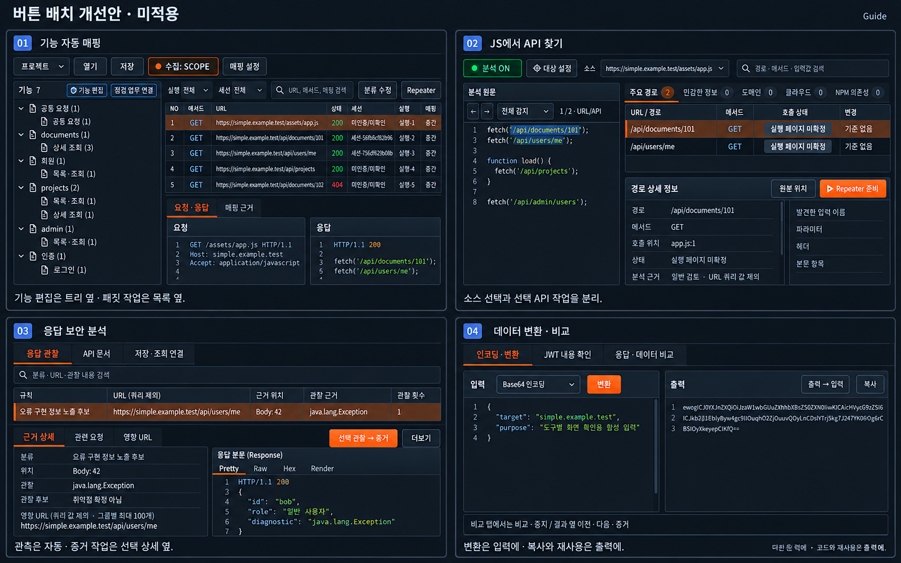
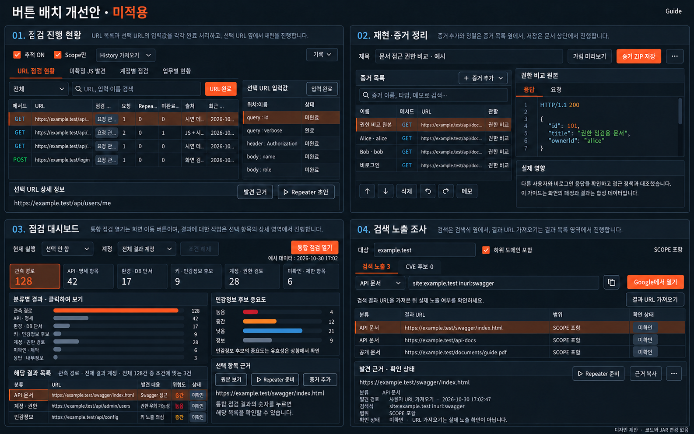

# 버튼 배치 개선 시안 · 미적용

2026-10-31 (Asia/Seoul). Simple 1.4.11의 실제 화면과 동작을 바탕으로 작성한 디자인 제안입니다. 코드와 JAR은 변경하지 않았습니다.

이전 답변의 `/workspace/...` 경로는 내부 작업 공간 경로여서 사용자 다운로드 링크로 적절하지 않았습니다. 아래 파일을 저장소에 게시해 접근 가능한 링크로 교체했습니다.

[전체 이미지·설명 ZIP](button-layout-proposal.zip) · [도구별 배치 설명](README_KR.md) · [갤러리 HTML](index.html)

공통 제안: 상단은 대상·검색·설정 중심, 실행·중지는 함께 고정하고 선택 항목 작업은 해당 목록·상세 영역 옆으로 옮깁니다. 요청 준비와 결과 활용 버튼은 단계별로 구분합니다. 이미지는 생성한 디자인 시안이며 실제 제품 캡처나 반영 완료 증거가 아닙니다.

## 전체 화면 · 요청·응답 목록

## 실행 도구 4종 · 계정 비교·입력값 검사·서버 탐색·CVE

## 분석 도구 4종 · 매핑·JS API·응답 분석·데이터 변환

## 관리·조사 4종 · 현황·증거·대시보드·검색 노출

