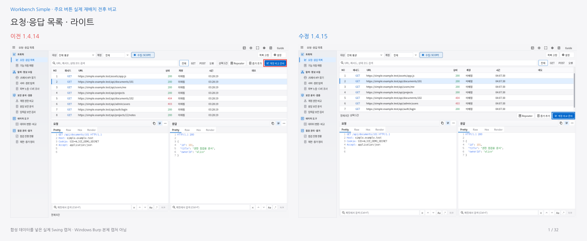
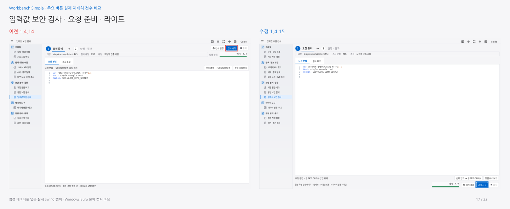

# Simple1.4.15 · 주요 버튼 실제 재배치

**[1.4.14→1.4.15 전후 비교PDF](workbench-simple-1.4.15-before-after.pdf)** · [설치JAR](../../../simple/downloads/1.4.15/burp-workbench-simple-1.4.15.jar) · [소스ZIP](../../../simple/downloads/1.4.15/burp-workbench-simple-1.4.15-source.zip) · [적용 이미지32장/오프라인갤러리ZIP](workbench-simple-1.4.15-images.zip)

사용자가 설치한1.4.14에서 주요 버튼 위치가 그대로라는 지적을 확인했습니다. 앞선 배포는16개 중3개 화면만 작업 영역 간 버튼을 이동했고 대부분은 간격·너비를 바꿨습니다. 이번에는 선택 작업의 실제 부모 영역을 목록/상세의 고정 하단으로 옮기고, 검색·필터와 분리했습니다. 페이로드 실행·중지는 두 단계에서 항상 보이는 화면 하단에 고정합니다.

**14개 화면에서 주요 버튼을 실제 이동했고, 요청 재현·인증 후보 연결2개는 기존 배치를 유지합니다.** [측정한 버튼 좌표](button-movement-verification.json)로 각 대표 버튼의 이전/현재 위치를 대조합니다. PDF는16개 화면×라이트·다크2종의32페이지이며, 빨간 박스가이전/파란 박스가수정 위치입니다.64장의삽입 이미지 픽셀은원본 캡처와 일치합니다. 강조 사각형만PDF 벡터로 겹쳐 표시합니다.

| 화면 | 버튼 | 실제 이동 |
|---|---|---|
| 요청·응답 목록 | Repeater·증거·비교 | 검색줄→요청 목록 아래 |
| 기능 자동 매핑 | 분류 수정·Repeater | 검색줄→결과 표 아래 |
| JS에서 API 찾기 | 추가 도구·원본 위치·Repeater | 상세 제목줄→상세 읽기 아래 |
| 서버·경로 탐색 | GET·일괄 실행·일시정지·중지 | 검색줄→후보 표 아래 |
| 검색 노출 | 선택 URL·근거·Repeater | 목록/상세 위→결과 표 아래 |
| CVE 후보 | 조회·취소·출처·근거 | 제품 입력/상세 위→결과/상세 아래 |
| 계정 권한 비교 | 비교·중지 | 검색줄→기록 표 아래 |
| 응답 보안 분석 | 선택 관찰→증거·API 초안 | 상세/표 위→아래 |
| 입력값 검사 준비 | 표시·미리보기·시작·중지 | 상단→편집기 아래/화면 하단 고정 |
| 데이터 변환·비교 | 변환·출력 재사용·복사 | 편집기 위→편집기 아래 |
| 점검 진행 현황 | URL 완료·입력 완료 | 표 위→각 표 아래 |
| 증거 정리 | 미리보기·ZIP 저장·더보기 | 제목줄→화면 하단 |
| 점검 대시보드 | 원본·Repeater·증거 | 근거 제목줄→근거 아래 |
| 입력값 검사 결과 | 증거·Repeater·실행·중지 | 상단→결과 표 아래/화면 하단 고정 |
| 요청 재현 | 배치 유지 | 1.4.14에서 정리한 요청/결과별 배치 유지 |
| 인증 후보 연결 | 배치 유지 | 1.4.14에서 정리한 넓은 선택란 유지 |

## 검증과 범위

최종 수치는[VERIFICATION.json](VERIFICATION.json)에 기록합니다. [전체 검사](full-check-summary.json) · [배치](layout-verification.json) · [Scope](scope-layout-verification.json) · [실제 창](native-verification.json) · [Guide 번호](guide-anchor-verification.json) · [Katana](katana-verification.json) · [PDF](pdf-verification.json).

첫 배치 검사에서1024px 증거 원문 읽기 영역이58px로 줄어65px 기준을 통과하지 못했습니다. 하단 상태·문서 작업을 한 줄로 모으고 상태 문구의 최소폭을180px로 제한해 줄바꿈하도록 보정했습니다. 기준은 낮추지 않았습니다. [중간 실패](intermediate-layout-evidence-too-short.json).

캡처는 합성 데이터를 넣은 실제Swing 컴포넌트입니다. Windows Burp 본체·DPI/IME와실시간 외부CVE/Google 제공자는 검증하지 않았습니다. 작은1024px 창에서는 표/패킷 리더의스크롤이 필요하며, 별도창 최대화와분할 조정으로 읽기 영역을 넓힐 수 있습니다. 이전 패키지와 원본Next는 보존합니다.

작업 브랜치`account-a/button-placement-correction`. Simple1.4.15/Mapper0.3.16/helper0.4.1. main 병합 완료를 의미하지 않습니다.

## 최종 검증

전체7,176개 검사(Java6,864·payload HTTP136·Mapper147·Node29), Swing194개 배치, 실제 별도창112개, Katana102개 통과. 실제 버튼이동14화면/유지2화면을 좌표로 확인했습니다.

JAR SHA-256: `4758e74ab9d0f268bbe2540b9c75cd565bab172a6576384cd1c4d46aa15987b9`.
