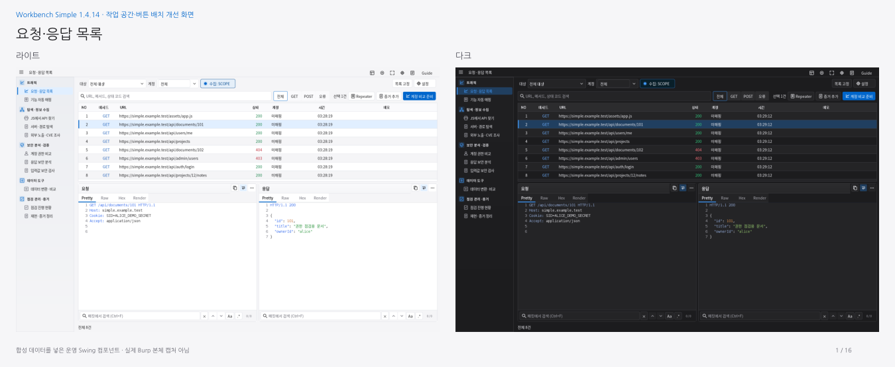

# Workbench Simple 1.4.14 · 작업 공간과 버튼 배치 개선

**[16개 화면 라이트·다크 PDF](workbench-simple-1.4.14-light-dark.pdf)** · [설치 JAR](../../../simple/downloads/1.4.14/burp-workbench-simple-1.4.14.jar) · [소스 ZIP](../../../simple/downloads/1.4.14/burp-workbench-simple-1.4.14-source.zip) · [오프라인 화면 모음 ZIP](workbench-simple-1.4.14-images.zip)

계정 설정을 왼쪽부터 넓게 정렬하고 대시보드 결과가 창 높이를 활용하도록 수정했습니다. URL 검색·표를 넓히고 요청 추가·실행·결과 저장을 해당 작업 영역에 모았습니다. 증거 목록 작업도 목록 바로 위에 모으고 단계줄·도구막대의 여백을 줄였습니다. Apple 라이트·다크 디자인과36px 공통 상단, Guide/F1, 독립 창/전체화면, 기존 기능은 유지합니다.

아래32장은 합성 데이터를 넣은 실제 운영 Swing 컴포넌트 캡처입니다. 실제 Windows Burp 본체·DPI/IME는 검증하지 않았습니다. 전체16개를 검토했고 개선이 필요한 작업 화면 및 공통 도구막대를 수정했습니다. Mapper는 같은 빈 표 안내 보정을 적용해0.3.15/helper0.4.1입니다.

| 화면 | 라이트 | 다크 |
|---|---|---|
| 요청·응답 목록 | [보기](images/light/traffic.png) | [보기](images/dark/traffic.png) |
| 기능 자동 매핑 | [보기](images/light/mapper.png) | [보기](images/dark/mapper.png) |
| JS에서 API 찾기 | [보기](images/light/js.png) | [보기](images/dark/js.png) |
| 서버·경로 탐색 | [보기](images/light/environment.png) | [보기](images/dark/environment.png) |
| 외부 노출 조사 · 검색 노출 | [보기](images/light/exposure-search.png) | [보기](images/dark/exposure-search.png) |
| 외부 노출 조사 · CVE 후보 | [보기](images/light/exposure-cve.png) | [보기](images/dark/exposure-cve.png) |
| 계정 권한 비교 | [보기](images/light/auth.png) | [보기](images/dark/auth.png) |
| 응답 보안 분석 | [보기](images/light/response-recon.png) | [보기](images/dark/response-recon.png) |
| 입력값 보안 검사 · 요청 준비 | [보기](images/light/payload.png) | [보기](images/dark/payload.png) |
| 데이터 변환·비교 | [보기](images/light/data.png) | [보기](images/dark/data.png) |
| 점검 진행 현황 | [보기](images/light/activity.png) | [보기](images/dark/activity.png) |
| 재현·증거 정리 | [보기](images/light/bounty.png) | [보기](images/dark/bounty.png) |
| 점검 대시보드 | [보기](images/light/dashboard.png) | [보기](images/dark/dashboard.png) |
| 입력값 보안 검사 · 실행·결과 | [보기](images/light/payload-results.png) | [보기](images/dark/payload-results.png) |
| 재현·증거 정리 · 요청 재현 | [보기](images/light/bounty-replay.png) | [보기](images/dark/bounty-replay.png) |
| 계정 권한 비교 · 인증 후보 연결 | [보기](images/light/auth-accounts.png) | [보기](images/dark/auth-accounts.png) |

## 검증

최종 수치는 [VERIFICATION.json](VERIFICATION.json)에 기록합니다. [배치 검사](layout-verification.json) · [Scope 배치](scope-layout-verification.json) · [실제 별도 창](native-verification.json) · [Guide 위치](guide-anchor-verification.json) · [Katana](katana-verification.json) · [PDF](pdf-verification.json).

첫 새 회귀 테스트 컴파일에서 하네스 인자 타입/종료 메서드 참조를 수정했습니다. 첫 native 시도는 초기 최대화 대기에서 시간초과되어 완료로 기록하지 않았습니다. 격리 창 관리자의 준비 상태를 확인하도록 실행 스크립트를 수정한 뒤 같은 JAR로 다시 실행하여112개 검사를 통과했습니다. 기존 검사 조건은 완화하지 않았습니다.

작업 브랜치: `account-a/apple-layout-polish`. 이전 Apple1.4.13 구현을 포함하며 main 병합 완료를 의미하지 않습니다.

1600×1000 주 화면에서 대시보드 결과 높이는320→557px, 계정 설정(1000×300) 선택란 너비는336→882px, 입력값 검사 단계줄은54→40px입니다. [측정값](layout-measurements.json).

중간 전체 검사에서는 계정 Guide 번호가 정확히40px 간격인 부분을 발견했습니다. 번호를 해당 선택란 안에서 좌우로 엇갈리게 배치하고, 기존의40px 초과 간격 검사는 유지했습니다. [중간 실패 기록](intermediate-check-guide-overlap.json). 작은 창에서 가로 스크롤 표의 빈 안내가 잘리는 문제도 실제 보이는 영역을 기준으로 그리도록 수정했습니다.

환경 재시작으로 최종 전체 검사 프로세스가ScopeInspectionRunnerTest 이후 종료되어 같은 소스로 전체 명령을 다시 실행했습니다. 완료된 최종 실행만VERIFICATION.json의 통과 수치에 포함합니다.

## 실행한 검사

- `python simple/dev.py check --java /workspace/.cloud-tools/jdk17/bin/java`
- `python simple/tools/render_simple.py --java /workspace/.cloud-tools/jdk17/bin/java --out tmp/polish-final-ui --sizes 1600x1000 1280x800 1024x720 --check`
- `python simple/tools/render_scope_inspection.py --java /workspace/.cloud-tools/jdk17/bin/java --out tmp/polish-final-scope --check`
- `ButtonPlacementNative`와`VisualGuideNative`를 격리Xorg/xfwm4에서 라이트·다크로 실행했습니다.
- `python simple/tools/verify_katana.py --java /workspace/.cloud-tools/jdk17/bin/java --katana .dev-tools/katana/katana --out tmp/polish-katana`

전체 검사 완료 후Simple 입력 파일을 동결하고 `simple/dev.py package`, `simple/dev.py verify`로 배포 파일의 소스 지문·체크섬·ZIP 무결성을 확인합니다.

전체 7,151개 검사(Java 6,839 · payload HTTP 136 · Mapper 147 · Node 29), Swing 194개 배치, 격리 실제 창 112개, Katana 102개를 통과했습니다.

## 업로드 결과

[배포 기록](PUBLISH_KR.md): 구현`69e00d8f56e17e49c7912b7573660ef7e335ff33`의 공개39개 파일을 재다운로드해HTTP200·크기·체크섬 일치를 확인했습니다. GitHub API가Forbidden을 반환해PR 생성과main 병합은 미완료입니다. 작업 브랜치의 파일을 사용할 수 있습니다.
