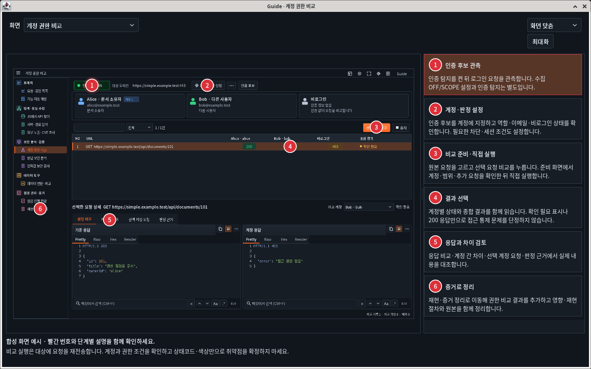
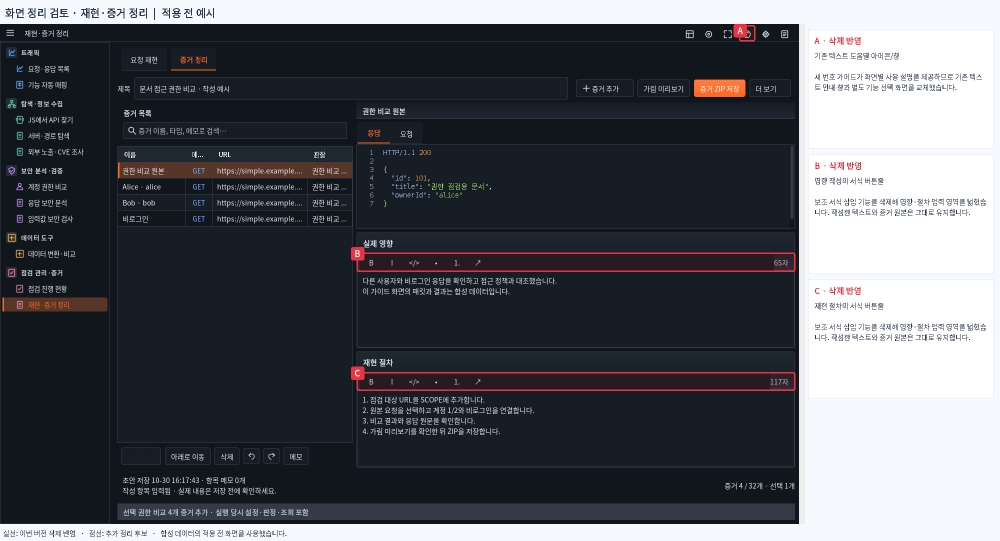

# Simple1.4.11 · 번호 가이드와 화면 정리 이미지

오른쪽 위 Guide/F1로 별도 창에서 빨간 번호 사용 설명을 봅니다. 실제 Linux Swing/창 관리자로 캡처했으며 예시 데이터는 합성입니다. Windows Burp 본체 캡처와 구분합니다.

[가이드·검토·정리 후 대화형 갤러리](index.html) · [전체 이미지 ZIP](all-images.zip) · [가이드 ZIP](guide-images.zip) · [정리 검토 ZIP](cleanup-review-images.zip)

**빨간 숫자는 사용 단계**입니다. **정리 검토의 빨간 박스는 적용 전 이미지**이며 실선=이번 버전 삭제 반영, 점선=추가 검토 후보입니다. 모든 점선 기능을 삭제한 것이 아닙니다.

실제 제거: 구형 텍스트 안내 창, 중복 준비 버튼, 중복 분류 수정 버튼, 증거 빠른 서식/글자 수 줄, 점검 현황 반복 제목줄. 문서/Markdown 직접 편집과 원본·점검 동작은 유지합니다.

| 도구 화면 | 빨간 번호 가이드 | 정리 검토 | 정리 후 예시 |
|---|---|---|---|
| 요청·응답 목록 | [보기](images/guides/dark/guide-traffic.png) | [보기](images/cleanup/traffic.png) | [보기](images/after/dark/traffic.png) |
| 기능 자동 매핑 | [보기](images/guides/dark/guide-mapper.png) | [보기](images/cleanup/mapper.png) | [보기](images/after/dark/mapper.png) |
| JS에서 API 찾기 | [보기](images/guides/dark/guide-js.png) | [보기](images/cleanup/js.png) | [보기](images/after/dark/js.png) |
| 서버·경로 탐색 | [보기](images/guides/dark/guide-environment.png) | [보기](images/cleanup/environment.png) | [보기](images/after/dark/environment.png) |
| 외부 노출 조사 · 검색 노출 | [보기](images/guides/dark/guide-exposure-search.png) | [보기](images/cleanup/exposure-search.png) | [보기](images/after/dark/exposure-search.png) |
| 외부 노출 조사 · CVE 후보 | [보기](images/guides/dark/guide-exposure-cve.png) | [보기](images/cleanup/exposure-cve.png) | [보기](images/after/dark/exposure-cve.png) |
| 계정 권한 비교 | [보기](images/guides/dark/guide-auth.png) | [보기](images/cleanup/auth.png) | [보기](images/after/dark/auth.png) |
| 응답 보안 분석 | [보기](images/guides/dark/guide-response-recon.png) | [보기](images/cleanup/response-recon.png) | [보기](images/after/dark/response-recon.png) |
| 입력값 보안 검사 · 요청 준비 | [보기](images/guides/dark/guide-payload.png) | [보기](images/cleanup/payload.png) | [보기](images/after/dark/payload.png) |
| 데이터 변환·비교 | [보기](images/guides/dark/guide-data.png) | [보기](images/cleanup/data.png) | [보기](images/after/dark/data.png) |
| 점검 진행 현황 | [보기](images/guides/dark/guide-activity.png) | [보기](images/cleanup/activity.png) | [보기](images/after/dark/activity.png) |
| 재현·증거 정리 | [보기](images/guides/dark/guide-bounty.png) | [보기](images/cleanup/bounty.png) | [보기](images/after/dark/bounty.png) |
| 점검 대시보드 | [보기](images/guides/dark/guide-dashboard.png) | [보기](images/cleanup/dashboard.png) | [보기](images/after/dark/dashboard.png) |
| 입력값 보안 검사 · 실행·결과 | [보기](images/guides/dark/guide-payload-results.png) | — | — |
| 재현·증거 정리 · 요청 재현 | [보기](images/guides/dark/guide-bounty-replay.png) | — | — |
| 계정 권한 비교 · 인증 후보 연결 | [보기](images/guides/dark/guide-auth-accounts.png) | — | — |

## 가이드 예시

## 삭제 반영 표시 예시

