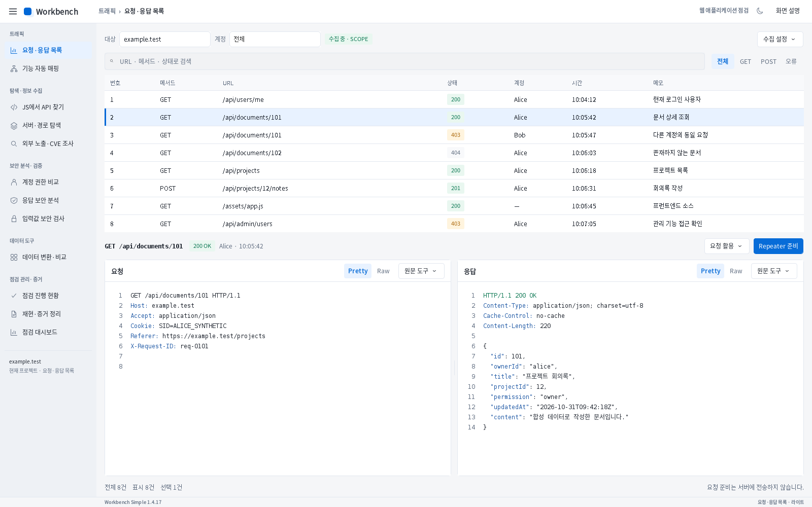

# 승인 시안 요청·응답 목록 예시 적용

사용자가 지정한 요청·응답 목록 화면만 수정한 **미배포 검토 빌드**입니다. 승인 기준은 [기존 traffic.png](../2026-10-31-workflow-design/images/light/traffic.png)입니다. 내부 버전은 기반 버전1.4.17을 유지하며, 기존 `simple/downloads/1.4.17/` 배포 파일은 변경하지 않았습니다. main 병합과 새 전체 버전 배포는 수행하지 않았습니다.

이 이미지는 수정한 JAR의 실제 Swing 컴포넌트를 Linux Xorg/xfwm4 창에서 실행하고 `Robot.createScreenCapture`로 클라이언트 영역1600×1000을 캡처한 원본입니다. 배경 시안 이미지, HTML 모형, 합성 UI 이미지를 사용하지 않았습니다. Burp API는 격리한 합성 어댑터이며, 실제 Burp Suite/Windows 설치 화면을 검증했다는 의미는 아닙니다.

## 시안 기준 배치

| 영역 | 승인 기준과 실제 좌표·크기 (x, y, 너비, 높이) |
|---|---|
| 왼쪽 메뉴 | 너비190px |
| 대상 선택칸 | 235, 62, 180, 31 |
| 검색 입력창 | 206, 104, 1183, 34 |
| 표 열 너비 | 98 / 124 / 442 / 132 / 114 / 160 / 308px |
| 표 행 높이 | 35px |
| 요청 카드 | 206, 512, 683, 427 |
| 응답 카드 | 901, 512, 683, 427 |

상단 상태칩, 빠른 필터, 선택 요청 요약, 상태 배지, 선택 행 표시, Pretty/Raw와 원문 도구, 카드 간격과 안쪽 여백을 이 화면 전용으로 적용했습니다. 헤더의 기존 설정·로그·SCOPE·대시보드·Guide 컨트롤은 화면 설명 버튼과 헤더 메뉴를 통해 기존 핸들러로 연결합니다. 다른 도구를 선택하면 기존 헤더 배치로 돌아갑니다.

시안과 전체 이미지가 픽셀 단위로 같다고 판정하지는 않았습니다. 브라우저 시안과 Swing의 글자 폭·안티앨리어싱에는 차이가 남아 있습니다. 캡처에는 실제 합성 원본8건을 사용하므로 시안의 전체120/표시10 표기를 복제하지 않았고, 응답 Content-Length도 실제 본문 바이트 길이220을 표시합니다. 시안의 ‘확장 소스 미적용’ 하단 주석은 제품 버전 표시로 바꿨습니다. 사이드바 하단에는 실제 선택 대상과 현재 도구를 표시합니다.

## 검증과 보존

- 최종 소스 관련10개 그룹 **682검사 통과**. [검사 결과](focused-tests.json)에 범위를 기록했습니다. 전체 릴리스 검사를 재실행한 결과는 아닙니다.
- 실제 창에서 Robot 마우스/키보드 **13항목 통과**: POST/전체 필터, 정확한 원본 행, Raw 원본 바이트, 요청 활용/수집 설정 메뉴, ID/바이트 보존, HTTP0건, 비동기 UI 예외0건, 불필요한 스크롤바 없음, 주요 사각형 좌표 일치. [실행 기록](verification.json).
- 호스트 테마 교체 후 미저장 입력/캡처 상태/35px 표 복구와 라이트·다크1024×720/1280×800 레이아웃은 관련 회귀 검사 범위입니다. 라이트1600×1000은 별도 실제 창 검사에 포함합니다. 시안과의 실제 PNG 비교는 라이트1600×1000에 한정합니다.
- 필터 축소 직후 선택 인덱스가 기존 범위에 남아 있던 오류를 보완했습니다. 유효하지 않은 뷰 인덱스를 원본으로 변환하지 않고, 기존 원본 ID를 기준으로 남은 선택을 복원합니다. 재현 검사를 추가했습니다.
- 원본 요청/응답 모델, 검색·정렬, SCOPE, 명시적 요청 활용과 Repeater 핸들러는 유지합니다. 캡처 예시 데이터는 하네스에만 있으며 제품 코드에 넣지 않았습니다.

## 검토 파일

[검토용 JAR](artifacts/burp-workbench-simple-1.4.17-traffic-review.jar) · [독립 빌드 소스 ZIP](artifacts/burp-workbench-simple-1.4.17-traffic-review-source.zip) · [SHA-256](artifacts/SHA256SUMS)

소스 ZIP에는 확장/Mapper 소스·리소스·고정 의존성·검사·빌드 도구가 들어 있습니다. 이전 설명서/디자인 이력은 제외했습니다. Java17로 독립 재빌드한 JAR가 검토 JAR와 바이트 단위로 같음을 확인했습니다. 결과는 `source-rebuild.json`에 기록합니다.

재현: Java17 활성화 → `python simple/dev.py test --group SimpleClassicLayoutTest --group SimpleAppearanceTest --group TrafficSearchUpgradeTest --skip-payload` → `bash simple/tools/run_approved_traffic_native.sh`. GUI 하네스에는 Xorg dummy 드라이버와 xfwm4가 필요합니다. 합성 격리 HOME만 사용하며 사용자 Burp/브라우저 설정을 바꾸지 않습니다.
