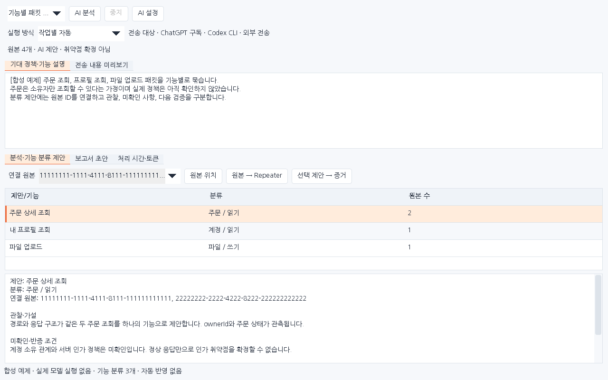
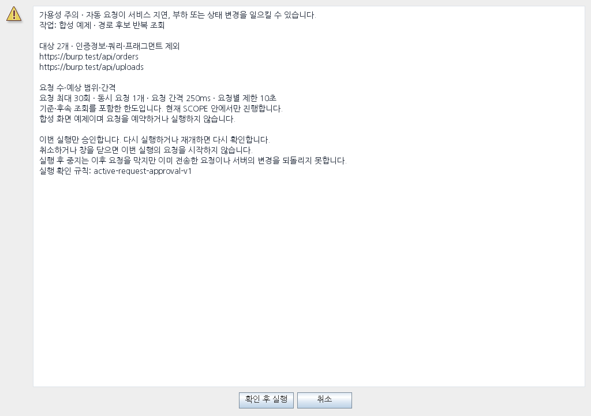
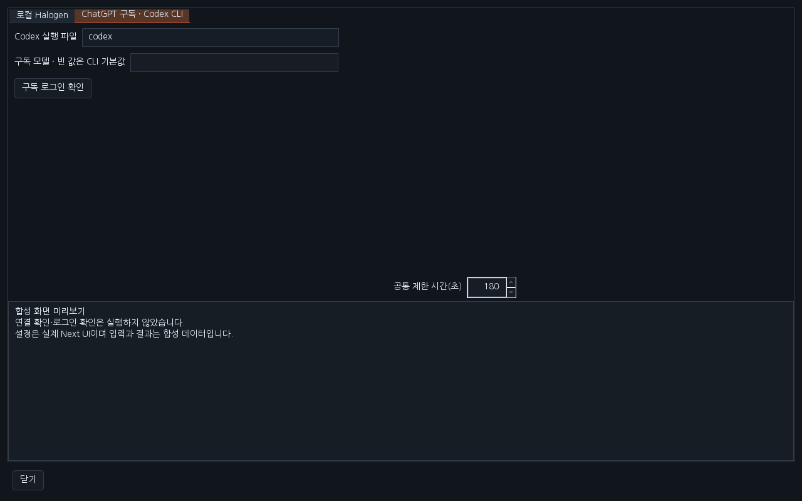

# Next 0.54.0 실제 AI 화면 검사

배포 JAR의 Swing AI 화면과 실행 확인 패널을 합성 원본/결과로 렌더링했습니다. 실제 Halogen 추론·ChatGPT 구독 로그인/요청·대상 HTTP·native Burp GUI는 실행하지 않았습니다. 승인 화면은 모달 창을 열거나 승인 함수를 호출하지 않고 실제 운영 패널만 렌더링했습니다.

밝은/어두운 테마 × 1024×720/1280×800 × 7개 상태, 총28장입니다. 버튼116개(활성84개)와 내용 영역56개를 측정했으며 잘림 위반0건입니다. 승인 기본값은 취소이고 결정값은 미설정 상태입니다. [상세 측정](UI_VERIFICATION.json)의 이미지 경로는 재현 명령으로 생성하는 전체 갤러리 기준입니다.

재현: `python tools/render_local_llm_ui.py --java /path/to/java17 --out tmp/local-llm-ui --check`

## 기능별 분류

아래 내용은 합성 예시이며 모델 품질 검증 결과가 아닙니다.

## 실행 전 확인

## 구독 설정

