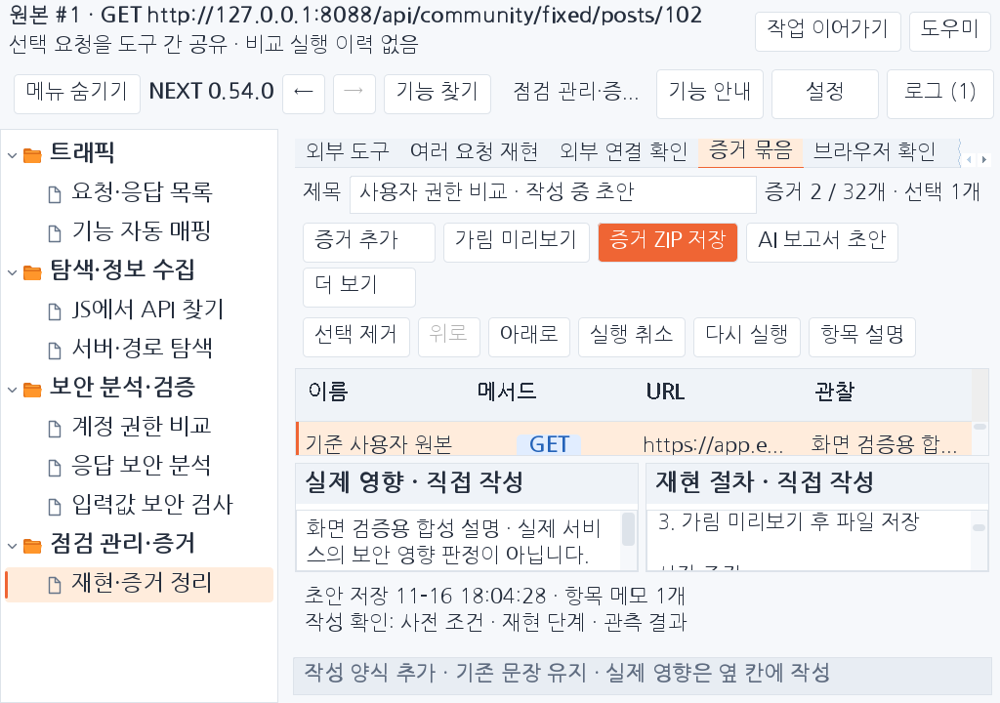
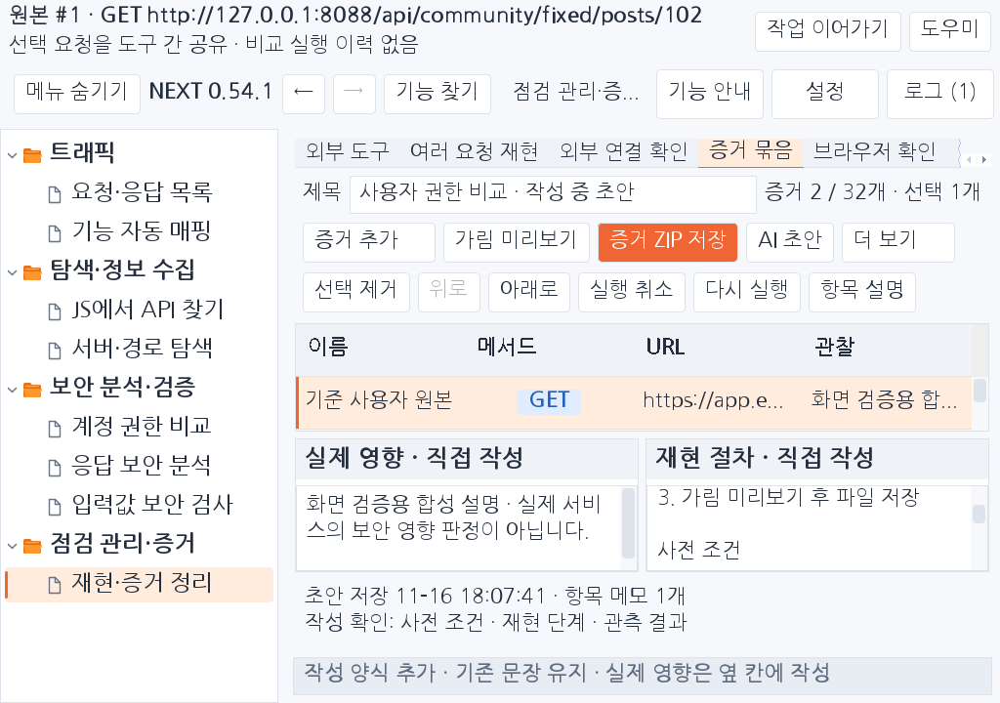

# Workbench Next 0.54.1 검증

0.54.0 AI 통합 후보를 이어받아 증거 작성 화면의 배치 실패를 수정했습니다. 실행 핸들러·원본 ID·AI 처리 경로·실행별 요청 확인은 유지합니다.

| 같은 Java17 · 1024×720 · 글자150% | 배포0.54.0 | 수정0.54.1 | 최소 기준 |
|---|---:|---:|---:|
| 영향 편집 영역 높이 |61px|86px|70px|
| 재현 편집 영역 높이 |61px|86px|70px|
| 두 테마에서 실패한 영역 수 |4|0|0|

긴 AI 버튼으로 도구 막대가 두 줄이 되던 현상을 `AI 초안` 표시로 바로잡았습니다. 전체 기능명은 접근성 이름과 툴팁으로 유지합니다. 검사 기준·시나리오·타임아웃은 바꾸지 않았습니다.

전체 기능5,195개(회귀4,691+payload HTTP136+전체 기능 HTTP102+모의 진단266), 별도 Mapper Java134/Node15, 패키징7개가 통과했습니다. 전체 화면576뷰·8,154컨트롤·5,280라벨·246상태와 AI 화면28개를 통과했습니다. 별도 집중 화면은 겹치는 검사이므로 전체 수에 합산하지 않습니다.

게시된0.54.0 JAR를 같은 Java17에서 다시 렌더해4건을 재현했습니다. [수정 전 측정](published-baseline-layout.json) · [최종 전체 측정](final-layout.json) · [AI 측정](ai-layout.json) · [전체 검사](check-summary.json) · [통합 검증](../../VERIFICATION_0.54.1.json).

첫 병렬 화면 검사에서는 기존 JSON 후보 준비의10초 제한에 걸려 전체 결과를 만들지 못했습니다. [당시 추적](first-final-layout-fixture-timeout.txt)을 보존합니다. 원인은 확정하지 않았으며, 이후 독립적인 순차 전체 실행은 같은 기준으로 통과했습니다. 부분 실행을 성공으로 합산하지 않습니다.

화면은 운영 Swing 구성 요소와 합성 패킷으로 생성했습니다. 실제 사용자 Burp GUI·M5의 구독 로그인/모델 추론·Windows DPI/IME·외부 대상 검증은 실행하지 않았습니다. 원격 CI와 main 병합은 PR의 실제 상태를 확인하세요.
