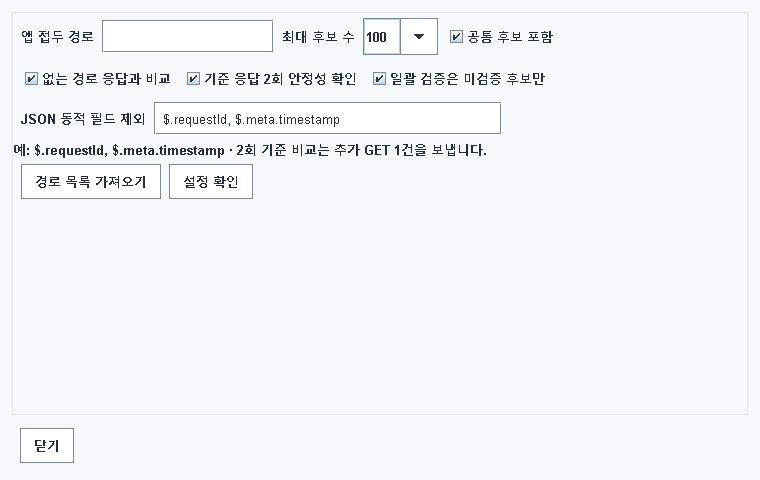
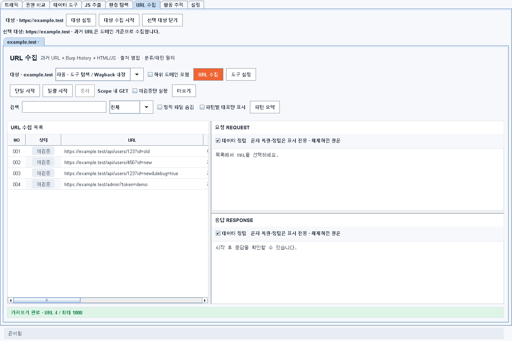
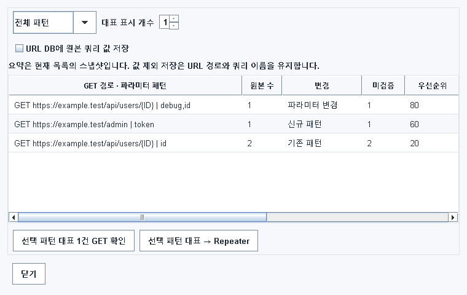
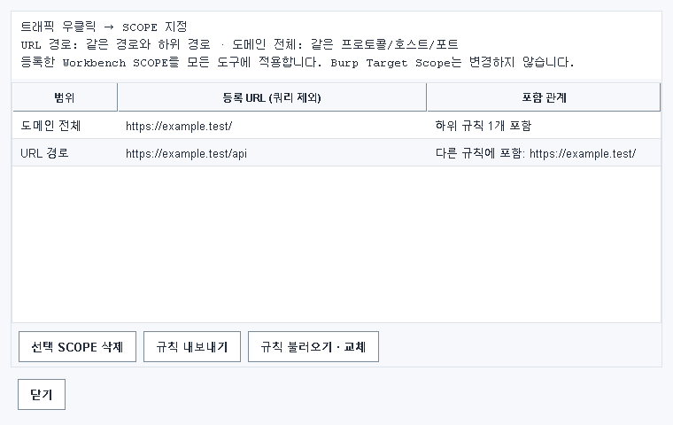
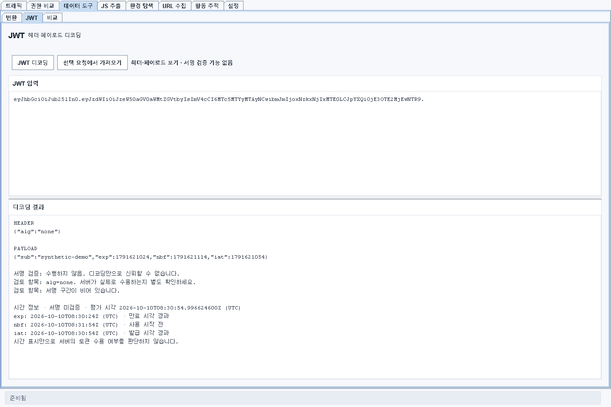

# Burp Workbench KR 0.17.4 변경 전/후

0.17.3에서 제안했던 추가 개선을 실제 Java 소스에 적용했습니다. 기존 JS 발견 근거·활동 추적·계정별 권한 비교 개선을 포함하는 누적 릴리스입니다.

| 기능 | 변경 전 (0.17.3) | 변경 후 (0.17.4) |
|---|---|---|
| 페이로드 검사 | 고정/적응형의 차단 대응이 달랐고 전송이 오래 대기할 수 있음 | 401/403/429/503 공통 중단, 타임아웃 즉시 중단, 연속 전송 오류 3회 중단, 마지막 결과·중단 이유 유지 |
| 전송 제어 | Legacy 콜백 전송에 의존 | Montoya 요청별 응답 제한(기본 10초), 리다이렉트 금지, 바이트 유지. Legacy 대기는 제한하고 겹치는 검사 방지 |
| 환경 탐색 | 없는 경로의 단일 응답 서명을 기준으로 후보 비교 | 기본 2회 기준 응답 안정성 확인, 선택한 동적 JSON 필드 제외, 불안정/실패 기준을 동등 판정에서 제외 |
| URL 목록 | 개별 URL 중심으로 확인 | 패턴 요약 별도 창, 신규/파라미터 변경/미검증 필터, 대표 1~5개 표시, 원본 보존 |
| URL DB | 원래 쿼리값까지 보존 | 기본으로 쿼리 이름만 저장, 원본 값 보존은 명시적 선택. 텍스트 내보내기에도 적용 |
| JWT | 헤더/페이로드 디코딩 중심 | exp/nbf/iat UTC 해석, 현재시각 대비 상태, 누락/형식/범위 오류 표시 |
| Wayback | 응답 읽기와 JSON 파서 크기 한도가 달라 큰 정상 응답도 실패 가능 | 8MB로 한도 일치, JSON 노드 40,000개·URL 1,000개 제한, 수집량과 상한 가능성 표시 |
| SCOPE 관리 | 등록된 규칙만 보여 중복/제외 원인을 확인하기 어려움 | 가장 구체적인 적용 규칙/제외 이유, 포함 관계 표시, JSON 가져오기/내보내기 |

## 주요 수정 파일

| 소스 ZIP 내부 경로 | 변경 |
|---|---|
| src/main/java/kr/payloadrunner/Engine.java · Adaptive.java | 공통 중단 정책 및 결과 상태 |
| src/main/java/kr/payloadrunner/PayloadHttp.java | Montoya 전송 및 Legacy 대기 제한 |
| src/main/java/kr/payloadrunner/PayloadRunnerPanel.java | 타임아웃 설정과 실행 중 상태 관리 |
| src/main/java/kr/workbench/EnvironmentControls.java · EnvironmentPanel.java | 안정적인 기준 비교와 설정 창 |
| src/main/java/kr/workbench/UrlGroups.java · PassiveScanPanel.java | 패턴 요약, 대표 필터, DB 저장 모드 |
| src/main/java/kr/workbench/JwtTimes.java · Core.java | JWT 시간 해석 |
| src/main/java/kr/workbench/ArchiveUrls.java | Wayback 크기/구조/개수 한도 |
| src/main/java/kr/workbench/WorkbenchScope.java · WorkbenchExtension.java | SCOPE 이유, 포함 관계, 파일 관리 |
| src/test/java/kr/workbench/OtherImprovementsTest.java | 이번 개선 회귀 검사 56개 |

## 판단 기준과 제한

- 패턴 점수는 검토 순서이며 취약점 심각도가 아닙니다. URL 수집 패턴은 GET 메타데이터를 기준으로 하고 활동 추적의 메서드별 기록을 대신하지 않습니다.
- 환경 안정성 확인은 기준 경로마다 GET 요청을 한 번 추가합니다. 동적 필드 제외는 기본값이 비어 있고 사용자가 지정한 필드에만 적용됩니다. 일치 분류를 취약점 확정으로 사용하지 않습니다.
- URL 원본은 화면/메모리에 유지됩니다. DB 기본 모드는 저장 시 쿼리값을 제외합니다. 경로에 포함된 정보까지 자동 제거하지는 않습니다.
- JWT 서명/발급자/대상 시스템의 실제 수용 여부를 검증하지 않습니다.
- Montoya의 진행 중 요청은 응답/제한시간까지 대기할 수 있습니다. Legacy 요청은 실제 전송 강제 취소가 불가능하므로 종료 전 새 실행을 차단합니다.
- SCOPE 가져오기는 목록 교체입니다. 파일 검증 실패 시 기존 목록을 유지합니다. 빈 목록은 전체 제외로 유지되며 Burp 전역 SCOPE로 자동 복귀하지 않습니다.
- 요약·설정·SCOPE 창은 별도 창이며 현재 메인 탭을 유지합니다. UI 버튼 배치도 기본 창 크기에서 확인했습니다.

## 검증 결과

**788개 통과, 0개 실패**. 신규 56개 검사에는 고정/적응형 차단, 전송 타임아웃과 Legacy 겹침 방지, 동적 기준 응답 비교, URL 그룹/DB 저장, JWT 극단값, Wayback 한도, SCOPE 가져오기 실패/빈 목록/포함 관계를 포함했습니다. 기존 JS·활동 추적·권한 비교와 UI 회귀 검사도 통과했습니다.

전체 회귀 실행 뒤 마지막 버튼 배치·URL 정규화·재실행 방지 수정은 관련 검사와 페이로드 엔진 검사로 다시 확인했습니다. JDK 24.0.2에서 Java 17 대상으로 빌드했으며 JAR 버전과 주요 클래스 버전을 확인했습니다. API 어댑터, 로컬 HTTP 테스트 서버, native CLI 테스트 및 headless Swing 화면 검증입니다. **실제 Burp GUI 로딩은 확인하지 않았습니다.**

## 화면 확인

아래는 합성 데이터로 렌더링한 화면입니다.

### 환경 탐색 설정

### URL 수집

### 패턴 요약

### SCOPE 관리

### JWT 시간 해석

