# Workbench Simple 1.1.0 사용 가이드

**기존 8개 통합 도구의 핵심 기능을 모두 유지하고 상단에서 바로 엽니다.**

원본 선택 → 필요한 도구 → 결과 확인·증거 저장이 공통 흐름입니다. 도구를 정해진 순서대로 모두 거칠 필요는 없습니다.

> 그림은 Simple 운영 Swing 화면에 합성 예제 패킷을 넣어 렌더링한 캡처입니다. 실제 Burp GUI를 조작한 캡처가 아닙니다.

## 설치

1. Simple 설치 JAR burp-workbench-simple-1.1.0.jar를 준비하고 기존 Workbench 파일을 보관합니다.
2. Burp Extensions → Add → Java에서 Simple JAR를 선택하고 Workbench Simple 탭을 엽니다.
3. 한 확장에서만 수집하려면 기존 Workbench의 로드를 해제하고 Simple을 사용합니다. 기존 확장이나 원본 파일을 삭제할 필요는 없습니다.

Simple 설정은 `simple.*`, 저장 폴더는 `.burp-workbench-simple`로 기존 Next와 분리됩니다.

## 확장별 핵심 기능과 부가 흐름 정리

| 기존 도구 | 유지한 핵심 기능 | 부가 흐름 정리 |
|---|---|---|
| 요청·응답 (요청·응답 목록) | SCOPE, OFF/SCOPE 수집, 검색, 요청·응답 원본, Repeater 준비와 증거 연결 | 중복 탐색·작업 관리 바 제거. 저장 검색 조건은 검색 설정에서 필요할 때 사용. |
| 기능 매핑 (기능 자동 매핑) | 기능·실행·세션 분류, 패킷·분류 근거, 프로젝트 저장·열기와 점검 업무 연결 | 핵심 분류·프로젝트 흐름 유지. 브라우저 도우미와 세부 설정은 필요한 경우 선택. |
| 계정 비교 (계정 권한 비교) | 계정 연결, 세션·권한·쓰기 조회 조건, 선택 요청 직접 비교, 중지와 결과 근거 | 신규 요청 자동 비교 토글 제거. 선택한 원본의 준비와 직접 실행에 집중. |
| API 찾기 (JS에서 API 찾기) | 관측 텍스트 응답의 API·키 후보, 원본 위치·로컬 이력, 선택 API의 요청 준비 | 시작 시 기존 History 자동 순회 제거. 부가 NPM·소스맵 조회는 메인 흐름에서 제외. |
| 서버·경로 (서버·경로 탐색) | 관측 서버·경로 정보, 후보 경로, 선택 경로의 직접 GET 확인 | 선택 대상과 확인 조건 중심으로 사용. 보조 설정·수집 경로는 필요할 때 열기. |
| 응답 분석 (응답 보안 분석) | 보안 단서, API 문서, 저장 후 조회 흐름과 원본·증거 연결 | 주요 분석 기능 유지. 보조 설정은 필요할 때 열고 원본 근거 확인에 집중. |
| 입력값 검사 (입력값 보안 검사) | 검사 유형, 입력 위치·값, 간격·한도·SCOPE, 기준·변경·대조 결과와 증거 연결 | 검사 조건과 결과 검토에 집중. 선택 결과에서 증거로 바로 연결. |
| 재현·증거 (재현·증거 정리) | 요청 순차 재현·중지·결과 확인, 원본·비교·재현 결과 추가, 가림과 ZIP 저장 | OAST·외부 도구·브라우저 보조 화면 제거. 요청 재현과 증거 정리 두 화면 유지. |

## 00. 기존 8개 도구를 상단에서 바로 엽니다

**시작**

1. Burp Extensions → Add → Java에서 Simple JAR를 추가한 뒤 Workbench Simple 탭을 엽니다.
2. 상단에 표시된 8개 도구 중 필요한 도구를 바로 선택합니다. 원본을 고르고 필요한 도구에서 결과를 확인한 뒤 증거로 연결합니다.

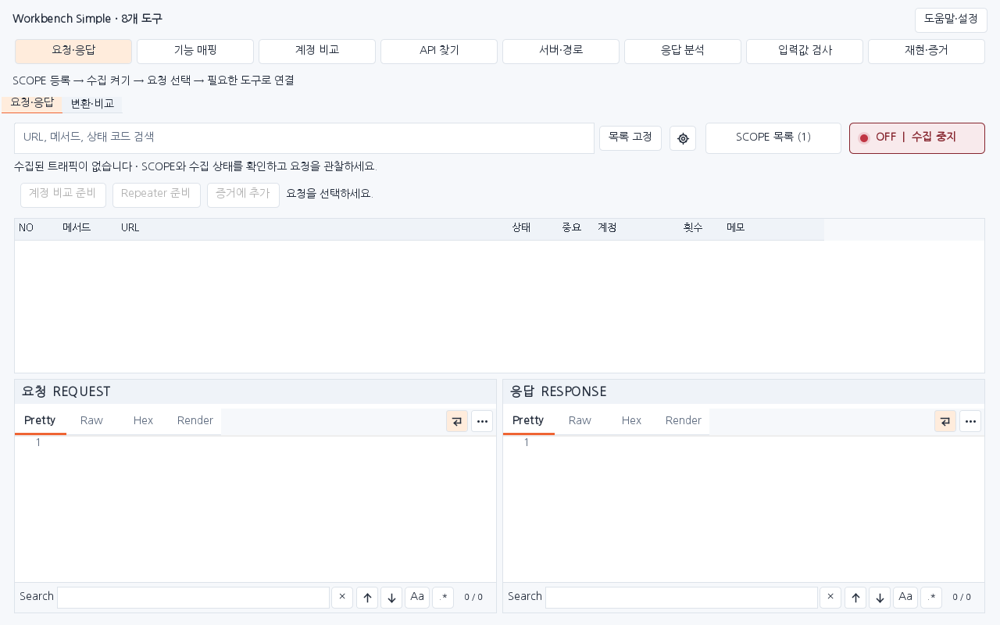

다음 확인: 도구 이동은 화면만 바꿉니다. 처음에는 수집 OFF이며, 원본을 선택하기 전 직접 작업 버튼은 비활성화됩니다.

## 01. SCOPE에 점검할 대상을 등록합니다

**요청·응답 목록**

1. 요청·응답의 SCOPE 목록을 열고 점검할 URL을 추가합니다. 경로를 지정하면 해당 경로와 하위 경로가 대상입니다.
2. 수집할 범위의 체크 상태를 확인합니다. Burp HTTP history의 Add to scope로 등록한 범위도 이 목록에서 확인합니다.

다음 확인: 의도한 프로토콜·호스트·포트·경로만 수집 범위에 들어 있는지 확인합니다.

## 02. SCOPE 수집을 켜고 사이트를 사용합니다

**요청·응답 목록**

1. 수집 버튼을 OFF에서 SCOPE로 바꾼 뒤 Burp 브라우저에서 대상 기능을 사용합니다.
2. 목록에 요청이 표시되는지 확인합니다. 기존 History는 SCOPE 수집을 켠 상태에서 필요한 요청을 골라 Simple로 가져옵니다.

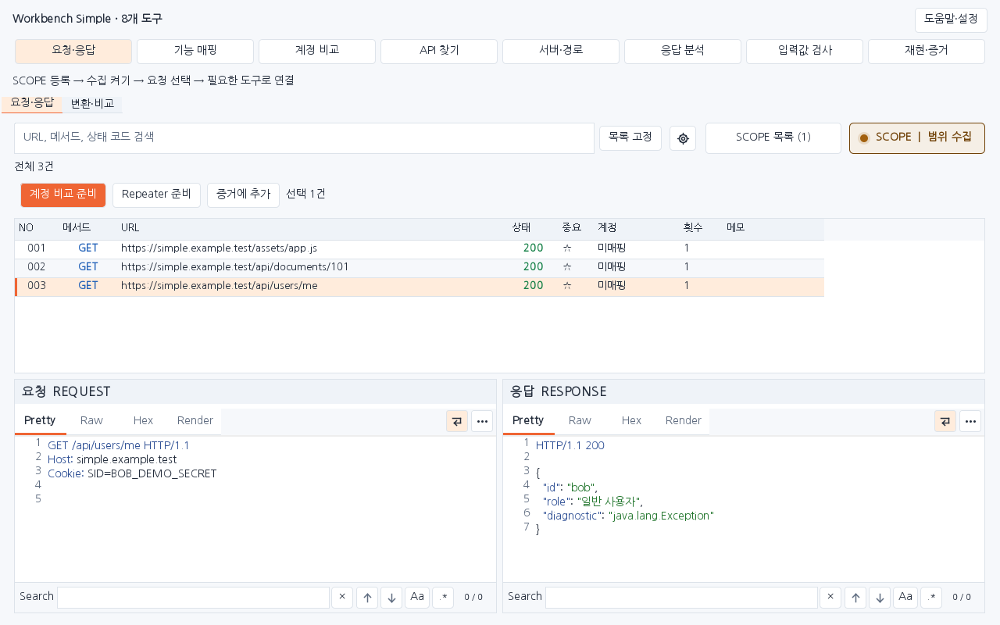

다음 확인: OFF에서는 새 트래픽과 수동 가져오기를 수집하지 않습니다. 목록 고정은 화면 갱신만 멈춥니다.

## 03. 원본을 선택하고 필요한 도구로 연결합니다

**요청·응답 목록**

1. 검색으로 요청을 찾고 행을 선택해 요청·응답 원문을 읽습니다. 여러 건은 Ctrl 또는 Shift로 선택합니다.
2. 계정 비교 준비, Repeater 준비, 증거에 추가를 사용하거나 행 메뉴에서 필요한 도구에 원본을 연결합니다. 상단 도구를 바꿔도 원본 선택은 유지됩니다.

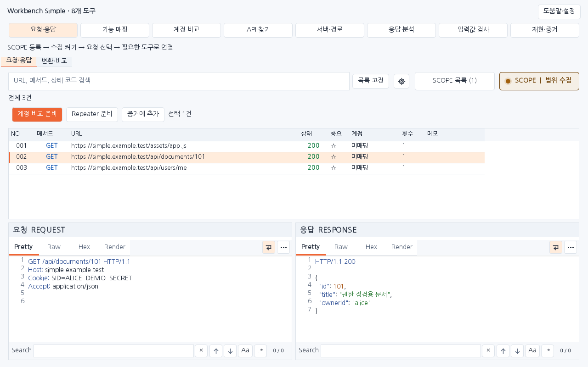

다음 확인: Repeater 준비는 요청을 복사하는 동작입니다. 실제 전송은 Repeater의 Send로 직접 실행합니다.

## 04. 기능·실행·세션과 패킷을 함께 확인합니다

**기능 자동 매핑**

1. 상단의 기능 매핑을 엽니다. SCOPE 수집 중 관측한 패킷이 기능·실행·세션에 어떻게 묶였는지 확인합니다.
2. 패킷과 분류 근거를 읽고 필요한 이름·메모를 정리합니다. 프로젝트 저장·열기와 점검 진행 현황 연결은 그대로 사용합니다.

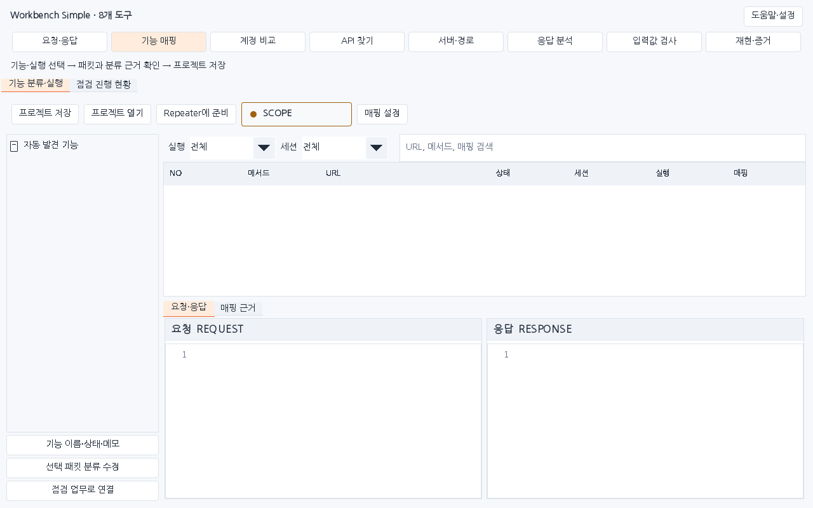

다음 확인: 자동 분류는 기능을 묶는 결과입니다. 실제 점검 완료는 검증 결과와 증거를 확인한 뒤 판단합니다.

## 05. 선택 응답의 API 후보와 원본 위치를 확인합니다

**JS에서 API 찾기**

1. 요청·응답 목록에서 텍스트 응답을 선택하고 행 메뉴의 선택 응답에서 API 찾기로 연결합니다. 상단의 API 찾기에서도 결과를 엽니다.
2. API·키 후보를 선택해 출처와 원본 위치를 읽습니다. 필요한 API만 요청으로 준비하고 메서드·인증·입력값을 확인합니다.

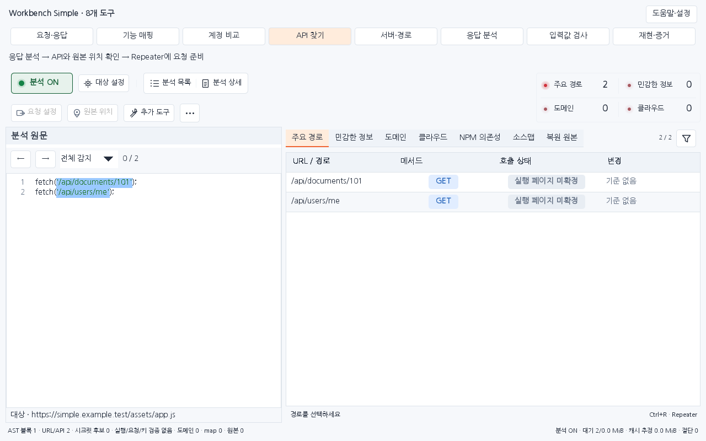

다음 확인: 코드 분석은 JavaScript 실행이나 요청 전송이 아닙니다. 시작 시 기존 History를 자동 순회하지 않습니다.

## 06. 관측 정보에서 필요한 경로만 직접 확인합니다

**서버·경로 탐색**

1. 상단의 서버·경로에서 관측한 사이트와 서버·경로 정보를 고릅니다.
2. 확인할 경로와 SCOPE·계정·요청 한도를 검토한 뒤 선택 경로의 GET 확인을 직접 실행합니다.

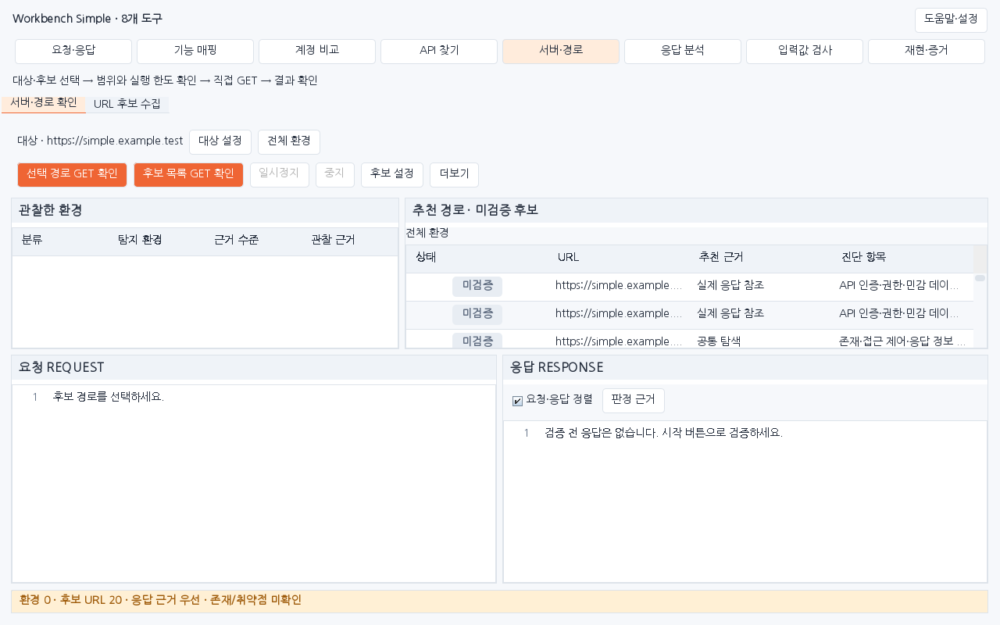

다음 확인: 후보 경로만으로 존재나 취약점이 확정되지는 않습니다. GET 확인은 서버에 요청을 전송합니다.

## 07. 응답의 보안 단서와 원본 근거를 읽습니다

**응답 보안 분석**

1. 상단의 응답 분석을 열어 관측 응답에서 나온 후보를 선택합니다.
2. 보안 단서·API 문서·저장 후 조회 흐름의 원본 위치와 근거를 확인합니다. 필요한 결과를 증거로 전달하고 영향을 직접 검증합니다.

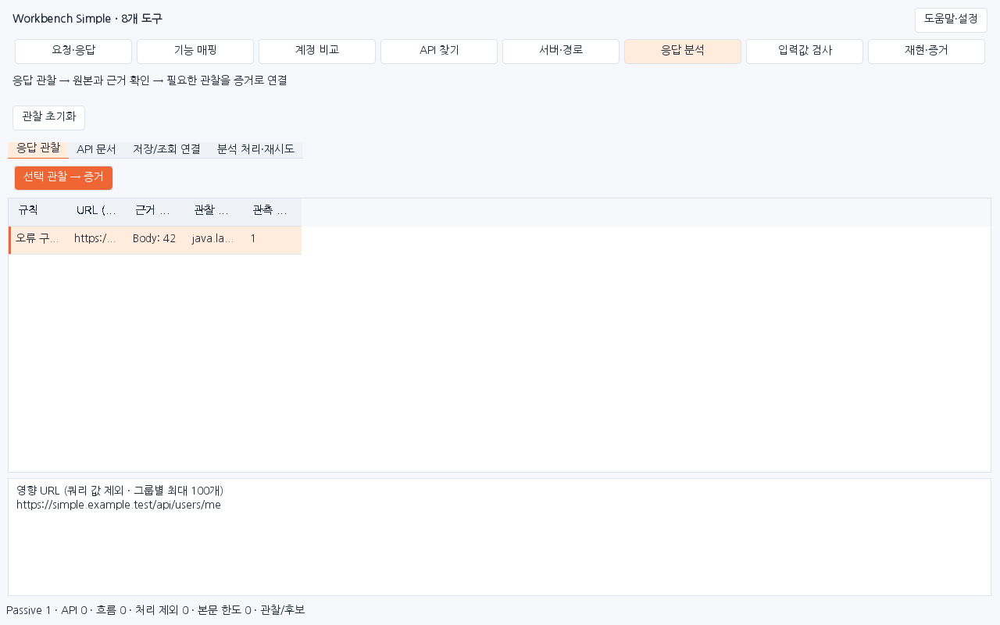

다음 확인: 분석은 관측 응답을 읽는 동작입니다. 오류 정보·헤더·반사 관찰만으로 취약점을 확정하지 않습니다.

## 08. 비교할 계정과 판정 조건을 준비합니다

**계정 권한 비교**

1. 인증 탐지를 ON으로 켜고 필요한 계정으로 사이트를 사용합니다. 탐지된 후보 행을 우클릭해 관리자·일반·후보1 중 비교 슬롯에 지정합니다.
2. 선택 요청 비교 또는 계정·판정 설정에서 계정, 허용·차단 기준과 필요한 세션·쓰기 후 조회 조건을 확인합니다.

다음 확인: 인증 탐지는 수집 OFF/SCOPE와 별도입니다. 후보 수집은 자동 비교 실행이 아니며 실제 비교에는 SCOPE가 필요합니다.

## 09. 설정을 확인한 뒤 비교를 직접 시작합니다

**계정 권한 비교**

1. 목록에서 원본을 선택하고 계정 비교 준비를 누릅니다. 조건을 바꿨다면 적용 상태 다시 확인 후 비교 시작(제한이 있으면 제한 확인 후 비교)을 누릅니다.
2. 결과에서 원본·계정별 응답과 판정 근거를 읽습니다. 진행 중인 비교는 중지로 멈추고 필요한 조건을 보완합니다.

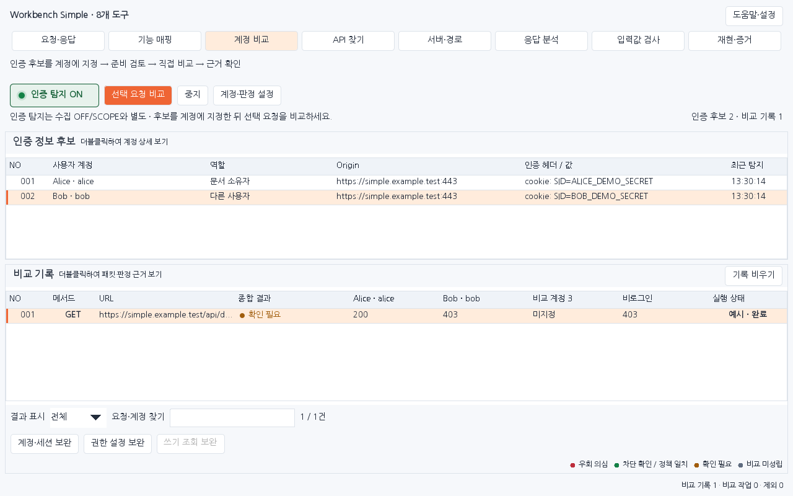

다음 확인: 상태 코드 차이만으로 권한 문제를 확정하지 않습니다. 세션 오류·쓰기 결과 미확인 등은 근거와 함께 검토합니다.

## 10. 입력 위치와 검사 조건을 정하고 결과를 확인합니다

**입력값 보안 검사**

1. 목록의 선택 요청을 입력값 검사에 연결하고 검사할 위치·값을 지정합니다. 검사 유형, 간격, 총 요청 한도와 SCOPE를 확인합니다.
2. 검사 시작은 직접 실행합니다. 기준·변경·대조 응답을 검토합니다. 결과 행을 선택하고 결과를 증거로 버튼으로 해당 검사의 기준·공격·대조 묶음 전체를 전달합니다.

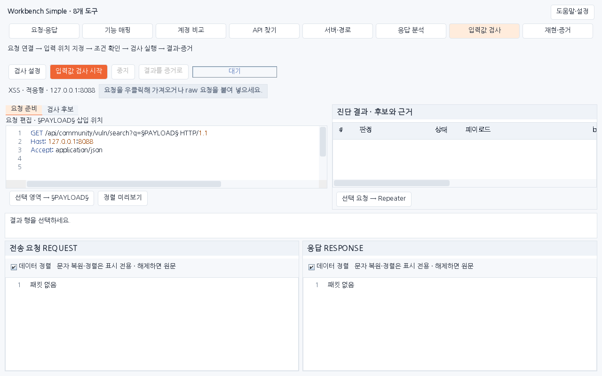

다음 확인: 요청 연결과 조건 편집은 전송하지 않습니다. 검사 시작은 여러 시험·대조 요청을 전송할 수 있습니다.

## 11. 필요한 요청을 순서대로 직접 재현합니다

**재현·증거 정리**

1. 상단의 재현·증거에서 요청 재현을 엽니다. 목록에서 선택한 원본 요청을 순서에 맞게 추가하고 단계별 입력과 인증 조건을 확인합니다.
2. SCOPE·Origin·쓰기 허용·대기 시간·총 요청 한도를 확인한 뒤 직접 실행합니다. 단계별 결과를 읽고 결과 → 증거 버튼으로 이번 재현의 전체 단계 결과를 연결합니다.

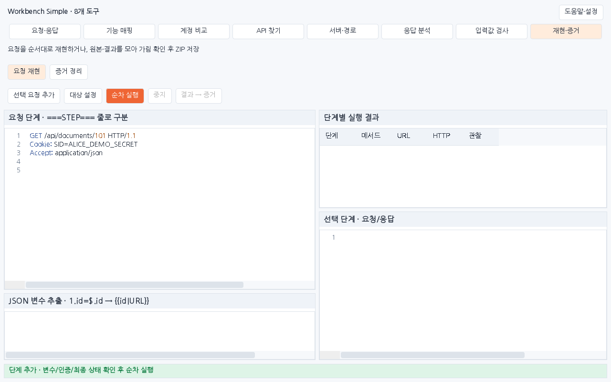

다음 확인: 단계 추가는 전송하지 않습니다. 순차 재현 실행은 서버에 요청을 전송하며, 중지와 실패 시 후속 실행 중단 조건을 확인합니다.

## 12. 원본·비교·재현 결과를 모으고 설명을 적습니다

**재현·증거 정리**

1. 재현·증거의 증거 정리 화면에서 증거 추가를 사용합니다. 비교 결과는 결과 목록에서 저장할 결과를 선택한 뒤 권한 비교 추가로 가져옵니다.
2. 제목, 영향, 재현 절차와 항목 설명을 작성합니다. 순서 변경·제거는 실행 취소와 다시 실행으로 복구합니다.

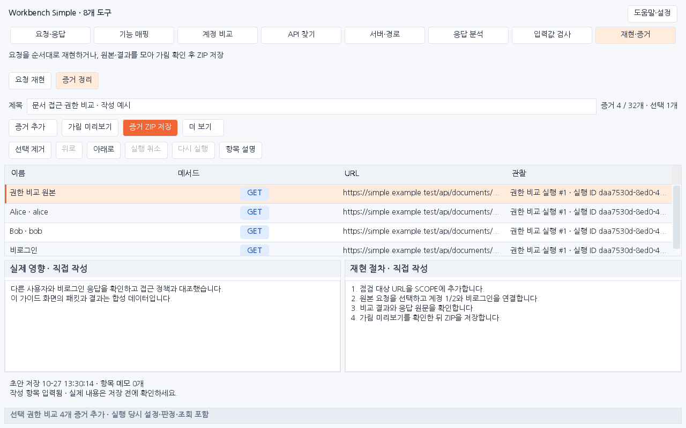

다음 확인: 비교 결과 추가는 실행 당시 원본·계정·조회와 판정 조건을 함께 보존합니다. 작성 초안만 복원한 경우 원본은 직접 연결합니다.

## 13. 가림 결과를 확인하고 ZIP으로 저장합니다

**재현·증거 정리**

1. 가림 미리보기를 열어 보고서와 패킷에 인증값·민감한 값이 남았는지 확인합니다. 추가 이름은 더 보기 → 가림 설정·본문 포함에서 지정합니다.
2. 직접 적은 문장과 첨부 이미지를 확인한 뒤 증거 ZIP 저장을 누르고 저장 위치를 지정합니다. 저장 완료 상태를 확인합니다.

![운영 가림 미리보기 · 합성 Cookie 값이 [REDACTED]로 가려진 내용을 보여 줍니다.](images/1.1.0/light/1280x800/06-redaction.png)

완료 확인: ZIP의 report.html 또는 report.md와 evidence.json을 열어 설명·순서·원본 연결·가림 결과가 의도한 대로 들어 있는지 확인합니다.

## 공통 확인 사항

- 원본 선택 → 필요한 도구 → 결과 확인·증거 저장이 공통 사용 흐름입니다. 8개 도구를 정해진 순서대로 모두 거칠 필요는 없습니다.
- Simple은 기존 폴더 탐색·화면 이력·작업 이어가기·도우미 관리 바를 메인 화면에서 제거했습니다. 각 확장의 주요 기능은 유지하고, 도구 이동은 화면만 바꿉니다.
- 요청·응답 목록의 Repeater 준비는 원본을 복사하는 동작입니다. 실제 전송은 Repeater Send로 실행합니다. 비교·경로 GET·입력값 검사·순차 재현은 각 도구에서 직접 실행합니다.
- 요청이 없으면 SCOPE 체크·수집 SCOPE 상태·Burp 프록시 경유를 확인하고 사이트를 다시 사용합니다. 인증 후보가 없으면 인증 탐지를 켜고 계정별 요청을 관측합니다.
- 비교가 보류되면 세션·권한표·쓰기 후 조회 조건과 원본·응답 근거를 확인합니다. 중지는 이미 발송한 요청의 응답 또는 타임아웃 이후 마무리됩니다.
- 작성 초안의 복원은 HTTP 원본의 자동 복원을 의미하지 않습니다. 필요한 원본을 연결하고 가림 미리보기를 확인한 뒤 ZIP으로 저장합니다.

**Ctrl+F** 요청 검색 · **Ctrl+R** Repeater 준비 · **F1** 현재 도구 안내. 상단 도구 단축키는 버튼 안내를 확인합니다.

## 검증 범위

그림은 Simple 운영 Swing 화면에 합성 예제 패킷을 넣어 렌더링한 캡처입니다. 실제 Burp GUI를 조작한 캡처가 아닙니다.
실제 실행한 검사와 미실행 범위는 [1.1.0 검증 기록](VERIFICATION_SIMPLE_1.1.0.json)을 확인합니다. 과거 버전의 통과 수를 새 버전 검사로 합산하지 않습니다.

[보존한 1.0.0 안내서](history/1.0.0/GUIDE_SIMPLE_KR.md)
