# Workbench Simple 1.3.2 사용 가이드

**기존 8개 도구를 유지하고 Katana와 SCOPE 통합 점검에서 메뉴·환경·경로·API·민감정보를 연결합니다.**

SCOPE URL·HTTP 계정 선택 → Katana·통합 점검 → 결과·원본 확인 → 원문 값 분류 보고서·기존 도구·증거 저장으로 이어갑니다.

> 그림은 Simple 운영 Swing 화면에 합성 예제 패킷을 넣어 렌더링한 캡처입니다. 실제 Burp GUI를 조작한 캡처가 아닙니다.

## 설치

1. Simple 설치 JAR burp-workbench-simple-1.3.2.jar를 준비하고 기존 Workbench 파일을 보관합니다.
2. Burp Extensions → Add → Java에서 Simple JAR를 선택하고 Workbench Simple 탭을 엽니다.
3. 한 확장에서만 수집하려면 기존 Workbench의 로드를 해제하고 Simple을 사용합니다. 기존 확장이나 원본 파일을 삭제할 필요는 없습니다.

Simple 설정은 `simple.*`, 저장 폴더는 `.burp-workbench-simple`로 기존 Next와 분리됩니다.

## 확장별 핵심 기능과 부가 흐름 정리

| 기존 도구 | 유지한 핵심 기능 | 부가 흐름 정리 |
|---|---|---|
| 요청·응답 (요청·응답 목록) | SCOPE, OFF/SCOPE 수집, 검색, 요청·응답 원본, Repeater 준비와 증거 연결 | 중복 탐색·작업 관리 바 제거. 저장 검색 조건은 검색 설정에서 필요할 때 사용. |
| 기능 매핑 (기능 자동 매핑) | 기능·실행·세션 분류, 패킷·분류 근거, 프로젝트 저장·열기와 점검 업무 연결 | 핵심 분류·프로젝트 흐름 유지. 브라우저 도우미와 세부 설정은 필요한 경우 선택. |
| 계정 비교 (계정 권한 비교) | 계정 연결, 세션·권한·쓰기 조회 조건, 선택 요청 직접 비교, 중지와 결과 근거 | 신규 요청 자동 비교 토글 제거. 선택한 원본의 준비와 직접 실행에 집중. |
| API 찾기 (JS에서 API 찾기) | 관측 텍스트 응답의 API·키 후보, 원본 위치·로컬 이력, 선택 API의 요청 준비 | 시작 시 기존 History 자동 순회 제거. 부가 NPM·소스맵 조회는 메인 흐름에서 제외. |
| 서버·경로 (서버·경로 탐색) | 관측 서버·경로 정보, 후보 경로, 선택 경로의 직접 GET 확인 | 선택 대상과 확인 조건 중심으로 사용. 보조 설정·수집 경로는 필요할 때 열기. |
| 응답 분석 (응답 보안 분석) | 보안 단서, API 문서, 저장 후 조회 흐름과 원본·증거 연결 | 주요 분석 기능 유지. 보조 설정은 필요할 때 열고 원본 근거 확인에 집중. |
| 입력값 검사 (입력값 보안 검사) | 검사 유형, 입력 위치·값, 간격·한도·SCOPE, 기준·변경·대조 결과와 증거 연결 | 검사 조건과 결과 검토에 집중. 선택 결과에서 증거로 바로 연결. |
| 재현·증거 (재현·증거 정리) | 요청 순차 재현·중지·결과 확인, 원본·비교·재현 결과 추가, 가림과 ZIP 저장 | OAST·외부 도구·기존 브라우저 보조 화면 제외. 요청 재현·증거 정리 유지, SPA는 통합 점검에서 선택. |

## 통합 점검에서 확인하는 항목

| 결과 | 기능 | 판정과 범위 |
|---|---|---|
| 메뉴·기능 발견 | Katana·HTML·JS·robots/sitemap·API 문서와 브라우저 관측을 연결합니다. | 실제 관측, 문서 선언, 기술 추정 후보를 구분합니다. |
| 환경·주요 경로 | 서버·WAS·프레임워크·프록시/CDN·DB 단서를 모으고 관련 경로를 확인합니다. | 탐지 근거·확실성과 응답 내용 확인 상태를 함께 읽습니다. |
| API·민감정보 | API 문서와 관측 요청을 대조하고 키·토큰·내부 정보 후보를 분류합니다. | 공개 식별자·예제·비밀키 후보, 중요도·확신도·유효성을 구분합니다. |
| 권한·변경 비교 | 선택한 HTTP 계정별 응답 차이와 이전 실행의 새 항목·변경 후보를 확인합니다. | 같은 프로젝트·계정·조건의 비교만 사용하고 불완전 실행을 해결로 확정하지 않습니다. |
| 원본·증거 | 불변 원본 ID에서 요청·응답을 열고 기존 도구와 증거에 연결합니다. | 과거 이력의 원본이 없으면 현재 원본처럼 열리지 않습니다. |
| 원문 값 분류 보고서 | 현재 응답의 API·민감정보·토큰·키·환경 값을 위치와 원본 ID별로 저장합니다. | 제품 탐지와 보고서 추가 파싱을 구분하며 로컬 ZIP에는 원문 값이 포함됩니다. |
| 범위·실행 상태 | SCOPE·리디렉션·요청 한도·세션·중지/재개와 제외 사유를 확인합니다. | HTTP 완료·브라우저 탐색·미검사·실패 상태를 각각 확인합니다. |

## Katana 1.8.0 설치와 수집

[공식 배포·SHA-256 확인 설치 도구](../tools/install_katana.py) · [고정 의존성 기록](KATANA_DEPENDENCY.json)

1. Simple 폴더 또는 독립 소스 ZIP의 루트에서 python tools/install_katana.py --dest 뒤에 쓸 수 있는 외부 절대 경로를 지정합니다. 저장소 루트에서는 simple/tools/install_katana.py를 사용합니다. 공식 Katana 1.8.0 배포와 SHA-256을 확인해 실행 파일·설치 기록을 저장합니다.
2. 설치 완료 시 출력된 실행 파일 경로를 복사합니다. Workbench의 SCOPE 통합 점검 → 실행 조건에서 파일 선택 또는 경로 입력 후 설치 확인을 누릅니다. Katana는 별도 설치하며 관리자 권한·PATH·사용자 CA 변경이 필요하지 않습니다.
3. Katana 탐색을 선택하고 Katana 페이지 한도와 수집 시간(초)을 정합니다. 선택한 HTTP 계정이 Katana 수집의 실행 주체입니다. 대상 URL·허용 경로·계정·총 요청 한도를 확인한 뒤 통합 점검을 시작합니다.
4. Katana 수집에서 상태·발견 출처·후보와 차단 사유를 확인합니다. 환경·경로·API·민감정보·계정별 차이·변경·커버리지는 기존 결과 탭에서 이어서 읽습니다.

- 기존 Katana 재개 자료가 필요하면 먼저 보관합니다. 공급자 Katana 1.8.0은 버전 확인 때도 기본 사용자 설정 위치의 10일 지난 resume 파일을 정리할 수 있습니다. 설치 도구는 HOME을 재지정하지 않으며 이 동작을 의존성·설치 기록에 명시합니다.
- Katana는 HTML·JavaScript·폼 메타데이터·기술 단서를 수집합니다. 실제 대상 요청은 실행 전용 인증 loopback 프록시를 거쳐 Workbench의 HTTP 계정·SCOPE·요청 예산을 적용합니다.
- HTTPS CONNECT도 같은 전송 경계를 사용합니다. 실행용 임시 인증서를 사용하며 사용자 운영체제·브라우저에 CA 인증서를 설치하지 않습니다. 대상 Cookie·Authorization은 Katana 명령행이나 설정 파일로 전달하지 않습니다.
- JSONL의 경로·폼·기술 메타데이터는 자동 재조회하지 않습니다. 폼의 action·메서드·입력 이름은 발견 정보이며 값은 메타데이터에 남기지 않고 민감 필드 이름을 가립니다. 폼 제출·자동 로그인·쓰기·키 자동 검증·외부 공급자 API·자동 업데이트는 실행하지 않습니다.
- Katana는 # 조각이 없는 HTTP(S) 주소에서 표준 HTML/JS 모드로 수집합니다. SPA 메뉴·hash route는 기존 브라우저 helper에서 선택합니다. 브라우저 로그인 세션은 선택한 Workbench HTTP 계정과 별개입니다.
- Katana 종료와 사이트 전체 검증 완료를 구분합니다. 시간·페이지·요청 한도, 차단·실패·부분 분석과 미확인 항목을 확인합니다. 일시정지 후 재개해도 처음 정한 절대 시간과 공통 요청 예산을 유지합니다.
- Katana 실행 파일이 없거나 실행에 실패하면 Katana 실패·부분 수집 사유를 확인합니다. 일반 HTTP 점검 결과는 따로 유지하며 Katana 수집 성공으로 표시하지 않습니다.

## 브라우저·SPA 탐색 준비

[브라우저 helper 0.4.1 ZIP](../downloads/1.3.2/feature-mapper-browser-helper-0.4.1.zip)

1. 배포 파일 feature-mapper-browser-helper-0.4.1.zip을 새 폴더에 풀어 manifest.json이 보이는 폴더를 준비합니다. 기존 helper와 배포 파일은 보관합니다.
2. Chrome은 chrome://extensions, Edge는 edge://extensions를 열고 개발자 모드에서 압축해제된 확장 로드를 선택해 해당 폴더를 불러옵니다.
3. Workbench의 기능 매핑 설정에서 브라우저 연결 주소와 토큰을 확인하고 helper 팝업에 입력한 뒤 연결을 확인·저장합니다. 토큰은 로컬 연결에 사용합니다.
4. 브라우저에서 대상 사이트를 열고 필요한 로그인을 마칩니다. helper에서 현재 사이트를 활성화하고 정상적인 사이트 접근 권한 절차를 진행합니다.
5. SPA 통합 탐색 허용을 켭니다. 통합 점검에서 브라우저 모드를 선택해 시작하면 helper가 같은 브라우저 프로필의 로그인 세션을 사용하는 별도 탐색 탭을 엽니다.
6. 기존 사용자 탭은 유지합니다. 실행을 중지하면 탐색 탭과 해당 실행의 가드 정리를 확인합니다. 브라우저 로그인 계정은 Workbench에서 선택한 HTTP 계정과 별개입니다.

이 설치 절차는 텍스트 안내이며 실제 Chrome/Edge 설치 화면을 캡처한 그림이 아닙니다.

## 결과를 읽는 기준

- 관측은 실제 응답이나 참조를 읽은 상태입니다. 기술 이름·DB 오류·경로 이름은 근거와 함께 읽고, 추정 또는 미확인 상태를 확정으로 바꾸지 않습니다.
- HTTP 200이어도 공통 홈·로그인·soft404일 수 있습니다. 부재 경로 대조가 불안정하거나 보안 확인·요청 제한이 발생하면 내용 확인을 보류합니다.
- 키 형식이 맞아도 공개 SDK 식별자·예제·비밀키 후보가 다릅니다. 기본은 마스킹과 원본 위치·지문 표시이며 발견한 키를 자동 검증하거나 인증값으로 사용하지 않습니다.
- 분류 보고서 저장은 응답 원문을 포함하는 별도 로컬 내보내기입니다. 정적 문자열과 동적 API 템플릿을 구분하고, 식을 평가하거나 없는 원문 값을 만들어내지 않습니다. 화면·이력의 가림은 유지합니다.
- 본문 줄·문자 위치는 분석한 텍스트 본문을 기준으로 읽습니다. HTTP 헤더를 포함한 원시 패킷의 바이트 위치와 다르며 압축·문자 인코딩에 따라 원본 미리보기와 직접 일치하지 않을 수 있습니다.
- 브라우저 메뉴·화면·API 연결은 전용 탭과 현재 라우트의 관측 문맥입니다. 지연 메뉴는 제한 시간 안에서 기다리며, 한도와 미확인 상태를 전체 메뉴 완료로 해석하지 않습니다.
- 브라우저 탐색은 허용 Origin·포트·경로·제외 범위를 지킵니다. URL 규칙으로 안전하게 표현할 수 없는 범위는 브라우저 모드 사용 불가 사유를 확인하고 HTTP 모드로 점검합니다.
- 좁은 SCOPE가 필요한 스크립트·리소스를 제외하면 일부 메뉴가 열리지 않을 수 있습니다. 결과는 부분 탐색으로 읽고 범위를 자동으로 넓힌 것으로 가정하지 않습니다.
- 자동 탐색은 GET/HEAD와 알려진 변경 경로 제외 규칙을 사용합니다. GET을 사용하는 서버 기능에 부작용이 전혀 없음을 보장하는 방식은 아니므로 결과와 원본을 확인합니다.
- HTTP 요청 예산에는 기준·신원·리디렉션 요청도 포함됩니다. 브라우저의 페이지·동작 한도와 실제 네트워크 관측 수는 HTTP 점검의 엄격한 요청 예산과 구분합니다.
- 대형 덤프·아카이브 후보는 자동 점검에서 제외합니다. 압축을 푼 본문 분석에도 바이트 한도를 적용하며 전체 압축 원본은 별도로 보관합니다. 분석 한도는 실제 다운로드 중단 한도가 아니므로 미검사·부분 분석 이유를 확인합니다.
- 저장된 실행 이력은 마스킹된 결과·지문 중심입니다. 인증 헤더·쿠키·본문·시크릿 원문을 실행 이력으로 저장하지 않으며, 현재 실행의 원본과 과거 요약을 구분합니다.

## S01. URL·HTTP 계정과 실행 조건을 한 번 선택합니다

**SCOPE 통합 점검**

1. 상단의 SCOPE 통합 점검을 엽니다. SCOPE에서 선택하거나 URL을 입력하고 실제 허용 범위를 확인합니다. 대상을 바꿨다면 목록 새로고침으로 계정을 다시 확인합니다.
2. HTTP 점검 계정을 선택합니다. 비로그인 점검과 계정별 비교는 실행 주체가 다르므로 필요한 프로필만 선택합니다. 브라우저 모드는 helper 준비 후 선택합니다.
3. 요청 수·깊이·간격·타임아웃·본문 분석 한도와 리디렉션 한도를 확인합니다. Katana 탐색을 사용할 경우 실행 파일과 수집 조건도 준비한 뒤 시작합니다.

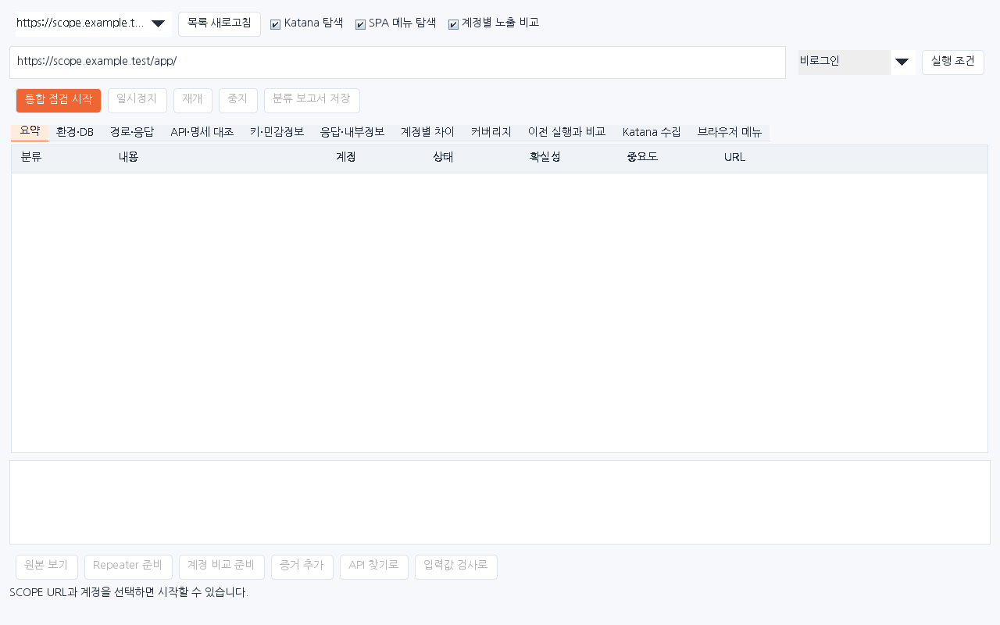

다음 확인: 시작 버튼을 누르기 전에는 대상 요청을 보내지 않습니다. 범위와 프로필은 이번 실행 ID의 조건으로 고정합니다.

## K01. Katana 설치를 확인하고 수집 조건을 정합니다

**Katana 설치와 실행 조건**

1. 공식 Katana 1.8.0을 설치하고 SCOPE 통합 점검 → 실행 조건에서 파일 선택 또는 경로 입력 후 설치 확인 결과를 읽습니다.
2. Katana 탐색과 페이지·수집 시간 한도를 정합니다. 대상 URL·HTTP 계정·SCOPE와 총 요청 예산을 확인한 뒤 통합 점검을 시작합니다.

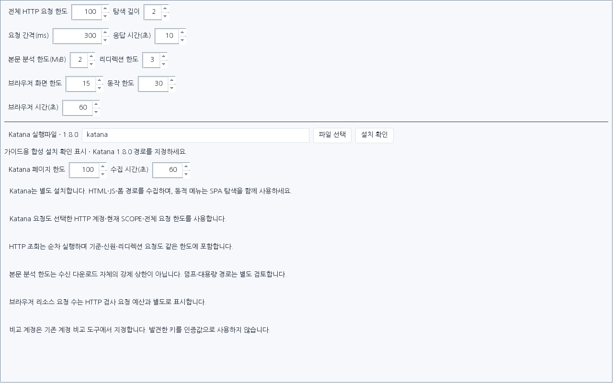

다음 확인: Katana 실행 파일은 별도 설치합니다. 실제 대상 조회에는 Workbench HTTP 계정·SCOPE·요청 한도가 적용됩니다.

## S02. 한 실행에서 발견·분석·확인 상태를 읽습니다

**요약**

1. 진행 상태와 전송·완료·대기·제외·실패·부분 분석 수를 확인합니다. 같은 응답을 환경·API·민감정보 분석에서 재사용합니다.
2. 일시정지·재개·중지로 진행을 제어합니다. 세션·429로 일시정지되면 원인을 보완해 재개하고, SCOPE·프로젝트 변경으로 중지되면 새 조건의 점검으로 시작합니다.

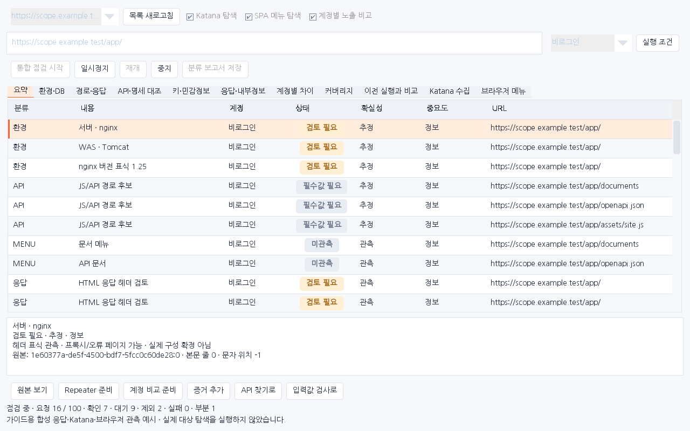

다음 확인: 큐를 끝까지 처리한 상태와 사이트 전체 기능의 확인 완료를 구분합니다. 중지·한도 도달·일부 제외는 별도 상태로 남습니다.

## K02. 수집 출처와 후보·차단·미확인 상태를 읽습니다

**Katana 수집**

1. Katana 수집에서 시작·진행·종료 상태, HTML·JS·폼·기술 출처와 발견 후보를 확인합니다. 실제 응답이 연결된 항목은 원본과 기존 분석 탭으로 이어집니다.
2. 범위 밖·쓰기·필수값 미확정·한도·실패 사유를 읽습니다. JSONL의 발견 메타데이터는 자동 재조회하지 않습니다. 환경·DB·API·민감정보·계정 차이·변경은 각각의 탭에서 근거와 함께 확인합니다.

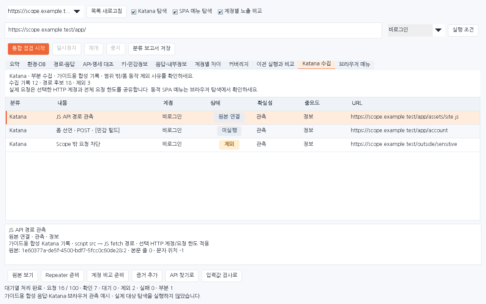

다음 확인: 후보 발견과 대상 내용 확인은 다릅니다. Katana가 끝나도 미검사·실패·부분 항목을 완료로 합산하지 않습니다.

## S03. 서버·WAS·DB와 탐지 근거를 함께 확인합니다

**환경·DB**

1. 환경 결과에서 서버, WAS, 프레임워크, 프록시/CDN, 프런트엔드와 DB 단서를 확인합니다.
2. 헤더·본문·오류의 근거와 원본 위치를 읽습니다. 관측된 숫자 버전은 출처와 함께 확인하고, 서로 다른 기술 단서는 충돌·추정 상태로 읽습니다.

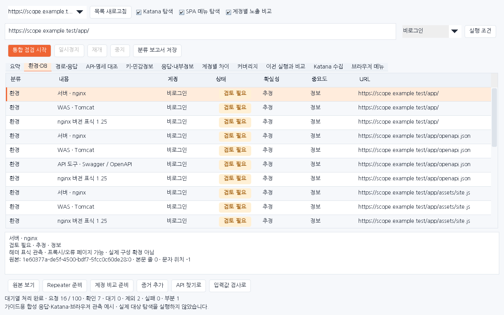

다음 확인: DB는 고유 오류·설정 구조 등 HTTP에서 관측한 단서로 추정합니다. 근거가 부족하면 미확인으로 남습니다.

## S04. 실제 참조와 환경별 후보 경로의 응답을 확인합니다

**경로·응답**

1. 실제 관측 경로, 문서 선언, 기술 추정 후보의 출처를 확인합니다. 환경에 맞는 주요 경로가 제한된 실행 큐로 이어집니다.
2. 응답 코드·내용 형식과 공통 화면·로그인·접근 제한·soft404 분류를 함께 읽습니다. 필요한 항목은 원본을 열어 응답 내용을 확인합니다.

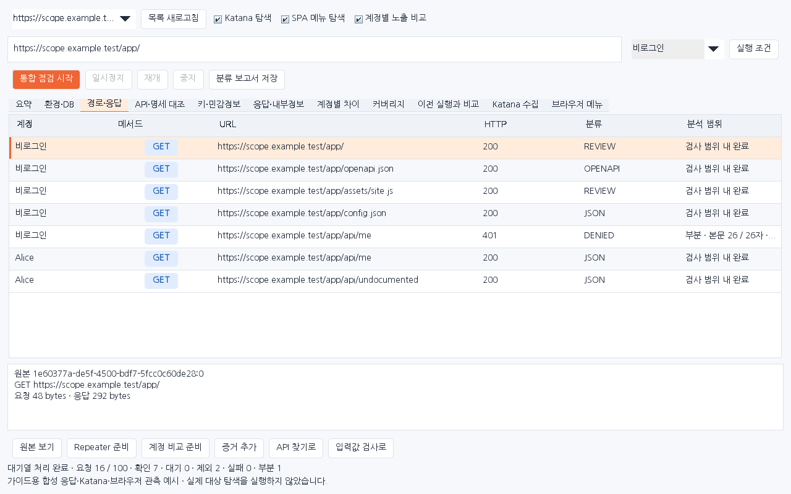

다음 확인: 상태 코드나 경로 이름만으로 실제 노출을 확정하지 않습니다. 대용량·미확정 API·범위 밖 항목은 제외/미확인 이유를 확인합니다.

## S05. 문서·JS·실제 관측 API를 대조합니다

**API·명세 대조**

1. API 결과에서 OpenAPI 등 문서 선언과 JS 후보, 실제 관측·응답 확인 상태를 구분합니다.
2. 문서에 없는 관측 API와 문서만 있는 항목을 확인합니다. 메서드·경로 변수·필수값이 미확정이면 필요한 원본을 기존 API 찾기나 Repeater로 연결해 준비합니다.

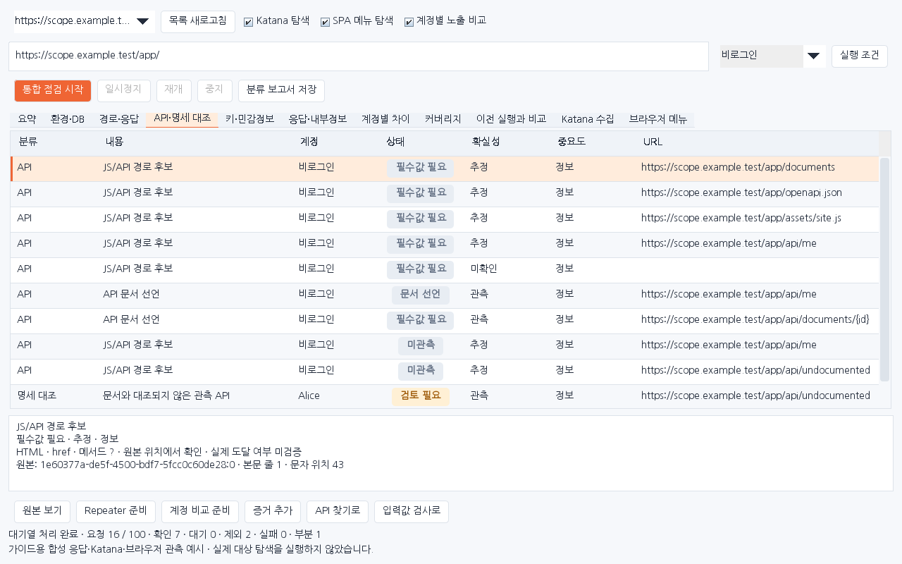

다음 확인: 미확정 메서드·입력값을 추측해 자동 전송하지 않습니다. 문서와 응답의 차이는 검토 후보입니다.

## S06. 키 후보를 마스킹·확실성·중요도로 검토합니다

**키·민감정보**

1. API 키·토큰·비밀번호·연결정보와 내부 주소·경로·오류 정보 후보를 확인합니다.
2. 공개 식별자·예제/테스트 값·비밀키 후보를 구분하고 중요도, 탐지 확실성, 유효성 확인 상태를 각각 읽습니다. 출처와 원문 위치를 열어 문맥을 확인합니다.

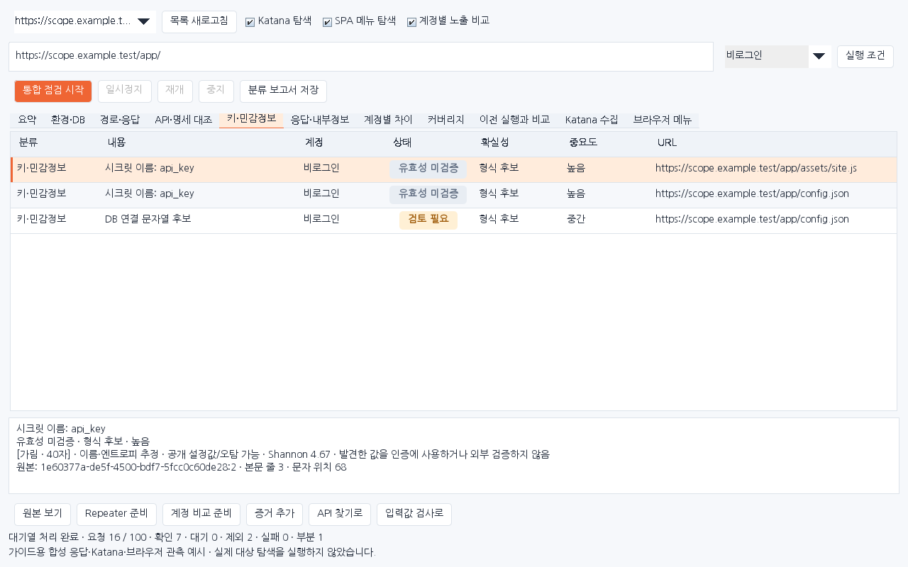

다음 확인: 발견한 키를 자동 사용하거나 외부 서비스에 보내 유효성을 검사하지 않습니다. 화면·이력·기존 증거의 가림과 원문 값이 포함되는 분류 보고서를 구분합니다.

## S07. 같은 경로를 HTTP 계정별로 확인합니다

**계정별 차이**

1. 계정별 비교를 선택해 실행한 경우, 비로그인과 선택한 HTTP 계정별 응답·내용 차이를 확인합니다.
2. 차이가 있는 항목의 계정 출처·세션 확인 상태와 원본을 읽습니다. 정책 검증이 필요하면 기존 계정 비교로 연결해 준비·권한 조건을 확인합니다.
3. 일부 경로의401은 새 신원·비로그인 대조 GET(합계2회)의 원본 근거를 확인합니다. 신원이 유지돼도 해당 경로의 권한은 미확인입니다. 신원 실패나 근거·예산 부족은 중단 사유를 확인합니다.

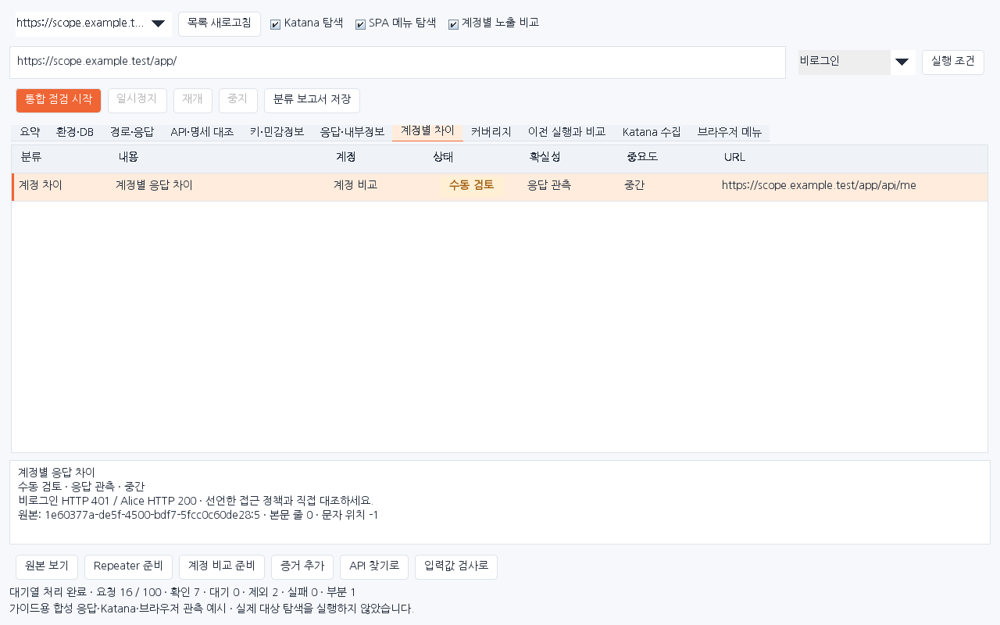

다음 확인: 응답 차이만으로 권한 우회를 확정하지 않습니다. 브라우저 로그인 계정은 별개이며 HTTP 계정 이름의 자동 증명이 아닙니다.

## S08. 같은 조건의 이전 실행과 비교합니다

**이전 실행과 비교**

1. 같은 프로젝트·Origin·계정·조건으로 다시 실행한 뒤 변경 결과를 확인합니다. Katana 수집을 시작한 HTTP 계정도 같은지 확인합니다.
2. 새 경로·새 API·새 키 지문, 응답 상태나 내용 변경과 해결 후보를 구분합니다. 과거 원본이 현재 세션에 없으면 요약 이력으로 읽습니다.

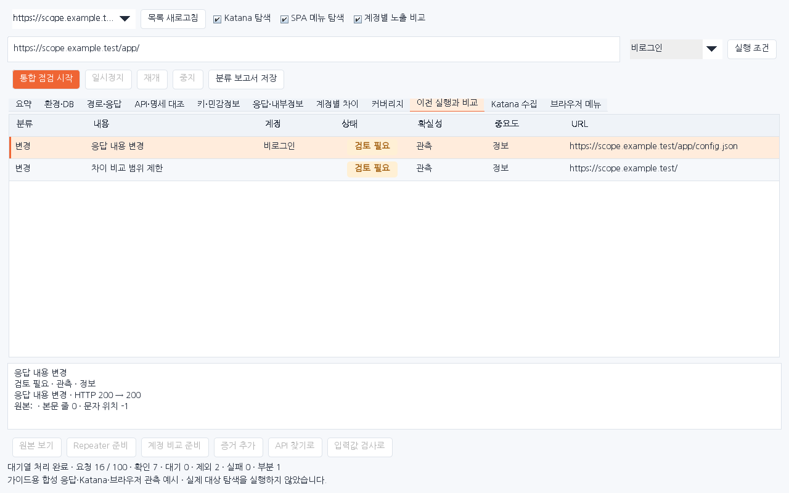

다음 확인: 범위·계정·조건이 다른 실행이나 인증 갱신이 섞인 실행은 비교를 보류합니다. 중지·실패·부분 실행으로 이전 발견의 해결을 확정하지 않습니다.

## S09. 미검사·제외·실패 사유까지 확인합니다

**커버리지**

1. 완료뿐 아니라 대기·범위 제외·메서드 미확정·대용량·분석 제한·전송 실패 항목을 확인합니다.
2. 미확인 항목을 선택해 다음 확인에 필요한 원본·계정·조건을 읽습니다. 요청 제한이나 세션 문제는 안내된 조건을 보완한 뒤 재개합니다.

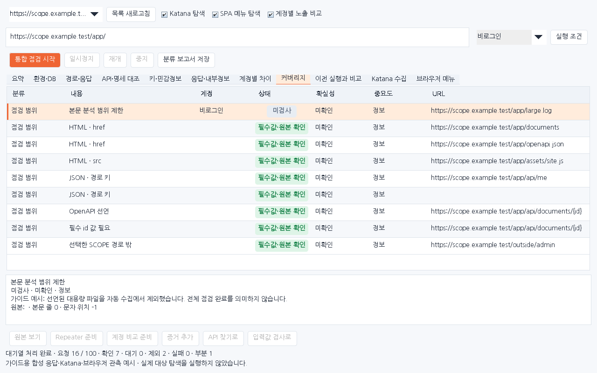

다음 확인: 대형 응답의 분석 한도와 실제 수신 한계를 구분합니다. 미검사 항목을 정상 결과로 합산하지 않습니다.

## S10. 로그인된 별도 탭에서 메뉴·동적 라우트를 탐색합니다

**브라우저 메뉴**

1. helper를 설치·연결하고 현재 사이트를 활성화한 뒤 SPA 통합 탐색 허용을 켭니다. Workbench 통합 점검에서 브라우저 모드를 선택합니다.
2. 새 탐색 탭은 지연 메뉴를 제한 시간 안에서 기다리고 동작 전 링크부터 보존합니다. 메뉴·hash route·API 연결과 부분/제외 상태를 확인합니다. 필요한 쿼리 값은 추측 재조회하지 않으며 쿠키를 HTTP 프로필로 복사하지 않습니다.
3. 범위 밖 리소스·로그인 화면·페이지/경로/메뉴 동작 한도가 있으면 부분 탐색 사유를 확인합니다. 로그인은 브라우저에서 보완하고, 종료·중지 시 전용 탭/가드 정리를 확인합니다.

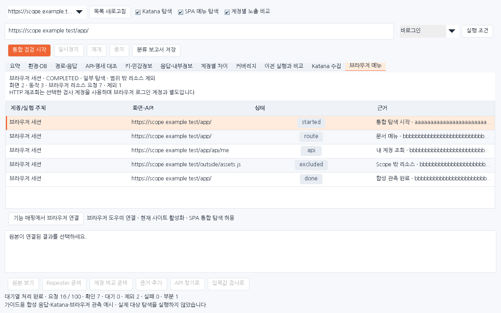

다음 확인: 최초 최소1.5초·동작 뒤350ms·최대3초 관찰입니다. 한도 이후 항목은 미확인이며 브라우저 예산은 HTTP 점검 예산과 별개입니다.

## S11. 같은 원본에서 검증과 증거 저장으로 이어갑니다

**원본·기존 도구·증거**

1. 결과를 선택하고 원본 보기로 요청·응답을 엽니다. 상세 영역의 본문 줄·문자 위치와 원문을 함께 읽습니다. 앞 64 KiB 미리보기의 더 보기(...)에서 Burp 기본 편집기로 전체 요청/응답을 읽습니다. 같은 불변 원본을 사용하는 읽기 전용 창은 합계 6개까지 열 수 있으며, 추가 창은 기존 창을 닫고 엽니다.
2. Repeater 준비, 계정 비교 준비, API 찾기로, 입력값 검사로 필요한 원본을 연결합니다. 제출할 항목은 증거 추가 후 기존 재현·증거에서 가림 미리보기와 ZIP 저장으로 마칩니다.

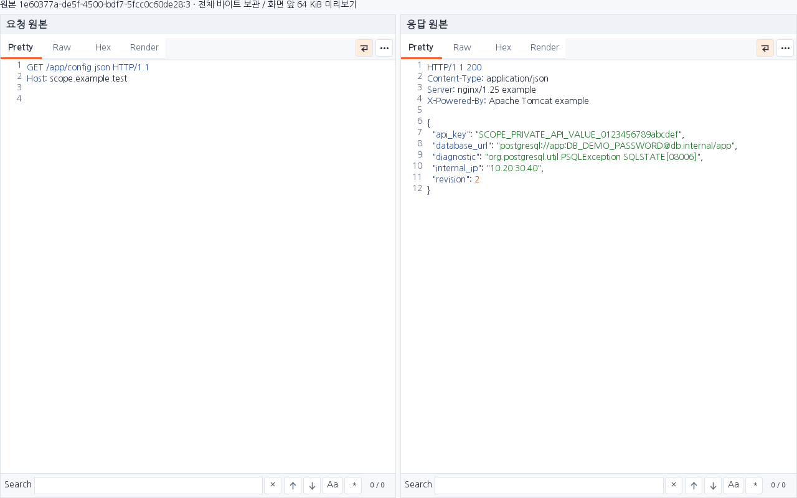

다음 확인: 원본은 현재 실행의 불변 패킷 ID로 연결됩니다. 도구 열기·초안 준비·증거 편집 자체는 추가 요청을 보내지 않습니다.

## S12. 파싱한 원문 값을 종류와 근거별로 저장합니다

**분류 보고서**

1. 점검이 끝나거나 중지된 뒤 상단의 분류 보고서 저장을 누르고 새 ZIP 파일의 저장 위치를 선택합니다. 응답에 있는 API·민감정보·토큰·키·환경·DB·내부 경로의 원문 값이 포함됩니다.
2. ZIP의 report.html에서 분류·값·위치·원본 ID를 읽고, report.json으로 정확한 값을 확인합니다. value는 파싱값, rawText는 원문 표기입니다. 백틱의 정적 문자열과 동적 API의 DYNAMIC_UNRESOLVED, 제품 탐지/추가 파싱과 예제·미검증 상태를 구분합니다.
3. values.csv는 스프레드시트 수식 실행을 막기 위해 일부 셀에 보호 문자를 붙입니다. 정확한 기계 값은 JSON을 사용합니다. 요청의 Cookie·Authorization을 별도 덤프로 포함하지 않습니다.

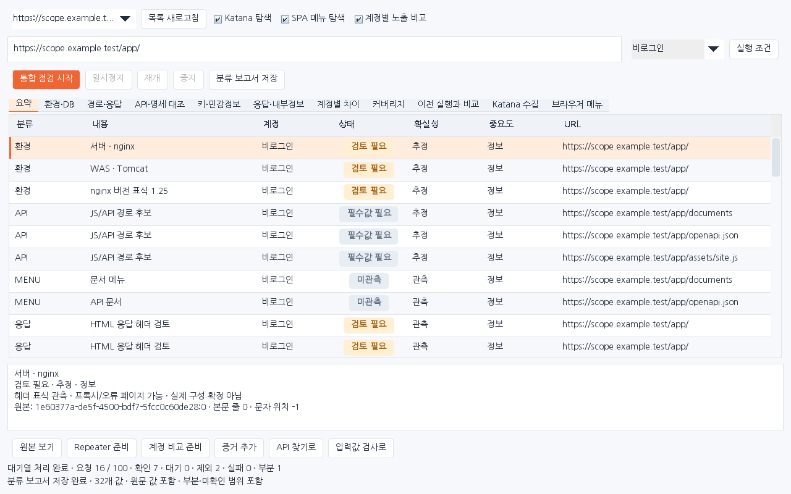

다음 확인: 보고서 생성은 대상 요청을 보내지 않습니다. 한도·원본 누락·부분 분석은 보고서에 남고, 기존 파일은 덮어쓰지 않습니다. 실행 이력의 가린 요약은 원문 보고서를 대신하지 않습니다.

## 00. 기존 8개 도구를 상단에서 바로 엽니다

**시작**

1. Burp Extensions → Add → Java에서 Simple JAR를 추가한 뒤 Workbench Simple 탭을 엽니다.
2. 상단에 표시된 8개 도구 중 필요한 도구를 바로 선택합니다. 원본을 고르고 필요한 도구에서 결과를 확인한 뒤 증거로 연결합니다.

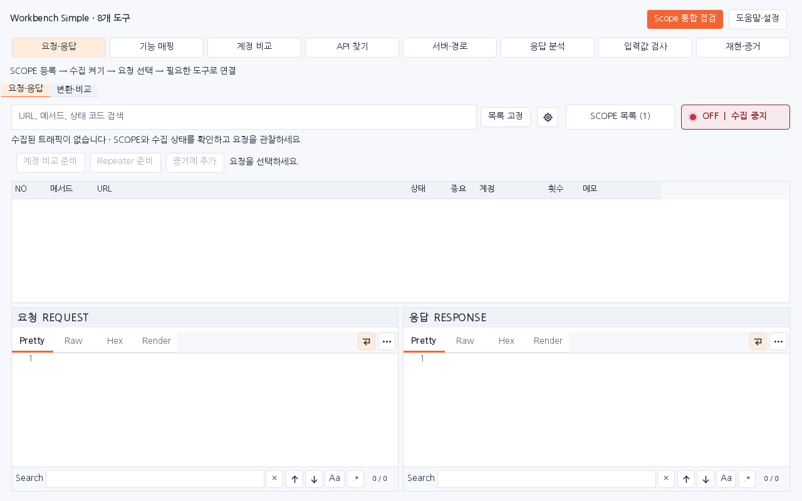

다음 확인: 도구 이동은 화면만 바꿉니다. 처음에는 수집 OFF이며, 원본을 선택하기 전 직접 작업 버튼은 비활성화됩니다.

## 01. SCOPE에 점검할 대상을 등록합니다

**요청·응답 목록**

1. 요청·응답의 SCOPE 목록을 열고 점검할 URL을 추가합니다. 경로를 지정하면 해당 경로와 하위 경로가 대상입니다.
2. 수집할 범위의 체크 상태를 확인합니다. Burp HTTP history의 Add to scope로 등록한 범위도 이 목록에서 확인합니다.

다음 확인: 의도한 프로토콜·호스트·포트·경로만 수집 범위에 들어 있는지 확인합니다.

## 02. SCOPE 수집을 켜고 사이트를 사용합니다

**요청·응답 목록**

1. 수집 버튼을 OFF에서 SCOPE로 바꾼 뒤 Burp 브라우저에서 대상 기능을 사용합니다.
2. 목록에 요청이 표시되는지 확인합니다. 기존 History는 SCOPE 수집을 켠 상태에서 필요한 요청을 골라 Simple로 가져옵니다.

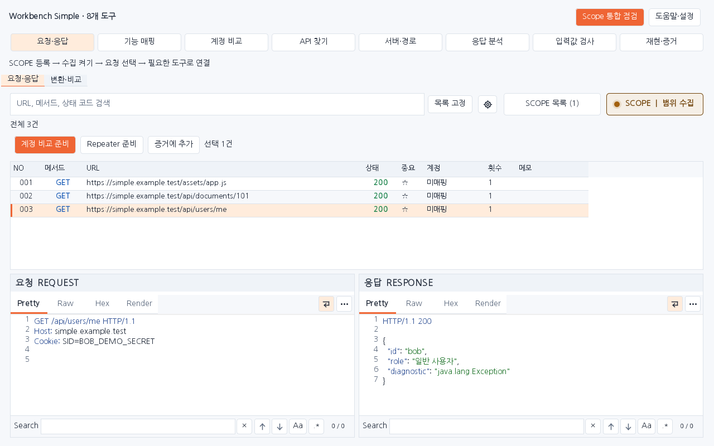

다음 확인: OFF에서는 새 트래픽과 수동 가져오기를 수집하지 않습니다. 목록 고정은 화면 갱신만 멈춥니다.

## 03. 원본을 선택하고 필요한 도구로 연결합니다

**요청·응답 목록**

1. 검색으로 요청을 찾고 행을 선택해 요청·응답 원문을 읽습니다. 여러 건은 Ctrl 또는 Shift로 선택합니다.
2. 계정 비교 준비, Repeater 준비, 증거에 추가를 사용하거나 행 메뉴에서 필요한 도구에 원본을 연결합니다. 상단 도구를 바꿔도 원본 선택은 유지됩니다.

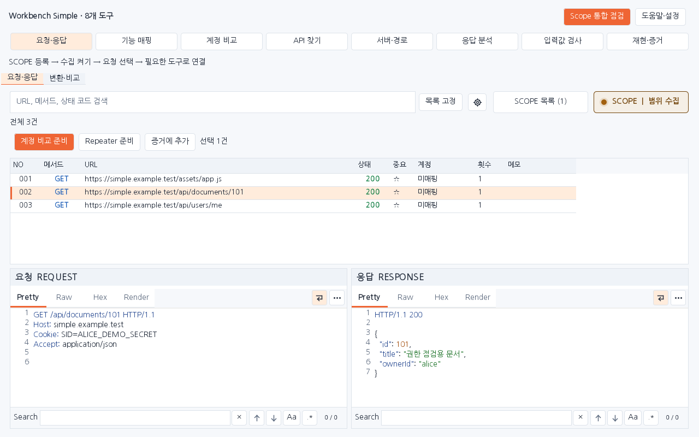

다음 확인: Repeater 준비는 요청을 복사하는 동작입니다. 실제 전송은 Repeater의 Send로 직접 실행합니다.

## 04. 기능·실행·세션과 패킷을 함께 확인합니다

**기능 자동 매핑**

1. 상단의 기능 매핑을 엽니다. SCOPE 수집 중 관측한 패킷이 기능·실행·세션에 어떻게 묶였는지 확인합니다.
2. 패킷과 분류 근거를 읽고 필요한 이름·메모를 정리합니다. 프로젝트 저장·열기와 점검 진행 현황 연결은 그대로 사용합니다.

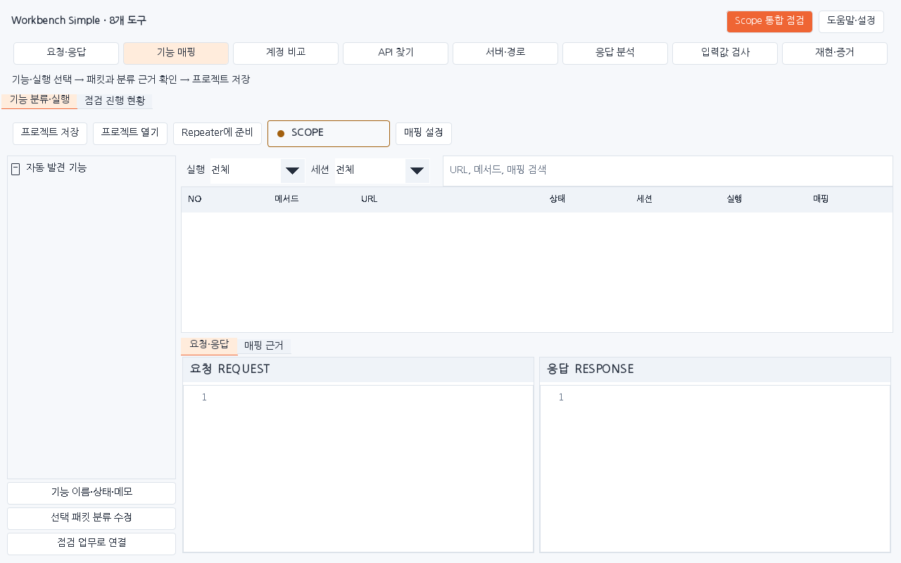

다음 확인: 자동 분류는 기능을 묶는 결과입니다. 실제 점검 완료는 검증 결과와 증거를 확인한 뒤 판단합니다.

## 05. 선택 응답의 API 후보와 원본 위치를 확인합니다

**JS에서 API 찾기**

1. 요청·응답 목록에서 텍스트 응답을 선택하고 행 메뉴의 선택 응답에서 API 찾기로 연결합니다. 상단의 API 찾기에서도 결과를 엽니다.
2. API·키 후보를 선택해 출처와 원본 위치를 읽습니다. 필요한 API만 요청으로 준비하고 메서드·인증·입력값을 확인합니다.

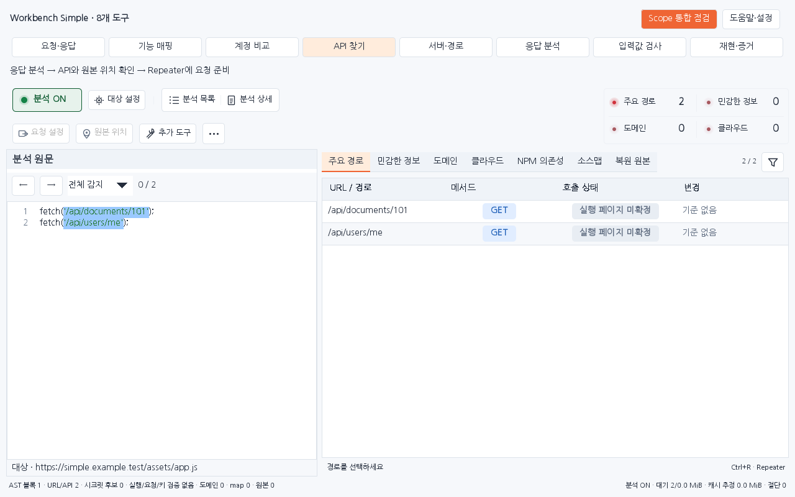

다음 확인: 코드 분석은 JavaScript 실행이나 요청 전송이 아닙니다. 시작 시 기존 History를 자동 순회하지 않습니다.

## 06. 관측 정보에서 필요한 경로만 직접 확인합니다

**서버·경로 탐색**

1. 상단의 서버·경로에서 관측한 사이트와 서버·경로 정보를 고릅니다.
2. 확인할 경로와 SCOPE·계정·요청 한도를 검토한 뒤 선택 경로의 GET 확인을 직접 실행합니다.

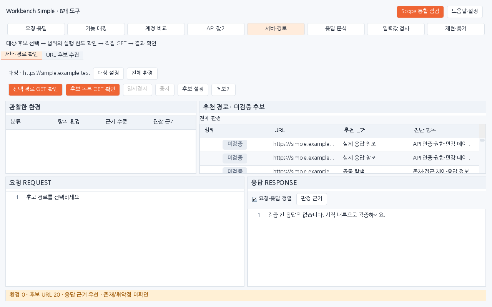

다음 확인: 후보 경로만으로 존재나 취약점이 확정되지는 않습니다. GET 확인은 서버에 요청을 전송합니다.

## 07. 응답의 보안 단서와 원본 근거를 읽습니다

**응답 보안 분석**

1. 상단의 응답 분석을 열어 관측 응답에서 나온 후보를 선택합니다.
2. 보안 단서·API 문서·저장 후 조회 흐름의 원본 위치와 근거를 확인합니다. 필요한 결과를 증거로 전달하고 영향을 직접 검증합니다.

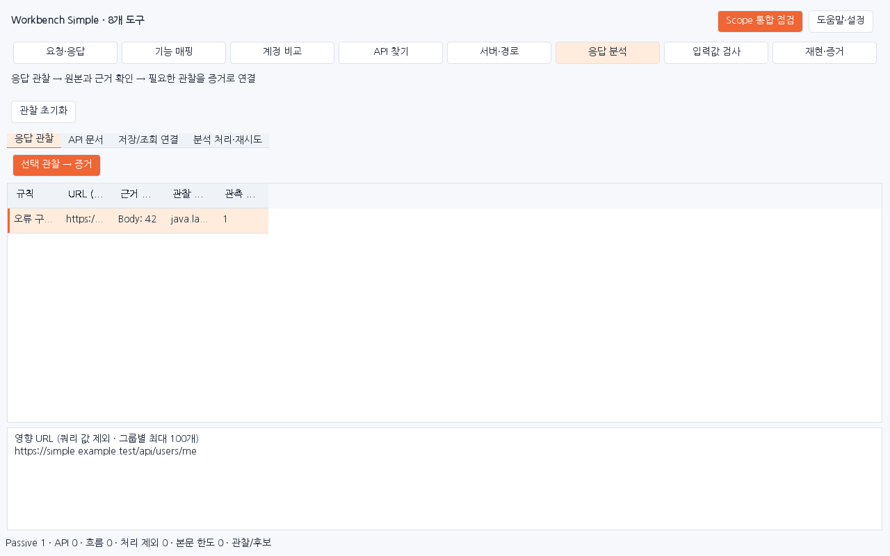

다음 확인: 분석은 관측 응답을 읽는 동작입니다. 오류 정보·헤더·반사 관찰만으로 취약점을 확정하지 않습니다.

## 08. 비교할 계정과 판정 조건을 준비합니다

**계정 권한 비교**

1. 인증 탐지를 ON으로 켜고 필요한 계정으로 사이트를 사용합니다. 탐지된 후보 행을 우클릭해 관리자·일반·후보1 중 비교 슬롯에 지정합니다.
2. 선택 요청 비교 또는 계정·판정 설정에서 계정, 허용·차단 기준과 필요한 세션·쓰기 후 조회 조건을 확인합니다.

다음 확인: 인증 탐지는 수집 OFF/SCOPE와 별도입니다. 후보 수집은 자동 비교 실행이 아니며 실제 비교에는 SCOPE가 필요합니다.

## 09. 설정을 확인한 뒤 비교를 직접 시작합니다

**계정 권한 비교**

1. 목록에서 원본을 선택하고 계정 비교 준비를 누릅니다. 조건을 바꿨다면 적용 상태 다시 확인 후 비교 시작(제한이 있으면 제한 확인 후 비교)을 누릅니다.
2. 결과에서 원본·계정별 응답과 판정 근거를 읽습니다. 진행 중인 비교는 중지로 멈추고 필요한 조건을 보완합니다.

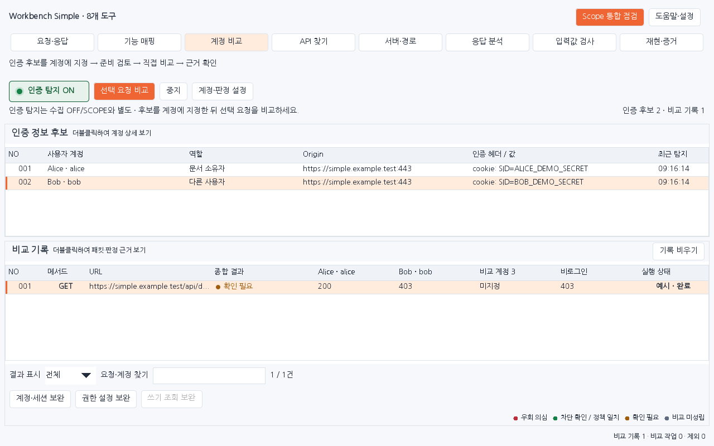

다음 확인: 상태 코드 차이만으로 권한 문제를 확정하지 않습니다. 세션 오류·쓰기 결과 미확인 등은 근거와 함께 검토합니다.

## 10. 입력 위치와 검사 조건을 정하고 결과를 확인합니다

**입력값 보안 검사**

1. 목록의 선택 요청을 입력값 검사에 연결하고 검사할 위치·값을 지정합니다. 검사 유형, 간격, 총 요청 한도와 SCOPE를 확인합니다.
2. 검사 시작은 직접 실행합니다. 기준·변경·대조 응답을 검토합니다. 결과 행을 선택하고 결과를 증거로 버튼으로 해당 검사의 기준·공격·대조 묶음 전체를 전달합니다.

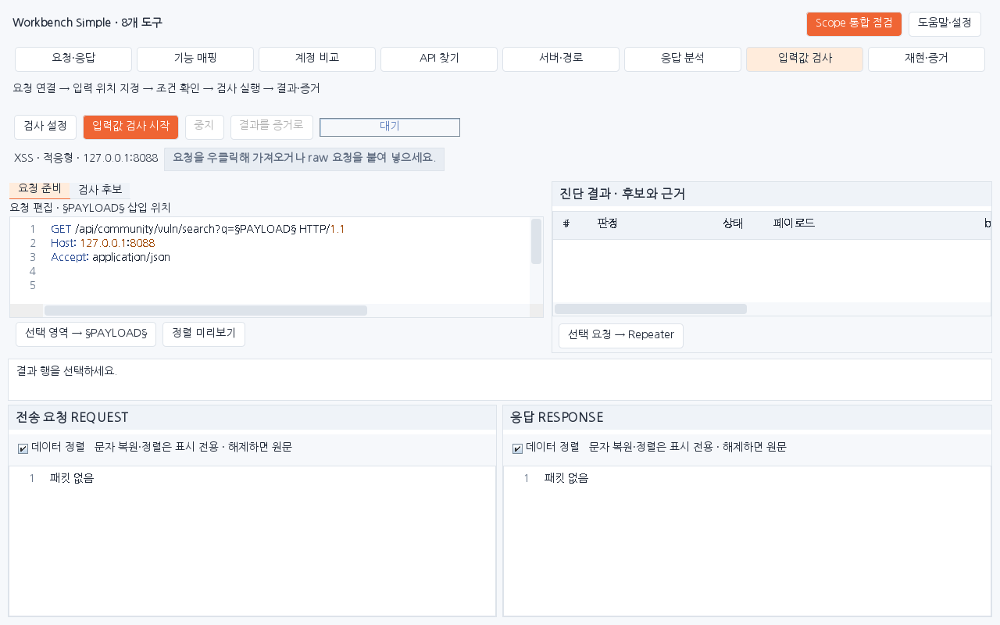

다음 확인: 요청 연결과 조건 편집은 전송하지 않습니다. 검사 시작은 여러 시험·대조 요청을 전송할 수 있습니다.

## 11. 필요한 요청을 순서대로 직접 재현합니다

**재현·증거 정리**

1. 상단의 재현·증거에서 요청 재현을 엽니다. 목록에서 선택한 원본 요청을 순서에 맞게 추가하고 단계별 입력과 인증 조건을 확인합니다.
2. SCOPE·Origin·쓰기 허용·대기 시간·총 요청 한도를 확인한 뒤 직접 실행합니다. 단계별 결과를 읽고 결과 → 증거 버튼으로 이번 재현의 전체 단계 결과를 연결합니다.

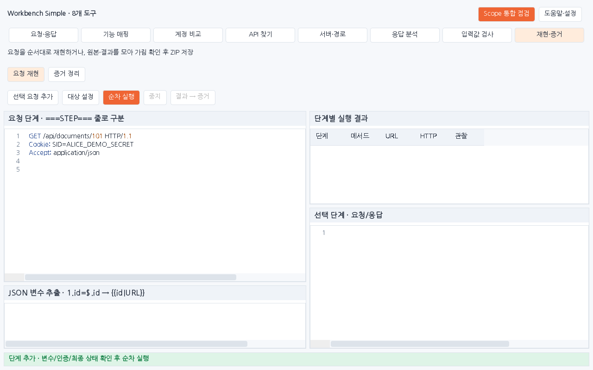

다음 확인: 단계 추가는 전송하지 않습니다. 순차 재현 실행은 서버에 요청을 전송하며, 중지와 실패 시 후속 실행 중단 조건을 확인합니다.

## 12. 원본·비교·재현 결과를 모으고 설명을 적습니다

**재현·증거 정리**

1. 재현·증거의 증거 정리 화면에서 증거 추가를 사용합니다. 비교 결과는 결과 목록에서 저장할 결과를 선택한 뒤 권한 비교 추가로 가져옵니다.
2. 제목, 영향, 재현 절차와 항목 설명을 작성합니다. 순서 변경·제거는 실행 취소와 다시 실행으로 복구합니다.

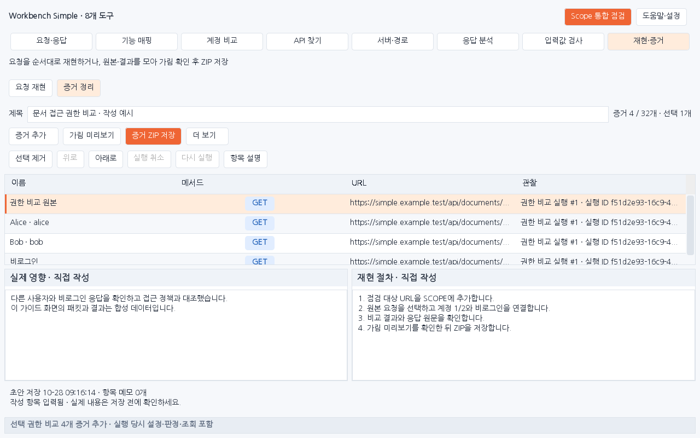

다음 확인: 비교 결과 추가는 실행 당시 원본·계정·조회와 판정 조건을 함께 보존합니다. 작성 초안만 복원한 경우 원본은 직접 연결합니다.

## 13. 가림 결과를 확인하고 ZIP으로 저장합니다

**재현·증거 정리**

1. 가림 미리보기를 열어 보고서와 패킷에 인증값·민감한 값이 남았는지 확인합니다. 추가 이름은 더 보기 → 가림 설정·본문 포함에서 지정합니다.
2. 직접 적은 문장과 첨부 이미지를 확인한 뒤 증거 ZIP 저장을 누르고 저장 위치를 지정합니다. 저장 완료 상태를 확인합니다.

![운영 가림 미리보기 · 합성 Cookie 값이 [REDACTED]로 가려진 내용을 보여 줍니다.](images/1.3.2/light/1280x800/06-redaction.png)

완료 확인: ZIP의 report.html 또는 report.md와 evidence.json을 열어 설명·순서·원본 연결·가림 결과가 의도한 대로 들어 있는지 확인합니다.

## 공통 확인 사항

- SCOPE URL·HTTP 계정 선택 → Katana·통합 점검 → 결과·원본 확인 → 원문 값 분류 보고서·기존 도구·증거 저장으로 이어갑니다. 기존 8개 도구는 직접 선택해 사용할 수 있습니다.
- Katana 수집은 실행용 인증 loopback 프록시를 사용해 같은 SCOPE·HTTP 계정·요청 예산으로 조회합니다. 폼 메타데이터와 기술 탐지 결과는 근거가 필요한 후보로 읽습니다.
- Simple은 기존 폴더 탐색·화면 이력·작업 이어가기·도우미 관리 바를 메인 화면에서 제거했습니다. 각 확장의 주요 기능은 유지하고, 도구 이동은 화면만 바꿉니다.
- 통합 점검 시작은 설정한 SCOPE 안에 조회 요청을 전송합니다. Repeater 준비는 원본을 복사하는 동작이며 실제 전송은 Send로 실행합니다. 입력값 검사·순차 재현은 해당 도구에서 직접 실행합니다.
- 요청이 없으면 SCOPE 체크·수집 SCOPE 상태·Burp 프록시 경유를 확인하고 사이트를 다시 사용합니다. 인증 후보가 없으면 인증 탐지를 켜고 계정별 요청을 관측합니다.
- 비교가 보류되면 세션·권한표·쓰기 후 조회 조건과 원본·응답 근거를 확인합니다. 중지는 이미 발송한 요청의 응답 또는 타임아웃 이후 마무리됩니다.
- 작성 초안의 복원은 HTTP 원본의 자동 복원을 의미하지 않습니다. 필요한 원본을 연결하고 가림 미리보기를 확인한 뒤 ZIP으로 저장합니다.
- 실행 이력은 마스킹된 요약과 지문을 저장합니다. 과거 원본이 현재 세션에 없으면 현재 원본처럼 열지 않고 이력으로 구분합니다.

**Ctrl+F** 요청 검색 · **Ctrl+R** Repeater 준비 · **F1** 현재 도구 안내. 상단 도구 단축키는 버튼 안내를 확인합니다.

## 검증 범위

그림은 Simple 운영 Swing 화면에 합성 예제 패킷을 넣어 렌더링한 캡처입니다. 실제 Burp GUI를 조작한 캡처가 아닙니다.
실제 실행한 검사와 미실행 범위는 [1.3.2 검증 기록](VERIFICATION_SIMPLE_1.3.2.json)을 확인합니다. 과거 버전의 통과 수를 새 버전 검사로 합산하지 않습니다.

[Katana 요구사항·구현·검사·가이드 연결표](KATANA_SCOPE_1.3.2_SPEC_KR.md)

[보존한 1.2.0 안내서](history/1.2.0/GUIDE_SIMPLE_KR.md) · [1.1.0 안내서](history/1.1.0/GUIDE_SIMPLE_KR.md) · [1.0.0 안내서](history/1.0.0/GUIDE_SIMPLE_KR.md)
