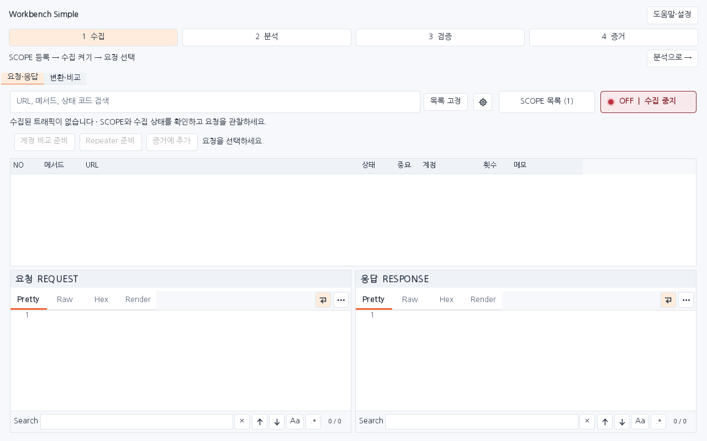
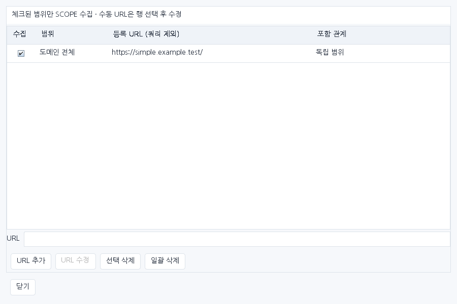
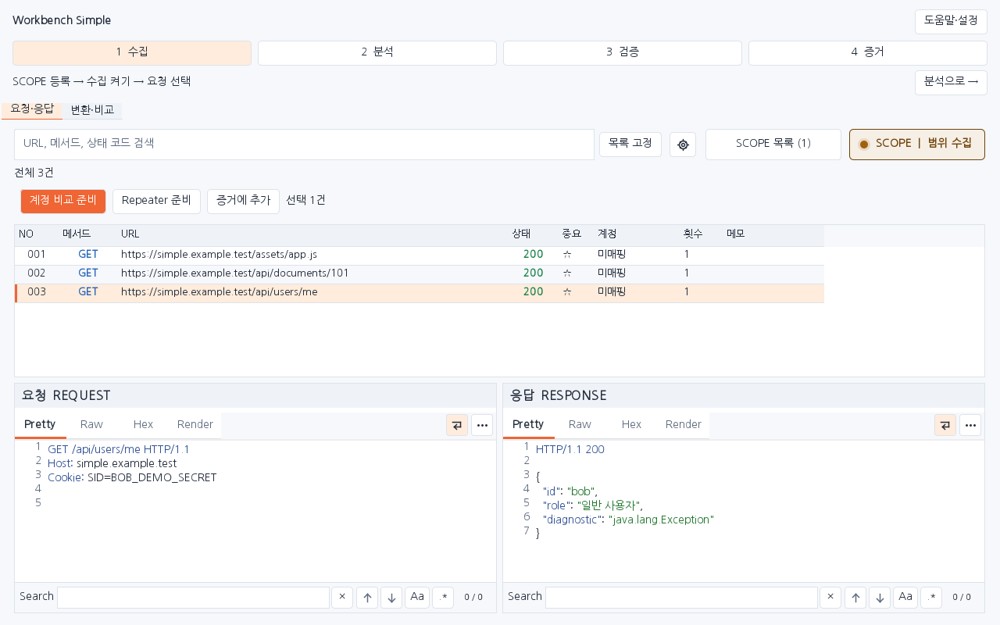
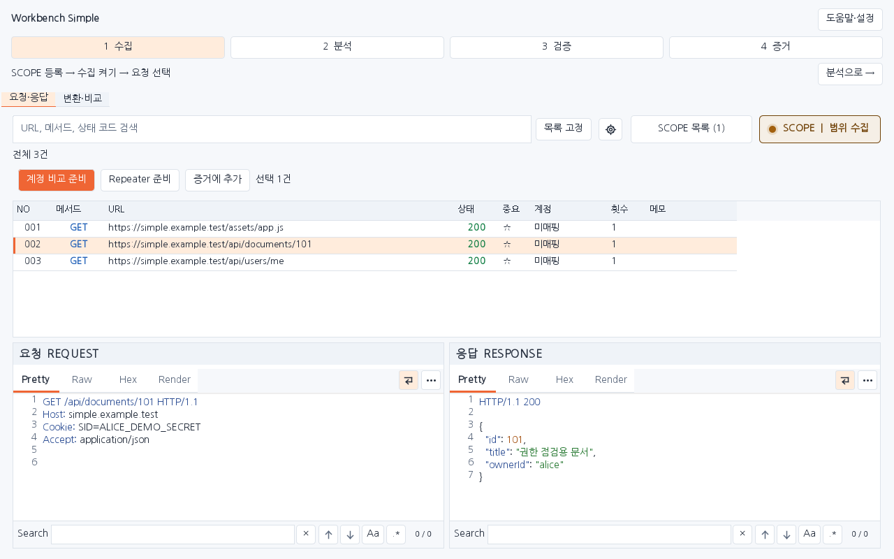
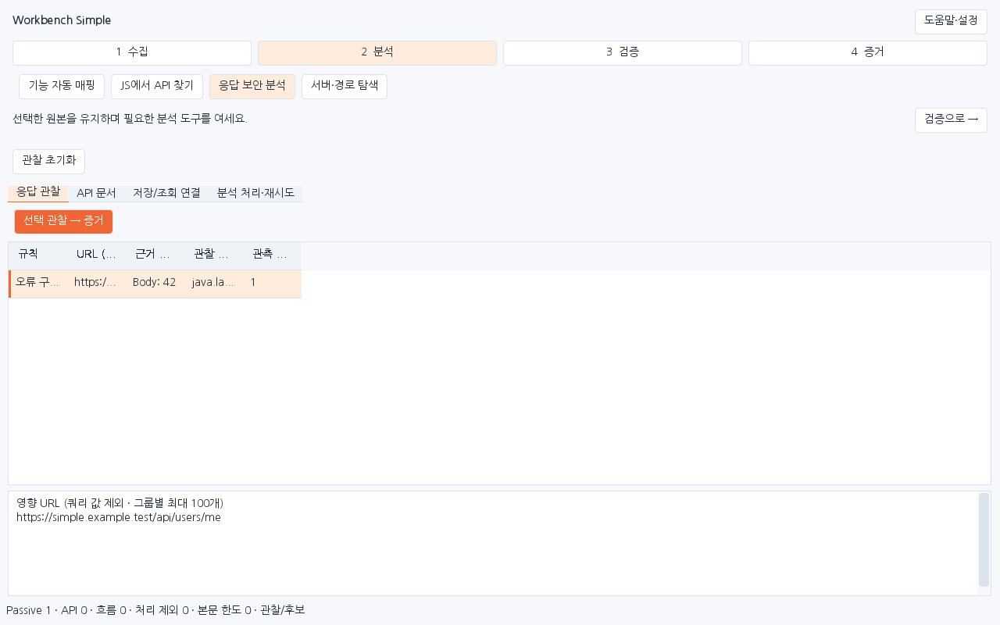
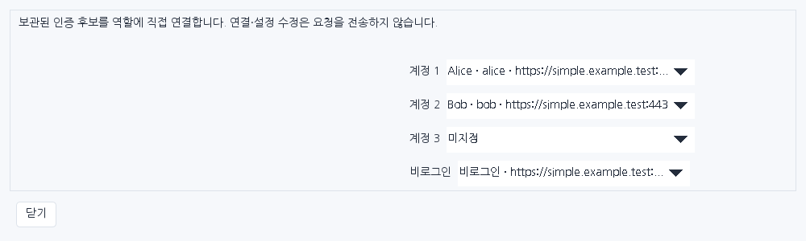
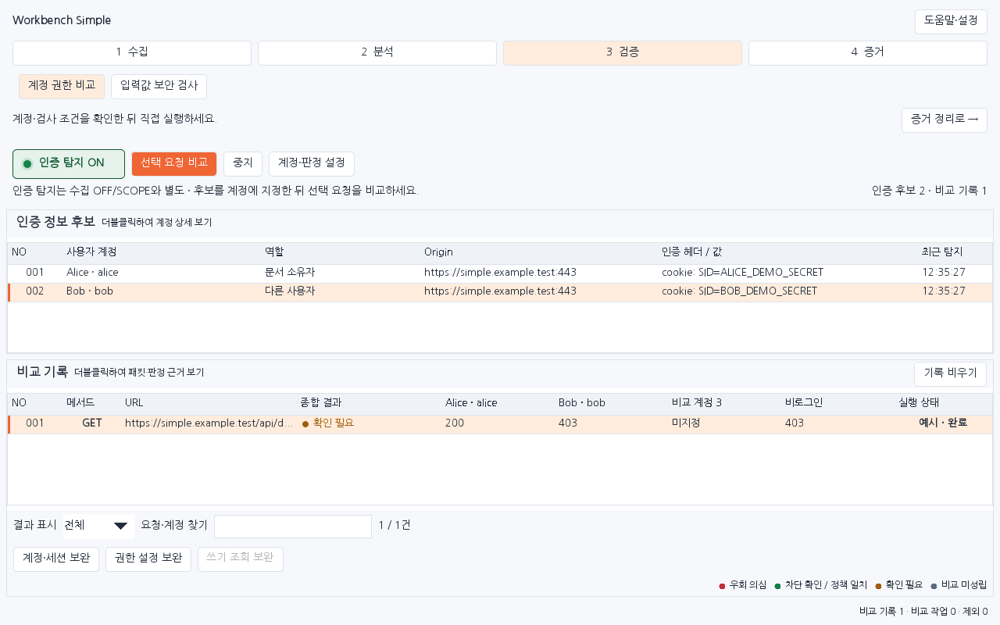
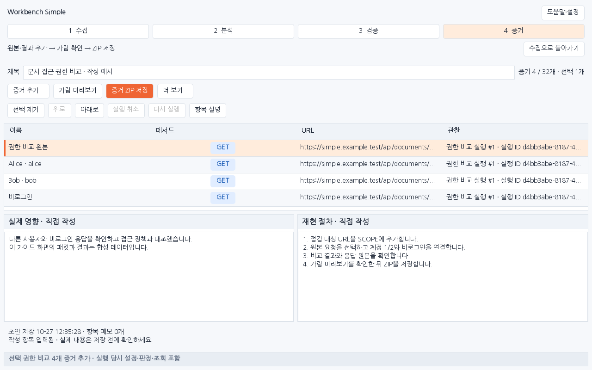
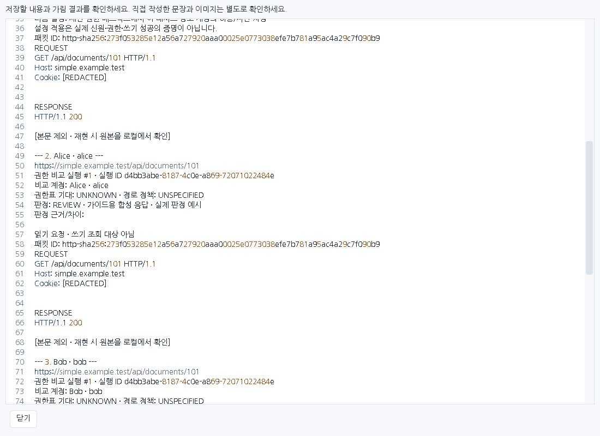

# Workbench Simple 1.0.0 사용 가이드

수집 → 분석 → 검증 → 증거의 네 단계로 원본 확인과 증거 저장을 이어갑니다.

> 그림은 Simple 운영 Swing 화면에 합성 예제 패킷을 넣어 렌더링한 캡처입니다. 실제 Burp GUI를 조작한 캡처가 아닙니다.

## 설치

1. `burp-workbench-simple-1.0.0.jar`를 준비하고 기존 Workbench JAR·파일을 보관합니다.
2. Burp **Extensions → Add → Java**에서 Simple JAR를 추가하고 **Workbench Simple** 탭을 엽니다.
3. 한 확장에서만 수집하려면 기존 Workbench 로드를 해제하고 Simple을 사용합니다. 기존 파일 삭제나 덮어쓰기는 필요하지 않습니다.

Simple 설정은 `simple.*`, 저장 폴더는 `.burp-workbench-simple`로 기존 Next와 분리됩니다. 단계는 필요한 순서로 바로 이동할 수 있으며, 다음 단계 버튼은 화면만 바꿉니다.

## 00. Simple을 열고 네 단계의 작업 화면을 확인합니다

**시작**

1. Burp Extensions → Add → Java에서 Simple JAR를 추가한 뒤 Workbench Simple 탭을 엽니다.
2. 상단의 1 수집, 2 분석, 3 검증, 4 증거로 바로 이동합니다. 오른쪽 도움말·설정에서 현재 도구 안내와 화면 설정을 엽니다.

다음 확인: 처음에는 수집이 OFF입니다. 요청을 선택하기 전 비교·Repeater·증거 버튼은 비활성화됩니다.

## 01. SCOPE에 점검할 대상을 등록합니다

**1 수집**

1. Simple의 SCOPE 목록을 열고 실제 점검할 URL을 추가합니다. 경로를 지정하면 해당 경로와 하위 경로가 대상입니다.
2. 수집할 범위의 체크 상태를 확인합니다. Burp HTTP history의 Add to scope로 등록한 범위도 이 목록에서 확인합니다.

다음 확인: 의도한 프로토콜·호스트·포트·경로만 수집 범위에 들어 있는지 확인합니다.

## 02. SCOPE 수집을 켜고 사이트를 사용합니다

**1 수집**

1. 수집 버튼을 OFF에서 SCOPE로 바꾼 뒤 Burp 브라우저에서 대상 기능을 사용합니다.
2. 목록에 요청이 표시되는지 확인합니다. 기존 History는 SCOPE 수집을 켠 상태에서 필요한 요청을 골라 Simple로 가져옵니다.

다음 확인: OFF에서는 새 트래픽과 수동 가져오기를 수집하지 않습니다. 목록 고정은 화면 갱신만 멈춥니다.

## 03. 원본을 고르고 바로 다음 작업으로 이어갑니다

**1 수집**

1. 검색으로 요청을 찾고 행을 선택해 요청·응답 원문을 읽습니다. 여러 건은 Ctrl 또는 Shift로 선택합니다.
2. 계정 비교 준비, Repeater 준비, 증거에 추가 중 필요한 작업을 누릅니다. 선택 전에는 세 버튼이 비활성화됩니다.

다음 확인: Repeater 준비는 요청을 복사하는 동작입니다. 실제 전송은 Repeater의 Send로 직접 실행합니다.

## 04. 필요한 분석 도구 하나를 선택합니다

**2 분석**

1. 2 분석에서 기능 자동 매핑, JS에서 API 찾기, 응답 보안 분석, 서버·경로 탐색 중 목적에 맞는 도구를 고릅니다.
2. 선택한 원본·출처와 분석 근거를 함께 확인합니다. 추가 요청이 필요한 확인은 도구의 실행 버튼으로 직접 시작합니다.

다음 확인: 분석 결과는 검토할 단서입니다. 화면을 바꾸는 것만으로 대상 요청을 전송하지 않습니다.

## 05. 비교할 계정과 판정 조건을 준비합니다

**3 검증**

1. 인증 탐지를 ON으로 켜고 필요한 계정으로 사이트를 사용합니다. 탐지된 후보 행을 우클릭해 관리자·일반·후보1 중 비교 슬롯에 지정합니다.
2. 선택 요청 비교 또는 계정·판정 설정에서 계정, 허용·차단 기준과 필요한 세션·쓰기 후 조회 조건을 확인합니다.

다음 확인: 인증 탐지는 수집 OFF/SCOPE와 별도입니다. 후보 수집은 자동 비교 실행이 아니며 실제 비교에는 SCOPE가 필요합니다.

## 06. 설정을 확인한 뒤 비교를 직접 시작합니다

**3 검증**

1. 수집 목록에서 원본을 선택하고 계정 비교 준비를 누릅니다. 조건을 바꿨다면 적용 상태 다시 확인 후 비교 시작(제한이 있으면 제한 확인 후 비교)을 누릅니다.
2. 결과에서 원본·계정별 응답과 판정 근거를 읽습니다. 진행 중인 비교는 중지로 멈추고 필요한 조건을 보완합니다.

다음 확인: 상태 코드 차이만으로 권한 문제를 확정하지 않습니다. 같은 인증·세션 오류·쓰기 결과 미확인은 근거와 함께 검토합니다.

## 07. 원본·비교 결과를 모으고 재현 절차를 적습니다

**4 증거**

1. 수집 화면의 증거에 추가 또는 4 증거의 증거 추가 메뉴를 사용합니다. 비교 결과는 결과 목록에서 저장할 결과를 선택한 뒤 권한 비교 추가로 가져옵니다.
2. 제목, 영향, 재현 절차를 작성하고 항목 설명으로 각 증거의 의미를 적습니다. 순서 변경·제거는 실행 취소와 다시 실행으로 복구합니다.

다음 확인: 권한 비교 추가는 실행 당시 원본·계정·조회와 판정 조건을 함께 보존합니다. 작성 초안만 복원한 경우 원본은 직접 연결합니다.

## 08. 가림 결과를 확인하고 ZIP으로 저장합니다

**4 증거**

1. 가림 미리보기를 열어 보고서와 패킷에 인증값·민감한 값이 남았는지 확인합니다. 추가 이름은 더 보기 → 가림 설정·본문 포함에서 지정합니다.
2. 직접 적은 문장과 첨부 이미지를 확인한 뒤 증거 ZIP 저장을 누르고 저장 위치를 지정합니다. 저장 완료 상태를 확인합니다.

완료 확인: ZIP의 report.html 또는 report.md와 evidence.json을 열어 설명·순서·원본 연결·가림 결과가 의도한 대로 들어 있는지 확인합니다.

## 유지한 도구

| 단계 | 도구 | 하는 일 |
|---|---|---|
| 수집 | 요청·응답 목록 / 변환·비교 | SCOPE, 수집, 검색, 원본 확인과 직접 작업 |
| 분석 | 기능 자동 매핑 / JS에서 API 찾기 / 응답 보안 분석 / 서버·경로 탐색 | 출처를 따라 단서를 확인하고 필요한 분석을 선택 |
| 검증 | 계정 권한 비교 / 입력값 보안 검사 | 조건을 준비한 뒤 명시적으로 실행하고 근거 검토 |
| 증거 | 증거 작성 / 가림 미리보기 / ZIP 저장 | 원본·실행 결과와 설명을 묶어 저장 |

Simple은 폴더 탐색·화면 이력·작업 이어가기·도우미 관리, 계정 자동 비교 토글, 증거 화면의 업무 흐름·OAST 등 부가 실행 화면을 메인 사용 흐름에서 제거합니다. 기존 확장 엔진과 원본·비교·증거 연결은 보존합니다. 시작 시 기존 History를 반복 분석하지 않습니다.

## 단축키

- **Alt+1~4**: 단계 이동
- **Ctrl+F**: 수집 목록 검색
- **Ctrl+R**: 선택 요청을 Repeater에 준비
- **F1**: 현재 도구 안내

## 검증 범위

그림은 Simple 운영 Swing 화면에 합성 예제 패킷을 넣어 렌더링한 캡처입니다. 실제 Burp GUI를 조작한 캡처가 아닙니다.
실제 Burp GUI·Windows DPI/IME·외부 서비스의 실행 검증과 구분합니다. Simple에서 실제 실행한 검사만 [검증 기록](VERIFICATION_SIMPLE.json)에 기록하며 기존 버전의 검사 수를 합산하지 않습니다.
