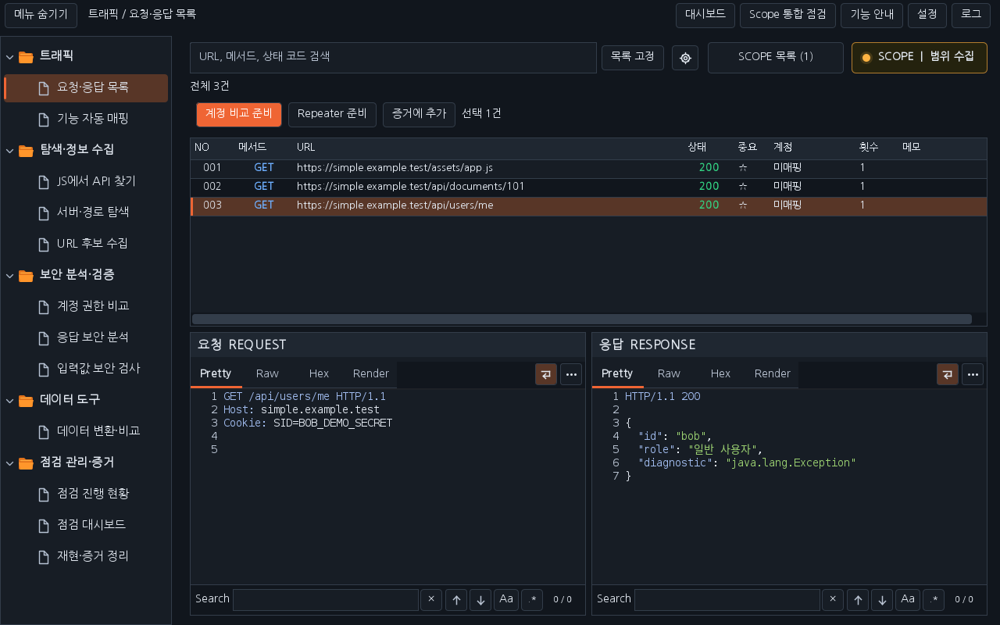
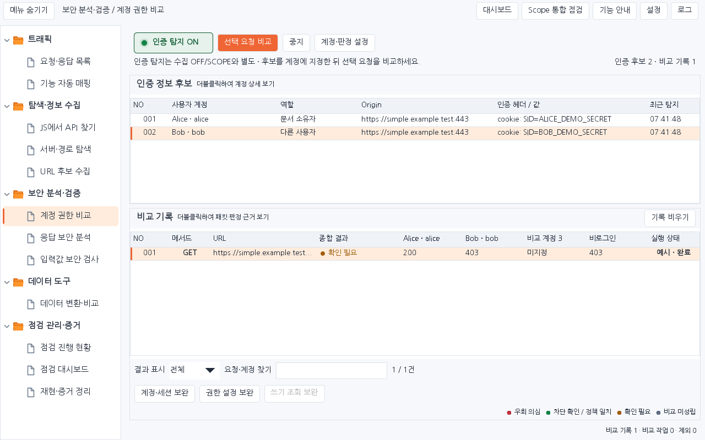

# Workbench Simple 1.4.4 · 0.39.2 스타일의 폴더 화면

첨부한 `burp-workbench-kr-0.39.2.jar`의 디자인·배치를 기준으로 Simple 화면을 정리합니다. 첨부 파일의 SHA-256은 보존된 0.39.2 JAR와 같은 `d4ace4deaee7b8e4b29f74580efe638c89baf4d182f46ac7ebe428e7959004da`입니다. 해당 버전의 소스·렌더링 자료를 대조했습니다.

[새 JAR](../downloads/1.4.4/burp-workbench-simple-1.4.4.jar) · [독립 빌드 소스 ZIP](../downloads/1.4.4/burp-workbench-simple-1.4.4-source.zip) · [SHA-256](../downloads/1.4.4/SHA256SUMS) · [이번 검증과 제한](VERIFICATION_SIMPLE_1.4.4.json)

## 화면과 배치

큰 8개 도구 버튼 줄을 왼쪽 폴더 메뉴로 바꿉니다. 상단은 메뉴 숨기기·현재 도구 경로·기능 안내·설정·로그의 작은 도구 모음으로 구성하며, 대시보드·Scope 통합 점검도 바로 열 수 있습니다. Next 배지나 별도의 작업 요약 헤더는 표시하지 않습니다.

| 폴더 | 화면 |
|---|---|
| 트래픽 | 요청·응답 목록, 기능 자동 매핑 |
| 탐색·정보 수집 | JS에서 API 찾기, 서버·경로 탐색, URL 후보 수집 |
| 보안 분석·검증 | 계정 권한 비교, 응답 보안 분석, 입력값 보안 검사 |
| 데이터 도구 | 데이터 변환·비교 |
| 점검 관리·증거 | 점검 진행 현황, 점검 대시보드, 재현·증거 정리 |

데이터 변환·URL 후보·점검 현황은 기존 화면을 폴더에서 직접 엽니다. 중복 내부 탭 표시를 숨기고 같은 컴포넌트·원본·입력을 유지합니다. 폴더 선택만으로 요청을 보내거나 도구를 다시 만들지 않습니다. 하위 도구와 폴더 선택 표시도 함께 바뀝니다.

0.39.2와 같은 밝은 배경·어두운 테마, 주황색 선택 강조, 표 테두리와 폴더 아이콘을 사용합니다. 기본 한글 글꼴은 해당 JAR처럼 내장 NanumGothic을 사용하고 표시 가능한 패킷 텍스트에는 고정폭 글꼴을 사용합니다. 글자 크기 100/125/150%, 목록 간격, 열·분할 설정 저장은 유지합니다.

기본 배치는 목록 위·요청과 응답 아래 좌우입니다. 상단 **설정 → 요청 / 응답 배치**에서 목록 왼쪽·요청/응답 상하로 바꾸거나 배치를 초기화할 수 있습니다. 왼쪽 메뉴 폭은 끌어서 바꾸고 숨기기·보기를 사용할 수 있습니다. `Ctrl+Shift+M`은 메뉴 표시 전환, `Alt+1~8`은 기존 8개 도구, `Ctrl+K`는 기능 찾기, `Alt+←/→`는 작업 화면 이동입니다.

아래는 운영 Swing 컴포넌트에 합성 예시를 넣은 미리보기입니다. 사용자 PC의 실제 Burp GUI 캡처가 아닙니다.






## 유지하는 기능과 설치

Simple의 8개 도구, 통합 점검·Katana·대시보드와 원본 ID·SCOPE·계정·요청 예산·증거 계약을 유지합니다. 화면·설정·안내를 여는 동작은 대상 요청을 보내지 않으며 실제 비교·GET·검사·Send는 직접 실행합니다.

1.4.3의 `jdk.httpserver` 접근 실패 시 전체 확장 로드 중단 방지도 포함합니다. 해당 모듈을 사용할 수 없는 Burp Java에서는 브라우저 도우미·SPA 연결 제한을 표시하며 일반 HTTP 작업을 사용할 수 있습니다. [Java 복구 안내](RELEASE_SIMPLE_1.4.3_KR.md)를 참고하세요.

기존 Simple의 로드를 해제하고 1.4.4 JAR를 추가합니다. 이전 JAR·프로젝트와 원본 Next·0.39.2 파일은 보존합니다. Simple의 설정·저장 공간은 그대로 사용합니다.

## 검증 범위

운영 Swing과 Montoya 어댑터로 폴더 선택, 하위 화면 연결, 입력·원본 보존, 메뉴 숨김·폭 복원, 두 테마·두 크기의 배치와 HTTP 무전송을 검사합니다. 재등록한 `FolderNavigationTest`와 새 `SimpleClassicLayoutTest`를 포함합니다. 기존 버튼 헤더 전제만 실제 트리 선택으로 맞추고 기능 계약은 유지합니다. 합성 렌더링은 실제 사용자 PC의 Burp GUI 캡처가 아닙니다.

```sh
python simple/dev.py check
python simple/tools/render_simple.py --out tmp/simple-layout-1.4.4 --check
python simple/tools/render_scope_inspection.py --out tmp/simple-inspection-layout-1.4.4 --check
python simple/dev.py verify
```

실제 실행 결과·제한은 검증 JSON에 기록하며 과거 0.39.2의 검사 수를 이번 결과에 합산하지 않습니다.
