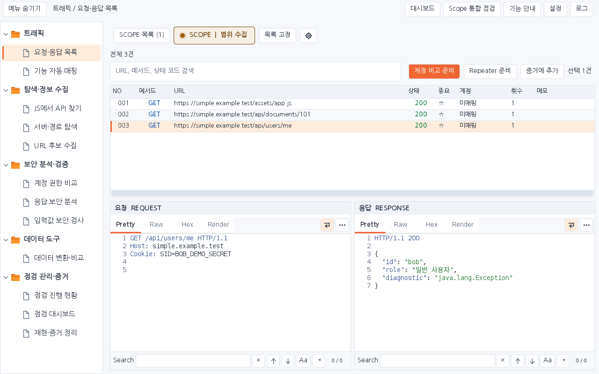
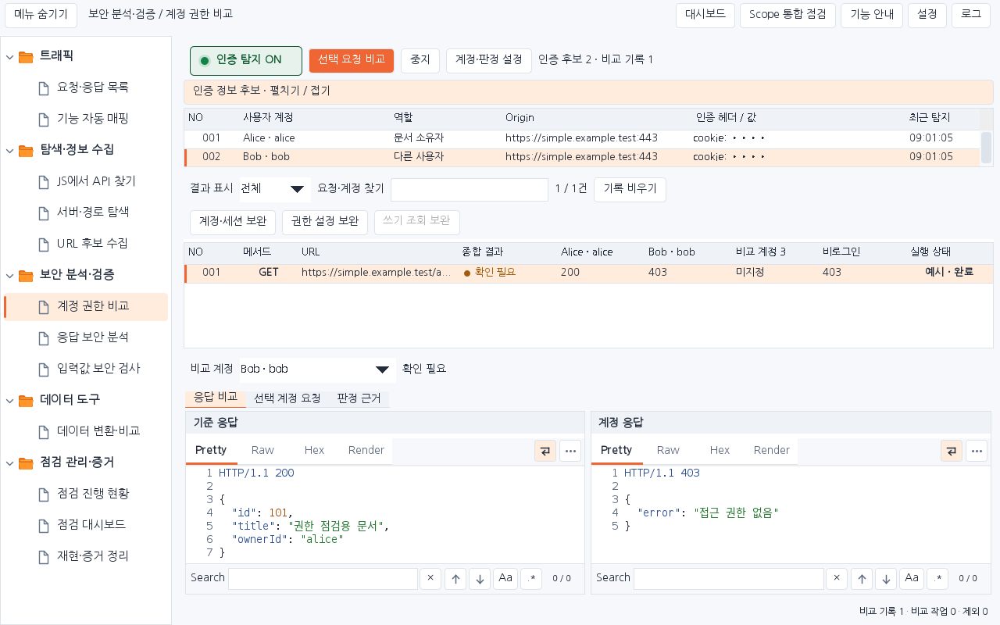
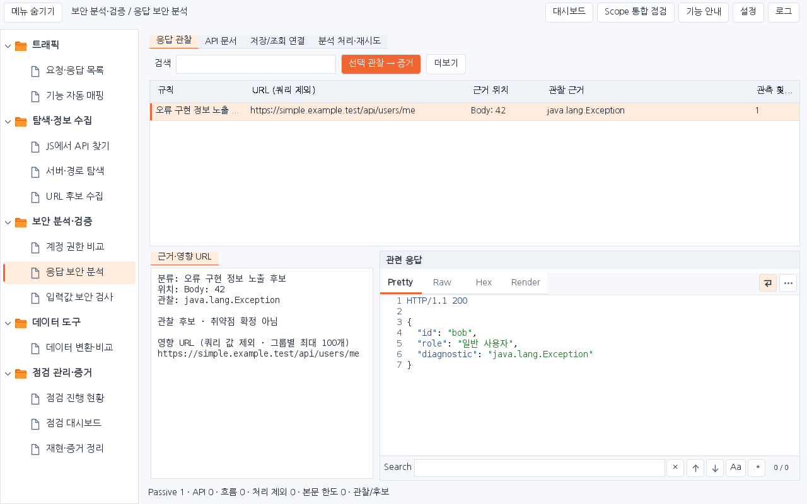
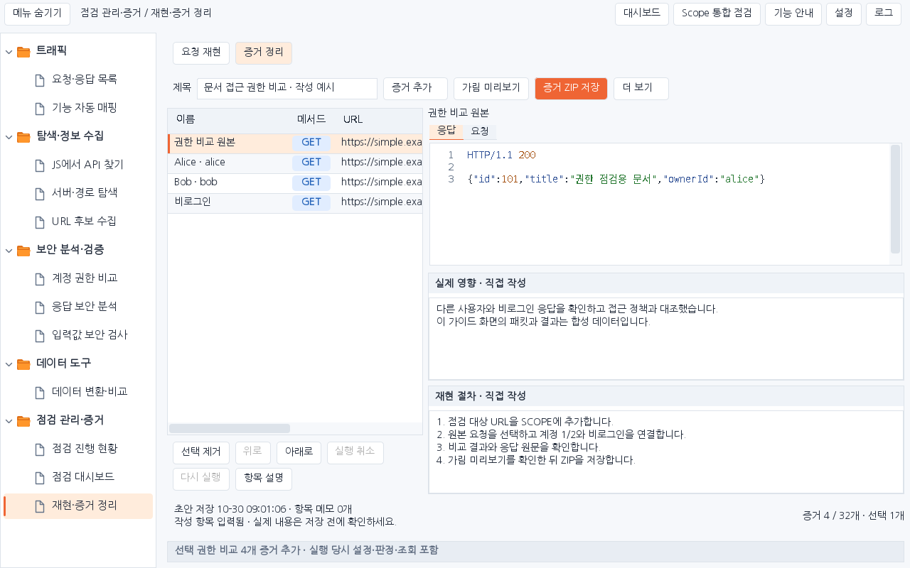

# Workbench Simple 1.4.5 · 제목 없는 작업 화면

승인한 8개 도구의 디자인 시안을 실제 Swing 화면에 적용합니다. 도구 이름은 왼쪽 폴더와 상단 경로에서 확인하며 본문은 작업 조건과 버튼으로 시작합니다. 큰 제목·소개 영역을 추가하지 않고 목록과 상세 읽기 공간을 확보했습니다.

[설치 JAR](../downloads/1.4.5/burp-workbench-simple-1.4.5.jar) · [독립 소스 ZIP](../downloads/1.4.5/burp-workbench-simple-1.4.5-source.zip) · [체크섬](../downloads/1.4.5/SHA256SUMS) · [검증 기록](VERIFICATION_SIMPLE_1.4.5.json)

## 도구별 변경

| 도구 | 적용 내용 |
|---|---|
| 요청·응답 목록 | SCOPE·수집·목록 상태를 첫 줄에 모으고 검색과 선택 항목 작업을 다음 줄에 배치합니다. 본문 좌우 여백을 줄였습니다. |
| 기능 자동 매핑 | 기능 트리 기본 폭을 190px로 줄이고 접기·펼치기를 제공합니다. 요청 목록보다 패킷 상세에 더 많은 높이를 배정합니다. |
| 계정 권한 비교 | 인증 후보를 접을 수 있으며 인증값은 목록에서 가립니다. 비교 기록 아래에서 기준 응답과 선택 계정 응답·요청·판정 근거를 읽습니다. 기존 더블클릭 확대 창도 유지합니다. |
| JS에서 API 찾기 | 상단 집계 카드 대신 결과 탭에 현재 소스의 항목 수를 표시합니다. 원문·결과 좌우 배치를 유지하고 도구 모음 간격을 줄입니다. |
| 서버·경로 탐색 | 관찰 환경은 기본 접힌 영역으로 표시합니다. 후보 목록은 본문 전체 폭을 사용하고 아래 요청·응답을 배치합니다. 선택 경로 GET만 주 버튼으로 강조합니다. |
| 응답 보안 분석 | 검색 가능한 표가 가용 폭을 채웁니다. 선택한 원본의 관련 응답과 관찰 근거·영향 URL을 아래에서 함께 읽습니다. 초기화는 더보기에 둡니다. |
| 입력값 보안 검사 | `1 요청 준비`와 `2 실행·결과`를 구분합니다. 시작 조건을 통과한 실행은 결과 단계로 이동하고 새 요청 가져오기는 준비 단계로 이동합니다. 탭 전환은 요청을 보내지 않습니다. |
| 재현·증거 정리 | 왼쪽 증거 목록, 오른쪽 선택 패킷·영향·재현 절차로 배치합니다. 제목은 작은 편집란으로 유지합니다. 순서·삭제·되돌리기는 목록 아래에 둡니다. |

시안에서 승인한 정보 구조와 제목 제거를 적용했으며, 운영 기능에 필요한 SCOPE 통합 점검·URL 후보 수집·계정 보완·기존 설정은 계속 접근할 수 있습니다.

패널 제목은 14px, 일반 표 행은 28px로 정리했습니다. 기존 촘촘한 표 24px와 글자 크기 100/125/150% 설정, 밝은·어두운 테마를 유지합니다. 저장해 둔 열 너비나 분할 비율은 사용자 설정이므로 보존합니다. 새 기본 비율이 필요하면 설정에서 배치를 초기화합니다.

시안의 예시 숫자·HTTP 응답·판정은 제품 데이터로 넣지 않습니다. 모든 상세는 실제 선택한 운영 모델과 연결됩니다. 생성 시안과 Swing의 글꼴·아이콘·컨트롤 표현은 차이가 있으며 아래 실제 렌더링이 구현 확인 자료입니다.

## 화면 확인

아래 PNG는 운영 컴포넌트를 합성 패킷으로 렌더링한 화면입니다. 실제 사용자 PC의 Burp GUI 캡처가 아닙니다.

전체 8개 도구의 밝은·어두운 화면은 [화면 모음](images/1.4.5/README.md)에 있습니다.

## 설치·호환성

기존 Simple 확장을 해제한 뒤 새 JAR를 추가합니다. Simple 설정·프로젝트 저장 형식은 유지합니다. 내장 Mapper는 0.3.8이며 브라우저 도우미 0.4.1·Katana 1.8.0은 유지합니다. 1.4.3의 HttpServer 모듈 누락 시 전체 확장 로드를 유지하는 수정도 포함합니다. 원본 Next, 첨부한 0.39.2 및 이전 배포 파일은 수정하지 않습니다.

## 검증 범위

전체 Java 회귀·격리 loopback HTTP·Mapper Java·도우미 Node 검사, 두 크기·두 테마의 실제 Swing 렌더링과 패키지 무결성을 확인합니다. `SimpleCompactDesignTest`는 검색·정렬 뒤 정확한 원본 표시, 계정별 응답, 증거 ID·작성 내용 보존, 단계 전환 무전송을 확인합니다. 초기 실패와 최종 결과는 검증 JSON에 구분합니다.

최종 전체 검사 **5,912개**(Java 회귀 5,602 · payload HTTP 136 · Mapper Java 145 · 도우미 Node 29), 운영 화면 **132개**, Katana **102개**가 통과했습니다. 화면 잘림·본문 붕괴는 0건입니다. 새 22개 상세 보기 검사는 전체 수에 포함됩니다.

실제 Burp Community 2026.9.2 GUI, Windows DPI/IME, 수동 브라우저 검증은 이 클라우드에서 실행하지 않았습니다.
