# Simple 1.4.10 · 도구별 실제 구현 화면

독립 창·최대화·전체화면과 공통36px 상단, 색상/선택/마우스 반응을 적용했습니다. 아래 도구 화면은 실제 배포 Swing 컴포넌트의 합성 요청·응답 캡처입니다. 일반/최대화/전체화면은 실제 Linux JFrame/창 관리자에서 확인했으며 사용자 Windows Burp 본체 캡처와 구분합니다. 제품에는 예시 행을 넣지 않습니다.

[전체 이미지 ZIP](../../../../docs/reports/2026-10-31-workbench-window/workbench-1.4.10-images.zip) · [대화형 갤러리 HTML](index.html) · [일반 창](light/01-window.png) · [최대화](light/02-maximized.png) · [밝은 전체화면](light/03-fullscreen.png) · [어두운 전체화면](dark/03-fullscreen.png)

ZIP을 풀고 index.html을 열면 도구와 테마를 선택해 원본 크기로 볼 수 있습니다. 아래에는 모든11개 메뉴와 CVE 두 탭, 대시보드까지13개 화면을 제공합니다.

## 요청·응답 목록

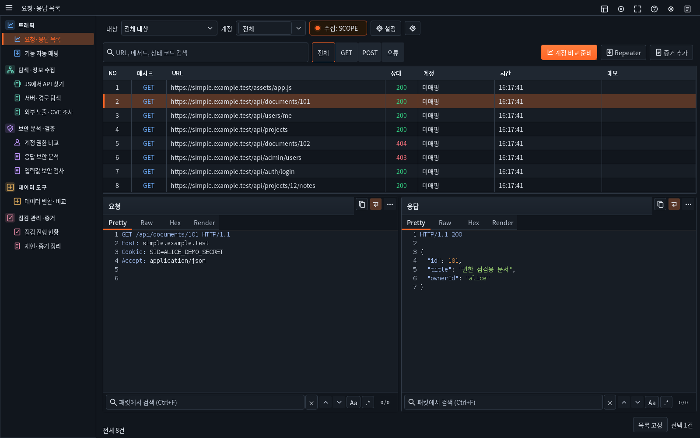

[밝은 테마](light/tools/01-traffic.png) · [어두운 원본](dark/tools/01-traffic.png)

## 기능 자동 매핑

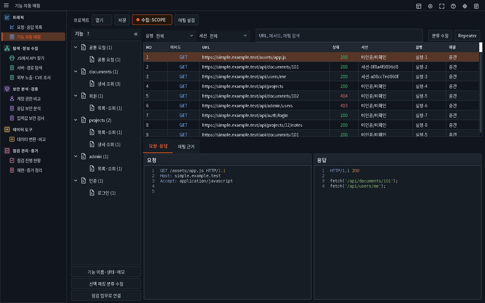

[밝은 테마](light/tools/02-mapper.png) · [어두운 원본](dark/tools/02-mapper.png)

## JS에서 API 찾기

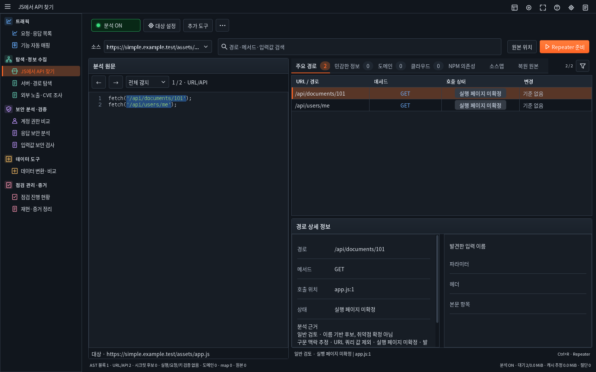

[밝은 테마](light/tools/03-js.png) · [어두운 원본](dark/tools/03-js.png)

## 서버·경로 탐색

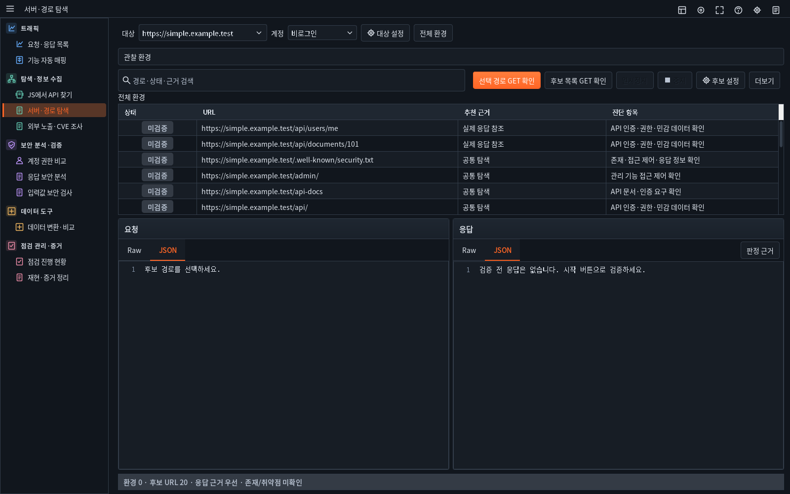

[밝은 테마](light/tools/04-environment.png) · [어두운 원본](dark/tools/04-environment.png)

## 외부 노출 조사 · 검색 노출

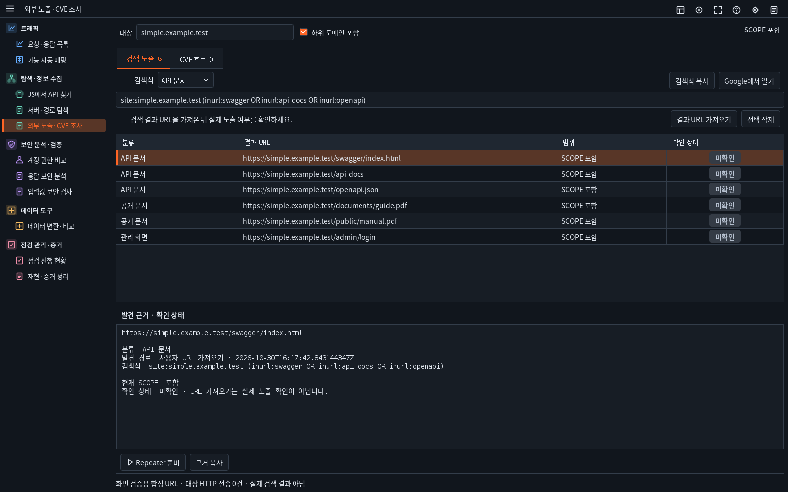

[밝은 테마](light/tools/05-exposure-search.png) · [어두운 원본](dark/tools/05-exposure-search.png)

## 외부 노출 조사 · CVE 후보

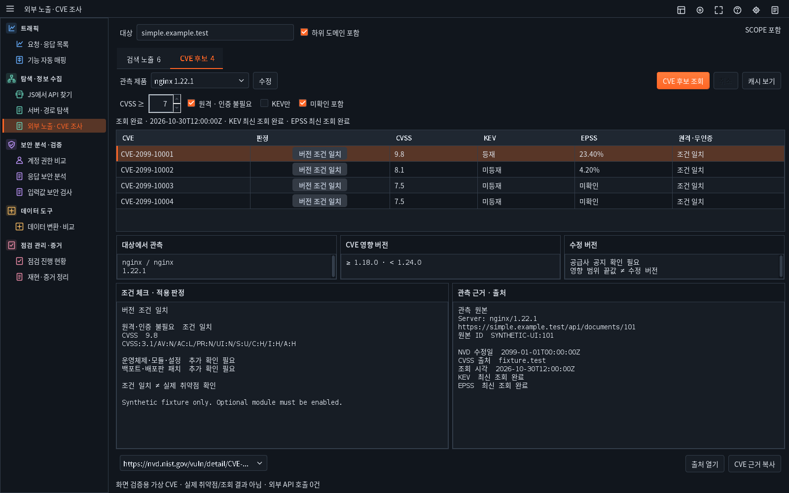

[밝은 테마](light/tools/06-exposure-cve.png) · [어두운 원본](dark/tools/06-exposure-cve.png)

## 계정 권한 비교

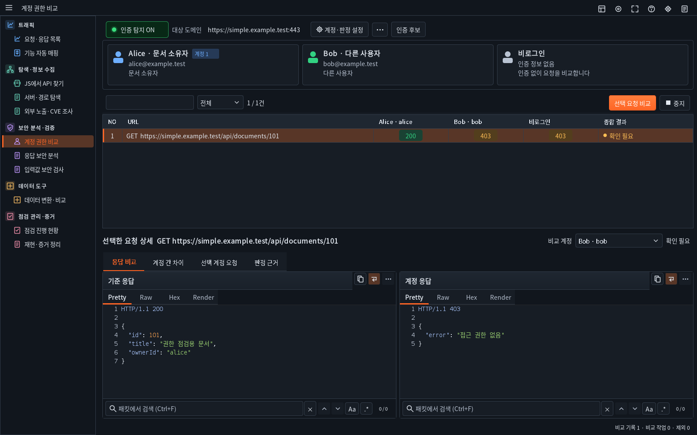

[밝은 테마](light/tools/07-auth.png) · [어두운 원본](dark/tools/07-auth.png)

## 응답 보안 분석

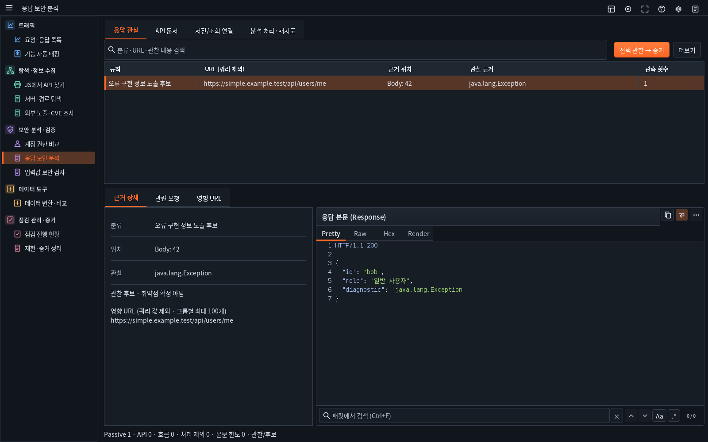

[밝은 테마](light/tools/08-response.png) · [어두운 원본](dark/tools/08-response.png)

## 입력값 보안 검사

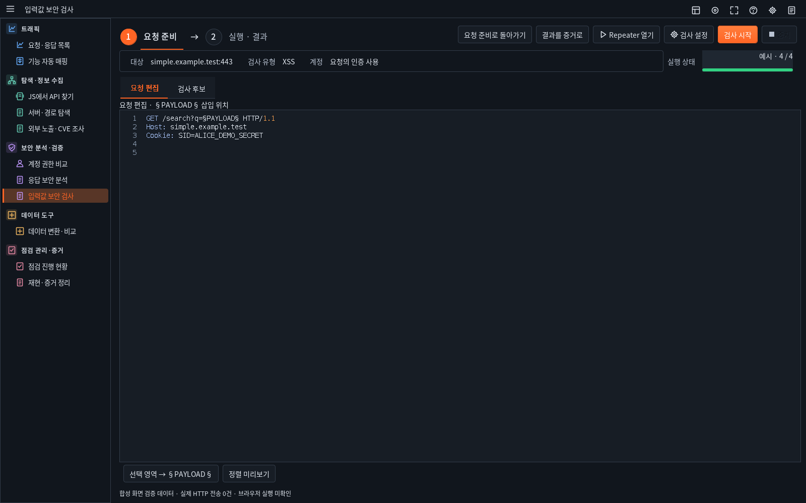

[밝은 테마](light/tools/09-payload.png) · [어두운 원본](dark/tools/09-payload.png)

## 데이터 변환·비교

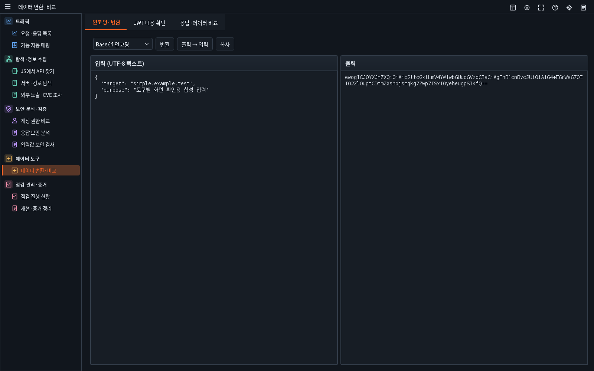

[밝은 테마](light/tools/10-data.png) · [어두운 원본](dark/tools/10-data.png)

## 점검 진행 현황

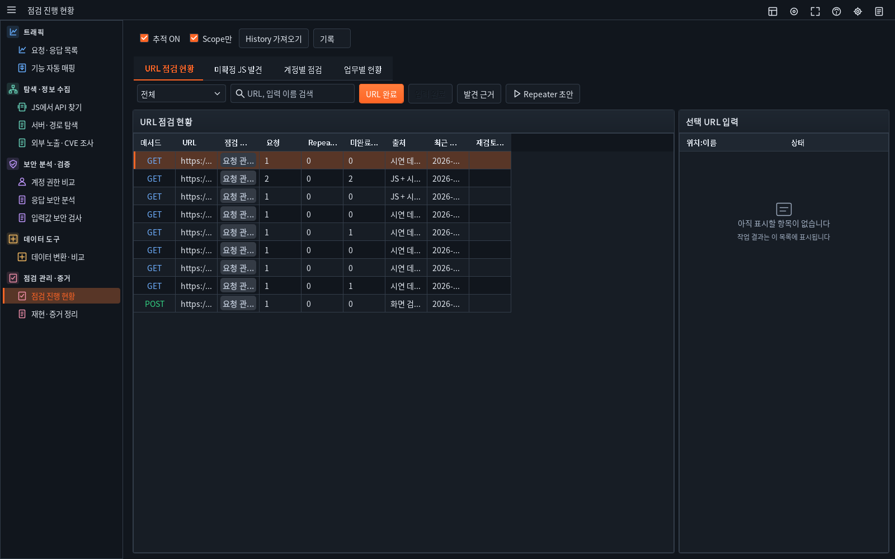

[밝은 테마](light/tools/11-progress.png) · [어두운 원본](dark/tools/11-progress.png)

## 재현·증거 정리

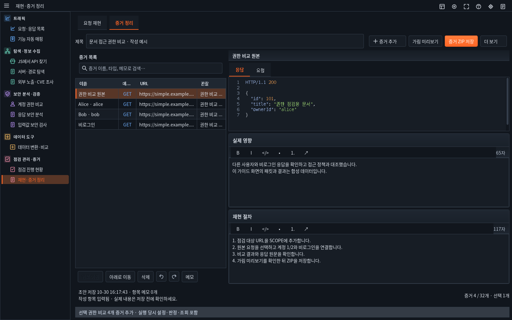

[밝은 테마](light/tools/12-evidence.png) · [어두운 원본](dark/tools/12-evidence.png)

## 점검 대시보드

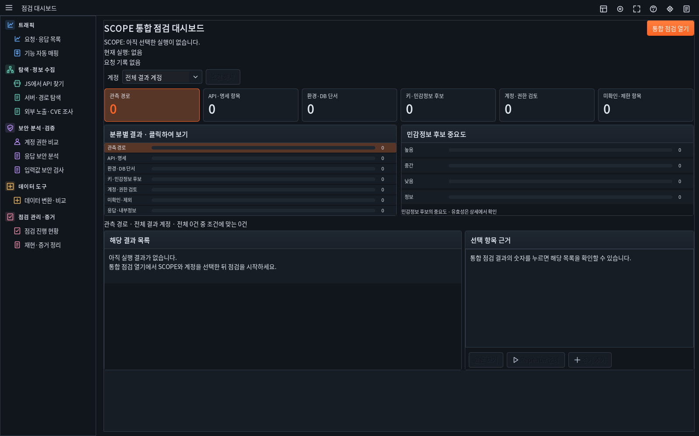

[밝은 테마](light/tools/13-dashboard.png) · [어두운 원본](dark/tools/13-dashboard.png)

