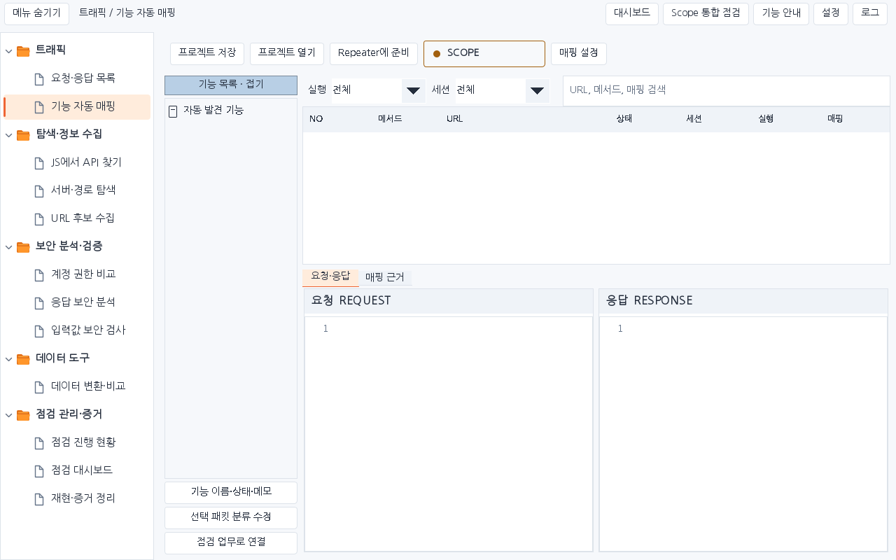
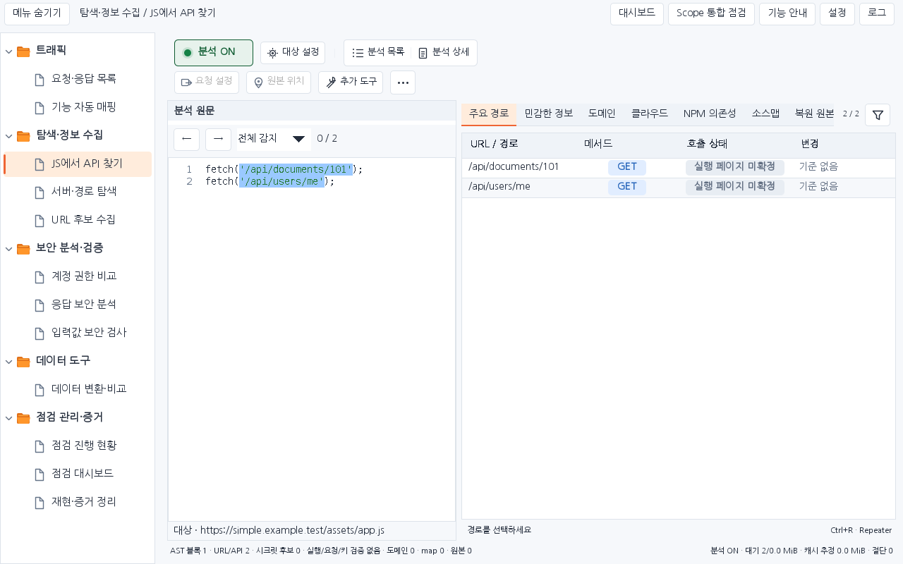
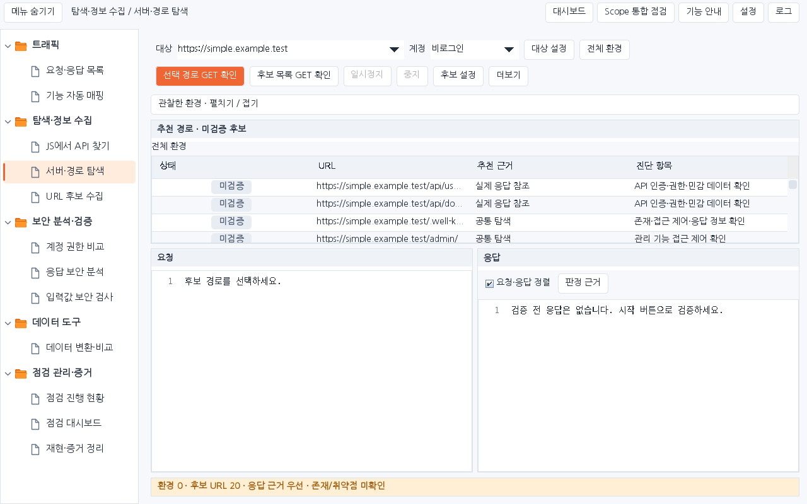
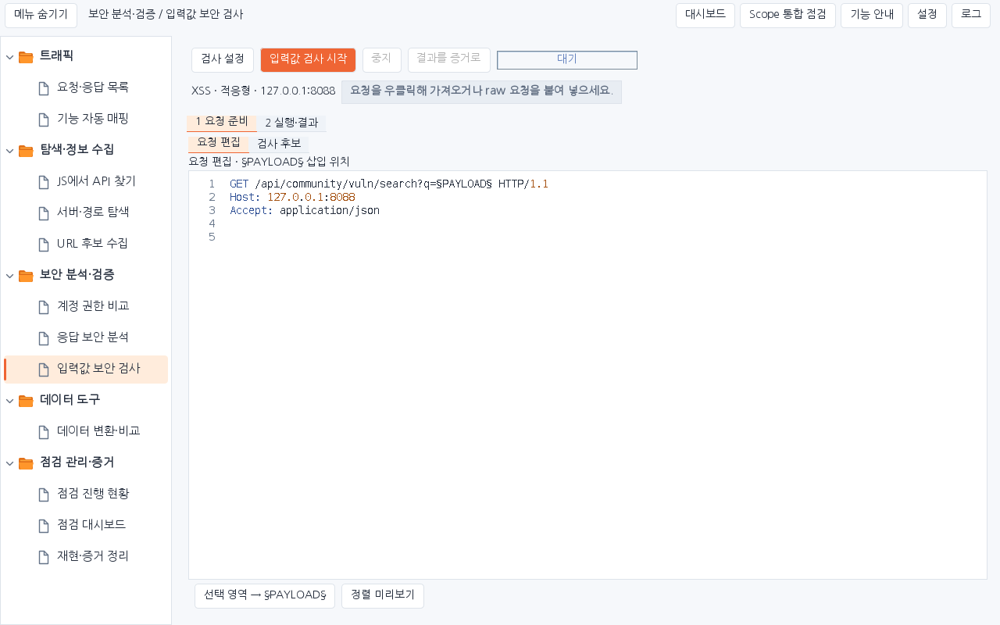
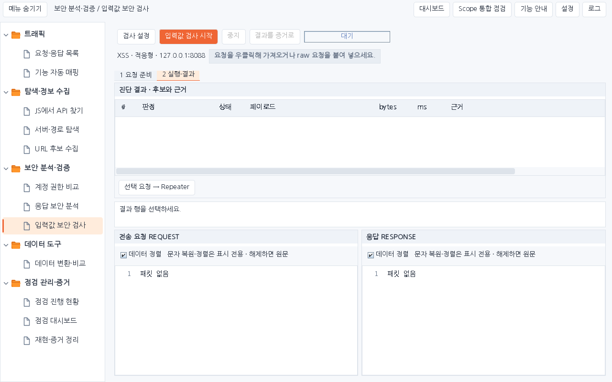

# Simple 1.4.5 도구별 실제 화면

운영 Swing 컴포넌트와 합성 패킷을 사용한 1280×800 렌더링입니다. 실제 Burp GUI 캡처가 아니며 렌더링으로 HTTP를 전송하지 않습니다. 생성 디자인 이미지와 구분합니다.

## 요청·응답 목록

합성 요청과 응답

[어두운 테마](01-traffic-dark.png)

## 기능 자동 매핑

초기 빈 프로젝트

[어두운 테마](02-mapper-dark.png)

## 계정 권한 비교

합성 계정·비교 이력, 기준/선택 계정 응답

[어두운 테마](03-auth-dark.png)

## JS에서 API 찾기

합성 JS 원문과 분석 결과

[어두운 테마](04-js-dark.png)

## 서버·경로 탐색

후보 목록, GET 확인 전

[어두운 테마](05-environment-dark.png)

## 응답 보안 분석

합성 관찰과 연결 원본 응답

[어두운 테마](06-response-dark.png)

## 입력값 보안 검사 · 준비

실행 전 요청 준비

[어두운 테마](07-payload-dark.png)

## 입력값 보안 검사 · 결과

실행 전 빈 결과 탭

[어두운 테마](07-payload-results-dark.png)

## 재현·증거 정리

합성 증거와 직접 작성 예시

[어두운 테마](08-evidence-dark.png)
