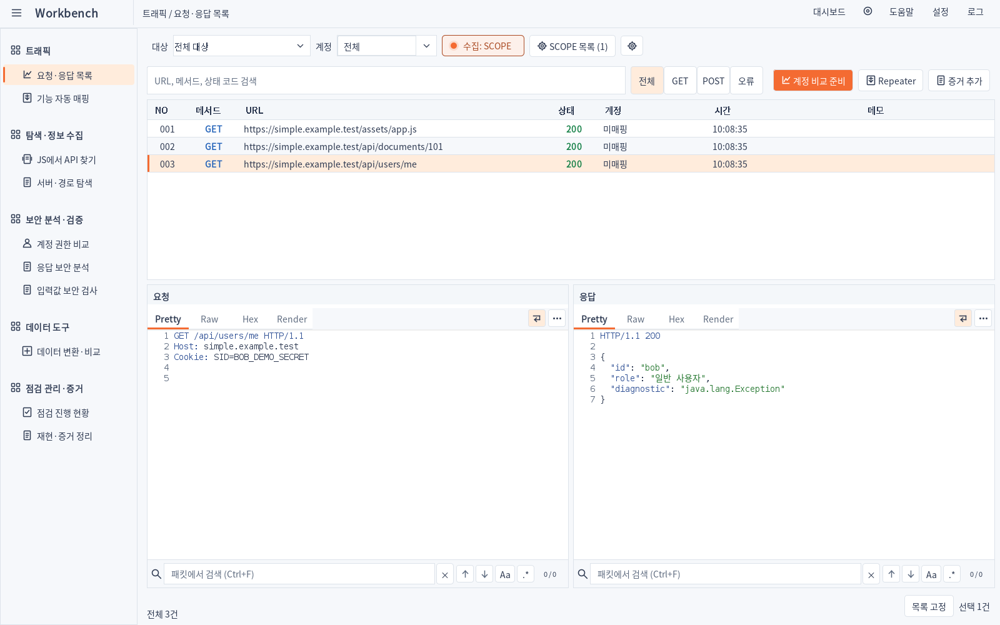
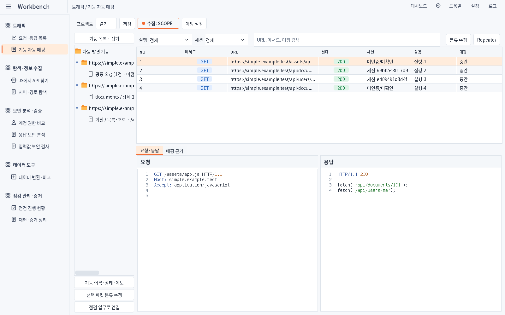
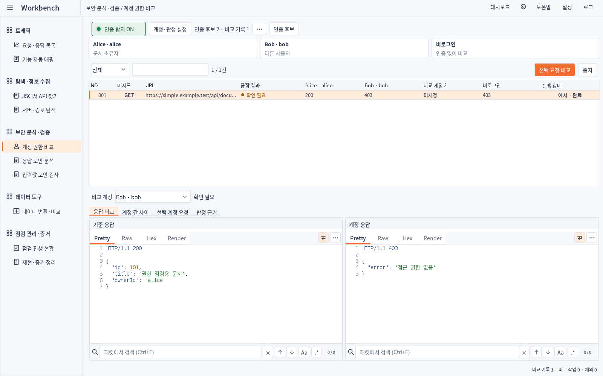
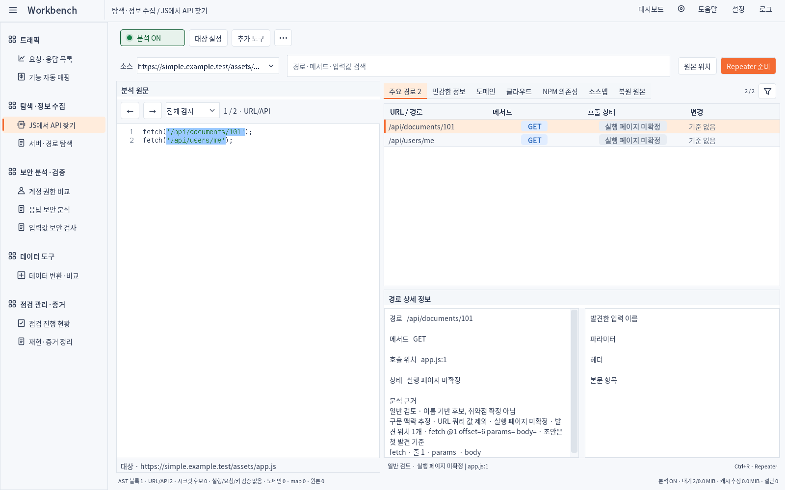
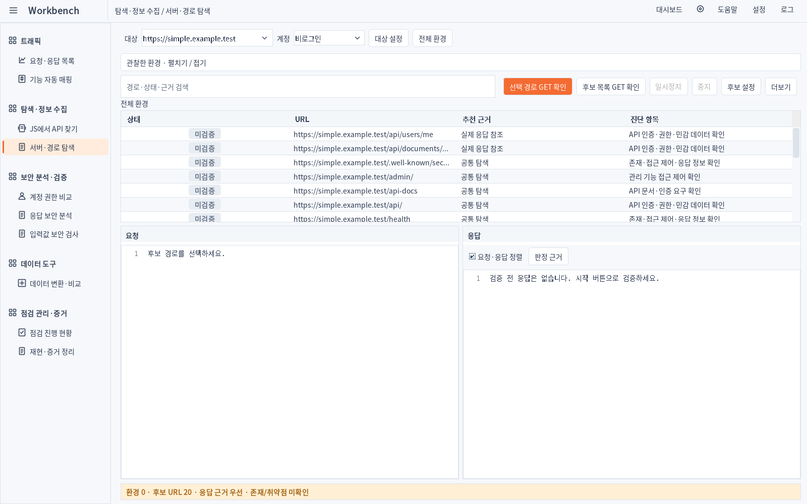
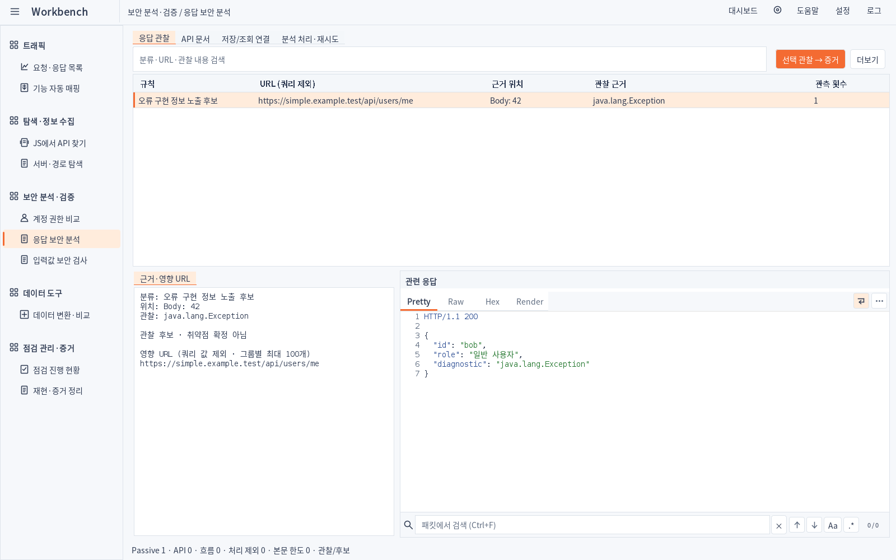
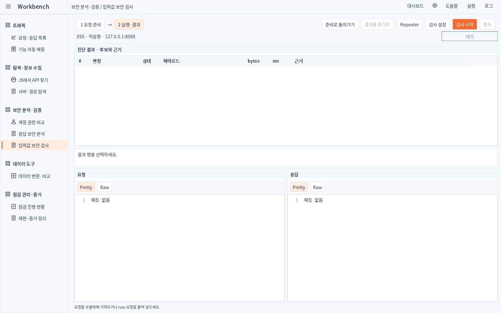
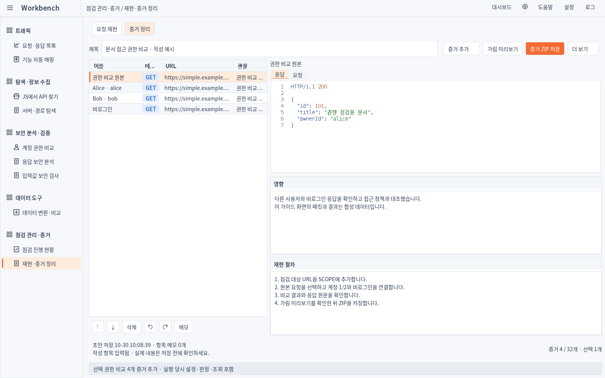

# Simple 1.4.6 · 실제 구현 화면

운영 Swing 컴포넌트를 1600×1000에서 합성 패킷으로 렌더링했습니다. 생성 시안이나 사용자 PC의 Burp GUI 캡처가 아닙니다. 목록의 건수·HTTP 결과는 검증용 데이터입니다.

[승인 시안과 구현 비교](../../design/1.4.6/COMPARE.html) · [변경·검증](../../RELEASE_SIMPLE_1.4.6_KR.md)

## 요청·응답 목록

[어두운 테마](01-traffic-dark.png)

## 기능 자동 매핑

[어두운 테마](02-mapper-dark.png)

## 계정 권한 비교

[어두운 테마](03-auth-dark.png)

## JS에서 API 찾기

[어두운 테마](04-js-dark.png)

## 서버·경로 탐색

[어두운 테마](05-environment-dark.png)

## 응답 보안 분석

[어두운 테마](06-response-dark.png)

## 입력값 보안 검사

[어두운 테마](07-payload-dark.png)

## 재현·증거 정리

[어두운 테마](08-evidence-dark.png)
