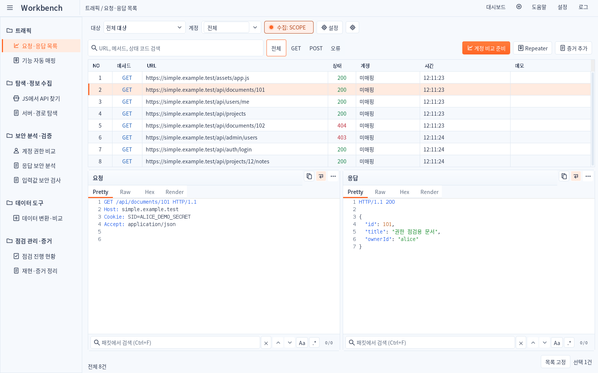
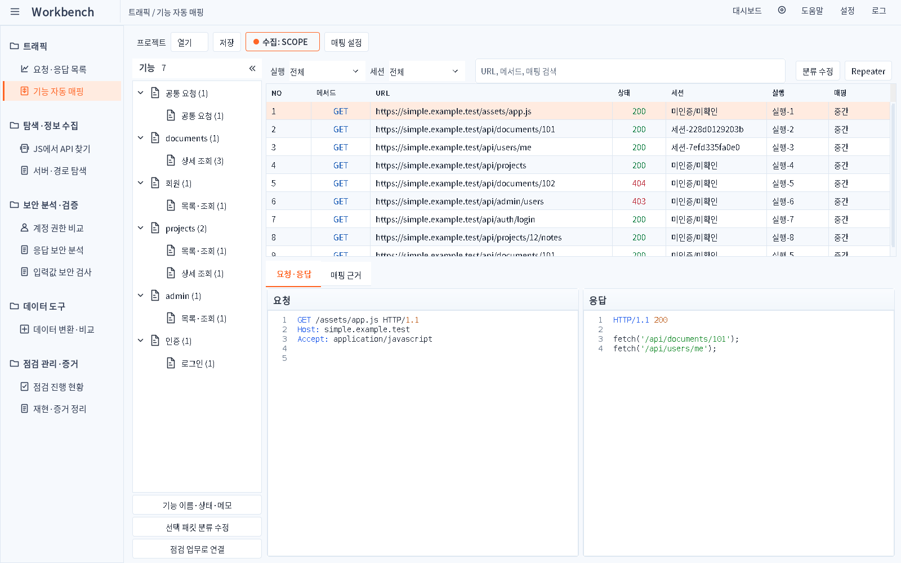
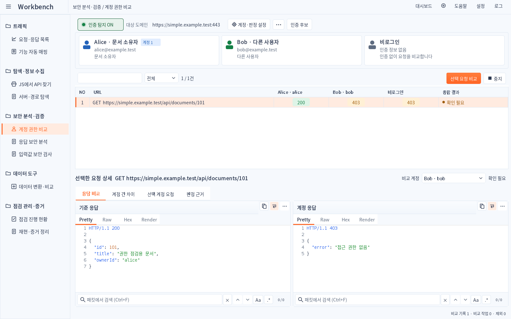
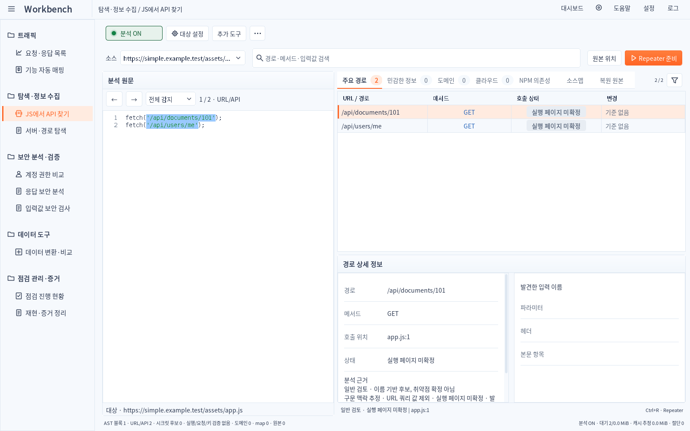
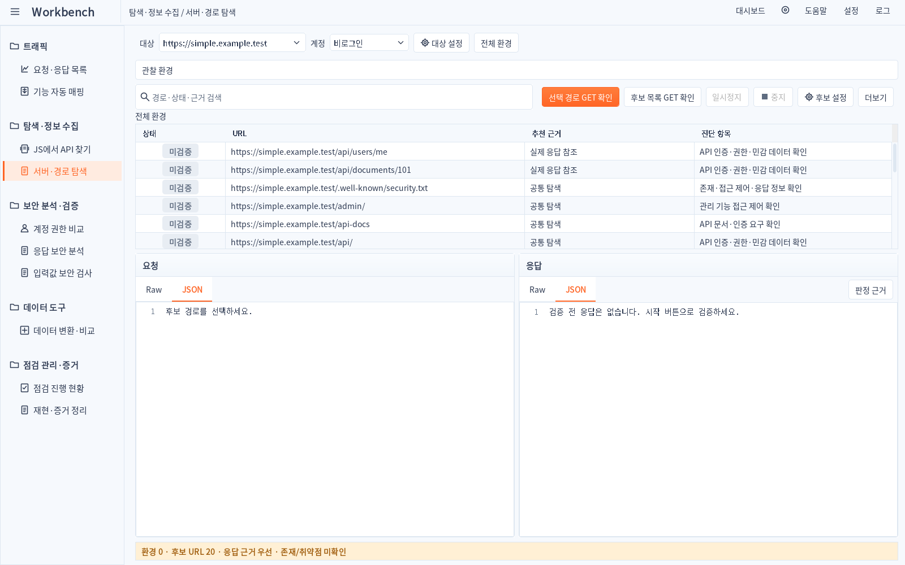
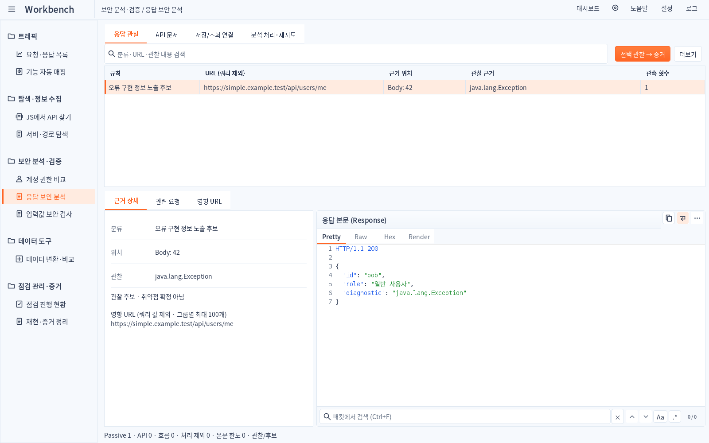
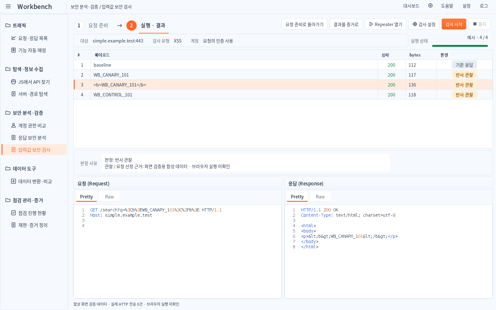
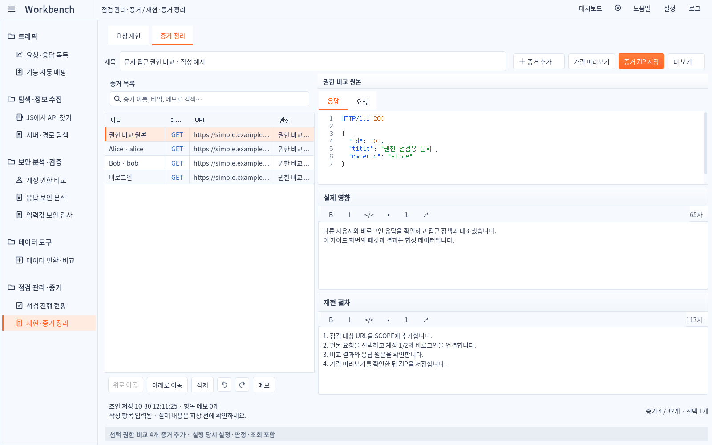
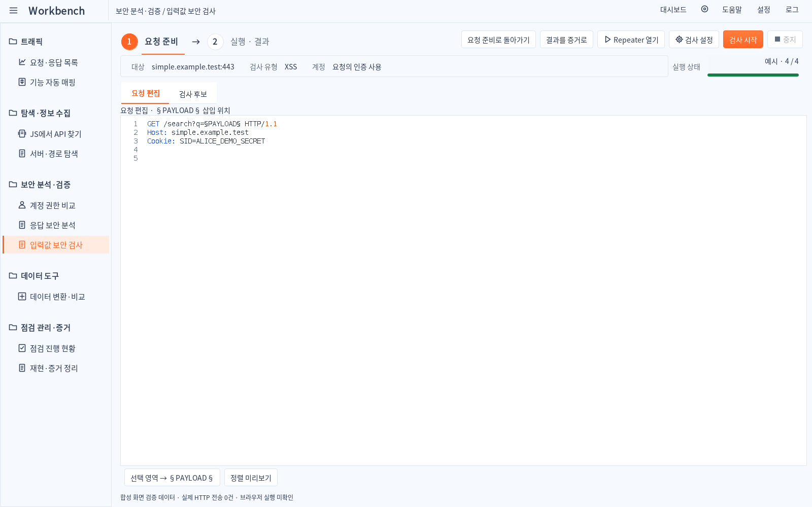

# Simple 1.4.8 · 세부 디자인 실제 화면

원형 단계 표시·대상 요약 줄·계정 비교·상세 정보·증거 편집을 시안의 구성 요소에 맞춰 다시 구성했습니다. 아래는 생성 시안이 아닌 **운영 Java Swing 컴포넌트**입니다. 내용은 격리된 합성 예시이며 Burp 본체의 캡처는 아닙니다. 이미지를 클릭하면 원본 크기로 확인할 수 있습니다.

[변경·검증](../../RELEASE_SIMPLE_1.4.8_KR.md) · [시안/이전/현재 비교](../../design/1.4.8/COMPARE.html)

## 요청·응답 목록

[밝은 테마](01-traffic-light.png) · [어두운 테마](01-traffic-dark.png)

## 기능 자동 매핑

[밝은 테마](02-mapper-light.png) · [어두운 테마](02-mapper-dark.png)

## 계정 권한 비교

[밝은 테마](03-auth-light.png) · [어두운 테마](03-auth-dark.png)

## JS에서 API 찾기

[밝은 테마](04-js-light.png) · [어두운 테마](04-js-dark.png)

## 서버·경로 탐색

[밝은 테마](05-environment-light.png) · [어두운 테마](05-environment-dark.png)

## 응답 보안 분석

[밝은 테마](06-response-light.png) · [어두운 테마](06-response-dark.png)

## 입력값 보안 검사

[밝은 테마](07-payload-light.png) · [어두운 테마](07-payload-dark.png)

## 재현·증거 정리

[밝은 테마](08-evidence-light.png) · [어두운 테마](08-evidence-dark.png)

## 입력값 검사 준비

[밝은 테마](07-payload-prepare-light.png) · [어두운 테마](07-payload-prepare-dark.png)

