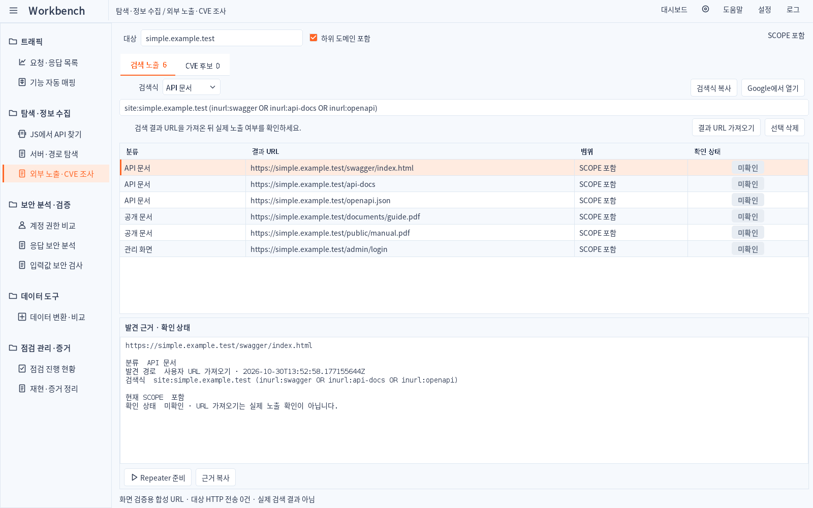
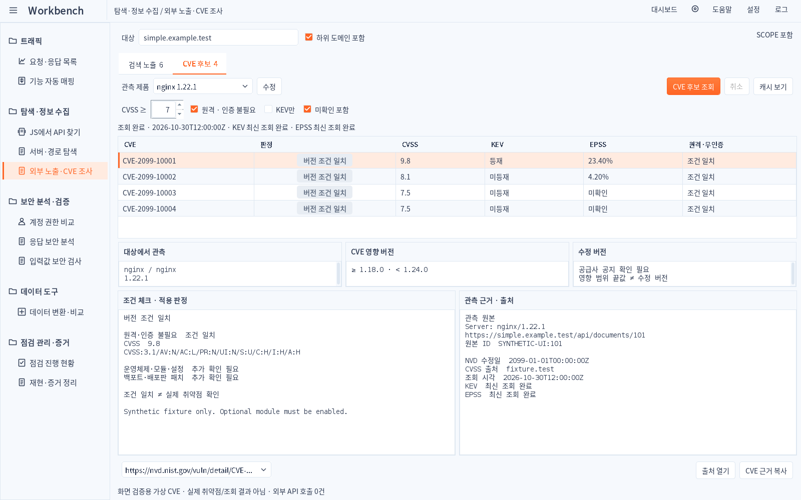

# Simple 1.4.9 · 외부 노출·CVE 조사 구현 화면

실제 배포 Swing 컴포넌트를 합성 URL/가상 CVE와 연결한 캡처입니다. 실제 Burp GUI 또는 외부 API 조회 결과가 아닙니다. 제품에는 예시 행을 포함하지 않습니다.

## 검색 노출

## CVE 후보

[어두운 검색 노출](dark/1600x1000/12-exposure-search.png) · [어두운 CVE 후보](dark/1600x1000/13-exposure-cve.png)

두 테마 × 1024×720 / 1280×800 / 1600×1000에서 캡처했습니다. 작은 창의 조건 체크·관측 근거·발견 근거 영역도 최소 표시 높이를 검사합니다. 큰 본문 제목을 추가하지 않고 기존 폴더·탭·표 디자인을 공유합니다.
